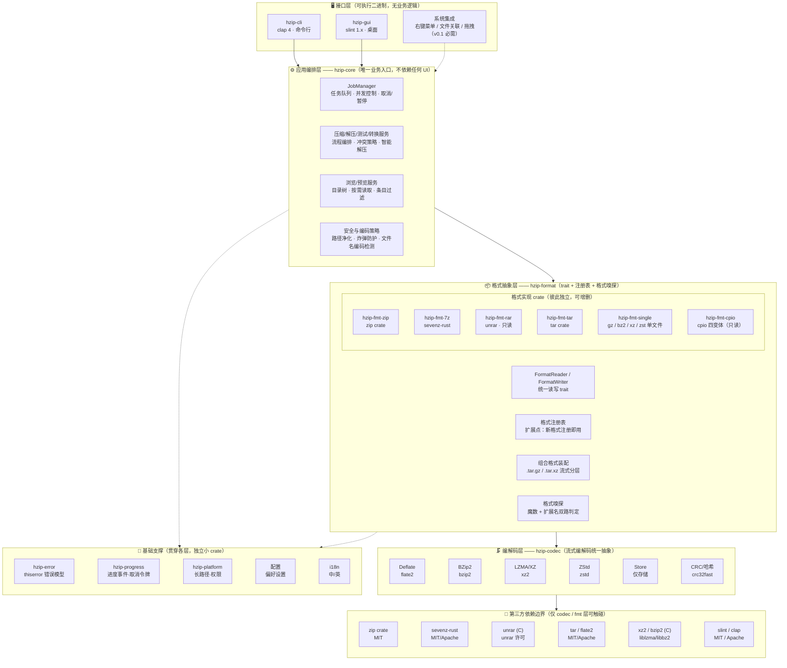

# hzip 总体架构设计

| 项目 | 内容 |
|---|---|
| 文档版本 | v0.2（架构决策已确认，待详细设计） |
| 日期 | 2026-09-01 |
| 状态 | 架构设计阶段，确认后进入功能详细设计 |
| 目标读者 | 项目开发者、评审人 |

---

## 1. 项目概述

**hzip** 是一个用 Rust 编写的跨平台（Windows / Linux / macOS）压缩打包工具，定位对标 Bandizip：**开箱即用、格式全面、速度快、界面友好**，同时提供 CLI 和桌面 GUI 两种使用方式。

核心设计原则：

1. **业务逻辑与界面彻底分离** —— 压缩/解压/预览的全部业务能力沉淀在独立的 crate 中，CLI 和 GUI 只是两层薄壳，二者可独立演进、独立编译。
2. **低耦合高内聚** —— 以 Cargo workspace 多 crate 组织，每个格式实现互不依赖，只依赖统一的格式抽象层；新增格式（如 zstd、brotli）只需新增一个 crate 并注册，不改核心代码。
3. **健壮性优先** —— 坏档案、加密档案、超长路径、文件名乱码、zip 炸弹等异常场景必须显式建模，不允许 panic 逃逸到用户界面。
4. **安全编码** —— 路径穿越（Zip-Slip）防护、符号链接策略、解压体积上限、密码内存清零，全部作为架构级约束而非事后补丁。

### 1.1 非目标（本期不做）

- RAR 格式的**创建/压缩**（RAR 为专有压缩格式，无公开规范，与 7-Zip/Bandizip 一致只支持解压，见 §5.3）；
- Bandizip 专有格式 **EGG**（无公开规范，无法合规实现）；
- **VHD / VHDX** 虚拟磁盘内文件提取（需完整 FAT/NTFS 文件系统解析器，成本远超收益，远期评估，见 §10.4）；
- 云存储 / 网络档案（SFTP/S3 挂载）；
- 备份调度、增量备份等备份类功能；
- RAR 恢复记录（Recovery Record）修复（专有格式能力）。

---

## 2. 业务功能点

> 本清单以 Bandizip 公开功能集为对标基准逐项比对得出，优先级含义：P0 首发必须 / P1 尽早 / P2 计划内 / P3 远期可选。

### 2.1 压缩（创建档案）

| 功能 | 说明 | 优先级 |
|---|---|---|
| 多格式创建 | zip / 7z / tar / tar.gz / tar.bz2 / tar.xz / tar.zst（gzip/bz2/xz/zstd 单文件压缩亦支持）；brotli 预留 | P0 |
| 压缩级别 | Store / Fastest / Fast / Normal / Maximum / Ultra，按格式映射到各自实现 | P0 |
| 多线程压缩 | 多文件并行压缩；单文件按格式利用其内部并行（如 deflate 多块、7z LZMA2 多线程），自动按 CPU 核数调优 | P1 |
| 密码与加密 | zip：AES-256（兼容 WinZip AES 规范）；7z：AES-256 + 文件名加密（列表也不可见条目名） | P1 |
| 分卷压缩 | 按卷大小切分（zip 分卷 / 7z 分卷），支持常见预设（CD/DVD/自定义） | P2 |
| 条目过滤 | glob 排除规则、隐藏文件开关、符号链接跟随策略、常用预设（如排除 `*.tmp`/`node_modules`/`.git`） | P1 |
| 固实压缩 | 7z solid block（高压缩比模式） | P2 |
| BCJ/BCJ2 过滤器 | 7z 高压缩比标杆模式（x86 可执行文件分支过滤 + LZMA），对齐 7-Zip 压缩比上限；优先验证 sevenz-rust 支持，不足则自研 filter crate（算法公开，实现面可控） | P2 |
| zipx 创建 | .zipx 本质是 zip 容器 + 进阶算法（LZMA/PPMd/zstd 方法 ID），随 zip 内嵌算法支持逐步开放 | P3 |
| 元数据保留 | mtime、文件权限（unix mode）、符号链接本身（而非其指向内容）、NTFS 数据流（Windows，尽力而为） | P1 |
| 压缩配置档案 | 保存常用格式+级别+过滤规则组合为命名 Profile，GUI 一键选用（Bandizip "压缩预置"） | P2 |
| 批量压缩 | 一次拖入多个目录/文件，各自生成独立档案（GUI 多选 + CLI 多目标） | P2 |
| 自解压（SFX） | zip/7z SFX 创建（内嵌解压模块，产出 .exe，仅 Windows 目标） | P3 |
| 压缩摘要 | 完成后输出：条目数、原始/压缩后大小、压缩率、耗时、平均速度 | P1 |

### 2.2 解压

| 功能 | 说明 | 优先级 |
|---|---|---|
| 全量解压 | 核心只读格式：zip / zipx / rar4 / rar5 / 7z / tar / tar.* / gz / bz2 / xz / zst（zipx 随 P2，见 §10.4） | P0 |
| 扩展只读格式 | iso / img 光盘镜像（P2）；lzh / cab / dmg / msi / nsis（P3）；alz（P3 远期，逆向工程格式）；wim（P3 远期）；vhd/vhdx 与 egg 不做（见 §10.4） | P2/P3 |
| 选择性解压 | 仅解压指定条目（CLI 传列表，GUI 勾选） | P0 |
| 智能解压 | 档案若只有一个顶层目录则直接展开，否则自动包一层同名目录（Bandizip 标志性行为，可配置） | P1 |
| 密码解压 | 密码尝试 + 上次密码记忆（会话级），GUI 弹窗 / CLI `--password` 或环境变量 | P1 |
| 文件名编码修复 | 自动检测 zip 中 GBK/Shift-JIS 等本地编码文件名并转 UTF-8（中文用户高频痛点）；可手动指定代码页 | P1 |
| 嵌套档案 | 可选的"解压后自动解压内嵌档案" | P3 |
| 冲突策略 | 覆盖 / 跳过 / 重命名（自动加序号）/ 询问 | P1 |
| 多卷档案解压 | 自动识别分卷集合，按序合并解压（.z01/.z02…、.7z.001…） | P2 |
| 批量解压 | 多档案一次性提交队列解压 | P2 |
| 损坏档案抢救 | best-effort 模式：跳过 CRC 校验失败的条目，尽可能提取其余内容并输出损坏清单（Bandizip "跳过错误继续解压"） | P2 |
| 拖出即解压 | GUI 中从档案列表直接拖拽条目到资源管理器/桌面即完成解压（Bandizip "Fast Drag & Drop"） | P2 |
| 解压完成动作 | 完成后打开目标文件夹 / 系统通知（可配置） | P2 |

### 2.3 浏览与预览（不解压）

| 功能 | 说明 | 优先级 |
|---|---|---|
| 列表 | 条目名、大小（原始/压缩）、压缩率、修改时间、属性、加密标志、CRC | P0 |
| 树形浏览 | GUI 中以目录树呈现档案内部结构 | P0 |
| 按需读取 | 只解压单个条目到内存/管道，供预览使用 | P0 |
| 内容预览 | 文本（自动编码检测）、图片、HEX 视图；大文件只读前 N KB | P1 |
| 缩略图视图 | GUI 图片条目的网格缩略图模式（按需解码生成，内存受限） | P2 |
| 档案内搜索 | 按名称/通配符即时过滤条目列表 | P1 |
| 双击打开 | 档案内文件双击 → 临时目录解压 → 调用系统程序打开；退出时清理临时目录（含孤儿清理） | P1 |
| 档案信息 | 格式、注释、分卷信息、加密方式 | P2 |
| 嵌套浏览 | 档案内的档案直接当作文件夹进入浏览（无需先解压） | P3 |

### 2.4 档案编辑（Bandizip "修改档案"）

| 功能 | 说明 | 优先级 |
|---|---|---|
| 追加文件 | 向已有 zip/7z 追加文件或目录（tar 追加受格式限制，tar.gz 等压缩组合需整档重写） | P2 |
| 删除条目 | 从 zip/7z 中删除指定条目 | P2 |
| 重命名条目 | zip/7z 内条目重命名/移动 | P3 |
| 档案内编辑保存 | 打开档案 → 双击条目解压到受监控临时目录 → 用户在外部程序编辑 → 检测到变更后提示"保存回档案"→ 复用转换管线流式重写档案（等效于"删除旧条目 + 追加新版本"）；GUI 核心编辑体验，与 2.3 双击打开共享临时目录与清理机制 | P2 |
| 档案注释 | zip/7z 注释的读取与编辑 | P3 |

> 说明：除 zip 追加外，多数编辑操作在实现上等价于"流式重写档案"，架构上复用"转换"管线，对 core 来说是同一种 Job。

### 2.5 测试与转换

| 功能 | 说明 | 优先级 |
|---|---|---|
| 完整性测试 | `test`：逐条目解压校验 CRC，不落盘；输出逐条目健康报告，定位首个损坏点 | P1 |
| 格式转换 | zip ↔ 7z ↔ tar.* 整档案转换（流式，避免全量落盘）；批量转换 | P2 |

### 2.6 任务与体验

| 功能 | 说明 | 优先级 |
|---|---|---|
| 任务队列 | GUI 支持多任务排队，可并发控制（如同时最多 N 个任务），任务历史列表 | P1 |
| 进度与速度 | 字节级进度、当前文件名、瞬时/平均速度、剩余时间估计 | P0 |
| 取消/暂停 | 取消即刻生效（安全回滚已写半的文件）；暂停仅 GUI | P1/P2 |
| 密码管理器 | 已用密码的会话记忆（仅进程生命周期内，不做持久化存储） | P2 |
| 磁盘空间预检 | 解压/转换前比对目标盘可用空间与解压后总大小，不足时预警 | P1 |
| 深色主题 | GUI 深色/浅色/跟随系统 | P2 |
| 国际化 | 中/英起步，i18n 框架内置 | P2 |
| 通知与日志 | 系统级完成/失败通知；运行日志导出（tracing 落盘） | P2 |

### 2.7 系统集成

| 功能 | 说明 | 优先级 |
|---|---|---|
| 右键菜单 | 资源管理器/文件管理器中对**目录和文件**的右键集成："解压到当前目录 / 解压到 `文件夹\` / 压缩为 xxx / 预览"；Windows 首发实现，macOS Finder 扩展、Linux 桌面（Nautilus/Dolphin）随后跟进 | P1 |
| 双击打开 | 档案文件在资源管理器中双击直接进入 hzip 浏览（见 2.3 双击打开条目） | P1 |
| 文件关联 | GUI 内管理档案扩展名关联（打开方式设置 hzip） | P2 |
| 拖放接收 | GUI 主窗口接收文件/目录拖入，弹出压缩选项 | P1 |

---

## 3. 总体架构



**贯穿性约束（不属于任何单层，架构级强制）**

| 类别 | 约束 |
|---|---|
| 安全 | Zip-Slip 路径穿越防护 · 符号链接策略（默认拒绝危险目标）· 解压体积/比率上限（炸弹防护）· 密码 zeroize 清零 · 条目数上限 |
| 运行时 | 无 async，纯线程 · GUI: worker 线程 + channel · 进度事件驱动 · 取消令牌原子传播 |
| 质量 | 单元 + 集成测试 · 属性测试 proptest · 黄金档案回归集 · CI 三平台（Win/Linux/macOS）· cargo-deny 依赖审计 |
| 规范 | rustfmt + clippy(-D warnings) · MSRV 固定 · crate 依赖方向检查 · rustdoc |

### 3.1 分层职责与依赖规则

**唯一强制的依赖方向**（由 CI 检查，见 §11）：

```
hzip-cli ──┐
           ├──▶ hzip-core ──▶ hzip-format ──▶ hzip-codec ──▶ 第三方库
hzip-gui ──┘        │              │
                    └─▶ hzip-error / hzip-progress / hzip-platform / 配置 / i18n
```

| 层 | crate | 职责 | 禁止事项 |
|---|---|---|---|
| 接口层 | `hzip-cli`、`hzip-gui` | 参数解析 / 界面渲染 / 事件绑定，把用户意图翻译为 core 调用 | **禁止**包含任何压缩业务逻辑、**禁止**直接依赖格式 crate |
| 编排层 | `hzip-core` | 任务生命周期、流程编排、安全策略、进度聚合 | 禁止依赖 clap / slint；禁止直接依赖具体格式实现 crate（只通过 `hzip-format` 的注册表） |
| 格式层 | `hzip-format` + `hzip-fmt-*` | 统一读写抽象、格式嗅探、各格式的具体实现 | 各 fmt crate 互相**禁止**依赖；只依赖 format + codec |
| 编解码层 | `hzip-codec` | 同步 `Read`/`Write` 流的编解码装饰器，抹平各压缩库差异 | 不感知"档案"概念，只做字节流 |
| 基础支撑 | `hzip-error` 等 | 错误、进度、平台差异、配置、i18n | 保持极小、零业务语义 |

### 3.2 关键抽象预览（示意，详细签名在详细设计阶段确定）

```rust
// hzip-format —— 所有格式实现的统一契约
pub trait FormatHandler: Send + Sync {
    fn signature(&self) -> &'static FormatSignature;      // 魔数/扩展名
    fn capabilities(&self) -> FormatCaps;                 // 读/写/加密/分卷能力矩阵

    fn open_reader(&self, src: Source, opts: &OpenOptions)
        -> Result<Box<dyn ArchiveReader>>;                // 列表 + 按需读取
    fn create_writer(&self, dst: Sink, opts: &CreateOptions)
        -> Result<Box<dyn ArchiveWriter>>;                // 流式写入
}

pub trait ArchiveReader: Send {
    fn entries(&self) -> Result<Vec<EntryInfo>>;          // 元数据（不解压数据）
    fn extract(&mut self, sel: &Selection, ctx: &ExtractCtx)
        -> Result<()>;                                    // ctx 携带进度/取消/密码回调/冲突策略
    fn read_entry(&mut self, id: EntryId) -> Result<Box<dyn Read>>;  // 预览用按需流
}
```

```rust
// hzip-core —— 业务入口（CLI/GUI 共用）
pub struct Engine { /* 注册表 + 线程池 + 配置 */ }

impl Engine {
    pub fn submit(&self, job: JobSpec) -> JobHandle;      // 立即返回，不阻塞 UI
}

pub struct JobHandle(pub JobId);
// JobHandle 订阅: ProgressEvent / 需要密码(回调式询问) / 冲突决策(回调式询问) / 完成/失败
```

要点：

- **密码与冲突决策通过回调/请求-应答通道上抛**（core → UI），core 永不直接弹窗或读 stdin，从而同时适配 CLI（提示符）与 GUI（对话框）。
- **进度与取消是事件流**：`hzip-progress` 提供轻量 `CancellationToken`（原子标志 + 代际计数）与 `ProgressEvent` 广播通道，格式层实现必须在每个条目/每块数据处检查令牌，保证取消延迟为毫秒级。

---

## 4. 代码组织（Cargo Workspace）

```
hzip/
├── Cargo.toml                  # [workspace]，依赖版本集中在 [workspace.dependencies]
├── rust-toolchain.toml         # 固定工具链版本（含组件 rustfmt/clippy）
├── deny.toml                   # cargo-deny：许可证 + 安全审计
├── crates/
│   ├── hzip-error/             # 统一错误模型（thiserror）
│   ├── hzip-progress/          # CancellationToken + ProgressEvent
│   ├── hzip-platform/          # 平台差异：Windows 长路径(\\?\)、文件属性、unix 权限、分发器
│   ├── hzip-codec/             # 编解码流抽象：deflate/bzip2/xz/zstd/store
│   ├── hzip-format/            # trait + 注册表 + 嗅探 + 组合格式装配
│   ├── hzip-fmt-zip/           # zip 实现（含 AES、GBK 文件名修复）
│   ├── hzip-fmt-7z/            # 7z 实现（含 AES、LZMA2、固实、分卷）
│   ├── hzip-fmt-rar/           # rar4/rar5 只读实现
│   ├── hzip-fmt-tar/           # tar 实现（读写）
│   ├── hzip-fmt-single/        # gz/bz2/xz/zst 单文件压缩（读写）
│   ├── hzip-fmt-cpio/          # cpio 四变体（只读引入：initramfs/rpm 载荷）
│   ├── hzip-core/              # 业务编排：Engine/JobManager/安全策略/预览
│   ├── hzip-cli/               # bin：hzip（clap）
│   ├── hzip-gui/               # bin：hzip-gui（slint），ui/ 下放 .slint 文件
│   └── hzip-format-testkit/    # dev-only：格式一致性测试套件（见 §11.2）
├── tests-assets/               # 黄金测试档案（各格式/各版本/加密/乱码名样本）
└── docs/
    └── design/                 # 设计文档（本目录）
```

组织规则：

1. **格式 crate 拆分的粒度理由**：第三方格式库的编译选项、unsafe 边界（unrar/xz2 是 C 绑定）、许可证差异都被隔离在最小单元里；某个格式出问题或需替换实现（如未来出现更好的纯 Rust 7z 库）不影响其他格式。若初期觉得 crate 过多，可将 `hzip-fmt-*` 合并为一个 crate 的多个 module 并保留同样的模块边界，目录结构不变，**但 trait 边界必须先行**。
2. **`hzip-format` 的注册表**支持运行时注册（`register_handler()`）与编译期默认注册（feature 开关 `default-formats`），为未来插件化（动态库加载）留口，但本期只做静态注册。
3. `hzip-core` 对格式 crate 的依赖通过 feature 透传（core 的 feature `zip`/`7z`…控制启用哪些格式），CLI/GUI 打开全部 feature。

---

## 5. 技术选型

### 5.1 格式与编解码库

| 领域 | 选择 | 理由与备注 |
|---|---|---|
| zip | [`zip`](https://crates.io/crates/zip) | 事实标准；支持 deflate/deflate64/bzip2/zstd 与 **AES 加密**读写；配合 `encoding_rs`+`chardetng` 做 GBK 文件名修复 |
| 7z | [`sevenz-rust`](https://crates.io/crates/sevenz-rust) | 纯 Rust，读写均支持，LZMA/LZMA2 多线程与 AES；纯 Rust 无 C 依赖，跨平台交叉编译友好 |
| BCJ/BCJ2 过滤器 | 优先复用 sevenz-rust 内置支持；不足则自研 `hzip-codec` 内 filter 模块 | BCJ2 为公开算法（x86 分支转换器，配合 LZMA 使用），7z 压缩比标杆模式必需，P2 |
| rar | [`unrar`](https://crates.io/crates/unrar) | 绑定官方 unrar C 库，rar4/rar5 只读解压的事实选择；见下方许可说明 |
| tar | [`tar`](https://crates.io/crates/tar) | 事实标准，读写流式 |
| gzip | `flate2`（miniz_oxide 后端，纯 Rust 可选） | 后端可切换（zlib-ng 提升速度，feature 控制） |
| bzip2 | `bzip2`（C 绑定） | 标准选择；cargo 自动编译 C 源码 |
| xz/lzma | `xz2`（C 绑定） | 稳定成熟；关注其多线程支持 |
| zstd | `zstd`（C 绑定，含 `zstd-safe`） | zstd 格式一等公民：.zst 单文件、tar.zst 组合、zip 内嵌 zstd 方法；多线程支持好，速度/压缩比平衡佳 |

**RAR 许可说明**：unrar 官方库许可允许免费用于解压软件（不可用于创建 RAR 压缩档的再实现），7-Zip/Bandizip 均在此模式下分发。若需完全开源合规（如进入某些发行版仓库），可做成**可选 feature**（默认编译带 rar，发行版构建可 `--no-default-features` 关闭）。

### 5.2 框架与基础库

| 领域 | 选择 | 理由 |
|---|---|---|
| CLI | `clap` v4（derive） | 事实标准；子命令 `compress(c)/extract(x)/list(l)/test(t)/preview/convert` |
| GUI | `slint` 1.x | 用户指定；声明式 UI、原生渲染、跨平台桌面成熟；LGPL/商业/社区许可可接受 |
| 错误 | `thiserror`（库）+ `anyhow`（bin） | 库错误类型化可匹配；二进制层聚合诊断信息 |
| 并发 | `std::thread` + `crossbeam-channel` + `rayon`（多文件并行） | **不引入 tokio/async**：压缩是 CPU+IO 密集型同步流式处理，async 无收益且增加取消/进度复杂度 |
| 进度/取消 | 自研轻量 `CancellationToken` + channel 广播 | 无需 async 工具链；取消延迟可控 |
| 文件名编码 | `encoding_rs` + `chardetng` | zip 本地编码文件名检测与转码 |
| 密码安全 | `zeroize` | 密码缓冲用后清零；密码以 `Zeroizing<String>` 在层间传递 |
| 日志 | `tracing` + `tracing-subscriber` | 结构化、零开销、GUI 可路由到日志面板/文件 |
| i18n | `rust-i18n`（或 fluent） | 编译期宏提取，简单可靠 |
| 测试 | `proptest` + 黄金档案集 | 路径净化等安全函数做属性测试；真实档案回归 |

### 5.3 关键取舍记录（ADR 摘要）

| # | 决策 | 备选 | 结论 |
|---|---|---|---|
| ADR-1 | 不用 libarchive 统一后端 | libarchive（C，全格式） | libarchive 全格式但 C 绑定 unsafe 面大、加密/写能力参差、交叉编译痛；纯 Rust 生态已覆盖所需格式，仅 rar/unrar/xz 需 C，可控 |
| ADR-2 | 不引入 async runtime | tokio | 见 §5.2；GUI 线程模型也更简单（worker 线程 + `slint::invoke_from_event_loop` 回投 UI） |
| ADR-3 | 格式层用 trait 对象 + 注册表，而非 enum | enum 分发 | 注册表满足开闭原则：新格式零侵入 core；enum 每加格式要改所有 match |
| ADR-4 | RAR 只读 | 自研 RAR 压缩 | 格式封闭且法律不允许，与 7-Zip/Bandizip 行为一致 |
| ADR-5 | 组合格式（.tar.gz）在 format 层装配 | 各 fmt crate 自己组合 | tar 不应知道 gzip 存在；嗅探→逐层剥开→管道装配，逻辑单点维护 |

---

## 6. 关键设计决策

### 6.1 错误模型（健壮性核心）

`hzip-error` 定义分层错误：`IoError` / `FormatError { format, kind }` / `ChecksumError` / `PasswordError` / `SecurityViolation { ZipSlip/Symlink/Quota }` / `Cancelled` / `Unsupported`。规则：

- **库代码禁止 panic**（`unwrap/expect` 仅限测试与进程启动期不变量，clippy lint 强制）；第三方库 panic 用 `catch_unwind` 在 core 任务边界捕获并转为错误，保证单个坏档案不崩溃整个 GUI。
- 错误对用户可读：每类错误映射到 i18n 消息模板；CLI 以非零码退出并给出修复建议（如"密码错误/档案可能损坏"）。
- **部分失败语义显式化**：解压 100 个文件失败 3 个，默认继续并在结束时汇总报告（可配置 fail-fast）。

### 6.2 GUI 线程模型

```
主线程: slint 事件循环（渲染 + 用户交互）
worker 线程池: 执行 hzip-core 任务
  ├─ ProgressEvent ──channel──▶ invoke_from_event_loop ──▶ UI 刷新（节流 ~10Hz）
  ├─ PasswordRequest ──channel──▶ UI 弹窗 ──应答通道──▶ worker 继续
  └─ Cancelled 由 CancellationToken 原子传播
```

### 6.3 安全设计（架构级约束）

| 威胁 | 对策（实现在哪层） |
|---|---|
| Zip-Slip 路径穿越 | 条目路径净化：拒绝绝对路径、`..`、盘符（Windows）、UNC；净化函数放 `hzip-core` 安全模块，proptest 全覆盖（core） |
| 解压炸弹 | 三重上限可配置：单文件解压后大小、总解压大小、压缩比阈值；超限即取消并报告（core，检查点在流式拷贝循环） |
| 恶意符号链接 | 默认拒绝指向档案外/绝对路径的链接；可选完全跳过或落盘为普通文件（core 策略 + fmt-tar/zip 实现） |
| 密码驻留 | `Zeroizing` 包裹；不写日志；进程内传递用借用（`PasswordRef`） |
| 磁盘耗尽 | 预检查目标可用空间 vs 解压后总大小（可跳过） |
| 坏档案 fuzz | 档案解析器对畸形输入返回 `FormatError` 而非 UB/panic；黄金集 + fuzz（cargo-fuzz，CI 定期跑） |

### 6.4 跨平台策略

| 议题 | 策略 |
|---|---|
| 长路径（Windows >260） | `hzip-platform` 统一封装：路径规范化、`\\?\` 前缀注入（仅 win32，按需） |
| 文件权限 | tar/zip 写入时保留 unix mode；Windows 上映射只读/隐藏/系统属性；解压时按目标平台语义恢复 |
| 大小写冲突 | mac/win 不区分大小写：解压同名（仅大小写不同）条目默认自动重命名并告警 |
| 换行/编码 | 内部一切 `Utf8PathBuf`（`camino`）+ `Path` 边界转换 |
| 交叉编译 | 纯 Rust 依赖优先；C 依赖（xz2/bzip2/unrar/zstd）用 `cc` 自动构建，CI 三平台 + x86_64/aarch64 矩阵验证 |
| 桌面打包 | cargo-dist 或自研脚本：Windows（含签名预留）、Linux（AppImage/deb/rpm）、macOS（universal dmg） |

---

## 7. CLI 命令草图（供评审感受形态，非最终）

```
hzip c -f 7z -l 9 --mt on -o out.7z --exclude "*.tmp" <文件/目录...>
hzip x archive.zip -o outdir/ --password-cmd "pass show zip"   # 或 HZIP_PASSWORD
hzip l archive.tar.gz --tree
hzip preview archive.zip path/to/file.txt                      # 输出到 stdout
hzip t archive.rar
hzip conv archive.zip --to 7z -l 9
```

全局约定：`--json`（脚本友好输出，进度走 stderr NDJSON）、`-v/--verbose`、`--no-color`、退出码规范（0 成功 / 1 部分失败 / 2 致命错误 / 130 取消）。

---

## 8. 里程碑规划

| 阶段 | 内容 | 验收标志 |
|---|---|---|
| M0 骨架 | workspace + error/progress/codec + CI + 格式 trait 定稿 | 三平台 CI 绿；trait 评审通过 |
| M1 核心可用 | tar/gz/bz2/xz/zst + zip 读写 + core 任务模型 + **CLI** | CLI 通过黄金集回归 |
| M2 全格式 | 7z、rar(只读)、密码、编码修复、预览、test/convert | 全功能覆盖 §2 P0/P1 |
| M3 桌面 | slint GUI：拖拽、队列、进度、密码弹窗、预览、双击打开 | 三平台 GUI 冒烟通过 |
| M4 集成与分发 | 分卷、固实、**BCJ2**、zipx 读、iso/img、**右键菜单（文件+目录）、文件关联**、i18n、打包分发 | 系统集成三平台验收；BCJ2 压缩比对比基准通过（vs 7-Zip ≤2% 差距）；发布 v0.1 |

---

## 9. 架构决策记录（已确认）

| # | 决策 | 结论 |
|---|---|---|
| D1 | 格式范围 | **zstd 为一等公民**：.zst 单文件、tar.zst、zip 内嵌 zstd 均纳入 M1；brotli 维持预留 |
| D2 | RAR | **仅支持解压**（rar4/rar5），基于 unrar C 库以 feature 引入，不做 RAR 压缩 |
| D3 | 密码管理 | **仅会话级记忆**（进程生命周期内），不做任何持久化存储 |
| D4 | 系统集成 | **列入 v0.1 必需项**：右键菜单（对目录和文件，压缩/解压/预览入口）、双击打开均提级为 P1，M4 交付 |
| D5 | 病毒扫描 | **不做**，从功能清单移除 |
| D6 | 命名 | **hzip** 敲定，作为 CLI 命令名与 crate 前缀（crates.io 可用性以注册时为准） |
| D7 | SFX | 维持 P3 远期（不在 v0.1 承诺范围内） |
| D8 | 测试基准 | 以 **7-Zip 为基准的双向交叉测试**（7z 压缩→hzip 解压、hzip 压缩→7z 解压）列为算法正确性核心门禁，见 §11.3 |
| D9 | BCJ2 | **纳入实现范围（P2）**：7z LZMA+BCJ2 高压缩比模式对齐 7-Zip 压缩比标杆；优先复用 sevenz-rust，不足则自研 filter |
| D10 | 只读格式路线 | P2：zipx 读、iso/img；P3：lzh/cab/dmg/msi/nsis；P3 远期：wim（只读）、alz；**不做：vhd/vhdx、egg**；逐项可行性见 §10.4 |
| D11 | 档案内编辑 | **纳入实现范围（P2）**：双击解压到受监控临时目录 → 外部编辑 → 变更检测 → 流式重写回档案，与双击打开共享临时目录机制，见 §2.4 |

---

## 10. 竞品功能调研与对比（7-Zip / Bandizip vs hzip）

### 10.1 竞品概况

**7-Zip**（1999–，Igor Pavlov，LGPL + unRAR 例外条款）：

- 核心优势：7z 格式（LZMA/LZMA2/PPMd/BCJ2）压缩比标杆；格式覆盖极广（wim/dmg/vhd/iso/msi/nsis 等大量"冷门但有用"的提取格式）；自带双面板文件管理器、哈希计算器、基准测试工具；命令行 `7z.exe` 生态成熟（无数构建脚本依赖它）。
- 短板：UI 陈旧（WinForms 风格）；官方仅 Windows（Linux 依靠非官方 p7zip / 7-Zip for Linux 移植）；macOS 支持薄弱；文件名编码修复、智能解压等易用性细节缺失；更新频率不稳定。

**Bandizip**（2011–，Bandisoft，免费版 + 订阅制专业版）：

- 核心优势：易用性打磨最细——智能解压（"解压到 文件夹\"）、Fast Drag & Drop、右键预览、文件名代码页自动修复、多核压缩速度快；跨平台（Win/mac/Linux）；专有 EGG 格式解决老 zip 的 Unicode 问题；专业版有密码管理器、病毒扫描、图片预览。
- 短板：闭源；专业版功能订阅收费；EGG/ALZ 生态封闭；CLI 能力弱于 7-Zip；Linux 版功能滞后于 Windows 版。

### 10.2 功能对比矩阵

✅ 完整支持　🟡 部分支持　❌ 不支持　📦 计划支持（标注里程碑）

| 维度 | 7-Zip | Bandizip | hzip（规划） |
|---|---|---|---|
| **格式：读写** | zip / 7z / tar / gzip / bzip2 / xz / zstd / wim | zip / zipx / 7z / tar / tar.* / EGG | zip / 7z / tar / tar.gz / tar.bz2 / tar.xz / tar.zst / zipx（M1+P3） |
| **格式：只读解压** | rar / iso / dmg / vhd / msi / nsis / lzh / cab… | rar / zipx / lzh / alz / egg / iso / img | rar4 / rar5（M2）；zipx（P2）；iso / img（P2）；lzh / cab / dmg / msi / nsis（P3）；alz / wim（P3 远期）；不做 vhd / egg（见 §10.4） |
| **压缩算法** | LZMA/LZMA2/PPMd/Deflate/BZip2/zstd/BCJ2 | 自研多核优化 Deflate/LZMA/zstd 等 | Deflate / BZip2 / LZMA2 / XZ / zstd / BCJ2（P2），多核利用 |
| **压缩比标杆（7z+BCJ2）** | ✅ | 🟡 | 📦 P2（BCJ2 已纳入实现范围） |
| **档案内编辑保存** | 🟡 | ✅ | 📦 P2 |
| **加密：算法** | zip: AES-256；7z: AES-256 | zip: AES-256；zipx:更强 | zip: AES-256；7z: AES-256（M2） |
| **加密：文件名加密** | ✅（7z 头加密） | ✅ | ✅（M2） |
| **分卷** | ✅ | ✅ | 📦 M4 |
| **固实压缩** | ✅ | ✅ | 📦 M4（7z） |
| **SFX 自解压** | ✅ | ✅ | 📦 P3（D7） |
| **智能解压（自动包目录）** | ❌ | ✅ | ✅ M2 |
| **文件名编码修复（GBK 等）** | ❌（需手动 -mcp） | ✅ 自动 | ✅ 自动（M2，P1） |
| **档案内浏览/搜索** | ✅ 双面板 | ✅ | ✅ 搜索 M2 |
| **缩略图/图片预览** | ❌ | 🟡 专业版 | 📦 M3 后 |
| **双击打开（临时解压+清理）** | 🟡 | ✅ | ✅ P1（M3） |
| **档案编辑（增删改条目）** | ✅ | ✅ | 📦 M4+（P2） |
| **格式转换** | 🟡（手动两步） | ✅ | 📦 M2 后（P2，流式） |
| **损坏档案抢救提取** | 🟡 | 🟡 | 📦 P2 |
| **密码管理器** | ❌ | 🟡 专业版（持久化） | 🟡 会话级（D3 明确不做持久化） |
| **病毒扫描集成** | ❌ | 🟡 专业版 | ❌（D5） |
| **右键菜单集成** | ✅ | ✅（打磨最好） | ✅ v0.1（D4，M4） |
| **文件关联** | ✅ | ✅ | ✅ M4 |
| **拖放（拖出即解压）** | 🟡 | ✅ | 📦 P2 |
| **CLI 完整度** | ✅（业界标准） | 🟡 | ✅ 与 GUI 功能对等（设计原则） |
| **跨平台** | 🟡（Windows 官方，Linux 非官方） | ✅ Win/mac/Linux | ✅ 三平台官方一等支持 |
| **性能：多核压缩** | 🟡（LZMA2 好，deflate 弱） | ✅ | ✅ 设计目标 |
| **安全：Zip-Slip/炸弹防护** | 🟡（部分） | 🟡 | ✅ 架构级强制（§6.3） |
| **开源** | ✅ LGPL | ❌ 闭源 | ✅ GPL-3.0-or-later（仓库根 `LICENSE` 为唯一事实源，04 §9） |
| **扩展性（新格式接入）** | ❌（需改内核） | ❌ | ✅ 格式注册表，新 crate 即插即用 |
| **基准测试工具** | ✅ | ❌ | 📦 P3（codec criterion 顺带产出） |

### 10.3 hzip 的差异化定位

1. **开源 + 三平台一等公民**：7-Zip 的生态地位 + Bandizip 的易用性 + 官方跨平台支持，这一组合目前空缺。
2. **CLI 与 GUI 功能完全对等**：Bandizip CLI 弱、7-Zip GUI 弱；hzip 的 core 单点沉淀业务使两者天然对等，且 `--json` 输出让脚本生态可用。
3. **安全模型显式化**：路径穿越、解压炸弹、符号链接攻击的防护作为架构级约束并公开配置，是对两款竞品均薄弱处的超越点。
4. **明确取舍**：不做 BCJ2 之外的 PPMd（v0.x）、不做病毒扫描/密码持久化（边界收敛换取健壮性与合规简洁），聚焦"日常 95% 场景的最佳体验"。

### 10.4 格式支持可行性评估（对齐 7-Zip / Bandizip 只读与读写清单）

针对与竞品对齐的候选格式逐一评估，评估维度：**格式规范可得性、Rust 生态现状、自研成本、目标用户日常价值**。

| 格式 | 类型 | 规范/生态现状 | 结论 |
|---|---|---|---|
| tar.*（gz/bz2/xz/zst） | 读写 | 已在核心范围 | ✅ 已支持（M1） |
| **zipx** | 读(→写) | 本质是 zip 容器 + 进阶方法 ID（LZMA=14 / zstd=93 / PPMd=98 / Brotli=121），zip crate 可扩展支持方法 | ✅ 解压 P2（随 zip 内嵌算法接入），创建 P3（等 PPMd/Brotli 就绪） |
| **wim** | 读写(7z)/只读(建议) | 格式规范公开（Microsoft），但需自研 LZX/XPress 解码器，无成熟 Rust 生态；日常用户价值低（Windows 部署镜像场景） | 🟡 只读 P3 远期（LZX 解码可复用 cab 的 LZX）；**写入不做** |
| **iso / img** | 只读 | ISO9660/UDF 规范公开，实现面清晰（纯目录结构解析，无压缩） | ✅ P2，成本低价值高（系统镜像内取单文件是常见需求） |
| **dmg** | 只读 | UDIF 格式公开，其压缩块（ADC/zlib/bzip2/lzma）均为已有编解码能力 | 🟡 P3 |
| **lzh** | 只读 | 老格式，规范公开（LHA），算法为 Huffman/lzari，实现简单 | 🟡 P3（老档案迁移场景） |
| **cab** | 只读 | MS Cabinet 规范公开，需 mszip（deflate 变体）+ LZX 解码 | 🟡 P3（与 wim 共享 LZX 解码器） |
| **msi** | 只读 | OLE 复合文档 + 内嵌 cab，两层均为公开规范，中等成本 | 🟡 P3 |
| **nsis** | 只读 | NSIS 安装包提取需逆向脚本头，社区有参考实现（7-Zip 的实现） | 🟡 P3 |
| **alz** | 只读 | ESTsoft 专有但已被社区逆向（无官方规范） | 🟡 P3 远期 |
| **egg** | 读+写(Bandizip) | Bandizip 专有，无公开规范 | ❌ 不做（无法合规实现） |
| **vhd / vhdx** | 只读(7z) | 需在虚拟磁盘镜像内解析 FAT/NTFS 文件系统才能取文件，等于实现文件系统读取层 | ❌ 不做（成本远超日常价值，远期评估） |
| **dmg 内 Apple 系专有压缩** | 只读 | 部分老 dmg 使用专有 ADC 算法 | 🟡 P3 随 dmg 一并评估 |

**建议采纳的路线**：P2 补 zipx（读）+ iso/img；P3 批量补 lzh/cab/dmg/msi/nsis；wim/alz 视社区需求；vhd/egg 明确不做。每个新增只读格式仍然是"一个 `hzip-fmt-*` crate + testkit 一致性套件"的标准接入模式，架构上零改动。

---

## 11. 测试方案

### 11.1 总体策略：分层测试金字塔

```
        ▲  E2E（CLI / GUI 冒烟）          —— 用户视角的最终验证
       ▲▲  集成测试（core + fmt 一致性套件）—— 黄金档案回归 + 算法矩阵
      ▲▲▲  单元测试（各 crate 内部）        —— 属性测试为主
```

原则：

- **测试代码与产品代码同crate 就近放置**（`#[cfg(test)]` + `tests/` 目录），跨 crate 共享的测试基建放独立 crate；
- 每次提交跑单元 + 集成 + CLI E2E；矩阵全集、fuzz、黄金集互操作放每日定时 CI（见 §11.7）；
- **测试资产与代码分离**：`tests-assets/` 存放黄金档案与生成脚本，禁止手改二进制。

### 11.2 核心测试基建 crate：`hzip-format-testkit`

架构上最重要的一个测试决策：**格式一致性测试套件（conformance suite）**。`hzip-format` 定义的是契约，那么每个 `hzip-fmt-*` 实现都必须通过同一套契约测试，保证"换格式不换语义"：

```rust
// hzip-format-testkit —— 所有格式 crate 复用
pub fn run_conformance<H: FormatHandler>(h: &H, ctx: &KitCtx) {
    // 1. 元数据：entries 字段完整性与一致性（大小/时间/CRC 合法范围）
    // 2. 全量 roundtrip：写入 → 重新打开 → 校验字节级一致
    // 3. 选择性解压：只解压第 N 个条目，其余不可被触碰
    // 4. 追加/删除（若 Capabilities 声明支持）
    // 5. 取消：读取中途取消令牌，断言毫秒级停止且无半写文件残留
    // 6. 密码：错误密码必须报 PasswordError，不得静默产出垃圾
    // 7. 畸形输入：截断/位翻转的档案必须返回 FormatError，绝不 panic
    // 8. 路径安全：含 ../、绝对路径、盘符的条目必须触发 SecurityViolation
}
```

每个格式 crate 的 `tests/conformance.rs` 只需几行注册即继承全部用例，**新格式接入的第一天就获得整套质量下限**。

### 11.3 加解密与压缩算法测试（矩阵法）

这是本项目的测试重点。压缩/加密的正确性不能只靠"自己写自己读"（roundtrip 会掩盖与外部世界的不兼容），必须三维交叉：

**维度一：roundtrip 矩阵（自产自销，验证内部一致性）**

| 维度 | 取值 |
|---|---|
| 格式 | zip / 7z / tar / tar.gz / tar.bz2 / tar.xz / tar.zst / gz / bz2 / xz / zst |
| 算法/级别 | 每格式 × Store/Fastest/…/Ultra 全级别 |
| 加密 | 无 / zip-AES-128/192/256 / 7z-AES + 文件名加密 |
| 文件名 | ASCII / 中文 / emoji / 空格与特殊字符 / 259+ 超长路径 / GBK 乱码样本 |
| 文件形态 | 空文件 / 1B / 高重复(全零，验证炸弹防护不误伤) / 随机(不可压缩) / 稀疏 / 符号链接 / 嵌套空目录 / 数万小文件 |
| 分卷 | 若格式支持：卷大小 < 单文件、= 单文件、> 总大小 |

矩阵用脚本生成（`tests-assets/gen/`），完整矩阵在 nightly CI 跑，PR 只跑抽样子集。

**维度二：黄金档案互操作（外部工具产出的档案，hzip 必须能解）**

`tests-assets/golden/` 收集由**外部权威工具**产出的档案，这是"世界兼容性"的判据：

| 产出工具 | 覆盖 |
|---|---|
| 7-Zip 25.x（官方） | zip / 7z / 各级别 / AES / 分卷 / 文件名加密 |
| WinRAR 7.x | rar4 / rar5 / 加密 rar / 分卷 rar |
| Bandizip | zip（多核 deflate 变体）/ zipx |
| Info-ZIP zip / unzip | 传统 ZipCrypto zip |
| Windows 系统自带"压缩为 ZIP" | deflate zip（最大众的 zip 来源） |
| GNU tar + gzip/bzip2/xz/zstd CLI | tar.* 全家桶、GNU/POSIX/pax 三种 tar 格式变体 |
| macOS 归档实用工具 | zip（含 `__MACOSX` 资源叉条目） |

每个黄金档案附 `expected.json`（条目清单 + 哈希），断言解压结果逐文件 sha256 一致。

**维度三：以 7-Zip 为基准的双向交叉测试（核心门禁）**

7-Zip 是事实上的行业基准实现，交叉验证是本项目算法正确性的**首要门禁**，两个方向都必须覆盖：

| 方向 | 方法 | 覆盖 |
|---|---|---|
| **7z 压缩 → hzip 解压** | CI 安装官方 7-Zip CLI，`7z a` 产出档案（全格式 × 全算法 × 全级别 × 加密开/关 × 分卷），hzip 解压后逐文件 sha256 比对 | 验证 hzip 对业界档案的兼容性（最重要——用户的档案大多来自 7-Zip/WinRAR/系统工具） |
| **hzip 压缩 → 7z 解压** | hzip 产出的每个档案先 `7z t`（完整性测试），再 `7z x` 解压比对 sha256 | 验证 hzip 产出的档案被业界工具接受，防止"自产自销"式假绿 |

- 同样模式对 `unrar`（rar 只读方向）、`xz` / `zstd` / `gzip` / `bzip2` CLI 各做单方向或双方向交叉；
- 加密档案额外用 7-Zip 验证 AES 规范兼容性（WinZip AES 的 KV 拆包格式是历史兼容重灾区）；
- 完整矩阵进 nightly CI，PR 流水线跑固定抽样子集（每格式 × 每算法至少 1 组双向用例）；
- 7-Zip 版本锁定并显式记录（如 25.01），升级 7-Zip 版本视为矩阵变更，需要完整重跑。

**加密专项：**

- 错误密码：各格式/各算法，必须精确报 `PasswordError`（不允许 hang、panic 或产出乱码文件）；
- 密码边界：空密码、超长密码、非 ASCII 密码、含 NUL 密码；
- 文件名加密（7z）：错误密码下 `entries()` 必须不泄露条目名；
- `zeroize` 验证：调试构建下用自定义分配器断言密码缓冲在 drop 后被清零（debug-only hook，不影响发布性能）。

### 11.4 hzip-core（业务库）测试

| 测试对象 | 方法 |
|---|---|
| 路径净化（Zip-Slip） | **proptest 属性测试**：随机生成畸形路径（`../`、绝对路径、盘符、UNC、NUL、空段、Windows 保留名 CON/NUL），断言全部被拒绝或净化为安全形态；这是安全函数，要求覆盖式而非用例式验证 |
| 智能解包一层决策 | 表驱动：单顶层目录 / 多顶层 / 单文件 / 混合，各自期望行为 |
| 冲突重命名 | 属性测试：任意文件名冲突集合 → 生成不冲突且可预测的序列号命名 |
| 解压限额（炸弹防护） | 构造高比率炸弹档案，断言超限即 `SecurityViolation` 且已写文件被清理 |
| JobManager | 多任务排队、并发上限、取消传播（断言毫秒级停止）、部分失败汇总语义 |
| 进度事件 | mock sink 断言事件序列单调、字节计数守恒（done ≤ total、最终相等） |
| 文件名编码检测 | GBK/Shift-JIS/EUC-KR/UTF-8 样本集 + 混合误判边界（短文件名场景） |
| panic 隔离 | 注入会 panic 的 mock FormatHandler，断言 Job 以错误结束而进程存活 |

core 测试大量使用 **mock FormatHandler**（testkit 提供），因此 core 的测试不依赖任何真实格式实现——这正是分层带来的可测性红利。

### 11.5 hzip-cli 测试

CLI 是薄壳，测试集中在"翻译"正确性，用 `assert_cmd` + `predicates` + `escargot`：

- **每个子命令的黄金 E2E**：c/x/l/t/preview/conv，真实文件 → 真实输出断言；
- **退出码契约**：0 / 1（部分失败）/ 2（致命）/ 130（取消）逐一覆盖；
- **`--json` 输出模式**：反序列化校验 schema（serde 强类型即天然 schema 测试），进度 NDJSON 走 stderr 不污染 stdout；
- **管道友好性**：`hzip x a.zip -o - --stdout` 输出重定向、`--password-env`、无 TTY 环境下不阻塞等待输入（CI 必须验证）；
- **clap 层**：帮助文本、错误参数提示用快照测试（`insta`）。

### 11.6 hzip-gui 测试

Slint GUI 的可测性靠架构保证——**UI 只做渲染，逻辑全在 ViewModel**（§6.2 的线程模型附带的红利）：

| 层次 | 方法 |
|---|---|
| ViewModel（纯 Rust） | 单元测试：列表过滤、树构建、选择集、进度节流、密码请求状态机——与 core 的 JobHandle 用真实 channel 对接，不起 slint 运行时 |
| Slint 回投 | `invoke_from_event_loop` 的回调序列用注入 spy 验证（节流 ~10Hz 不刷屏） |
| GUI 冒烟 | CI 每平台启动二进制 → 打开固定档案 → 断言条目数（Linux 用 xvfb 虚拟显示）；失败自动附截图 |
| 手工检查单 | 发布前 checklist：三平台右键菜单、双击关联、拖放、深色主题、HiDPI——系统集成类功能（D4）自动化成本高，以受控手工清单 + 录屏归档管理 |

### 11.7 CI 编排与质量门禁

| 流水线 | 触发 | 内容 |
|---|---|---|
| PR 流水线 | 每次提交 | fmt + clippy(-D warnings) + 单元 + 集成（矩阵抽样）+ CLI E2E + cargo-deny（许可证/安全通告）+ **依赖方向检查脚本**（§3.1 规则机械校验） |
| Nightly | 每日 | 全矩阵 + 黄金集互操作（正反向）+ 三平台 × x86_64/aarch64 + 覆盖率（llvm-cov，阈值门禁 codec/fmt ≥ 85%，core ≥ 90%） |
| Fuzz（定时） | 每日定时批次 | cargo-fuzz：zip/7z/tar/rar 四个解析器目标，语料库入库累积；崩溃自动建 issue 并附最小化输入 |
| 性能回归 | 每周 | criterion 基准：各 codec 吞吐、大档案（>1GB）解压耗时；与基线对比超过阈值告警（防"无声劣化"） |

### 11.8 覆盖率目标与例外

| crate | 目标 | 备注 |
|---|---|---|
| hzip-core / hzip-format / hzip-fmt-* | ≥ 85–90% | 行覆盖为主，安全函数要求分支覆盖 |
| hzip-codec | ≥ 85% | 薄封装，主要靠矩阵测试覆盖 |
| hzip-cli | ≥ 80% | E2E 计入 |
| hzip-gui | 不设硬指标 | ViewModel 覆盖，渲染层靠冒烟 + 手工清单 |

---

*下一步：按 crate 逐个产出详细设计（`02-hzip-format-详细设计.md`、`03-hzip-core-详细设计.md` 等），包含完整 API 签名、状态机、错误码表，以及从本测试方案细化出的具体测试计划。*
