# hzip 程序详细设计

| 项目 | 内容 |
|---|---|
| 文档版本 | v0.2（供审核，重写扩充版） |
| 上游文档 | [01-总体架构设计.md](01-总体架构设计.md) |
| 覆盖范围 | 全部 crate 的模块结构、公开 API、核心算法、流程图、边界条件 |

本文档遵循架构文档已确认的决策 D1–D11。Rust 代码为**设计签名**（实现可微调生命周期等细节），但模块边界、类型语义、错误分类、流程步骤不允许偏离。每个模块按「模块结构 → 流程图 → 关键算法/边界条件 → API 签名」四段式组织。

---

## 目录

- [1. 文档约定](#1-文档约定)
- [2. Workspace 总览](#2-workspace-总览)
- [3. hzip-error 错误模型](#3-hzip-error-错误模型)
- [4. hzip-progress 进度与取消](#4-hzip-progress-进度与取消)
- [5. hzip-platform 跨平台基础支撑](#5-hzip-platform-跨平台基础支撑)
- [6. hzip-codec 编解码层](#6-hzip-codec-编解码层)
- [7. hzip-format 格式抽象层](#7-hzip-format-格式抽象层)
- [8. hzip-fmt-\* 格式实现](#8-hzip-fmt-格式实现)
- [9. hzip-core 业务编排层](#9-hzip-core-业务编排层)
- [10. hzip-cli 命令行](#10-hzip-cli-命令行)
- [11. hzip-gui 桌面界面](#11-hzip-gui-桌面界面)
- [12. 配置、i18n、日志](#12-配置i18n日志)
- [13. API 冻结范围与实现风险](#13-api-冻结范围与实现风险)
- [附录 A 错误码总表](#附录-a-错误码总表)
- [附录 B 配置与默认常量](#附录-b-配置与默认常量)

---

## 1. 文档约定

### 1.1 命名规范

| 对象 | 规范 | 示例 |
|---|---|---|
| 类型 | UpperCamelCase，能力后缀 | `ArchiveReader`、`FormatCaps` |
| 函数/方法 | snake_case，动词开头 | `extract_entries`、`sniff_format` |
| 枚举变体 | UpperCamelCase | `JobKind::Extract` |
| 错误码 | `HZ-` + 4 位数字，全局唯一只增 | `HZ-3001` |
| feature | kebab-case | `default-formats`、`rar` |
| 模块 | 单数名词 | `sanitize`、`quota` |
| i18n key | `模块.位置.语义` | `err.hz_3101`、`dialog.password.title` |

### 1.2 通用约束

- 公开类型默认 `Send + Sync + Debug`；不可 `Sync`/不可 `Clone` 必须在 rustdoc 中注明原因。
- 库 crate 禁止 `unwrap/expect`（clippy lint `clippy::unwrap_used` 设为 deny，测试代码除外）；禁止 `println!`（用 tracing）。
- 涉及密码的类型一律 `Zeroizing` 包裹或借用传递（`PasswordRef`）。
- 所有时间使用 `time::OffsetDateTime`（UTC 存储，展示层转本地）。

---

## 2. Workspace 总览

### 2.1 依赖关系图

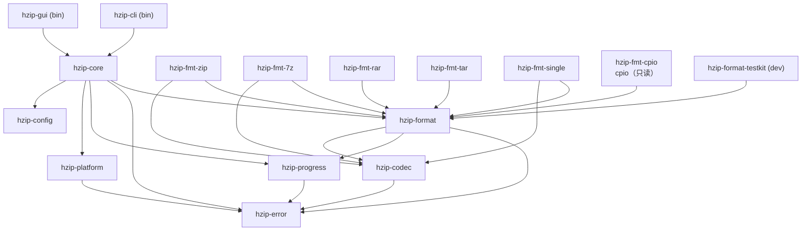

依赖红线（`build/checks/deps-direction.py` 机械校验）：

1. `hzip-fmt-*` 之间**零依赖**；
2. `hzip-cli` / `hzip-gui` **禁止**依赖任何 `hzip-fmt-*` 与 `hzip-codec`（只经 core）；
3. `hzip-format` **禁止**依赖任何 `hzip-fmt-*`（依赖倒置：实现依赖抽象）；
4. `hzip-error` / `hzip-progress` / `hzip-platform` 不依赖 workspace 内其他业务 crate；
5. `windows-sys` / `core-foundation` 等平台 crate **只允许**出现在 `hzip-platform` 的依赖里（平台收口，见 §5）。

### 2.2 feature 矩阵

| crate | features（默认全开） | 作用 |
|---|---|---|
| hzip-codec | `deflate, bzip2, xz, zstd, bcj2` | 按格式裁剪依赖 |
| hzip-format | `default-formats` | 聚合透传各 fmt crate |
| hzip-fmt-zip | `aes, zipx` | AES 写入 / zipx 方法解码 |
| hzip-fmt-7z | `aes, bcj2, solid, split` | 对应 7z 能力开关 |
| hzip-fmt-single | `gz, bz2, xz, zst` | 各单文件流 |
| hzip-fmt-cpio | —（无 feature 门控） | cpio 四变体只读读取 |
| hzip-core | `default-formats, rar, json` | rar 剔除通道（发行版合规）；json 供 CLI |
| hzip-platform | `win-long-path` | Windows `\\?\` 处理 |

版本集中在根 `Cargo.toml` 的 `[workspace.dependencies]`，成员一律 `workspace = true` 引用；全部 crate 同版本号同步发布。

---

## 3. hzip-error 错误模型

### 3.1 模块结构

| 子模块 | 职责 |
|---|---|
| `lib` | `HzipError` 枚举与变体 |
| `code` | 错误码常量表 + `HzipError::code()` |
| `context` | `ErrorContext` 链式构造辅助（`.with_path()`、`.with_entry()`） |

### 3.2 错误分类决策流程

任何操作失败时，按以下顺序归类（决定 CLI 退出码与 UI 文案级别）：

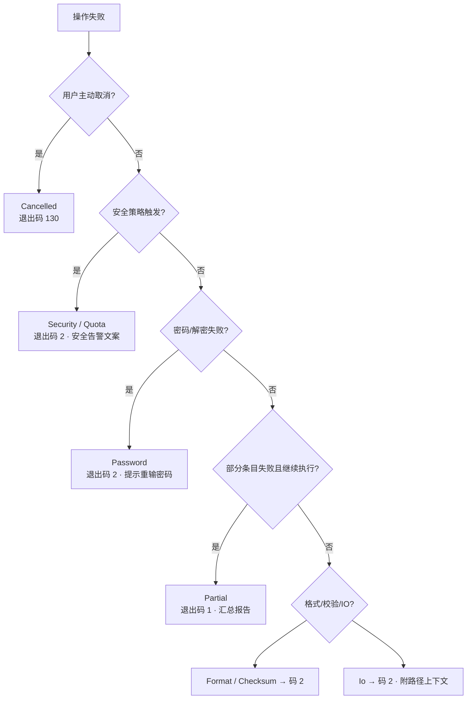

### 3.3 API 签名

```rust
#[non_exhaustive]
#[derive(Debug, thiserror::Error)]
pub enum HzipError {
    #[error("IO 错误: {source}{}", path.as_ref().map(|p| format!(" ({})", p.display())).unwrap_or_default())]
    Io { #[from] source: std::io::Error, path: Option<PathBuf> },

    #[error("格式错误 ({format}): {kind}")]
    Format { format: FormatId, kind: FormatErrorKind },

    #[error("校验失败: 条目 {entry} 期望 CRC {expected:08x} 实际 {actual:08x}")]
    Checksum { entry: EntryName, expected: u32, actual: u32 },

    #[error("密码错误或加密数据损坏: {target}")]
    Password { target: PasswordTarget },   // Archive / Entry / Header

    #[error("安全策略拦截: {violation}")]
    Security { violation: SecurityViolation },

    #[error("配额超限: {quota}")]
    Quota { quota: QuotaKind },

    #[error("不支持的操作: {what}")]
    Unsupported { what: Cow<'static, str> },

    #[error("任务已取消")]
    Cancelled,

    #[error("部分失败: {succeeded} 成功, {failed} 失败")]
    Partial { succeeded: usize, failed: Vec<(EntryName, Box<HzipError>)> },
}

impl HzipError {
    pub fn code(&self) -> u32;              // HZ-xxxx 数字部分
    pub fn is_retryable(&self) -> bool;      // Io(网络盘瞬断)→true，其余 false
    pub fn user_action(&self) -> UserAction; // 文案选择：重输密码/换目标盘/忽略等
}
```

### 3.4 错误码区段表

| 区段 | 类别 | 典型码 |
|---|---|---|
| 1000–1999 | IO / 磁盘 / 权限 | 1001 目标不可写、1002 磁盘不足、1003 权限拒绝 |
| 2000–2999 | 格式解析 | 2001 魔数不匹配、2002 档案截断、2003 未知压缩方法、2004 头部损坏 |
| 3000–3099 | 校验 | 3001 CRC 不匹配 |
| 3100–3199 | 密码/加密 | 3101 密码错误、3102 头加密不可列条目、3103 未知加密方案 |
| 4000–4499 | 安全 | 4001 路径穿越、4002 符号链接逃逸、4003 保留设备名、4004 NUL/控制字符 |
| 4500–4999 | 配额 | 4501 单文件超限、4502 总量超限、4503 炸弹比率、4504 条目数超限 |
| 5000–5999 | 业务规则 | 5001 不支持操作、5002 决策超时、5003 参数非法、5004 源不存在、5005 目标非空冲突 |
| 6000–6999 | 任务 | 6001 已取消、6002 部分失败、6003 队列已关闭 |

### 3.5 边界规则

- `Partial` 是正常业务结果而非异常，永远由 core 聚合产生（格式层只报单条目错误）。
- `Cancelled` 不携带副作用信息；回滚报告走 `ProgressEvent::JobFinished` 的 outcome。
- 未知变体（`#[non_exhaustive]`）必须被 CLI/GUI 兜底为「内部错误 HZ-0000 + 请求上报 issue」。

---

## 4. hzip-progress 进度与取消

### 4.1 模块结构

| 子模块 | 职责 |
|---|---|
| `token` | `CancellationToken`（原子标志 + 代际计数 + 父子级联） |
| `event` | `ProgressEvent` / `Outcome` 定义 |
| `bus` | `ProgressBus`（crossbeam 广播通道，多订阅者） |
| `throttle` | UI 侧 10 Hz 合并器（GUI 专用，core 不感知） |

### 4.2 取消传播流程

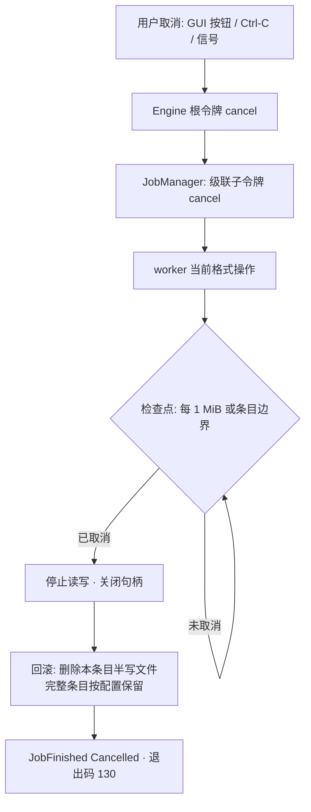

检查点实现约定：格式层在流拷贝循环内调用 `ctx.checkpoint()?`；内部为「读原子标志 → 命中则 `Err(Cancelled)`」，单次开销 < 5 ns。

### 4.3 进度事件流水线

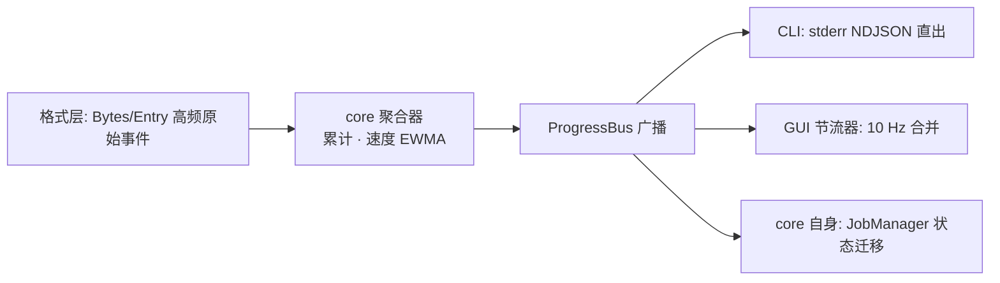

### 4.4 API 签名

```rust
pub struct CancellationToken(Arc<CancelInner>);
impl CancellationToken {
    pub fn new() -> Self;
    pub fn child(&self) -> Self;                          // 父取消 → 子自动取消
    pub fn cancel(&self);                                 // 幂等
    pub fn is_cancelled(&self) -> bool;
    pub fn throw_if_cancelled(&self) -> Result<(), HzipError>;
}

#[non_exhaustive]
pub enum ProgressEvent {
    JobStarted   { job_id: JobId, total_bytes: u64, total_entries: u64 },
    EntryStarted { entry: EntryName, bytes: u64 },
    EntryDone    { entry: EntryName, bytes: u64, crc_ok: bool },
    Bytes        { delta: u64 },
    JobFinished  { job_id: JobId, outcome: Outcome },
}

pub enum Outcome {
    Done(JobStats),
    Partial(JobStats, Vec<EntryFailure>),
    Failed(HzipError),
    Cancelled,
    RolledBack(Vec<PathBuf>),   // Cancelled 时列出的已清理文件
}
```

### 4.5 速度与剩余时间算法

- 瞬时速度：EWMA（α = 0.3），窗口 2 s；
- 剩余时间 = `(total - done) / EWMA`；显示时 < 10 s 显示「即将完成」，> 24 h 显示 `--`；
- 启动前 500 ms 不显示速度（避免尖峰误导）。

---

## 5. hzip-platform 跨平台基础支撑

**定位（修订）**：本 crate 是**全部**跨平台差异的唯一收口层。任何 crate 需要触碰「操作系统相关行为」时，只允许 import `hzip-platform`；`windows-sys` / `core-foundation` 等平台 crate 出现在其他 crate 的依赖里即 CI 报错（红线 5，§2.1）。

### 5.1 模块总表

| 子模块 | 职责 | 平台差异点 |
|---|---|---|
| `long_path` | Windows `\\?\` 前缀注入/还原 | 仅 win；unix 直通 |
| `metadata` | 统一属性（mtime/权限/隐藏/只读/系统/可执行）读写与语义映射 | win 属性位 ↔ unix mode |
| `symlink` | 符号链接/硬链接创建、读取、类型判定 | win 需特权，降级链 |
| `fs_util` | 磁盘空间、稀疏检测、大小写敏感性实测、安全删除、原子替换 | rename 跨卷回退 |
| `temp_area` | 双击打开/编辑保存的受监控临时目录 | 各平台临时目录约定 |
| `watch` | 文件变更监听（notify 封装）+ 去抖 | inotify / FSEvents / ReadDirectoryChangesW |
| `open` | 用系统程序打开 / 在文件管理器中显示（reveal） | ShellExecute / open / xdg-open |
| `exec` | 外部查看器/编辑器进程派生与脱离 | 三平台 spawn 语义 |
| `proc` | 进程存活检测（PID + 创建时间双判定） | 防 Windows PID 复用 |
| `signal` | SIGINT/SIGTERM/控制台事件 → CancellationToken 桥接 | win 控制台处理器 |
| `dirs` | 配置/数据/缓存/日志目录解析 | XDG / Library / AppData 约定 |
| `fs_caps` | 文件系统能力探测（大小写、保留字符集、路径上限） | NTFS / APFS / ext4 |
| `file_icon` | 系统文件类型图标查询（T-ICON）：按扩展名 + 种类取操作系统文件管理器同款图标，返回预乘 BGRA 位图与系统本地化类型名 | win `SHGetFileInfoW`（32px 单档）／linux XDG 图标主题查表（仅 PNG）／macOS 恒 `None`（回退自有图标） |
| `lang` | 系统界面语言探测（T-ICON）：返回 `zh-CN`/`en-US` 形态标签，供 GUI 语言「跟随系统」 | win `GetUserDefaultLocaleName`／unix `LC_ALL→LC_MESSAGES→LANG` |

### 5.2 平台分发统一流程

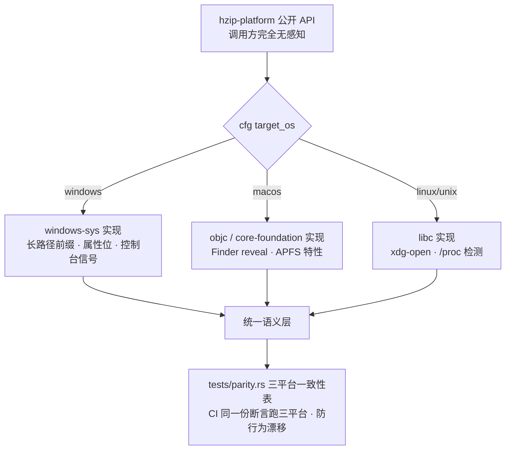

### 5.3 各子模块设计

#### 5.3.1 long_path

```rust
pub fn to_extended(p: &Path) -> PathBuf;   // win: 非 \\?\ 则注入（含 \\?\UNC\）
pub fn from_extended(p: &Path) -> PathBuf; // 反向，用于显示与日志
pub fn max_path_len() -> usize;            // win: 32767 · unix: pathconf 查询
```

规则：注入只发生在「即将传给文件系统 API」的边界（open/create/rename/metadata）；显示、列表输出、日志一律 `from_extended` 还原。

#### 5.3.2 metadata —— 属性映射表

| 内部模型 | Windows | Unix |
|---|---|---|
| `read_only` | FILE_ATTRIBUTE_READONLY | mode & 0o222 == 0 |
| `hidden` | FILE_ATTRIBUTE_HIDDEN | 名以 `.` 开头（约定） |
| `system` | FILE_ATTRIBUTE_SYSTEM | 无（恒 false） |
| `mtime` 精度 | FILETIME 100 ns | 纳秒（ext4） |
| `executable` | 无（按扩展名 .exe/.bat 推断） | mode & 0o111 |

档案内存储 `mode`（unix 视角）+ `attrs`（win 视角）双字段，解压时按**目标平台**语义恢复。

#### 5.3.3 symlink —— 创建降级链

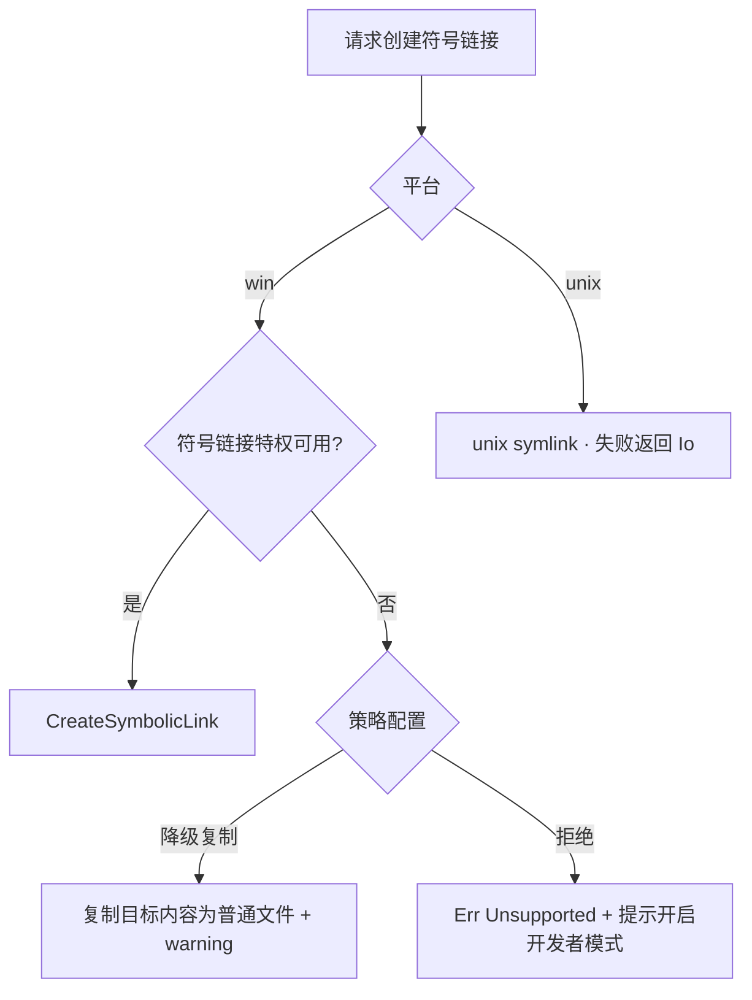

#### 5.3.4 fs_util

```rust
pub fn available_bytes(path: &Path) -> io::Result<u64>;
pub fn is_sparse(path: &Path) -> io::Result<bool>;
pub fn is_case_sensitive(dir: &Path) -> bool;      // 探测式：临时对撞文件实测
pub fn atomic_replace(src: &Path, dst: &Path) -> io::Result<()>; // 同卷 rename；跨卷 copy+fsync+rename
pub fn remove_all_no_follow(root: &Path) -> io::Result<()>;      // 不跟随目录内符号链接（防逃逸删除）
```

`is_case_sensitive` 必须实测而非按 FS 类型推断（macOS 卷可配置、Linux 挂 NTFS 等场景），结果供 core 冲突检测使用。

#### 5.3.5 temp_area —— 生命周期状态机

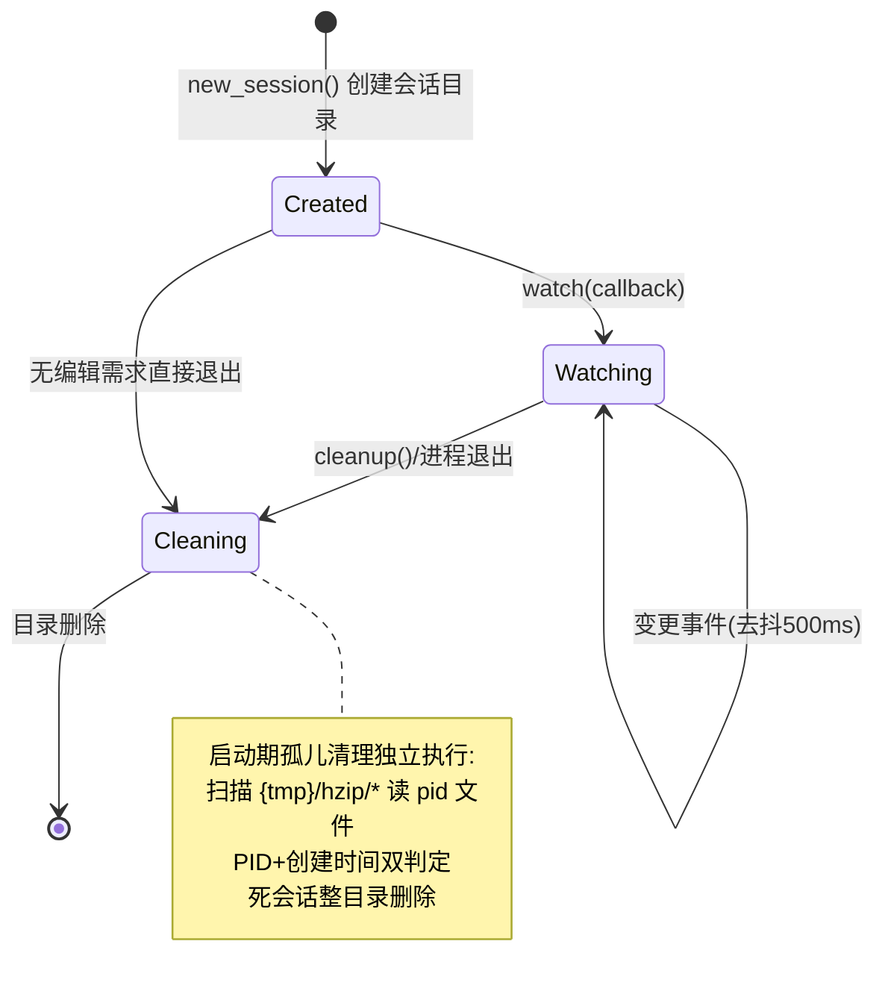

路径分配规则（稳定可复现）：`{root}/{档案路径 sha256 前 8 字符}/{条目安全名}`；条目安全名经与解压相同的净化函数处理（`TC-SEC-015`）。

#### 5.3.6 watch

notify crate 封装：事件过滤（modify / close_write）→ 去抖（500 ms 窗口合并）→ 回调；watch 目标为具体文件；句柄随 TempArea 生命周期自动释放。

#### 5.3.7 open / exec

```rust
pub fn open_with_default_app(path: &Path) -> io::Result<()>;   // ShellExecuteW / open / xdg-open
pub fn reveal_in_file_manager(path: &Path, select: bool) -> io::Result<()>; // explorer /select · Finder · dbus
pub fn spawn_detached(cmd: &OsStr, args: &[OsStr]) -> io::Result<()>;       // 查看/编辑器派生
```

#### 5.3.8 proc —— PID 复用防护

孤儿清理不能只看 PID 存在：比对（pid, 进程创建时间戳）二元组。Windows 用 `OpenProcess + GetProcessTimes`；Linux 读 `/proc/{pid}/stat` 第 22 字段；macOS 用 `proc_pidinfo`。会话启动时写 `pid` 文件：`{"pid":n,"created_ms":...}`。

#### 5.3.9 signal

```rust
pub fn install_cancel_handler(root: CancellationToken) -> Box<dyn Fn() -> ()>;
```

- POSIX：`sigaction` 捕获 SIGINT/SIGTERM；第二次信号直接默认终止（取消已尽力，不阻拦强杀）；
- Windows：`SetConsoleCtrlHandler` 捕获 CTRL_C/CTRL_CLOSE；窗口关闭给 2 s 宽限走回滚。

#### 5.3.10 dirs

| 用途 | Windows | macOS | Linux |
|---|---|---|---|
| 配置 | `%APPDATA%\hzip` | `~/Library/Application Support/hzip` | `$XDG_CONFIG_HOME/hzip` |
| 日志 | `%LOCALAPPDATA%\hzip\logs` | `~/Library/Logs/hzip` | `$XDG_STATE_HOME/hzip` |
| 临时 | `GetTempPath()/hzip` | `$TMPDIR/hzip` | `XDG_RUNTIME_DIR 或 /tmp 下 hzip` |

---

## 6. hzip-codec 编解码层

### 6.1 模块结构

| 子模块 | 职责 |
|---|---|
| `trait` | `CodecProvider` / `Encoder` / `Decoder` 抽象 |
| `deflate` / `bzip2` / `xz` / `zstd` | 第三方库封装 |
| `filter` | BCJ / BCJ2 可执行文件分支过滤器 |
| `crc` | crc32 流式增量 |
| `level` | 统一 Level → 各库参数映射 |

### 6.2 编码流水线

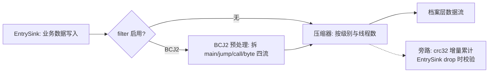

解码方向相反：档案流 → 解压器 →（BCJ2 重组）→ 上层 `Read`。

### 6.3 级别映射表

| Level | zip deflate | 7z lzma2 dict | xz preset | zstd | bzip2 block |
|---|---|---|---|---|---|
| Store | store | copy | 0 | — | — |
| Fastest | 1 | 64 KB · fast | 1 | 1 | 1 |
| Fast | 3 | 1 MB | 3 | 5 | 3 |
| Normal（默认） | 6 | 16 MB | 6 | 9 | 6 |
| Maximum | 9 | 64 MB | 9 | 16 | 9 |
| Ultra | 9 | 256 MB | 9e | 22 | 9 |

线程规则：`threads = min(请求值, 可用核数)`；deflate/bzip2 并行发生在「档案内多条目」层（core 调度）；lzma2/zstd 由编码器内部多线程。

### 6.4 BCJ2 四流结构

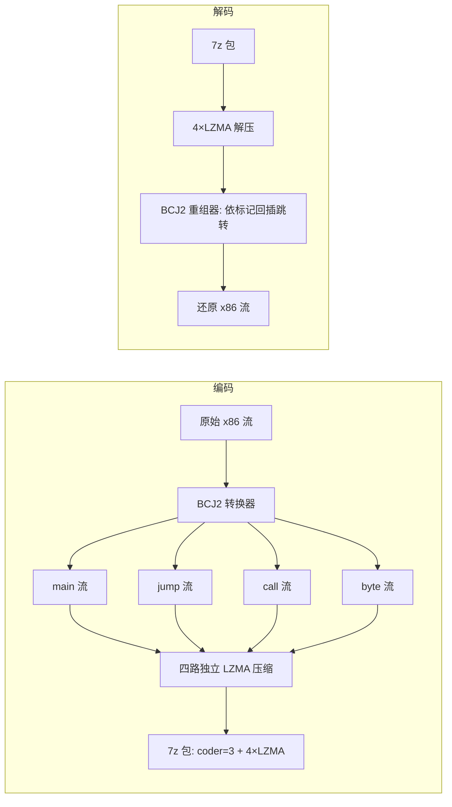

实施约束：解码器先于编码器交付（解 7-Zip 产出的 BCJ2 档案是 P2 首要目标）；编码器开启时禁用 solid 块内多文件并行；`TC-ALG-004` 与 `TC-X-001/002` 为验收门禁。

### 6.5 API 签名

```rust
pub trait CodecProvider: Send + Sync {
    fn id(&self) -> CodecId;
    fn caps(&self) -> CodecCaps;                     // 线程性、流式性
    fn encode(&self, level: Level, threads: u32) -> Box<dyn Encoder>;
    fn decode(&self, threads: u32) -> Box<dyn Decoder>;
}
pub trait Encoder: Write { fn finish(self: Box<Self>) -> io::Result<EncoderStats>; }
pub trait Decoder: Read  { fn finish(self: Box<Self>) -> io::Result<DecoderStats>; }
```

---

## 7. hzip-format 格式抽象层

### 7.1 模块结构

| 子模块 | 职责 |
|---|---|
| `types` | `EntryInfo`、`EntryId`、`FormatId`、`EntryName`（规范化路径类型） |
| `caps` | `FormatCaps` 能力矩阵、`EncryptionCaps` |
| `handler` | `FormatHandler` trait 与 `Signature` 描述 |
| `reader` / `writer` / `editor` | 三个契约 trait 与 `ExtractCtx` / `WriteCtx` |
| `registry` | 注册表 + 嗅探 + 组合装配 |
| `password` | `PasswordRef` 与密码来源抽象 |
| `sniffer` | 魔数/扩展名嗅探与组合装配的层解码器（`wrap_layer_decoder` 亦供嵌套容器下钻复用） |
| `exts` | **面向用户的扩展名表**（`FORMATS_EXTS`）：文件关联候选、右键菜单档案判定、打开选择器过滤、嵌套容器识别、文件类型展示的唯一来源；含 `tgz`/`tbz2` 等别名与 `tar.gz` 复合写法（`Signature::extensions` 是**嗅探回退**表，两者分工见该模块文档） |

### 7.2 数据类型

```rust
pub type FormatId = SmolStr;
pub type EntryId = usize;

/// 条目名：内部统一 '/' 分隔、无前导 './'、不允许 '\\'
/// 构造时做语法校验（净化决策仍在 core 安全模块）
pub struct EntryName(SmolStr);

#[non_exhaustive]
pub struct EntryInfo {
    pub id: EntryId, pub name: EntryName, pub is_dir: bool, pub is_symlink: bool,
    pub symlink_target: Option<PathBuf>,
    pub size_raw: u64, pub size_packed: u64,
    pub mtime: Option<OffsetDateTime>, pub mode: Option<u32>, pub attributes: EntryAttrs,
    pub encrypted: bool, pub header_encrypted: bool,
    pub crc32: Option<u32>, pub codec: Option<CodecId>,
    pub name_encoding: NameEncoding,     // Utf8 | Suspect(codepage) | Unknown
}

#[non_exhaustive]
pub struct FormatCaps {
    pub read: bool, pub write: bool, pub append: bool, pub edit: bool,
    pub encryption: EncryptionCaps,     // None | ZipCrypto | Aes(128|192|256) | AesHeader
    pub split: bool, pub solid: bool, pub comment: bool,
}

/// 归档根的自我描述条目判定（`"."` / `"./"`；`..` 与 `.hidden` 不命中）
pub fn is_root_entry_name(raw: &[u8]) -> bool;
```

**`is_root_entry_name` 的由来（跨格式共性缺陷）**：标准工具会写一个「归档根自我
描述条目」——`find . | cpio -o` 写 `.`，`tar cf x.tar .` 写 `./`。它不承载条目语义，
且规范化后是空名（`parse_entry_name` 按 N1/N5 必然拒绝）。旧实现里 tar 侧直接在
`parse_entry_name` 处失败 → `tar cf x.tar .` 产出的档案**整档 2004 打不开**（用户实测
复现）；cpio 侧实现时同一坑再次浮现。故判定抽到本 crate 共享，**容器 reader 解析名字
前必须先跳过**（cpio `reader`/tar `reader` 各一处调用）。

### 7.3 契约 trait 与上下文

```rust
pub trait FormatHandler: Send + Sync {
    fn id(&self) -> FormatId;
    fn signature(&self) -> &'static Signature;
    fn caps(&self) -> FormatCaps;
    fn open_reader(&self, src: Source, opts: &OpenOptions) -> Result<Box<dyn ArchiveReader>, HzipError>;
    fn create_writer(&self, dst: Sink, opts: &CreateOptions) -> Result<Box<dyn ArchiveWriter>, HzipError>;
    fn open_editor(&self, src: Source, opts: &OpenOptions) -> Result<Box<dyn ArchiveEditor>, HzipError>; // caps.edit 才实现
}

pub trait ArchiveReader: Send {
    fn caps(&self) -> FormatCaps;
    fn entries(&self) -> Result<Vec<EntryInfo>, HzipError>;                 // 红线 1
    fn read_entry(&self, id: EntryId, pw: PasswordRef<'_>) -> Result<Box<dyn Read + Send>, HzipError>;
    fn extract(&self, sel: &Selection, ctx: &ExtractCtx<'_>, dest: &Path) -> Result<ExtractReport, HzipError>;
    fn test(&self, ctx: &ExtractCtx<'_>) -> Result<ExtractReport, HzipError>;
}

pub trait ArchiveWriter: Send {
    fn next_entry(&mut self, meta: &EntryMeta, pw: PasswordRef<'_>) -> Result<EntrySink<'_>, HzipError>;
    fn finish(self: Box<Self>) -> Result<WriteReport, HzipError>;
}

pub trait ArchiveEditor: Send {
    /// 基于现有档案 + 变更集流式重写新档案（zip/7z）
    fn rewrite(&self, changes: ChangeSet, dst: Sink, ctx: &WriteCtx<'_>) -> Result<WriteReport, HzipError>;
}

/// 格式层只消费不构造；密码/冲突经请求-应答回调到 core
pub struct ExtractCtx<'a> {
    pub cancel: &'a CancellationToken,
    pub progress: &'a ProgressBus,
    pub passwords: &'a dyn PasswordSource,
    pub conflicts: ConflictPolicy,
    pub sanitize: &'a SanitizeConfig,
    pub quota: &'a QuotaLimits,
    pub best_effort: bool,
    pub codepage: Option<Encoding>,        // 手动指定优先于自动检测
}
```

**四条契约红线**（testkit `TC-CONF-001..010` 逐条验证）：

1. `entries()` 除头部加密外不读数据区——大档案列表秒开；
2. `read_entry` 任意 id 独立可用、可乱序、可重复；
3. 错误密码必须返回 `Password` 错误，禁止静默产出乱码流（底层库无法区分时，实现层做 HMAC/校验头预验）；
4. 任何输入不 panic：畸形数据 → `Format` 错误。

### 7.4 嗅探流程

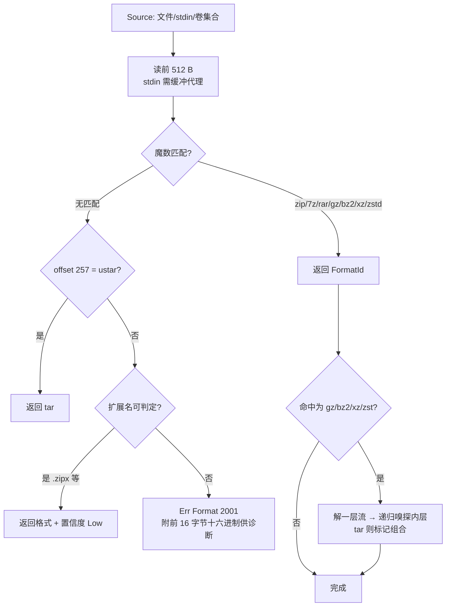

### 7.5 组合格式装配

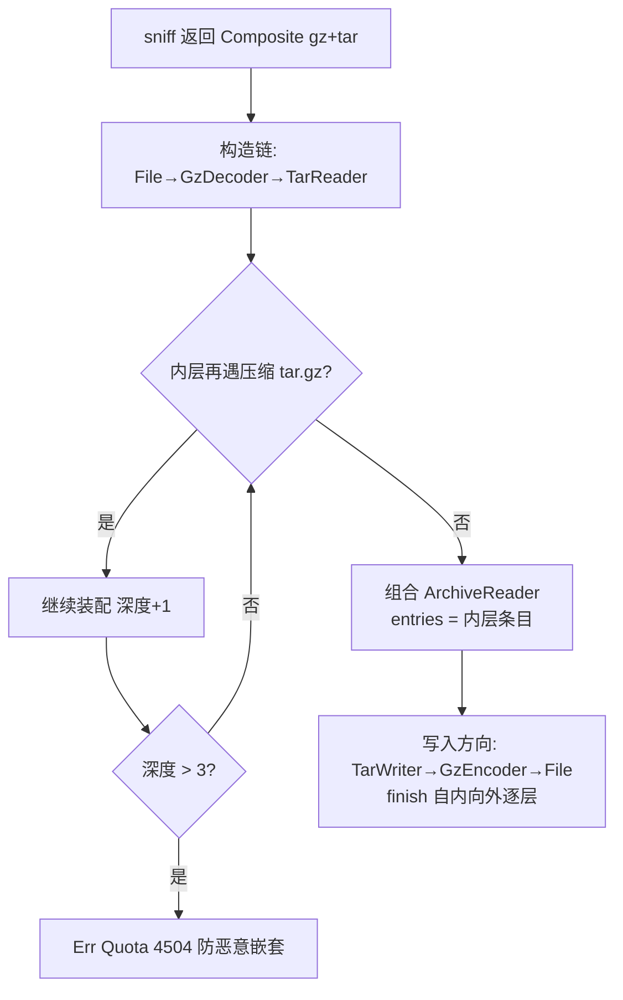

### 7.6 注册表时序

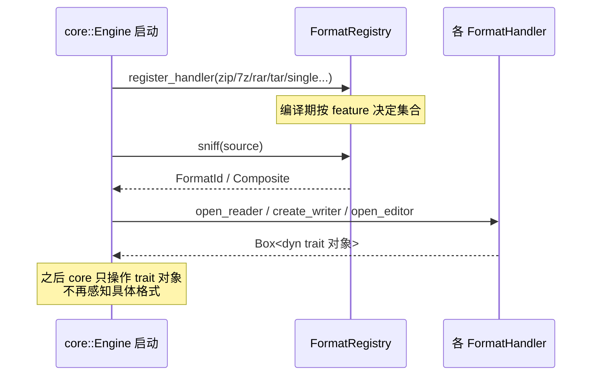

---

## 8. hzip-fmt-* 格式实现

### 8.1 hzip-fmt-zip

**模块结构**

| 子模块 | 职责 |
|---|---|
| `reader` | 基于 zip crate 的 ArchiveReader |
| `writer` | 创建/追加（zip 追加直接改中央目录，无需重写） |
| `aes` | WinZip AES（KV 拆包、HMAC-SHA1 验证头）密码预验 |
| `encoding` | 文件名编码修复（chardetng 批量检测 + 转码） |
| `zipx` | 方法 ID 12(bzip2)/93(zstd)/14(LZMA) 解码路由（feature） |

**解压单条目流程**

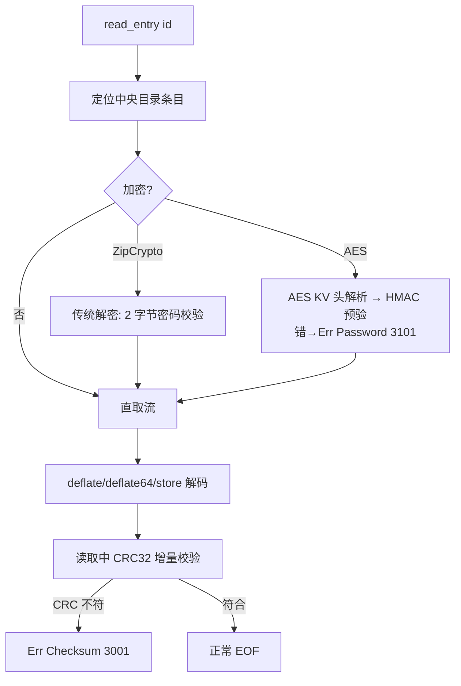

**文件名编码修复流程**

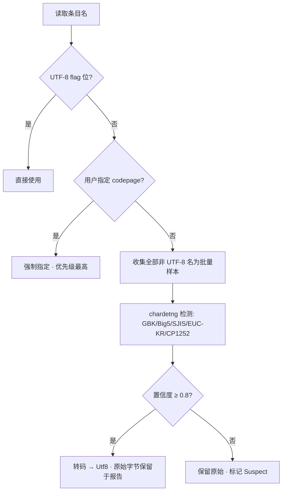

**写入路径要点**：分卷由输出端按字节切分；`next_entry` 先落本地头，`EntrySink` drop 校验 CRC，`finish` 统一写中央目录——中途失败产物为可恢复的「无目录 zip」，实现层提供 salvage 读取并打 warning。

### 8.2 hzip-fmt-7z

**模块结构**：`reader`（头解析/卷装配）、`writer`（solid 块打包）、`coder`（lzma/lzma2/BCJ2 路由）、`header_crypt`（AES + SHA-256 头加密）、`split`（分卷）。

**头解析流程**

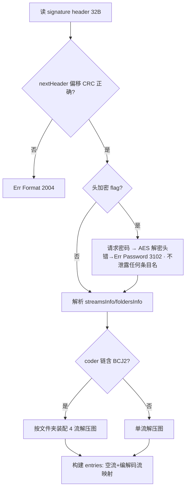

**写入（solid 模式）流程**

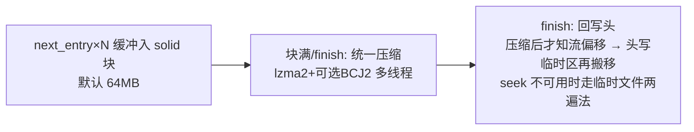

关键边界：管道输出（`Sink::Stdout`）时 7z 头需回写，策略为「先落临时文件再拷出」，在文档与 UI 中说明。

### 8.3 hzip-fmt-rar

**模块结构**：`reader`（unrar 绑定）、`volume`（卷集发现）、`panic_wall`（C 边界防护）。

**C 接口三重防护**

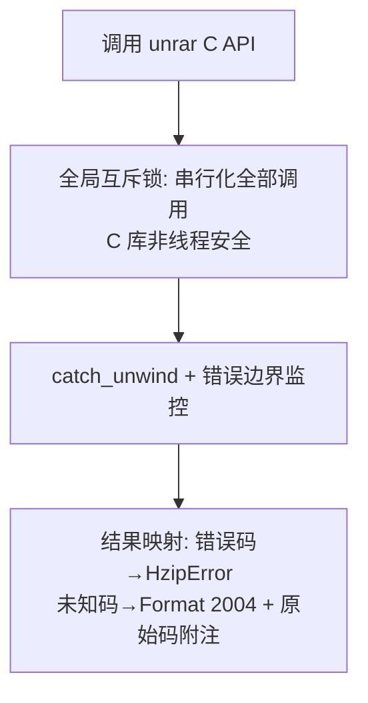

**卷集自动发现流程**

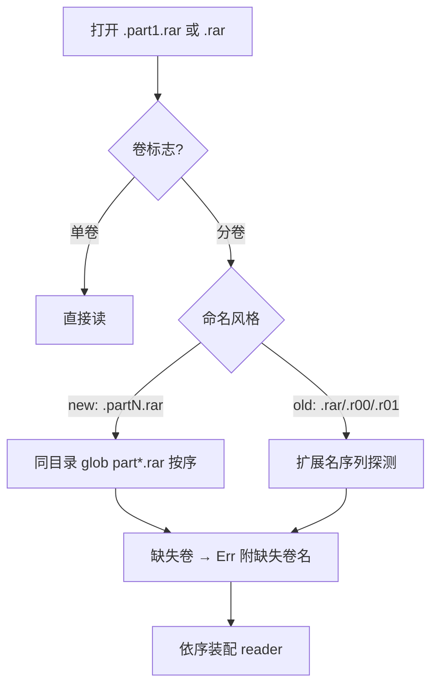

### 8.4 hzip-fmt-tar

- 三变体兼容读取：GNU（长名/稀疏扩展）/ POSIX ustar / pax（`PaxHeaders` 属性合并）；
- `caps`：`write=true, append=仅未压缩 tar, edit=false`（压缩组合一律走 core 转换管线）；
- pax 头 `path`/`mtime`/`linkpath` 覆盖规则按 POSIX 规范；`GNU.sparse.*` 稀疏条目按映射稀疏写文件。

### 8.5 hzip-fmt-single

- 条目名规则：`a.txt.gz → a.txt`；stdin 输入时为 `stdin`（CLI `--entry-name` 可覆盖）；
- mtime 来源：gzip（mtime 字段）/ zstd 帧可选 / xz 与 bzip2 无（None）；
- 多成员 gzip（multi-stream tar.gz 常见）：读取端串联全部成员（zstd 同理处理 skippable frame）；
- **`size_raw` 口径（2026-09-24 修订）**：容器元数据里写着原始大小时**如实上报**
  （gz 尾部 `ISIZE`（`gzip -l` 同口径，单成员 < 4 GiB 精确）/ xz 尾部索引求和（精确）/
  zstd 帧头 `Frame_Content_Size`（写了才有）），未知仍为 `0`（bz2 无该字段）。理由：
  原先一律 `0` ⇒ core 的 `total_bytes = Σ size_raw` 恒 0 ⇒ **百分比无从计算**（用户实测：
  解压一个大 `.gz` 一直 0%，而按字节推进的能力其实一直在）。探测只读容器元数据
  （有界 seek + 小读），红线 1「`entries()` 不读数据区」仍成立。

### 8.6 hzip-format-testkit（dev crate）

```rust
pub struct KitCtx { pub assets: &Path, pub tmp: TempDir, pub caps_filter: CapsFilter }
pub fn run_conformance<H: FormatHandler>(h: &H, ctx: &KitCtx) -> DynTestList; // 可命名测试集合
```

10 组基础用例见[测试文档 §2.1](03-测试方案及用例.md)（TC-CONF-001..010）；testkit 同时提供 `MockHandler`（可注入 panic/慢速/错误）供 core 测试。

另提供 **cpio 夹具构造器** `hzip_format_testkit::cpio`：cpio 在 hzip 里是**只读**格式，
没有写侧可生成测试素材；该模块按 GNU cpio 口径直接拼四变体字节流（含对齐、
`crc` 的 `check` = 数据字节和、`TRAILER!!!` 尾条目），供 fmt/core/CLI 三处测试共用
（对齐口径按 GNU cpio 2.14 实测校准，见该模块单测 `alignment_matches_gnu_cpio_probe`）。

### 8.7 hzip-fmt-cpio（只读引入格式）

- **四变体兼容读取**：SVR4 `newc`（`070701`）/ `crc`（`070702`，`check` = 数据字节和）/
  旧可移植 ASCII `odc`（`070707`）/ 旧二进制 `bin`（`0x71C7`，LE 与 BE 两种字序，按魔数
  选读法、不做跨端字节交换）；变体以**首条头判定、全程必须一致**，不一致 → 2004；
- **caps**：`read=true, write=false, append=false, edit=false, encryption=None,
  split=false, solid=false, comment=false, methods=[]`——与 rar 同档的「只读引入」定位：
  现实用例是解包 initramfs（`newc`）/ rpm 载荷 / 发行版镜像，hzip 自身不产出 cpio，
  `create_writer`/`open_editor` 恒 `Err Unsupported`（HZ-5001）；
- **组合形态归 registry**：`.cpio.gz`（及 bz2/xz/zst）由 §7.5 组合装配解层后以
  `Source::Stream` 交给本 handler（本 crate 不感知压缩层）；嗅探表认 cpio 魔数、
  扩展名表列 `.cpio*` 即通；
- **对齐口径**：名字区与数据区**各按自己的起点**对齐（newc 4 / bin 2 / odc 无）——
  数据区起点 = `align(头长 + namesize)`，下一条头 = `数据区起点 + align(filesize)`；
  按「统一自头起点对齐」会算错 2 字节（GNU cpio 2.14 实测，见 8.6 夹具单测）；
- **归档根的自我描述条目**（`find . | cpio -o` 的 `.`）不索引：判定统一在
  `hzip_format::is_root_entry_name`（tar 的 `./` 同源缺陷一并修复，见 §7.2 注）；
- **符号链接**：目标是数据区内容 → 索引期按 4 KiB 上限有界读出填
  `EntryInfo::symlink_target`（这是红线 1「`entries()` 不读数据区」的唯一例外，
  代价有界且与数据区总大小无关）；
- **完整性**：`test()` 除比对长度外，对 `crc` 变体校验数据字节和（`check == 0` 视为
  无校验——GNU 对空文件与链接如此写），不符 → `Checksum`（HZ-3001）；
- **已知限制**：硬链接数据只存于同 inode 组的末条目（与 tar 侧同口径 → 前置条目落空
  文件）；> 4 KiB 的链接目标按未知处理；记录内部截断 → 2002，记录边界 EOF 容错收尾。

---

## 9. hzip-core 业务编排层

### 9.1 模块结构

| 子模块 | 职责 |
|---|---|
| `engine` | Engine 构建、配置、线程池 |
| `jobs` | JobSpec/JobKind、JobManager 队列与状态机 |
| `services` | compress / extract / test / convert / browse / preview / edit 服务函数 |
| `security` | 路径净化、符号链接策略、配额检查 |
| `smart_extract` | 解压落盘形态判定（v2：默认原样 / --smart 包壳） |
| `conflict` | 冲突决策器与 RenameAuto |
| `encoding` | 文件名编码检测策略 |
| `report` | ExtractReport/WriteReport/JobStats 聚合 |

### 9.2 Engine 初始化流程

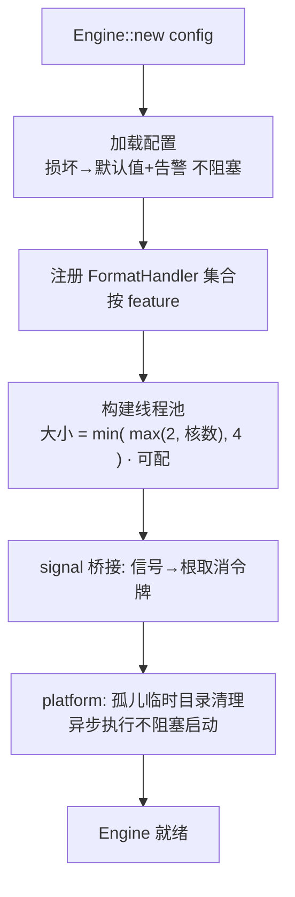

### 9.3 任务提交与 worker 主循环

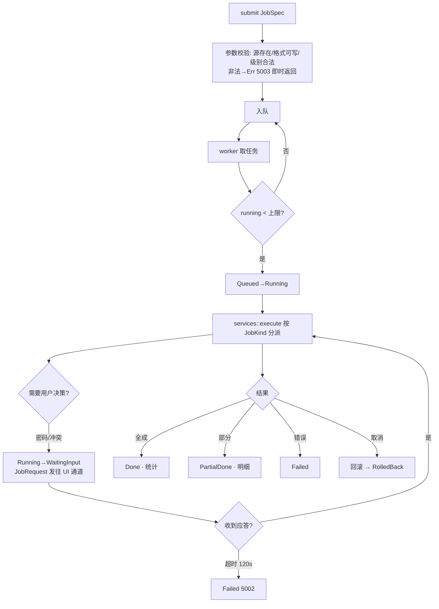

> **UI 线程阻塞审计（2026-09-24 用户实测「展开 cpio 后主界面卡住」）**：完整清单、
> 判定基准、方案与待办优先级见 `docs/design/12-UI线程阻塞审计与后台化方案.md`。
> 已落地的通则：重活三段式（锁内取句柄 → 锁外重活 → 锁内落账）、会话切换原子闸、
> 「操作进度窗」+ 任务中心留痕、`Config::load` 进程内缓存（mtime 守卫）、
> UI 线程滞后看门狗（`app::ui_lag`）。

### 9.9.y 打开类操作：后台线程 + 原子闸 + 过程明细（2026-09-24 用户口径）

用户口径原话：「双击 cpio 文件后应该弹窗显示加载进度并**在后台新线程**加载该 cpio，
这样才不会阻塞 UI 主线程；包括在目录里打开子压缩包这些也都是需要在后台线程进行逻辑
操作，并且弹窗显示进度，增强可观测性，并且对操作加**原子锁**避免用户多次双击导致多次
触发」。四条落地为：

1. **重活离 UI 线程**：`shell::run_open_flow` 的 `work` 跑在**专用后台线程**
   （`std::thread::Builder::name("hzip-open")`），不走 gpui 后台执行器的共享池——这类
   操作按秒~分钟计、CPU/IO 密集，占共享池会拖住别人的后台任务。argv 直接模式
   （`--extract-here` 等）的「先打开再解压」也改为 `smol::unblock` 上后台线程
   （原先在主线程上直呼同步 `open`，大档案即冻界面）。
2. **重活不持 AppData 锁**：延迟展开这一步原先在**锁内**跑（UI 每帧读快照 ⇒ 等锁
   ⇒ 界面冻住）。现在把 `Browser` 从会话里**摘出**（`MainViewModel::take_browser`）、
   锁外后台展开、再连同结果一次落账（成功装子会话；失败 `restore_browser` 原样还回，
   core 已把延迟态放回 ⇒ 可重试）。
3. **过程明细**：`OpenDetail`（阶段文案 + 已处理字节，工作者线程写、渲染侧每 100 ms 读）
   在「正在打开」窗里多出一行：`正在解出内层档案… · 已处理 1.2 GiB / 3.4 GiB`。
   解出内层档案的字节数由 `CountingReader` 包住条目流累计（流式操作的进度只能这样拿）。
4. **会话切换原子闸**：`AppData::session_switch`（`SessionSwitchGate` + RAII 闸票）在
   打开档案 / 进入容器 / 展开延迟层 / 弹出层四处取闸；**互斥不排队**——拿不到闸的触发
   直接忽略（连点两下想要的是「快点」不是「开两次」）。两个并发切换会各自压栈换会话、
   落账互相覆盖（栈里多一层、会话却只有一个），故必须挡。

### 9.9.x 组合档**延迟展开**（`.cpio.gz` 打开不再立刻解 cpio；2026-09-24 用户口径）

「打开像 cpio.gz 这样的压缩包时感觉是默认就把 cpio 展开了，应该在目录树/文件列表里
双击该 cpio 时才触发加载打开逻辑（弹出打开进度弹窗）」——落地如下：

- **打开**（`services::browse::browse` + `OpenOptions::defer_composite`）：组合档
  （编码层 + 容器尾，如 `.cpio.gz`）**只嗅探**（毫秒级），列表/树里只给**一行**内层
  容器（`init.cpio`，`id=0` 的合成条目：`is_dir=false`、名字命中容器扩展名表 ⇒ GUI 按
  容器行展示与路由；大小取编码层**声明**大小）。此前打开即装配解码链 + 落 spool +
  索引内层容器：实测 940 MB `.cpio.gz` 要 10+ 秒（无进度），3.9 GB initramfs 还要
  同量临时盘。
- **双击那一层**（`Browser::enter_deferred` ⟵ GUI `open_container` 的延迟分支）：这时
  才做那唯一耗时的一步，走 `run_open_flow` ⇒ **打开进度窗** + 任务中心留痕（用户口径
  的两条一并满足）。展开 = 以原源走完整组合路径（与「打开即展开」产物逐字相同），
  失败**保留延迟态可重试**（存路径而非 `Source` 正是为此）。
- **CLI 不延迟**（`defer_composite=false`）：`l`/`p`/`t` 是一次性取数，没有「双击」
  语义，直接给最终结构。
- 由此 `TreeNode::with_composite_layer`（旧「合成一层目录」手法）整体下线：那一层现在
  是**真实条目**，树/列表/面包屑/类型列/双击路由全走既有链路。

### 9.6.x 智能解压壳目录（`--smart`）：别名后缀与撞名（2026-09-24 用户实测修复）

`--smart` 在「会污染目标根」时于目标根下以**档案 stem** 建壳目录。两处坑（用户右键
「智能解压」报「目标不可写」而磁盘充裕，实测复现于 `.tgz`）：

1. **别名后缀必须剥**：stem 的来源是档案名剥全部已知档案后缀，后缀清单取自
   `hzip_format::exts`（唯一来源）而非本地小抄——旧实现列了
   `["gz","bz2","xz","zst","tar","cpio","zip","7z","rar"]` **漏了别名**
   `.tgz/.tbz2/.txz/...`，于是 `x.tgz` 的 stem 仍是 `x.tgz`，壳目录与**档案自己
   同名** ⇒ `create_dir_all` 报 os 183「当文件已存在时，无法创建该文件」⇒ 用户看到
   HZ-1001「目标不可写」（码来自 `io_code` 的兜底分支，与磁盘无关）。
2. **撞名不失败**：壳目录候选被**同名文件**占据（或与他进程竞态）→ 依次尝试
   `stem (2)`、`stem (3)`…（上限 `WRAP_RENAME_MAX=10`）；候选已是目录 → 合并复用
   （与 7-Zip/Bandizip 一致）。全部失败才 `Err Io`。

### 9.3.x 磁盘/临时空间预检（2026-09-24 用户实测补充）

空间预检有两个时机，共用一份判定与错误构造（`hzip-core::services::space`）：

| 时机 | 「需要多少」的来源 | 拒绝点 |
|---|---|---|
| 解压开始前（§9.4 D 框） | Σ 选中条目 `size_raw` × `SPACE_HEADROOM`(1.05) | 目标盘 |
| **打开档案前**（组合链） | 内层编码层**声明**的解压后大小（gz 尾 `ISIZE` / xz 尾索引 / zst 帧头） | **临时**盘 |

组合档（`.cpio.gz`/`.tar.gz`/…）的内层容器 handler（cpio/tar）必须先把解压后的
整层落临时文件才能随机访问（索引/乱序读要 seek）⇒「临时盘装得下解压后大小」是
打开的前置条件。此前没有这一检：临时盘不足时会在**解压完**、写盘途中才报 ENOSPC
（实测用户等十来秒后只看到「磁盘」错误）。现在声明大小可得时**解压之前**即拒绝
（HZ-1002 + 临时目录落点）；大小未知（bz2 / 自产 zst）或源不可预检（stdin/流）
时放行，由 fmt 层 spool 的写盘错误兜底（错误同样带临时目录上下文）。

**临时缓冲自愈**：spool 文件名带 `hzip-spool-` 前缀（`fmt-cpio`/`fmt-tar`），
启动时 `sweep_stale_spools`（阈值 24 h）回收崩溃残留——`NamedTempFile` 只在 drop
时删，进程被强杀会留下孤儿（实测一次累积 29.6 GiB、把系统盘挤到 3 GiB 可用，
正是上面那次 ENOSPC 的直接原因）。

### 9.4 解压服务完整管道

```mermaid
flowchart TD
    A[JobKind::Extract] --> B[sniff 格式/组合]
    B --> C[open_reader]
    C --> D[预检: 目标盘空间 ≥ 解压总量×1.05<br/>不足→Err 1002]
    D --> E[smart_extract 判定 → 实际目标目录]
    E --> F[遍历 Selection 条目]
    F --> G[sanitize_entry_path 净化]
    G --> H{符号链接条目?}
    H -->|是| L1[目标净化+逃逸判定 → 策略分支]
    H -->|否| I{目标已存在?}
    I -->|是| L2[冲突决策器]
    I -->|否| J[创建父目录链]
    L1 --> J
    L2 --> J
    J --> K[流拷贝: read→write 1MiB/次]
    K --> K1{检查点每4MiB: 取消/配额}
    K1 -->|超限| QE[Err Quota + 回滚本条目]
    K1 -->|取消| QC[Cancelled + 回滚]
    K1 -->|继续| K2{条目完}
    K2 -->|CRC 校验| K3{best_effort?}
    K3 -->|是·失败| SK[记录失败 继续]
    K3 -->|否·失败| FF[fail-fast]
    K2 -->|还有条目| F
    K3 -->|全部完| R[聚合 ExtractReport<br/>Done 或 Partial]
```

### 9.5 压缩服务管道

```mermaid
flowchart TD
    A[JobKind::Compress] --> B[展开输入: 目录递归<br/>按 glob/隐藏/链接策略筛选]
    B --> C[预统计: 条目数/总大小 → 进度 total]
    C --> D{输出分卷?}
    D -->|是| E[Sink::Split 初始化]
    D -->|否| F[Sink::File]
    E --> G[create_writer · 级别/线程/密码映射]
    F --> G
    G --> H[调度: 小文件 rayon 并行预读<br/>写入按 handler 能力串行/并行]
    H --> I[next_entry: 目录=零长条目<br/>symlink=记录 target]
    I --> J[流拷贝 + CRC + 进度]
    J --> K{链接策略=跟随?}
    K -->|是| J2[目标内容按普通文件写入]
    K -->|否| J3[链接条目]
    J2 & J3 --> K2{还有输入?}
    K2 -->|是| H
    K2 -->|否| L[finish: 中央目录/尾块/卷收尾]
    L --> M[WriteReport + 可选重开自检]
```

### 9.6 安全模块

**sanitize_entry_path 算法**（红线函数，proptest + fuzz 双轨验证）：

```mermaid
flowchart TD
    A[输入: 档案条目名] --> J{"首段为绝对路径标志?<br/>斜杠开头 / 盘符 / UNC"}
    J -->|是| X1[✗ 拒绝 4001]
    A --> B["按斜杠与反斜杠切分"]
    B --> C[遍历段]
    C --> D{段内容}
    D -->|空串 或 .| E[丢弃]
    D -->|..| X2[✗ 拒绝 4001 不做抵消]
    D -->|含 NUL/控制字符| X3[✗ 拒绝 4004]
    D -->|Windows 保留名<br/>CON PRN AUX NUL COM1-9 LPT1-9<br/>不区分大小写 含带扩展名形式| X4[win:✗ 4003 · unix:✓ 放行]
    D -->|合法| I[暂存]
    C --> K[全部段通过]
    K --> L{段尾空格或句点?}
    L -->|win| M[截断 + warning]
    L -->|unix| N[保留]
    M & N --> O[dest.join 相对路径<br/>win: 经 long_path 转换]
```

**符号链接策略表**（默认 deny-escape；`skip` 档面向跨平台档案释放——
Linux 容器/工程档内指向绝对路径的链接（如 `/usr/lib/nginx/modules`）在
Windows 上无法恢复也无须恢复，跳过并记失败明细，其余条目照常释放；
dest 内相对目标的链接照常恢复。平台执行：Windows `CreateSymbolicLinkW`
（目录链接带 `SYMBOLIC_LINK_FLAG_DIRECTORY`，特权不足按降级链 §5.3.3），
Linux/macOS 原生 `symlink`）：

| 条目形态 | deny-escape（默认） | skip | flatten | deny-all |
|---|---|---|---|---|
| 链接目标净化后仍在 dest 内 | 恢复为符号链接 | 恢复为符号链接 | 展平 | 展平 |
| 目标为绝对路径 / dest 外 | 拒绝 4002 | **跳过**（记失败明细，不中止） | 展平（目标存在时） | 拒绝 4002 |
| 后续条目写入「已被链接路径」之下 | 拒绝 4002（逃逸组合攻击，全策略档不可配置） | 同左 | 同左 | 同左 |

**配额检查点**（每 4 MiB）：

```
raw_done + chunk > max_file_bytes    → Quota 4501
total_done + chunk > max_total_bytes → Quota 4502
raw_done / packed_read > max_ratio   → Quota 4503 (packed=0 视为 ∞ 触发)
entries_seen > max_entries           → Quota 4504
```

默认值：`max_file=32 GiB`、`max_total=128 GiB`、`max_ratio=200`、`max_entries=1,000,000`、`min_free_disk=5%`。

### 9.7 解压落盘形态判定（v2：默认保真原样，--smart 可选包壳）

**v2 语义修订**（替代旧「智能解包剥壳」）：默认解压恒**原样**展开——
档内条目名即相对路径，不剥任何顶层目录、不额外包壳（用户 -o 指定目标
不存在时自动创建）。`--smart`（extract.smart）开启时才做防污染判定。

```mermaid
flowchart TD
    A{extract.smart?} -->|false 默认| D[Direct: 目标根原样展开<br/>条目名 = 相对路径 恒不剥不包]
    A -->|true| B[全部顶层条目名]
    B --> C{恰 1 个顶层目录 或 恰 1 个文件?}
    C -->|是| D
    C -->|否 多顶层/散文件| WRAP["Wrap: 目标根下创建 档案同名目录/ 再展开"]
    D --> GO[执行]
    WRAP --> GO
```

要点：① 压缩侧目录输入**保留目录名**（`c src` → 档内 `src/` + `src/...`，
含 src 目录条目自身）——压缩与解压路径逐字节保真、互为逆；② `--flat`
已移除（默认即原样，无壳可展平）；③ Wrap 判定只防「多顶层散落污染目标
根」，单顶层目录/单文件（无论有无目录条目）恒原样。

### 9.8 冲突决策器

```mermaid
flowchart TD
    A[目标路径已存在] --> P{策略}
    P --> Overwrite[直接覆盖]
    P --> Skip[跳过并记录]
    P --> NewerOnly{源 mtime 更新?}
    NewerOnly -->|是| Overwrite
    NewerOnly -->|否| Skip
    P --> RenameAuto[探测下一个可用名<br/>a→a 2→a 3 · 幂等并发安全]
    P --> Ask[JobRequest::Conflict 上抛<br/>120s 超时→默认 Skip]
    A2[大小写不敏感卷] --> A3[A.txt 与 a.txt 视为冲突<br/>is_case_sensitive 实测判定]
```

### 9.9 编辑保存服务（D11）

```mermaid
sequenceDiagram
    participant UI
    participant C as core::services::edit
    participant T as platform::TempArea
    participant F as ArchiveEditor
    UI->>C: open_entry_for_edit(archive, entry)
    C->>T: materialize() + watch(callback)
    C-->>UI: 临时文件路径（UI 调 open_with_default_app）
    Note over T: 用户在外部程序编辑并保存
    T-->>C: 变更事件（去抖 500ms）
    C-->>UI: 确认请求「保存回档案？」
    UI->>C: confirm
    C->>C: ChangeSet::Replace(entry, tmp_path)
    C->>F: rewrite(变更集, {原档案}.hzip-tmp-{uuid})
    F-->>C: WriteReport
    C->>C: fs_util::atomic_replace(tmp, 原档案)
    Note over C: rewrite 或 replace 失败:<br/>原档案字节不变 · 临时文件清理
    C-->>UI: JobFinished（含新旧大小/条目数对比）
```

### 9.10 浏览与预览服务

- `browse()`：同步轻量（不占线程池），返回 `Browser { reader, entries, filter }`，支持 `refresh()`；
- `preview(entry, max_bytes)`：`read_entry` 截断读取（文本 256 KB / 图片 8 MB / HEX 4 KB 默认），文本经 chardetng 转 UTF-8；图片解码在 GUI 侧（core 不依赖图像库）。

### 9.11 JobHandle 与请求应答

```rust
pub struct JobHandle { job_id: JobId, bus: ProgressBus, /* 请求通道 */ }
impl JobHandle {
    pub fn events(&self) -> Receiver<ProgressEvent>;
    pub fn requests(&self) -> Receiver<JobRequest>;          // 容量 1：同时最多一个待决问题
    pub fn answer(&self, req: RequestId, resp: JobResponse) -> Result<(), HzipError>;
    pub fn cancel(&self);
    pub fn wait(self) -> JobResult;
}

#[non_exhaustive]
pub enum JobRequest {
    Password { entry: Option<EntryName>, reason: PasswordReason },
    Conflict { path: PathBuf, existing: FileBrief },
}
pub enum JobResponse {
    Password(Zeroizing<String>),
    Conflict(ConflictDecision),   // Overwrite | Skip | RenameAuto | Abort
}
```

---

## 10. hzip-cli 命令行

### 10.1 命令分发总流程

```mermaid
flowchart TD
    A[hzip argv] --> B[clap 解析<br/>错误→帮助文本+退出 2]
    B --> C[全局初始化: tracing/信号桥接/i18n]
    C --> D[Engine::new]
    D --> E{子命令}
    E --> F[c/x/l/p/t/cv → 构造 JobSpec]
    F --> G[engine.submit]
    G --> H[主线程: events 渲染进度<br/>requests: stdin 提示或 env 取密码]
    H --> I[wait 结果]
    I --> J[报告输出: 人读 或 --json]
    J --> K[退出码: 0/1/2/130]
```

### 10.2 密码解析优先级

```mermaid
flowchart TD
    A[需要密码] --> B{--password-env 指定?}
    B -->|是| C[读该环境变量 · 缺失→Err 5003]
    B -->|否| D{HZIP_PASSWORD 已设?}
    D -->|是| E[使用 · 失败后提示不再重试]
    D -->|否| F{stdin 是 TTY?}
    F -->|是| G[rpassword 隐藏输入 · 失败重试 3 次]
    F -->|否| H[读 stdin 一行 · 失败→Err 3101 不挂起]
```

### 10.3 clap 骨架

```rust
#[derive(Parser)]
#[command(name = "hzip", version, about)]
struct Cli {
    #[arg(long, global = true)] json: bool,
    #[arg(long, global = true)] no_color: bool,
    #[arg(short, long, global = true, action = ArgAction::Count)] verbose: u8,
    #[command(subcommand)] cmd: Cmd,
}

#[derive(Subcommand)]
enum Cmd {
    /// 压缩（别名 c）
    Compress { #[arg(short, long)] format: FormatArg, #[arg(short='L', long)] level: LevelArg,
               #[arg(short, long)] out: PathBuf, #[arg(long)] password_env: Option<String>,
               #[arg(long)] exclude: Vec<GlobArg>, #[arg(long)] follow_symlinks: bool,
               #[arg(long)] split: Option<HumanBytes>, inputs: Vec<PathBuf> },
    /// 解压（别名 x）
    Extract { archive: PathBuf, #[arg(short, long)] out: Option<PathBuf>, #[arg(long)] flat: bool,
              #[arg(long)] codepage: Option<String>, #[arg(long)] select: Vec<EntryName>,
              #[arg(long, default_value="ask")] on_conflict: ConflictArg },
    /// 列表（别名 l）
    List { archive: PathBuf, #[arg(long)] tree: bool, #[arg(long)] select: Vec<EntryName> },
    /// 预览条目（别名 p）
    Preview { archive: PathBuf, entry: EntryName, #[arg(long)] max_bytes: Option<u64> },
    /// 测试完整性（别名 t）
    Test { archive: PathBuf },
    /// 格式转换（别名 cv）
    Convert { archive: PathBuf, #[arg(long)] to: FormatArg, #[arg(short='L', long)] level: LevelArg },
}
```

### 10.4 退出码契约与 JSON

| 码 | 语义 |
|---|---|
| 0 | 全部成功 |
| 1 | 部分失败（Partial） |
| 2 | 致命错误（参数/格式/IO/安全） |
| 130 | 取消（含 Ctrl-C） |

`--json`：结果走 stdout（单文档 JSON），进度走 stderr NDJSON；schema 以 serde 强类型反序列化测试锁定（`TC-CLI-003/010`）。

---

## 11. hzip-gui 桌面界面

### 11.1 架构分层

```mermaid
flowchart TD
    subgraph S[slint 层·薄壳]
        U[窗口组件 · 仅渲染与事件]
    end
    subgraph V[ViewModel 层·纯 Rust 可单测]
        VM1[MainViewModel 条目/过滤/选择]
        VM2[JobsViewModel 队列/进度/取消]
        VM3[DialogViewModels 压缩/解压/密码/冲突]
    end
    subgraph C[core]
        E[Engine · JobHandle]
    end
    U --> VM1 & VM2 & VM3
    VM1 & VM2 & VM3 --> E
    E -->|ProgressEvent 节流 10Hz| VM2
    E -->|JobRequest| VM3
```

规则：slint 组件内**零业务逻辑**；ViewModel 不 import slint 类型（纯数据 `EntryRow` 等），保证 `cargo test -p hzip-gui --lib` 无需图形环境。

### 11.2 启动流程

```mermaid
flowchart TD
    A[main] --> B["单实例检测: 数据目录文件锁 hzip.lock<br/>二实例→转发路径参数后退出"]
    B --> C[Engine::new 复用 CLI 初始化]
    C --> D[加载 UiConfig 主题/语言]
    D --> E[slint::run_ui 主窗口]
    E --> F[命令行参数: hzip-gui --open a.zip<br/>直接进入浏览]
    F --> G[退出钩子: TempArea.cleanup<br/>+ 任务取消等待 2s]
```

### 11.3 请求路由（密码/冲突弹窗）

```mermaid
sequenceDiagram
    participant W as worker
    participant R as GUI 请求路由线程
    participant S as slint 主线程
    W->>R: JobRequest::Password
    R->>S: invoke_from_event_loop(show_password_dialog)
    S->>S: 用户输入（Zeroizing 持有）
    S->>R: answer(Password)
    R->>W: 应答通道
    W->>W: 继续执行
    Note over R: 超时 120s → Abort 任务
```

### 11.4 窗口组件清单

> R2 重建后（gpui-kit 全家桶；06 §3 组件映射表为权威）。自绘/原生菜单/旧框架 .slint 均已退役。

| 组件 | 文件 | gpui-kit 载体 | 关键交互 |
|---|---|---|---|
| 主窗口 chrome | `src/ui/app.rs` + `layout/{menu_bar,toolbar,tab_bar}.rs` | `TitleBar`/`PopupMenu`/`Button`/`TabBar` | 自绘标题栏；五菜单 PopupMenu 弹出；8 钮工具栏；页签行 |
| 浏览页 | `src/ui/browse.rs` + `layout/browse_layout.rs` | `Tree`/`DataTable`/`Breadcrumb`/`Input` | 左树右表（列显隐/顺序按 ColumnsConfig）；`..` 上级；过滤防抖 |
| 设置面板 | `layout/settings_layout.rs` + `components/settings_sections.rs` | `Dialog`/`TabBar`/`Form`/`Select`/`Checkbox` | Tabs 四分类（外观/行为/浏览列/默认参数）；即时保存 hzip-config |
| 对话框族 | `src/ui/dialogs.rs` | `Dialog`/`Form`/`Input`/`NumberInput`/`Switch` | 压缩/解压/密码/冲突四 Modal；密码密文+提交即清空 |
| 任务中心 | `src/ui/jobs_view.rs` | `DataTable`/`Tag`/`Progress` | 六列表格；状态语义色全枚举；失败下钻 |
| 预览窗口 | `src/ui/preview.rs` | `uniform_list`（gpui 本体）+`img` | 文本/图片/HEX 三视图；虚拟滚动 |
| 状态栏 | `components/status.rs` | `StatusBar`/`Spinner`/`Progress` | 计数 + 任务胶囊（点击切页签）；busy 条 |
| 图标 | `components/icon.rs` + `assets/icons/` | `AppIcon`（IconNamed）+ 链式 AssetSource | lucide 自有 39 枚优先，回落 gpui-kit-assets 101 枚 |

### 11.5 系统集成（D4）实现边界

| 平台 | 右键菜单 | 关联/双击 |
|---|---|---|
| Windows | 独立 `hzip-shell` DLL（IExplorerCommand）：**Win11/Server 2025 走稀疏包**（现代菜单顶层）；**Win10/Server 2016-2022 走经典注册**（`ExplorerCommandHandler`，HKCU 免管理员） | 注册表 ProgId |
| macOS | Finder Sync 扩展（顶层，限授权目录）+ Services（全局，右键底部「服务」子菜单）；启用走 `pluginkit -e use -i <bundle-id>`（参照 Bandizip） | Info.plist CFBundleDocumentTypes |
| Linux | 桌面探测后分派：GNOME/Nautilus（nautilus-python 扩展 + 脚本兜底）、KDE/Dolphin（KIO servicemenu）、XFCE/Thunar（UCA）；其余桌面 `Unsupported` 降级 | `.desktop` MimeType |

**实现落点**（T-CM）：`crates/hzip-platform/src/context_menu/` 以 trait 抽象
（`ContextMenu::{install,uninstall,status}`）收口三平台差异，各平台后端互相隔离；
`shell/hzip-shell/` 为**独立 workspace** 的 Shell 扩展 DLL；设置页「应用/清除」
两个按钮显式提交（勾选只改内存草稿，不即时写操作系统）。菜单条目与文案由 DLL
现读 `%APPDATA%\hzip\shell-menu.json`，故**增删勾选项无需改注册表、无需重启资源管理器**。

`hzip-shell` 不属于 workspace（独立目录 `shell/hzip-shell/`），与核心零代码依赖，只约定命令行协议：`hzip-gui --open <path>` / `--extract-here <path>` / `--compress <paths...>`。

命令行协议（R-GUI2 增补；`--delete` 收尾挂账 R-GUI3）：

| 参数 | 语义 |
|---|---|
| `--open <path>`（**裸路径等价**） | 主界面模式打开该档案进入浏览。资源管理器双击关联文件传的就是裸路径 `"%1"`（`hzip.Archive\shell\open\command`），解析器把无旗标裸参数一律当 `--open`——两种形态共用一条链路 |
| `--extract-here <path> [--delete]` | 解压全部到源档案所在目录（`--delete` 为删除源变体，GUI 侧收尾逻辑挂账 R-GUI3，当前按不删除执行并 warn） |
| `--auto-extract <path>` | 智能解压（smart = true） |
| `--extract-dir <path> [--delete]` | 解压到源目录/「压缩文件名」/（`--delete` 同上挂账） |
| `--extract-to <path>` | 解压到目录选择器所选目标 |
| `--extract-options <path...>` | **解压参数窗**：整批档案共用一套参数（`%SELS`；窗口内定目标/智能/冲突/编码/尽力而为） |
| `--compress <path...> [--format <fmt>]` | 固定格式直接压缩：输出 = 源同级/源名.格式，**重名追加 `_1` 而不覆盖**；多路径合成一个档案（右键「添加到 X.zip」） |
| `--compress-to <path...>` | 压缩这些输入到**用户选定**的档案路径（保存框预填源名派生名；右键「添加到压缩文件…」） |

> **多值语义**：`--compress` / `--compress-to` 吸收紧跟其后的**全部**非旗标参数
> （右键菜单用 `%SELS` 把全部选中项塞进一条命令行）。其余动词仍是单值
> （`%SEL` = 每个选中项各起一次进程）。
>
> **右键菜单注册路径互斥**：`{* | Directory | Directory\Background}` 三作用域下，
> 稀疏包（现代菜单 `desktop5:Verb`）与经典注册（`ExplorerCommandHandler`）**只能存在其一**
> ——两者在经典菜单里会同时渲染成两个「hzip」项（实测）。选择依据本机经典菜单开关
> （HKCU CLSID `{86CA1AA0-…}`）：开关开 → 经典路径（并注销残留包）；否则 → 稀疏包。
>
> **行状态投影规则**：GUI 任务行的状态是 core 作业状态的**投影**，其唯一事实来源
> 是 `JobHandle::state()`——事件流（`JobStarted` 等）只作加速，因为广播总线无历史、
> 晚订阅者必丢首发事件（订阅发生在 `submit` 返回之后，派发在 `submit` 内部已开始）。
> 泵每 tick 回填；**终局只由 `JobFinished` 落账**（outcome/失败明细/耗时定格都在那里）。
> 另：活跃但无进度数据时不得说「等待开始」——流式归档建索引阶段可达数秒（实测 3.6 s），
> 文案必须区分 `Queued`（等待开始）/ `Running`（准备中）。
>
> **窗口前台与泵位置（直接模式的硬约束）**：① 主线程泵必须挂在应用闭包层、
> 两种模式都跑（写进主窗口 builder 会让直接模式没有泵 → 进度窗停在「队列中」、
> 弹窗永不出现）；② 新进程无权抢占前台，由启动方（DLL 宿主 Explorer）在
> `CreateProcessW` 前 `AllowSetForegroundWindow(ASFW_ANY)` 预授权，GUI 侧
> `activate_window()` 方生效。
>
> **打开档案的两条铁律（R-GUI2-06 / T-OPEN1）**：
>
> 1. **重活不进 UI 线程、也不持 AppData 锁**。`Engine::browse` 是同步 API
>    （§9.10），旧实现有两处踩坑：意图消费者在主线程直呼（打开大档案界面冻住），
>    后台线程里**持锁**跑完（UI 每帧读 AppData 快照 ⇒ 一样冻）。现统一走
>    `ui::shell::run_open_flow`：后台执行器跑工作闭包，闭包内**先取引擎/条目 id
>    就放锁**，browse 与解压在锁外，只在落账时短暂加锁。
> 2. **超过门槛才弹「正在打开」窗**（`views/open_progress.rs`）：打开耗时 >
>    `[jobs].open_show_delay_ms`（默认 250 ms）才弹（小档案秒开不闪窗）；终局按结果
>    分岔——**成功**停留 `[jobs].open_close_delay_ms`（默认 100 ms）自动关，
>    **失败不关**（2026-09-24 用户口径：失败弹窗一律不自动关，否则用户只看到窗口
>    一闪、连原因都读不到；原因常驻直到用户点「关闭」/ ✕ / Esc）。两个延迟**仅配置
>    文件可调**、与「完成后退出」那套无关（打开不是任务：无句柄/无取消语义）。
>    **但打开要在任务中心留痕**（2026-09-24 用户口径：「这些错误都需要在任务中心
>    记录该操作及操作结果，失败要记录明确的失败原因」）：`run_open_flow` 终局调
>    `JobsViewModel::record_open` 落一行（行为「打开」、输入=档案名+全路径、状态
>    已完成/失败、失败原因原文含 `HZ-xxxx` 码）；该行无句柄 ⇒ 不可取消、泵不驱动、
>    不计活跃徽标。成功也记（「记录该操作及操作结果」）。
>    窗口只是「界面没死」的证据——Spinner + 档案名 + 已耗时，附关闭按钮/Esc 只关窗
>    不中止打开。
>    **按钮尺寸**：关闭按钮用**标准尺寸**（`component_size()`，随布局密度档——用户口径
>    2026-09-24：不再单独压到 `Size::Small`）。
>    **可缩放 + 长名换行（2026-09-24 用户口径）**：窗口 `is_resizable: true`（下拉角
>    可拖，最小尺寸仍由 `window_min_size` 守）；档案名改**折行**显示——此前
>    `text_ellipsis` 单行省略，长名截断后认不出是哪个档案。gpui 只在合法断点折行，
>    无空格长名靠 [`breakable`](`ui/views/open_progress.rs`) 每 24 字符插一个零宽空格
>    （U+200B：提供断点、不显示、不改字符）；内容列可纵向滚动，任何长度都读得到。
>
> **嵌套浏览的树与图标（2026-09-21 用户反馈修正）**：左栏树**不换根**——最外层
> 档案永远是根，内层压缩包作为**容器节点**挂在它所属目录下（`FolderZip` 图标、
> 可展开，展开即内层会话的行）。铺行在 `AppData::display_nav_rows`（逐层拼：外层
> 帧 → 容器 → 内层帧），每行带 `TreeRow.level`；同名目录内外各有一份 ⇒ 树的
> item id 用 `binding::tree_item_id(level, path)`（跨层唯一），点击/展开按层路由
> 回对应会话（外层节点点击 = 先弹回那层再进）。容器所在的祖先链在组合树里
> **强制可见**（用户可能在外层把它收起来了，但既然已经进去了，树不该把它藏起来）。
> 图标：档案根、内层容器、以及详细列表/图标网格/紧凑列表里的容器行一律
> `AppIcon::FolderZip`——画成文件图标会让人以为双击只是预览（用户实测反馈）。
>
> **嵌套浏览（压缩包当目录）**：右栏双击**容器条目**（`is_container` = 名字命中
> `hzip_format::exts::container_handler`）不再走 `enter_dir`（父档案索引里没有它，
> 结果是进一个空目录），而是 `open_container`：把该条目解到会话临时目录
> （`TempArea::materialize`，独立 reader、锁外）→ `browse` 内层 → 压栈换会话。
> `AppData.open_stack` 存**整个父层 `MainViewModel`**（当前目录/选中/展开态都留住），
> 于是「退层」回到离开时的样子；`..` 在嵌套会话的档案根 = 退出该层（`RowAction::LeaveContainer`），
> 退层时删掉内层临时档案。面包屑用 `Crumb.level` 标明段属于哪一层（外层段点击 =
> 先弹回该层再跳 seg）——段名在两层里可能同名（`a.zip/b.zip`），光靠 seg 分不出层。
>
> **双击关联（`--open` 的注册侧，R-GUI2-05 / T-ASSOC1）**：`hzip_platform::assoc`
> 写 HKCU（免管理员），键布局与语义见该模块文档；要点：
>
> - **双击落点 = `HKCU\Software\Classes\.<ext>\(Default)`**（不是
>   `OpenWithProgids`——那只进「打开方式」列表，**不影响双击**）。写这个值会顶掉
>   原默认程序，故同键写入 `hzip.Archive\PrevDefault\<ext>` 保存旧值，解除关联
>   时**只在当前值仍是我们**的前提下还原（用户中途自己改过就尊重用户），旧值本不
>   存在则删值让系统回落 HKLM 层。
> - **Windows 8+ 的 `UserChoice` 压过一切**：`FileExts\.<ext>\UserChoice\ProgId`
>   是哈希保护的，程序**写不进**合法值；`IApplicationAssociationRegistration::SetAppAsDefault`
>   在「当前默认程序发行者不同」时返回 `E_ACCESSDENIED`（MSDN Remarks 原文），
>   所以**从 Bandizip/7-Zip 手里抢默认没有任何「写值」途径**。但**删掉这一层是允许的**：
>   `UserChoice` 的 DACL 是 `Deny <当前用户> SetValue` + `Allow <当前用户> FullControl`，
>   即「不许改值、但允许删键」——故 `apply_association` 在写 `.ext\(Default)` 之前
>   **直接 `delete_subkey_all` 掉 `FileExts\.<ext>\UserChoice`**（本机实测：
>   `KEY_READ` 可开 / `KEY_READ|KEY_WRITE` → 拒绝访问 / `delete_subkey_all` ✓），
>   系统随即回落 `.ext\(Default)` ⇒ **双击立刻归本程序**（「应用关联」即接管，
>   与 Bandizip 经典模式同款；不再有开关，这就是唯一行为）。
>   **注意**：实现里绝不带写标志打开 `UserChoice` 本身（探存在性也不行）——那个
>   `KEY_WRITE` 请求会被 `Deny SetValue` 当场拒绝，用户看到的是「报错没有权限」
>   （2026-09-29 用户报障的真因）。
>   代价如实写进界面：用户此前在系统 UI 的显式选择被丢弃且无法还原（哈希不在我们手里）。
>   极少数机器/策略连 DELETE 也被拒时，用 `ShellExecuteW("runas", 本程序,
>   --hzip-elevate-clear-user-choice=<ext,…>)` 弹 UAC 提权兜底（该开关是**内部**
>   argv，不进 §11.5 冻结的公开协议；子进程只删键随即退出）。
>   写完发 `SHChangeNotify(SHCNE_ASSOCCHANGED)`（与 `context_menu` 共用实现），
>   否则 Explorer 不重读，用户看不到效果。
> - **界面必须如实回显**：`assoc::ext_state` 按系统解析优先级（UserChoice → HKCU
>   Classes → HKLM Classes）回读「双击实际归谁」，设置页关联页状态行据此分
>   「已生效 / 待应用 / 被 <占用者> 占用」；被占用的格式由页脚的「打开系统『默认应用』设置」
>   按钮收口（2026-09-29 用户口径：取消每格式一个「打开方式」按钮——它要在模态
>   对话框里再选一次程序，价值不如经典模式直接）。状态行列出的扩展名取 **AppData
>   镜像**（与勾选框同源），保证与用户眼前勾选逐项一致；应用/解除后失效状态缓存。
> - **解除关联 = 清干净我们留下的痕迹**（三平台同口径）：清理范围取**当前勾选集
>   ∪ 台账**，不是只看眼前勾了哪些——Windows 用 `PrevDefault` 台账（顶替过的每个
>   扩展名，二次 apply 重放保留）∪ 勾选集；Linux 摘掉 `mimeapps.list` 里**所有**
>   值含 `hzip.desktop` 的条目；macOS 摘掉**所有** `LSHandlerRoleAll` 指向本包 id
>   的 handler（`strip_handlers` 传空扩展名集）。否则「先取消勾选、再点解除」会把
>   此前接管的格式留在系统里，用户以为解除了却没有。**不拿『我们写过注册表』自证生效**。
> - **`RegisteredApplications` + `Capabilities`**（HKCU）另写一份：让 hzip 出现在
>   「设置 → 默认应用 → 按应用设置默认值」里，用户可在系统 UI 一次性改全部格式
>   （平台 API `open_default_apps_settings`，Win11 深链到 hzip 的条目页）。
> - **三平台（2026-09-29）**：关联不再只有 Windows 实现——Linux 写
>   `~/.local/share/applications/hzip.desktop` + `~/.config/mimeapps.list`
>   （`[Default Applications]`/`[Added Associations]`，行级手术只动我们认领的
>   MIME），macOS 用 `lsregister -f <bundle>` + 合并写 `LSHandlers`
>   （`plutil -convert json` 读回 → `defaults write` 写回，绝不整体覆盖别人的条目）。
>   回读统一为 `ExtAssocState{effective, effective_name, ours, pinned}`：
>   `pinned`（程序改不动）**只可能为 true 于 Windows 的 `UserChoice`**——那两个
>   平台直接改配置文件即可夺回，故界面只在 Windows 且真被占住时才请用户出手。
> - **运行期路由**：转发意图（GUI 已运行时双击）按**存活窗口**分发（注册表快照里
>   id 最小的那个，主界面模式），不再固定发回「第一个窗口」——第一窗口被关掉后
>   （多窗口）固定回投会把档案装进没人渲染的数据面，症状就是「双击了却什么都没
>   出现」；直接模式仍用它的意图宿主数据面。
>
> **工作模式（argv → 模式）**：argv 含动作动词且**无 `--open`** → **直接模式**
> （不弹主界面：独立进程、不取单实例锁、不参与转发队列，只开本动作的参数窗/
> 输出窗；失败必开**标准消息窗**）。`--open` 或无参 → 主界面模式。判定收口在
> `hzip-gui::ui::shell::runtime::launch_mode`（纯函数 + 单测）。
>
> **单实例转发（必须成对实现，且仅主界面模式）**：GUI 已运行时，右键项经 `CreateProcessW` 拉起的
> 是**二实例**；二实例把**整条 argv** 追加到 `<data_dir>/hzip-forward-queue`
> （逐行 JSON）后退出，运行中的首实例经 `watch` 消费并走**与启动相同**的意图执行
> 路径。只转发路径会丢动词（退化成「打开」），不接线 watch 则转发成死信
> （菜单点了毫无反应）——两者都必须成立。

---

## 12. 配置、i18n、日志

### 12.1 配置（hzip-config）

```toml
# {config_dir}/hzip/config.toml —— 未知键忽略（向前兼容）
[defaults] format = "zip"  level = "normal"
[security] max_total_gib = 128  max_ratio = 200  symlink = "deny-escape"
[extract]  smart = false  conflict = "ask"  best_effort = false
[jobs]     max_parallel = 4
[ui]       theme = "system"  lang = "system"
[update]   check_url = "https://api.github.com/repos/flyl3una/hzip/releases/latest"
```

损坏 → 默认值 + warning 不阻塞；`HZIP_CONFIG` 环境变量可覆盖路径（测试用）。

### 12.2 i18n / 12.3 日志

- i18n：rust-i18n，`locales/{zh-CN,en}.toml`；CLI 与 GUI 共用文案源；错误文案 key 即 `err.hz_{code}`。
  - **缺字形 → 回退英文**（用户口径 2026-10-12）：产品不内置字体，文案语言默认跟随系统；若本机
    **没有任何能渲染中文字形的字体**，中文文案会逐字变成 `.notdef`（豆腐块）——用户既读不懂、也看不出
    该装什么。故 GUI 在启动（`app.run` 内、**开窗之前**）与运行期切语言时做一次判定：用界面当前字体
    真整形一个探针汉字，测不到字形就把语言回退 `en` 并落一条告警日志（写明装哪款字体）；判定失灵
    （连拉丁字形都拿不到）时**不做**回退，宁可维持原语言。显式 `[ui].lang = "zh-CN"` 视为用户明确
    选择 → 只告警、不改语言。实现与单测见 `crates/hzip-gui/src/ui/fonts.rs`；设置页「界面语言」的
    `？` 帮助文案（`setting.lang.help`）向用户解释这条行为。
  - **打包侧配合**：Linux 安装包把中文字体列为**弱依赖**（deb `Recommends: fonts-noto-cjk`、rpm
    `Recommends: google-noto-sans-cjk-fonts`）——apt/dnf 默认装它，中文用户开箱即得；显式
    `--no-install-recommends` 的最小安装也仍可用（英文界面）。
  - **不内置字体**（2026-10-12 参照同类产品拍板）：Bandizip 的官方 changelog/help 里没有任何
    字体打包条目——Windows 版 v7.33 把对话框字体改为系统逻辑别名 `MS Shell Dlg 2`（CJK 由系统
    FontLink 补齐）、v7.32 把树控件/注释的字体交给用户设置，路线是「系统字体 + 用户可选」；它不需要
    缺字体降级，只因只在 Windows/macOS 发行（两系统自带雅黑/Malgun Gothic/苹方）。本项目同路线
    （`[ui].font_family` 即用户可选面），差异只在 Linux 的缺字体降级。要「零依赖中文」（含压缩包内
    中文文件名）时再落地内置字体：全量 ≈ 10–16 MB（顶破 04 §4.2 的 GUI ≤ 15 MB 预算 + 字体许可
    随包），界面文案子集 ≈ 0.2–0.4 MB（只保界面）。
- 日志：tracing；core/fmt 层 `debug`、安全事件 `info`、GUI 默认 `warn`；GUI 落 `{data_dir}/hzip/logs/hzip-YYYYMMDD.log` 滚动 7 天；密码与家目录路径经 `redact!` 宏脱敏。
  - **`[logging].dir` 语义**：留空/省略 = 平台默认（上句路径）；非空则**相对路径按进程工作目录**解析、
    绝对路径原样用；目录**建不出或写不进**时回退平台默认并 `warn!`（旧实现静默 `None` = 日志一条不落，
    用户只看到「配了目录却没有日志」）。GUI「常规 → 日志目录」可改（需重启生效），行内另有
    「打开日志目录 / 打开配置文件」。
  - **模板 ≠ 运行时配置**（`etc/hzip.toml` 只在 `{config_dir}/config.toml` **缺失**时落盘一次；
    已有文件永不覆盖）。故「改 `etc/hzip.toml` 却没生效」是配置来源误解——改配置请改运行时那份
    （设置页可一键打开）。模板与内置默认的一致性由 `hzip-config` 单测把守（只允许注释差异）。

---

## 13. API 冻结范围与实现风险

### 13.1 冻结接口（破坏性变更需 RFC）

`FormatHandler / ArchiveReader / ArchiveWriter / ArchiveEditor`、`HzipError` 全部变体与错误码语义、`Engine::submit/browse`、`JobRequest/JobResponse`、CLI 退出码与 JSON schema、`hzip-platform` 全部公开 API（收口层，牵一发动全身）。

### 13.2 风险清单

| 风险 | 影响 | 缓解 |
|---|---|---|
| sevenz-rust BCJ2 支持不确定 | M4 压缩比目标（D9） | M2 结束前技术验证；不足则自研 filter（§6.4） |
| unrar C 库非线程安全 | 并发任务崩溃 | 全局互斥 + catch_unwind 双防护（§8.3） |
| slint 数万条目列表 | GUI 卡顿 | VirtualList + M3 压测（TC-GUI-007） |
| 7z 头回写与管道输出冲突 | stdout 模式失败 | 临时文件中转策略（§8.2）文档化告知 |
| zip crate deflate64 只读 | 老 zip 写路径 | 写入永不用 deflate64，读取兼容（能力矩阵限定） |
| Windows 符号链接特权 | 解压行为不一致 | 降级链（§5.3.3）+ 策略配置 |

---

## 附录 A 错误码总表

**用途**：错误码的唯一定义与速查入口。新增错误时在此登记：**只增不改语义**；错误码一经发布即冻结。本文与 `hzip-error/src/code.rs` 中的常量表一一对应，以本文为评审基准。

**字段约定**：

- **变体/字段**：对应 `HzipError` 的枚举分支与判别信息；
- **i18n key**：用户文案键（`locales/*.toml`），CLI 与 GUI 共用；
- **用户动作**：文案中的行动建议方向（`user_action()` 返回值）；
- **退出码**：CLI 最终退出码（经 §3.2 分类流程归并后）。

### A.1 完整错误码目录

| 错误码 | 错误 | 变体/字段 | i18n key | 用户动作 | 退出码 |
|---|---|---|---|---|---|
| HZ-1001 | 目标不可写 | `Io` path | `err.hz_1001` | 检查目标路径与权限 | 2 |
| HZ-1002 | 磁盘空间不足 | `Io` / 预检 | `err.hz_1002` | 更换目标盘或清理空间 | 2 |
| HZ-1003 | 权限拒绝 | `Io`（EACCES/ERROR_ACCESS_DENIED） | `err.hz_1003` | 以合适权限运行或换目录 | 2 |
| HZ-1004 | 源不存在 | `Io`（ENOENT 归类为 5004，此码保留原始 IO 层） | `err.hz_1004` | 确认路径输入 | 2 |
| HZ-2001 | 魔数不匹配/无法识别格式 | `Format{kind: BadSignature}` | `err.hz_2001` | 确认文件是受支持的档案 | 2 |
| HZ-2002 | 档案被截断 | `Format{Truncated}` | `err.hz_2002` | 重新获取完整档案（分卷是否齐全） | 2 |
| HZ-2003 | 未知压缩方法 | `Format{UnknownMethod(id)}` | `err.hz_2003` | 升级 hzip 或换工具创建 | 2 |
| HZ-2004 | 档案头损坏 | `Format{BadHeader}` | `err.hz_2004` | 档案可能损坏，尝试修复性读取 | 2 |
| HZ-2005 | 分卷缺失 | `Format{MissingVolume(name)}` | `err.hz_2005` | 补齐缺失卷（错误信息含卷名） | 2 |
| HZ-3001 | CRC 校验失败 | `Checksum{entry,expected,actual}` | `err.hz_3001` | 档案损坏；可尝试 best-effort 模式 | 1/2 |
| HZ-3101 | 密码错误 | `Password{target}` | `err.hz_3101` | 重新输入密码（最多 3 次） | 2 |
| HZ-3102 | 头部加密，无法列出条目 | `Password{Header}` | `err.hz_3102` | 输入正确密码后重试 | 2 |
| HZ-3103 | 未知加密方案 | `Format{UnknownCrypto}` | `err.hz_3103` | 升级 hzip | 2 |
| HZ-4001 | 路径穿越（`..`/绝对路径/盘符/UNC） | `Security{PathTraversal(raw)}` | `err.hz_4001` | 安全拦截，错误信息含条目名 | 2 |
| HZ-4002 | 符号链接逃逸 | `Security{SymlinkEscape}` | `err.hz_4002` | 调整符号链接策略或跳过该条目 | 2 |
| HZ-4003 | Windows 保留设备名 | `Security{ReservedDeviceName}` | `err.hz_4003` | 安全拦截（仅 Windows） | 2 |
| HZ-4004 | 条目名含 NUL/控制字符 | `Security{ControlChars}` | `err.hz_4004` | 安全拦截 | 2 |
| HZ-4501 | 单文件解压超限 | `Quota{MaxFileBytes}` | `err.hz_4501` | 调大限额（明确风险）或放弃 | 2 |
| HZ-4502 | 总解压量超限 | `Quota{MaxTotalBytes}` | `err.hz_4502` | 同上 | 2 |
| HZ-4503 | 压缩比率超限（疑似炸弹） | `Quota{MaxRatio}` | `err.hz_4503` | 警告文案优先；确认可信后调限额 | 2 |
| HZ-4504 | 条目数超限/组合层数超限 | `Quota{MaxEntries}` | `err.hz_4504` | 调整限额 | 2 |
| HZ-5001 | 不支持的操作 | `Unsupported{what}` | `err.hz_5001` | 文案指明格式不支持该操作（如 rar 压缩） | 2 |
| HZ-5002 | 决策请求超时 | 业务超时 | `err.hz_5002` | 提示「响应超时，任务已中止」 | 2 |
| HZ-5003 | 参数非法 | 提交前校验 | `err.hz_5003` | 指出具体参数与合法范围 | 2 |
| HZ-5004 | 源不存在 | `JobSpec` 校验 | `err.hz_5004` | 确认输入路径 | 2 |
| HZ-5005 | 目标非空且策略要求失败 | 冲突流程 | `err.hz_5005` | 选择覆盖策略或换目录 | 2 |
| HZ-6001 | 任务已取消 | `Cancelled` | `err.hz_6001` | 无（伴随回滚说明） | 130 |
| HZ-6002 | 部分失败 | `Partial{succeeded,failed}` | `err.hz_6002` | 展示逐条目失败明细 | 1 |
| HZ-6003 | 队列已关闭 | Engine 关闭后提交 | `err.hz_6003` | 程序正在退出 | 2 |
| HZ-0000 | 内部错误（未知变体兜底） | `#[non_exhaustive]` 兜底 | `err.hz_0000` | 引导附带日志上报 issue | 2 |

### A.2 错误码分配与演进规则

1. **登记制**：新码先在本文登记（含全部字段），再写 `code.rs` 常量与 i18n 条目，三处一致由测试 `TC-CORE-021`（新增）比对锁定；
2. **只增不改**：已发布码的语义、退出码映射不可变更；需要新语义时新增码、废弃旧码（保留占位并注明 `deprecated`）；
3. **区段预留**：未列出的码位保留给同区段扩展，禁止跨区段跳用；
4. **退出码归并**：多条 HZ 码可映射同一退出码（如全部 4xxx → 2），反向不成立。

---

## 附录 B 配置与默认常量

### B.1 运行时配置（用户可改）

配置文件 `{config_dir}/hzip/config.toml`（定位规则见 §5.3.10）；未知键忽略（向前兼容）；损坏文件降级默认值并告警。

**优先级（高 → 低）**：命令行参数 > 环境变量（`HZIP_*`）> 配置文件 > 默认值。

| 键 | 类型 | 默认值 | 说明 |
|---|---|---|---|
| `defaults.format` | string | `"zip"` | GUI/CLI 缺省格式 |
| `defaults.level` | string | `"normal"` | 缺省压缩级别 |
| `security.max_file_gib` | u64 | `32` | 单条目解压上限（§9.6 配额） |
| `security.max_total_gib` | u64 | `128` | 单任务总量上限 |
| `security.max_ratio` | u32 | `200` | 压缩比率上限 |
| `security.max_entries` | u64 | `1000000` | 条目数上限 |
| `security.min_free_disk_pct` | u8 | `5` | 磁盘余量预检阈值 |
| `security.symlink` | enum | `"deny-escape"` | `deny-escape / skip / flatten / deny-all`（skip = 逃逸链接跳过记失败，其余条目照常释放——跨平台档案释放场景） |
| `security.follow_symlinks` | bool | `false` | 压缩时是否跟随链接（而非存链接） |
| `extract.smart` | bool | `false` | 解压原样直展；true = --smart 多顶层自动包档案名壳 |
| `extract.conflict` | enum | `"ask"` | `ask / overwrite / skip / rename / newer` |
| `extract.best_effort` | bool | `false` | 坏条目跳过继续 |
| `extract.delete_after` | bool | `false` | 解压成功后删除档案（Bandizip 同名选项） |
| `extract.codepage` | string? | `null` | 强制文件名代码页（如 `gbk`） |
| `compress.keep_metadata` | bool | `true` | mtime/权限/属性保留 |
| `compress.verify_after` | bool | `true` | 写后重开自检（大文件可关） |
| `compress.solid_block_mib` | u32 | `64` | 7z 固实块大小 |
| `jobs.max_parallel` | u8 | `4` | 任务并发上限（实际 = min(该值, 池大小)） |
| `preview.max_text_kb` | u32 | `256` | 文本预览截断 |
| `preview.max_image_mb` | u32 | `8` | 图片预览截断 |
| `preview.max_hex_kb` | u32 | `4` | HEX 预览截断 |
| `ui.theme` | enum | `"system"` | `system / light / dark` |
| `ui.lang` | enum | `"system"` | `system / zh-CN / en`（`system` = 真探测系统语言，探测不到回退 `zh-CN`） |
| `ui.file_type_icons` | enum | `"system"` | `system / builtin`（文件列表行/树/网格条目图标来源，T-ICON；`builtin` = 零平台调用） |
| `ui.open_action` | enum | `"preview"` | 双击条目行为 `preview / external` |
| `update.check_url` | string | `"https://api.github.com/repos/flyl3una/hzip/releases/latest"` | 在线更新检查地址（**T43 消费**：「帮助 ▸ 检查更新」/设置页按钮当前只弹占位提示，尚未发起请求）。放配置里 = 换更新源不必重新打包 |
| `logging.level` | enum | `"info"` | `debug / info / warn / error` |
| `logging.retention_days` | u8 | `7` | 日志滚动保留天数 |

**环境变量**：

| 变量 | 作用 |
|---|---|
| `HZIP_CONFIG` | 覆盖配置文件路径（测试用） |
| `HZIP_PASSWORD` | 默认密码来源（§10.2 优先级链） |
| `HZIP_LOG` | 覆盖日志级别（排障用，等价临时 `logging.level`） |

### B.2 编译期常量（代码内定义，改动需评审）

统一放各 crate 的 `consts` 模块，命名 `UPPER_SNAKE_CASE`；下表为全量清单与出处，实现不得散落魔法数字。

| 常量 | 值 | 定义位置 | 说明（出处章节） |
|---|---|---|---|
| `COPY_CHUNK_BYTES` | 1 MiB | `hzip-format::consts` | 流拷贝块大小（§7.3） |
| `CANCEL_CHECK_INTERVAL` | 每 chunk 一次 | `hzip-format::consts` | 取消检查随拷贝块（§4.2） |
| `QUOTA_CHECK_INTERVAL` | 4 MiB | `hzip-core::consts` | 配额检查点间隔（§9.6） |
| `SPACE_HEADROOM` | 1.05 | `hzip-core::consts` | 磁盘预检系数（§9.4） |
| `PROGRESS_THROTTLE_HZ` | 10 | `hzip-progress::throttle` | GUI 刷新频率（§4.3） |
| `SPEED_EWMA_ALPHA` | 0.3 | `hzip-progress` | 速度平滑系数（§4.5） |
| `SPEED_WARMUP_MS` | 500 | `hzip-progress` | 速度显示预热期（§4.5） |
| `REQUEST_TIMEOUT_SECS` | 120 | `hzip-core::jobs` | 密码/冲突决策超时（§9.3） |
| `REQUEST_CHANNEL_CAP` | 1 | `hzip-core::jobs` | 同时最多一个待决问题（§9.11） |
| `PASSWORD_MAX_RETRIES` | 3 | `hzip-cli` / GUI | 密码重试次数（§10.2） |
| `EDIT_DEBOUNCE_MS` | 500 | `hzip-platform::watch` | 编辑变更去抖（§5.3.6） |
| `COMPOSITE_DEPTH_MAX` | 3 | `hzip-format::registry` | 组合格式装配深度上限（§7.5） |
| `SOLID_BLOCK_DEFAULT_MIB` | 64 | `hzip-fmt-7z` | 固实块默认（可被配置覆盖） |
| `JOB_POOL_SIZE` | `min(max(2, 核数), 4)` | `hzip-core::engine` | 线程池大小（§9.2） |
| `TEMP_SESSION_DIR` | `{tmp}/hzip/{uuid}` | `hzip-platform::temp_area` | 会话临时目录布局（§5.3.5） |
| `TEMP_ENTRY_HASH_LEN` | 8 | `hzip-platform::temp_area` | 档案哈希目录名截断长度 |
| `LISTING_TIME_BUDGET` | 1 s @ 1 GiB | testkit 断言 | `entries()` 性能红线（§7.3 红线 1） |
| `LOG_RETENTION_DAYS` | 7 | `hzip-gui` | 日志滚动（§12.3） |
| `SNIFF_HEAD_BYTES` | 512 | `hzip-format::registry` | 嗅探读取量（§7.4） |
| `TAR_MAGIC_OFFSET` | 257 | `hzip-fmt-tar` | ustar 魔数偏移（§7.4） |

**常量变更规则**：上表任何值调整需在 PR 中引用出处章节并说明动机（如压测证明 4 MiB 配额检查点开销过高）；影响契约红线（LISTING_TIME_BUDGET 等）的变更同时更新测试文档对应用例阈值。
