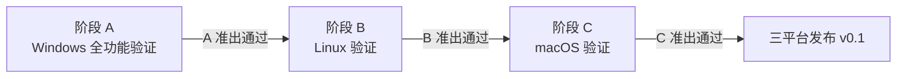

# hzip 测试方案及用例

| 项目 | 内容 |
|---|---|
| 文档版本 | v0.1（供审核） |
| 上游文档 | [01-总体架构设计.md](01-总体架构设计.md) §11、[02-程序详细设计.md](02-程序详细设计.md) |
| 范围 | 分层测试策略 + 结构化用例目录（可直接导入测试管理/issue 模板） |

---

## 第一部分 测试方案

### 1.1 分层策略（摘要）

| 层级 | 对象 | 工具/载体 | 运行时机 |
|---|---|---|---|
| L1 单元 | 各 crate 内部函数 | `#[cfg(test)]` + proptest | 每次提交 |
| L2 一致性 | 各 `hzip-fmt-*` 对 `hzip-format` 契约 | `hzip-format-testkit` | 每次提交（抽样）/ nightly（全量） |
| L3 集成 | hzip-core 编排逻辑 | mock handler + 真实档案 | 每次提交 |
| L4 交叉 | 与 7-Zip/unrar/xz/zstd 等外部工具双向验证 | CI 安装外部 CLI | PR 抽样 / nightly 全矩阵 |
| L5 E2E | hzip-cli / hzip-gui | assert_cmd / GUI 冒烟 | 每次提交 |
| L6 专项 | fuzz / 性能基准 / 覆盖率 | cargo-fuzz / criterion / llvm-cov | 定时 |

完整策略（金字塔、CI 编排、覆盖率门禁）见架构文档 §11，本文不重复；本文聚焦**用例目录**。

### 1.2 测试环境矩阵

| 维度 | 取值 |
|---|---|
| OS | **Windows 10/11（阶段 A 主验证平台，先行）**、Ubuntu 22.04/24.04（阶段 B）、macOS 13/14（阶段 C） |
| 架构 | x86_64、aarch64 |
| 外部基准工具 | 7-Zip 25.01（锁定版本）、WinRAR 7.x（Windows，仅黄金集生成）、unrar 7.x、GNU tar/gzip/bzip2/xz、zstd CLI、Info-ZIP |
| 文件系统 | NTFS、ext4、APFS（覆盖大小写敏感性差异：macOS/APFS 默认不敏感，Linux 敏感） |

### 1.3 平台分阶段测试策略（Windows 先行）

按确认的验证节奏，平台验证分三个阶段**串行**推进，每阶段有独立进入/准出条件：

| 阶段 | 范围 | 进入条件 | 准出条件 |
|---|---|---|---|
| **A：Windows** | 本文**全部**通用用例（TC-CONF/ALG/X/SEC/CORE/CLI/GUI/PERF）+ §2.10 TC-WIN 专项，在 Windows 10 与 Windows 11 双版本执行 | CLI/GUI 可安装运行 | 通用 P0 全通过、P1 ≥ 95%；TC-WIN 专项全绿；MSI 安装/卸载/升级验证通过 |
| **B：Linux** | 通用用例平台无关子集 + TC-LIN 专项（Ubuntu 22.04/24.04，x86_64 与 aarch64） | 阶段 A 准出 | 通用 P0 全绿；TC-LIN 全绿；deb/rpm/AppImage 三包安装验证 |
| **C：macOS** | 通用用例平台无关子集 + TC-MAC 专项（Intel + Apple Silicon） | 阶段 B 准出 | 通用 P0 全绿；TC-MAC 全绿；公证/Gatekeeper 验证通过 |

配套规则：

1. **用例平台标注**：用例目录默认「全平台」；仅某平台有意义的行为已在用例预期中注明平台分支（如保留设备名在 unix 上放行的对照断言）；阶段 B/C 只需重跑通用 P0 + P1 抽样 + 平台专项，不重复全量。
2. **缺陷平台归属**：阶段 A 发现的缺陷标注 `platform:windows` 或 `platform:all`；`all` 类缺陷在 B/C 阶段强制回归。
3. **parity 测试是跨阶段安全网**：02 文档 §5.2 的三平台一致性表在 CI 常跑三平台，阶段 B/C 的大部分平台差异已被前移消化，缩短串行等待。
4. 阶段 A 期间 Linux/macOS 的 CI **构建**持续保持绿灯（不阻塞），只冻结「平台准出判定」。

### 1.4 测试资产规范

- `tests-assets/gen/`：矩阵生成脚本（Rust bin），**所有档案可重新生成**，禁止手改二进制；
- `tests-assets/golden/`：外部工具产出的黄金档案，每项附 `expected.json`（条目清单 + 逐文件 sha256 + 元数据）；
- `tests-assets/malicious/`：安全用例专用（zip-slip、炸弹、畸形档案），来源：自构造 + 部分采用公开 CVE 样本，目录内附 README 说明构造方法；**该目录不入库**（`.gitignore`）⇒ 需要真实档案的用例要么**在测试内自造**（现状：`hzip-core/tests/malicious_extract.rs` 的 `build_ratio_bomb`/`build_total_bomb`），要么在本地先跑生成器；其余安全用例走内嵌等价字面量表（`malicious_replay.rs`）；
- 黄金集 license：档案内容全部为自造数据（随机/文本样本），不含第三方版权材料。
- **样本以「字节」参与断言 ⇒ 样本目录一律标 `-text`**（`.gitattributes`：
  `crates/*/tests/fixtures/**`、`crates/*/src/tests/data/**`）。理由：文本型样本（如
  `zipcrypto-7z.plain.txt`）不显式标 `-text` 时，Windows 检出（`core.autocrlf=true`，
  GitHub 的 windows runner 即如此）会把它写成 **CRLF**，而档案内部存的是 **LF** ⇒
  `assert_eq!(解压结果, include_bytes!(样本))` 必红，且失败文本是几百字节数组差、
  看起来像「解密/解析错了」。2026-10-13 实例：该样本被检成 CRLF ⇒
  `hzip-fmt-zip --test zipcrypto::zipcrypto_correct_password` 与
  `hzip-cli --test e2e::tc_cli_009_password_channels` 同因失败；Linux/macOS runner 不转换
  ⇒ 那两腿全绿，是「只在 Windows 腿红」的典型指纹。两条用例各带一条「样本是否被 EOL
  转换」的前置自检，把这类失败一句话说清。

### 1.5 缺陷管理与准出标准

| 阶段 | 进入条件 | 准出条件 |
|---|---|---|
| M1（CLI 可用） | 代码冻结分支 | P0 用例通过率 100%；P1 ≥ 95%；无未修复安全类缺陷（`SEC-*`） |
| M2（全格式） | 同上 | 交叉测试（L4）矩阵全绿；黄金集通过率 100% |
| M3（GUI） | 同上 | GUI 冒烟全绿；手工检查单三平台签字 |
| M4（v0.1 发布） | 同上 | 全部 P0/P1 用例通过；覆盖率达标（core ≥ 90%、fmt/codec ≥ 85%）；性能基准无回归 |

缺陷分级：`S0 崩溃/数据损坏`（24h 内修复）、`S1 功能不可用`（版本内修复）、`S2 体验问题`、`S3 建议`。

---

## 第二部分 用例目录

### 2.0 用例字段约定

每条用例：**ID | 标题 | 前置与步骤 | 预期结果 | 级别**。级别：P0 = 发布门禁，P1 = 重要，P2 = 补充。自动化列均指已规划的自动化层级（L1–L5），`手工` 表示发布前人工执行。

---

### 2.1 格式一致性套件（TC-CONF，L2，testkit 对每个格式 crate 自动展开）

cpio（只读格式，无写侧）的素材由 `hzip_format_testkit::cpio` 直接拼字节：见 02 §8.6。

套件共 10 组基础用例，格式 × 套件展开（如 `TC-CONF-003-7z` 表示 7z 的选择性解压用例）。表中「适用格式」列注例外。

| ID | 标题 | 前置与步骤 | 预期结果 | 级别 |
|---|---|---|---|---|
| TC-CONF-001 | 元数据完整性 | 打开测试档案（含空文件/目录/符号链接/中文名），读取 entries | 字段齐全且类型合法：`size_packed ≤ 合理上限`、mtime 在 [1980, now+1d]、id 连续不重复 | P0 |
| TC-CONF-002 | 全量 roundtrip | 写入混合内容档案 → 重新打开 → 全量解压 → 逐文件 sha256 比对 | 全部一致；元数据（mtime ±2s、mode、symlink）保留 | P0 |
| TC-CONF-003 | 选择性解压 | 档案含 100 条目，仅解压 id=5、id=50 | 只有 2 个条目落盘；其余路径不存在 | P0 |
| TC-CONF-004 | 乱序与重复读取 | `read_entry` 按 id 逆序、重复、交叉读取 | 各次结果字节一致，互不干扰 | P1 |
| TC-CONF-005 | 追加条目 | 适用：zip、tar（未压缩）。向已有档案追加 1 文件 | 旧条目不变，新条目可读（rar/7z 应报 `Unsupported`，适用性检查） | P1 |
| TC-CONF-006 | 中途取消 | 解压大档案（>200 MiB）在 30% 处触发 cancel | 100 ms 内停止返回 `Cancelled`；已解压半文件被清理 | P0 |
| TC-CONF-007 | 错误密码 | 加密档案用错误密码 open/extract | 返回 `Password` 错误（HZ-3101）；无输出文件；不超时 | P0 |
| TC-CONF-008 | 畸形输入 | 对黄金档案逐字节截断（10%、50%、末字节）与随机位翻转（每档案 20 处） | 全部返回 `Format`/`Checksum` 错误，**无 panic**（catch_unwind 计数为 0） | P0 |
| TC-CONF-009 | 编辑原子性 | 适用：zip/7z。执行 `EditSave` 替换条目，注入写盘 IO 错误 | 原档案字节不变；临时文件被清理 | P0 |
| TC-CONF-010 | 列表零 IO | 构造含大条目档案，记录 `entries()` 耗时 | 列表耗时与数据区大小无关（< 1s @ 1 GiB 档案，头部加密除外） | P1 |

---

### 2.2 算法矩阵（TC-ALG，L2/L4，nightly 全量）

生成器维度：`格式 × 算法/级别 × 文件形态 × 文件名`。下表列出矩阵锚点用例（其余由生成器展开，命名 `TC-ALG-{格式}-{算法}-{级别}`）。

| ID | 标题 | 前置与步骤 | 预期结果 | 级别 |
|---|---|---|---|---|
| TC-ALG-001 | zip × deflate × 6 级别 | 混合内容（文本/二进制/空/全零）分别在 Store/Fastest/Fast/Normal/Max/Ultra 创建并解压 | roundtrip 字节一致；压缩率随级别单调不减（全零样本上验证） | P0 |
| TC-ALG-002 | zip × bzip2 / zstd / lzma（zipx 方法） | 启用 zipx feature，创建方法 ID 12/93/14 的档案 | hzip 自解压一致；`7z t` 通过（TC-X-020 联动） | P1 |
| TC-ALG-003 | 7z × lzma2 × 级别与字典映射 | 每级别创建，检查 header 中 dict size 与级别映射表一致 | 映射符合 02 文档 §6.5 定义；roundtrip 一致 | P0 |
| TC-ALG-004 | 7z × lzma + BCJ2 | 对含 PE/ELF/Mach-O 可执行样本压缩 | 解压字节一致；压缩比显著优于纯 lzma（可执行样本上 ≥ 5% 提升） | P1 |
| TC-ALG-005 | 7z 固实模式 | 100 个相似文本文件 solid on/off 对比 | roundtrip 一致；solid 压缩率优于非 solid | P2 |
| TC-ALG-006 | tar × 5 种压缩组合 | tar、tar.gz、tar.bz2、tar.xz、tar.zst 各创建解压 | 目录结构、权限（unix）、mtime 保留 | P0 |
| TC-ALG-007 | 单文件流 gz/bz2/xz/zst | `a.txt` 压缩为各格式再解压 | 还原为 `a.txt`；gzip/xz 的 mtime 从流头恢复 | P0 |
| TC-ALG-008 | 级别边界 | Level 取值 0 与最大值的边界 + 非法值 | 非法值被 CLI/Engine 层拒绝（HZ-5003 类），不进格式层 | P1 |
| TC-ALG-009 | 不可压缩数据 | 1 GiB 随机数据 Normal 级压缩 | 成功（无 ratio 误报）；压缩率 ≈ 1.0；不触发配额 | P1 |
| TC-ALG-010 | 空档案 | 空目录列表创建档案（zip/7z/tar） | 创建成功；entries=0；再次打开合法 | P0 |
| TC-ALG-011 | 超大单文件 | 10 GiB 单文件（稀疏生成）zip Normal | 解压 sha256 一致；进度 total 正确；内存占用平稳（< 512 MiB RSS） | P1 |
| TC-ALG-012 | 数万小文件 | 50,000 × 512B 文件 | roundtrip 一致；条目数正确；无句柄泄漏（ulimit 验证） | P1 |
| TC-ALG-013 | 文件名形态矩阵 | 名含：中文/emoji/空格/制表符/259 字符（win 短路径边界）/260+（长路径）/前后空格 | 全部合法落盘（前导/尾空格在 Windows 截断并 warning）；长路径在 `\\?\` 下成功 | P0 |
| TC-ALG-014 | 符号链接保留 | unix 下含 指向档案内/外 的 symlink | 按策略：内部链接原样恢复；外部链接拒绝（HZ-4002）或降级（配置项） | P0 |
| TC-ALG-015 | 分卷矩阵 | 7z/zip 分卷：卷大小 < 单文件 / 介于两文件之间 / > 总量 | 均成功；`TC-CONF` 套件在卷集合上重放通过 | P1 |

---

### 2.3 外部工具交叉测试（TC-X，L4，核心门禁，见架构文档 D8）

| ID | 标题 | 前置与步骤 | 预期结果 | 级别 |
|---|---|---|---|---|
| TC-X-001 | 7z→hzip 全矩阵 | CI 用 `7z a` 生成 zip/7z（deflate/bzip2/zstd/lzma/lzma2/ppmd×全级别）档案，hzip 解压 | 逐文件 sha256 与源一致（**7z 专有 ppmd 档案可返回 Unsupported，须明确报错而非乱码**） | P0 |
| TC-X-002 | hzip→7z 全矩阵 | hzip 产出全部可写格式档案 | `7z t` 退出码 0；`7z x` 解压 sha256 一致 | P0 |
| TC-X-003 | 7z→hzip 加密档案 | 7z 产 AES zip / AES+头加密 7z（密码中英混合） | 正确密码解压一致；错误密码报 HZ-3101 | P0 |
| TC-X-004 | hzip→7z 加密档案 | hzip 产 AES zip（128/192/256 key 长度）与 AES 7z | 7-Zip 可解压且 sha256 一致（WinZip AES KV 兼容性验证） | P0 |
| TC-X-005 | 7z→hzip 分卷 | `7z a -v1m` 产分卷 7z/zip | hzip 自动识别卷集合并解压 | P1 |
| TC-X-006 | unrar→hzip | unrar CLI 产 rar4/rar5（含加密、分卷） | hzip 解压一致；rar5 默认格式样本必测 | P0 |
| TC-X-010 | GNU 工具→hzip | `tar czf/jcJf` 与 `gzip/bzip2/xz/zstd` 单文件流 | hzip 解压一致，含 GNU/pax 变体、mtime 恢复 | P0 |
| TC-X-015 | GNU cpio→hzip | `find . \| cpio -o -H newc/crc/odc/bin` 四变体 + `gzip` 组合档；7-Zip `l` 对照 | hzip 列表/解压一致（sha256），条目集与 `7z l` 相符；条目内含 `.` 根条目时列表不得报错 | P0 |
| TC-X-011 | hzip→GNU 工具 | hzip 产 tar.gz/tar.xz/tar.zst | 对应 CLI `tar tvf`/`zstd -t` 通过 | P1 |
| TC-X-012 | Windows 系统 zip→hzip | 资源管理器「压缩为 ZIP」产物（deflate64 样本附黄金集） | hzip 解压一致 | P0 |
| TC-X-013 | macOS 归档→hzip | macOS「压缩」产物（含 `__MACOSX` 与资源叉条目） | 正常解压；`__MACOSX` 目录按配置默认隐藏于列表 | P1 |
| TC-X-014 | Bandizip zipx→hzip | Bandizip 产 zipx（LZMA 方法）样本（黄金集） | P2 阶段支持解压；不支持时明确 Unsupported | P1 |
| TC-X-020 | 多层组合 | `7z a` 的 tar.gz 内含 tar.gz（两层嵌套） | 嵌套浏览/解压正常，装配深度 ≤ 3 防护生效 | P1 |
| TC-X-030 | 版本锁定回归 | 7-Zip 升版后重跑 TC-X-001~005 | 矩阵全绿（版本变更流程验证） | P1 |

---

### 2.4 安全用例（TC-SEC，L1/L3，含恶意档案语料）

| ID | 标题 | 前置与步骤 | 预期结果 | 级别 |
|---|---|---|---|---|
| TC-SEC-001 | 路径穿越 ../ | 档案条目名 `../../etc/evil`、`a/../../../b` | HZ-4001 拒绝；目标位置无任何写入 | P0 |
| TC-SEC-002 | 绝对路径条目 | `/etc/passwd`、`C:\Windows\evil`、`\\server\share\x` | HZ-4001 | P0 |
| TC-SEC-003 | Windows 保留名 | `CON`、`con.txt`、`NUL.bin`、`COM1` | HZ-4003；unix 上正常落盘（平台差异正确） | P0 |
| TC-SEC-004 | NUL 与控制字符 | 条目名含 `\0`、`\r\n`（伪造列表项） | 拒绝或净化；列表显示不注入（GUI 列表以纯文本渲染验证） | P0 |
| TC-SEC-005 | zip 炸弹（比率） | 高比率嵌套压缩构造 ratio 500:1（上限 200） | HZ-4503；已写文件清理 | P0 |
| TC-SEC-006 | zip 炸弹（总量） | 42 KB → 4 PB 经典构造样本 | HZ-4502 触发于默认 128 GiB 限额内 | P0 |
| TC-SEC-007 | 炸弹白名单 | 正当高压缩内容（1 GiB 全零） | **不误伤**：正常解压（quota 检查点语义验证） | P0 |
| TC-SEC-008 | 条目数炸弹 | 10 万空条目（限 100 万内）+ 200 万条目样本 | 前者成功后者 HZ-4503(max_entries) | P1 |
| TC-SEC-009 | 符号链接逃逸 | tar 含 `ln -s / pwn` 后续条目写 `pwn/etc/evil` | HZ-4002；`/etc/evil` 不存在 | P0 |
| TC-SEC-010 | Windows 长路径 | 260/1024/32767 字符路径解压（win-long-path on/off） | on 全部成功；off 明确报错不截断 | P0 |
| TC-SEC-011 | 大小写冲突卷 | mac/win 上档案含 `A.txt`+`a.txt` | RenameAuto 生效或按策略询问，无静默覆盖 | P1 |
| TC-SEC-012 | 净化属性测试 | proptest：随机畸形段生成（含 Unicode 同形字符、`..%5c` 编码变体） | sanitize 输出必在 dest 内或拒绝（10 万次生成零逃逸） | P0 |
| TC-SEC-013 | 密码内存清零 | debug 构建 + 自定义分配器追踪 | 密码缓冲 drop 后内存模式为 0；日志/错误信息中无密码明文 | P1 |
| TC-SEC-014 | 磁盘空间预检 | 目标盘 mock 满 | HZ-1002 预检拦截，未开始写入 | P1 |
| TC-SEC-015 | 临时目录越权 | TempArea 恶意条目名注入路径 | materialize 路径净化生效，无法逃出会话目录 | P1 |

---

### 2.5 hzip-core 业务用例（TC-CORE，L3，mock handler）

| ID | 标题 | 前置与步骤 | 预期结果 | 级别 |
|---|---|---|---|---|
| TC-CORE-001 | 智能解压-单顶层目录 | 档案 `root/a`、`root/b` | 直接展开（dest 下即 a、b） | P0 |
| TC-CORE-002 | 智能解压-散文件 | 档案 `a.txt`、`dir/b.txt` | 包一层 `{档案名}/` | P0 |
| TC-CORE-003 | 智能解压-单文件 | 档案仅 `a.txt` | 直接展开；`--flat`/关闭开关后行为对照 | P0 |
| TC-CORE-004 | 冲突-RenameAuto 幂等 | 目标已有 `a.txt`、`a (2).txt` | 新文件命名为 `a (3).txt`；并发场景不重名（proptest） | P0 |
| TC-CORE-005 | 冲突-Ask 回调 | mock 请求通道，延迟应答 Overwrite | 期间任务处于 WaitingInput 不占 CPU；应答后继续 | P1 |
| TC-CORE-006 | 冲突-Ask 超时 | 不应答等待 120s（测试缩短为 2s） | 任务 Failed（HZ-5002），无半写文件 | P1 |
| TC-CORE-007 | 部分失败汇总 | mock 100 条目中 3 条返回 Checksum | 任务 PartialDone；报告含 3 条明细；CLI 退出码 1 | P0 |
| TC-CORE-008 | best-effort 开关 | 同上场景开启 best_effort | 3 条失败计入报告但任务 Done；报告标注 skipped | P1 |
| TC-CORE-009 | 取消回滚 | 解压中 cancel，检查半写文件 | Cancelled + 已写不完整条目删除；完整条目保留（策略配置） | P0 |
| TC-CORE-010 | 进度守恒 | 订阅事件流验证 | Σbytes_delta == total_bytes（Done 时相等）；事件顺序合法（job 状态机穷举验证） | P0 |
| TC-CORE-011 | 级联取消 | 提交 3 任务，取消父令牌 | 3 任务全部进入 Cancelled；队列中未启动任务直接移除 | P1 |
| TC-CORE-012 | 并发上限 | 池上限 2，提交 5 任务 | 同时 Running ≤ 2；完成顺序无关但全部完成 | P1 |
| TC-CORE-013 | panic 隔离 | mock handler 在 extract 中 panic | Job Failed（含诊断）；进程存活；后续任务正常 | P0 |
| TC-CORE-014 | 取消延迟 | 各格式实现 1 GiB 档案解压中取消 | 全部 < 100 ms 返回（一致性套件 TC-CONF-006 的 core 层重放） | P0 |
| TC-CORE-015 | GBK 编码修复 | zip 内 GBK 名条目（chardetng 置信度 > 0.8 样本） | 列表与解压为正确 UTF-8；`--codepage gbk` 强制路径验证 | P0 |
| TC-CORE-016 | 编码低置信度 | 短名歧义样本（如 2 字节名） | 保留原名 + 可疑标记；不崩溃不乱猜 | P1 |
| TC-CORE-017 | 嵌套档案类型装配 | 打开 `x.tar.gz`，sniff 两层 | Reader 为组合装配；深度 4 层样本触发 Quota 防护 | P1 |
| TC-CORE-018 | 编辑保存流程 | materialize → 修改 → rewrite → 原子替换 | 新档案条目内容为编辑后版本；mtime/CRC 更新；原档失败保护（TC-CONF-009） | P0 |
| TC-CORE-019 | 编辑外部修改检测 | TempArea watch + 500ms 去抖 | 多次保存只触发一次确认请求 | P2 |
| TC-CORE-020 | 孤儿临时目录清理 | 伪造 PID 不存在的 hzip 临时目录后启动 | 启动时被清理；存活会话目录不受影响 | P1 |
| TC-CORE-021 | 错误码三处一致性 | 比对 02 文档附录 A / `code.rs` 常量 / i18n 条目 | 三处错误码集合与语义完全一致（登记制门禁，见 02 附录 A.2） | P1 |

---

### 2.6 CLI 端到端用例（TC-CLI，L5，assert_cmd）

| ID | 标题 | 前置与步骤 | 预期结果 | 级别 |
|---|---|---|---|---|
| TC-CLI-001 | c 基本压缩 | `hzip c -f zip -o a.zip dir/` | 退出码 0；产物可被 `hzip l` 列出 | P0 |
| TC-CLI-002 | x 智能解压 | 上一产物 `hzip x a.zip` | 目标目录结构符合 SmartExtract 预期 | P0 |
| TC-CLI-003 | l 列表与 tree | `hzip l a.zip --tree` | stdout 列表/tree 渲染正确；`--json` 输出符合 schema 且可反序列化 | P0 |
| TC-CLI-004 | p 预览管道 | `hzip p a.zip dir/b.txt > out` | stdout 字节等于条目内容；`--max-bytes` 截断生效 | P0 |
| TC-CLI-005 | t 测试 | 正常与 CRC 损坏档案 | 正常退出 0 并输出统计；损坏退出 1 且指明条目 | P0 |
| TC-CLI-006 | cv 转换 | `hzip cv a.zip --to 7z -L 9` | 产物为合法 7z（`7z t` 验证）；条目集一致 | P1 |
| TC-CLI-007 | 退出码契约 | 分别构造成功/部分失败/参数错/Ctrl-C | 0 / 1 / 2 / 130 | P0 |
| TC-CLI-008 | stdin/stdout 流 | `hzip x - < a.zip` 与 `-o -`（单条目） | 管道模式工作；无 TTY 时不等待交互输入 | P0 |
| TC-CLI-009 | 密码三通道 | `--password-env`/环境变量/Ask（stdin 提示） | 三通道均正确；错误密码退出码 2 且 stderr 有建议文案 | P0 |
| TC-CLI-010 | --json 进度分离 | `--json 2>prog.ndjson` | stdout 纯结果 JSON；stderr NDJSON 进度流 | P1 |
| TC-CLI-011 | glob 排除 | `--exclude "*.tmp" --exclude "sub/*"` | 排除规则命中；空结果给 warning | P1 |
| TC-CLI-012 | 无 TTY 交互保护 | CI 环境触发 Ask 冲突且未提供决策参数 | 直接按默认策略 Skip 并 warning，不挂起（超时看门狗验证） | P0 |
| TC-CLI-013 | 帮助与错误提示快照 | 全子命令 `--help`、典型错误输入 | insta 快照匹配（i18n zh/en 两套） | P2 |
| TC-CLI-014 | 大文件进度与速度显示 | 终端模式解压 1 GiB | 进度条刷新、速度与剩余时间合理（≈ 实测 ±20%） | P2 |
| TC-CLI-015 | 信号处理 | 发送 SIGINT/SIGTERM（posix）与 Ctrl-C（win） | 走取消流程（清理半写）后退出 130，非硬中断 | P0 |

---

### 2.7 GUI 用例（TC-GUI，L5 冒烟 + 手工检查单）

自动化冒烟（三平台 CI，Linux 用 xvfb）：

| ID | 标题 | 步骤 | 预期结果 | 级别 |
|---|---|---|---|---|
| TC-GUI-001 | 启动冒烟 | 启动 hzip-gui | 主窗口 3s 内出现，无崩溃报告 | P0 |
| TC-GUI-002 | 打开档案 | 打开固定 zip/7z/rar | 条目数与 expected.json 一致 | P0 |
| TC-GUI-003 | 拖放接收 | 拖入目录 | 弹出压缩对话框且路径正确 | P1 |
| TC-GUI-004 | 压缩任务全流程 | 对话框默认参数压缩 | 任务中心出现进度 → 完成 → 产物可再打开 | P0 |
| TC-GUI-005 | 密码弹窗联动 | 解压加密档案 | Password 请求弹窗出现；输入后继续；取消则任务取消 | P0 |
| TC-GUI-006 | 预览三视图 | 文本/图片/二进制条目各预览 | 对应视图正确；大文件截断提示 | P1 |
| TC-GUI-007 | 数万条目性能 | 打开 5 万条目档案 | 列表滚动流畅（VirtualList 生效，帧时间 < 33ms） | P1 |
| TC-GUI-008 | 主题与语言切换 | 设置中切换深色/浅色、中/英 | 全窗口即时生效无残缺 | P2 |

手工检查单（每平台发布前执行并归档录屏，见架构文档 §11.6）：

| ID | 项目 | 覆盖 |
|---|---|---|
| TC-GUI-101 | 右键菜单 | 目录/文件右键的压缩/解压/预览入口；含中文路径与空格路径 | 
| TC-GUI-102 | 双击关联 | 各格式双击进入 hzip 浏览；解除关联恢复 |
| TC-GUI-103 | 双击打开+编辑保存 | 档案内文本编辑保存回档案全流程（D11） |
| TC-GUI-104 | 拖出即解压 | 拖条目到资源管理器/桌面 |
| TC-GUI-105 | HiDPI/多显示器 | 150%/200% 缩放渲染 |
| TC-GUI-106 | 卸载残留 | 卸载后无临时目录/注册表/配置残留 |

**界面锚点用例只认 debug 档**（2026-10-13 实测）：`ui/` 下的渲染契约用例（tab 栏/工具栏/列表行/
设置页…）靠 `VisualTestContext::debug_bounds("锚点名")` 取元素边界，而 gpui-pre 的 `Div::debug_selector`
是 `#[cfg(any(test, all(debug_assertions, feature = "test-support")))]`——**release 下有意为 no-op**
（上游注释：省掉每帧记边界的开销，好让 `test-support` 留在 release 依赖图里）。故
`cargo test --release -p hzip-gui` 下 `debug_bounds` 恒为 `None`，实测 **55 条**用例整片报
「锚点缺失/…未绘制」，根因与产品代码无关。现已在 `crates/hzip-gui/src/lib.rs` 用
`#[cfg(all(test, not(debug_assertions)))] compile_error!` 把这一组合挡在编译期（附原因与替代跑法）；
release 档的行为验证走「`cargo build --release` + 手工检查单」，release 档要跑非界面用例用
`cargo test --release -p <crate>`。

---

### 2.8 性能基准（TC-PERF，L6，criterion，周基线对比）

| ID | 基准 | 通过标准 |
|---|---|---|
| TC-PERF-001 | codec 吞吐（deflate/bzip2/xz/zstd 各级别） | 与基线偏差 > 10% 告警 |
| TC-PERF-002 | zip/7z 解压 1 GiB 混合档案 | 与 7-Zip 同任务耗时比 ≤ 1.5x（记录用，超标告警） |
| TC-PERF-003 | 列表打开 10 万条目档案 | < 2s |
| TC-PERF-004 | 启动时间（冷/热） | GUI 冷启动 < 1.5s |
| TC-PERF-005 | 内存峰值（10 GiB 档案解压） | RSS < 512 MiB |
| TC-PERF-006 | BCJ2 压缩比基准（vs 7-Zip） | 7z LZMA+BCJ2 档案压缩率差距 ≤ 2%（M4 验收项） |

---

### 2.9 Fuzz 目标（TC-FUZ，L6，每日定时批次）

| ID | 目标 | 语料 |
|---|---|---|
| TC-FUZ-001 | zip 解析器 | 黄金集最小化语料 + corpus 持续累积 |
| TC-FUZ-002 | 7z 解析器 | 同上 |
| TC-FUZ-003 | tar 解析器（含 GNU/pax 变体） | 同上 |
| TC-FUZ-004 | rar 绑定层（C 边界） | 黄金 rar 语料；crash 自动最小化并建 issue |
| TC-FUZ-005 | 路径净化函数 | proptest 与 fuzz 双轨（结构化生成优先） |

---

### 2.10 平台专项用例（阶段 A/B/C）

#### 2.10.1 TC-WIN —— Windows 专项（阶段 A，先行验证）

| ID | 标题 | 前置与步骤 | 预期结果 | 级别 | 类型 |
|---|---|---|---|---|---|
| TC-WIN-001 | 长路径全链路 | 解压含 260/1024/32767 字符路径的档案（win-long-path on） | 全部成功；列表/日志显示无 `\\?\` 前缀污染 | P0 | 自动 |
| TC-WIN-002 | 保留设备名净化 | 解压含 `CON`、`con.txt`、`NUL.bin`、`COM1` 条目 | HZ-4003 拒绝且错误信息指明条目名；无任何设备读写 | P0 | 自动 |
| TC-WIN-003 | 中文与 GBK 全链路 | ① 中文用户名目录（`C:\Users\张三\`）下压缩解压；② GBK 文件名 zip 修复；③ 中文密码加密解密 | 三场景全部正确；CLI 输出无乱码（chcp 65001 与默认代码页双验证） | P0 | 自动 |
| TC-WIN-004 | Windows 自带 zip 兼容 | 资源管理器「压缩为 ZIP」产档案 → hzip 解压；hzip 产 zip → 资源管理器双击进入 | 双向兼容；中文/空格路径正确 | P0 | 自动+手工 |
| TC-WIN-005 | 右键菜单（D4） | 对**文件**与**目录**分别右键：压缩为 xxx / 解压到当前目录 / 解压到 `文件夹\` / 预览 | 四入口全部出现且功能正确；含中文与空格路径；多选文件批量压缩 | P0 | 手工 |
| TC-WIN-006 | 文件关联（应用即接管默认） | 设置 → 文件关联 勾选后点「应用关联」→ 资源管理器双击 `.tar`（无 UserChoice）与 `.zip`（原被 Bandizip 占 UserChoice）都应进入 hzip 浏览；「解除关联」恢复原程序（含已取消勾选的格式） | 应用后 `FileExts\.<ext>\UserChoice` 被清除、`.ext\(Default)` 生效，**不弹 UAC**（DACL 只 Deny SetValue；实测 `delete_subkey_all` 通过）；Explorer 无需重启（`SHChangeNotify`）；仅当连 DELETE 被拒时才弹一次 UAC，取消则如实报错；解除关联清掉我们留下的全部痕迹并还原 Top 默认程序；状态行扩展名集合与勾选逐项一致 | P0 | 手工 + 自动（`assoc::win::tests::apply_query_remove_roundtrip`（含 `DefaultIcon` 断言）、`apply_clears_user_choice_and_takes_over`、`remove_cleans_formats_no_longer_ticked`、`dispatch::tests::assoc_failure_message_classifies_reasons`） |
| TC-GUI-104 | 双击内层压缩包（R-GUI2-06） | 打开 `a.zip`（内含 `sub/b.7z`）→ 右栏双击 `b.7z` → 进入内层浏览（标题/面包屑根 = `b.7z`，面包屑 = `a.zip / sub / b.7z`）；`..` 在 `b.7z` 档案根 = **退出该层**（回到 `a.zip` 的 `sub/`，位置不变）；面包屑点 `a.zip` 段同样回外层 | 进入/退出都不丢父层位置；退层后临时目录里解出的 `b.7z` 已删除；**左栏树根仍是最外层 `a.zip`**（子压缩包作为可展开的容器节点挂在 `sub/` 下，图标为压缩包而非文件/文件夹）；内层加密/损坏 → 报错且**不**留下空会话 | P0 | 手工 |
| TC-PRG-001 | 进度百分比按**字节**推进 | 解压一个大档案（> 1 GiB）与单个大单流文件（`.gz`/`.xz`）；压缩一个大目录 | 百分比 = `done/total`（字节），运行期可见中间值（非 0%→100% 跳变）；`total` 未知时显示「…」+ 不确定态滑动（**不得**冒充 0%） | P0 |
| TC-GUI-105 | 打开进度窗（R-GUI2-06） | 打开超大档案（固实 7z / 大 tar.gz）→ 超过 `[jobs].open_show_delay_ms`（默认 250 ms）弹出「正在打开」窗（转圈 + 档案名 + 已耗时）；打开**成功** → 停留 `[jobs].open_close_delay_ms`（默认 100 ms）自动关闭；打开小档案 → **不**弹窗；**超长档案名**（> 窗口宽）→ 名称折行显示不截断，窗口可拖动缩放（2026-09-24 用户口径） | 弹窗期间界面可交互（不卡）；提速/关窗都不影响打开结果；两个延迟只可经配置文件改（设置页无此项）；长名**完整可读**（不省略、不断字符：断行靠零宽空格的合法断点 + 窗口可缩放） | P1 | 手工 |
| TC-GUI-112 | 打开**失败**：窗口不自动关 + 任务中心留痕（2026-09-24 用户口径） | 打开一个必然失败的档案（截断/损坏，或把 `TEMP` 指向不可用目录后打开 `.cpio.gz`） | ① 「正在打开」窗**不自动关**，错误色状态行显示原因（`HZ-xxxx` + 原文 + 落点路径）直到用户点「关闭」/ ✕ / Esc；② 任务中心新增一行：行为「打开」、状态「失败」、失败行显示**同一句原因**；③ 成功打开也记一行（状态「已完成」）；④ 打开行不可取消、不计入活跃徽标 | P0 | 自动（`ui::views::open_progress::tests::failed_window_is_not_closed_automatically`、`viewmodel::jobs_vm::tests::record_open_marks_result_and_reason`、`ui::binding::jobs_row_ui_tests::failure_reason_from_final_line_when_no_entry_failures`） |
| TC-GUI-113 | 面包屑段名过长：中段省略 + 悬停显全名（2026-09-24 用户口径） | 打开名字超长的档案（如 `initramfs-tools_0.142ubuntu25_all_amd64_very_long_archive_name_for_wrap.cpio.gz`）或进多层嵌套容器 | ① 该段显示为 `initramfs-tools…cpio.gz` 形态（**中段**省略，头尾都留）；② 鼠标悬停浮现**完整**名称；③ 短段名不受影响（逐字不变、不挂 tooltip）；④ 每段仍可点击跳转（当前位置段不可点） | P1 | 自动（`ui::widgets::breadcrumb::tests::middle_ellipsis_keeps_head_and_tail`、`middle_ellipsis_leaves_short_names_intact`、`middle_ellipsis_degenerate_max`）+ 手工看观感 |
| TC-GUI-127 | 面包屑分隔符用 `/` 且与段名同基线（2026-10-14 用户口径） | 打开多段路径（档案名 + ≥2 层目录） | ① 段间分隔符是文本 `/`（**不是** `>`/chevron 图标）；② 分隔符与段名**垂直中线一致**（肉眼：不再比段名高/低一截） | P2 | 自动（`ui::widgets::breadcrumb::tests::separator_shares_segment_line`）+ 手工看观感 |
| TC-GUI-114 | 任务中心「失败原因」列（2026-09-24 用户口径） | 造一次失败操作（打开损坏档案 / 智能解压撞名失败）→ 看任务中心该行 | 原因显示在**独立列**（不是行首/行根），其余各列内容不错位；列可拖宽换序；文案为 i18n 原因或带 HZ 码原文；无失败的行该列为空 | P0 | 自动（`ui::binding::jobs_row_ui_tests::failure_reason_from_final_line_when_no_entry_failures`、`ui::views::jobs` 列定义）+ 手工看列对齐 |
| TC-GUI-116 | 进入容器/展开延迟层**不冻界面**（2026-09-24 用户口径） | 打开含大内层容器的组合档（如 1 GB `.cpio.gz`）→ 双击那一行；期间拖动窗口/切页签/开任务中心 | ① 界面全程可交互（不白屏、不无响应）；② 超过门槛后出现「正在打开」窗，明细行显示阶段与已处理字节并**持续更新**；③ 结束后进入内层会话（面包屑 `a.cpio.gz / a.cpio`）；④ 失败不自动关窗且延迟态保留可重试 | P0 | 自动（`ui::shell::tests::run_open_flow_work_runs_off_ui_thread`〔work 必须不在 UI 线程〕、`ui::views::open_progress::tests::detail_line_reports_phase_and_bytes`、`counting_reader_accumulates_read_bytes`）+ 手工看观感 |
| TC-GUI-117 | 会话切换**原子闸**（连点只触发一次） | 对同一容器行**快速双击多次**；再对 `..` 连点两下 | ① 只发生一次会话切换（不出现两次压栈/两个子会话；第二次点击无反应，进度窗仍在）；② `..` 连点不连退两层；③ 闸随操作结束放行（随后单次点击照常生效） | P0 | 自动（`app::state::tests::session_switch_gate_excludes_and_releases_on_drop`）+ 手工连点验证 |
| TC-GUI-128 | 组合档**退回父层再进**：父层结构仍在（2026-10-14 用户实测） | 打开 `a.tgz`（gzip+tar 组合档）→ 双击那一行 `a.tar` 进内层 → 从内层 `..` 退回外层 → **再双击**那一行 | ① 退回后外层仍是「有浏览态 + 停留在延迟层」（`is_open()` 真、`deferred_layer()` = `a.tar`）；② 再进得到的是**那一层自身**的条目（该 tar 的目录结构，含其中的 `ops.tgz` 行），**不是**它某个条目的内容（修前 `read_entry(0)` 撞上内层容器条目空间 ⇒ 父层直接显示子压缩包的 `ops/` 层级）；③ 反复「退出→再进」多次结果稳定；④ 面包屑/标题显示**就地展开这一层**的名字（`a.tgz › a.tar`，不是 `a.tgz › a.tgz`） | P0 | 自动（`ui::shell::tests::composite_parent_reenter_keeps_its_own_layer`、`viewmodel::main_vm::tests::composite_open_defers_inner_container`）+ 手工用 `bh_auto_ops.itr2.x86_64.tgz` 复现 |
| TC-GUI-115 | 组合档**延迟展开**（2026-09-24 用户口径） | 打开 `.cpio.gz`（大档更明显）→ 观察列表/树；再双击 `*.cpio` 那一行 | ① 打开**毫秒级**，列表/树只有一行 `*.cpio`（容器行：归档图标、类型列显格式名）；② 双击它才加载：弹出「正在打开」进度窗，随后看到 cpio 内真实结构（嵌套层：面包屑 `a.cpio.gz / a.cpio`、`..` 退出该层）；③ 展开失败（源被删/临时盘不足）→ 窗口报因且延迟态保留，可再点 | P0 | 自动（`viewmodel::main_vm::tests::composite_open_defers_inner_container`）+ 手工看观感 |
| TC-GUI-118 | UI 线程**滞后看门狗**（2026-09-24 审计落地） | 构造一次 UI 线程长帧（如打开万级条目档案、或在调试版里手动 sleep）→ 查 `hzip-YYYY-MM-DD.log` | 超过 150 ms 记 warn、超过 500 ms 记 error，条目含**块名**（`主窗口渲染` / `泵批处理(行重建+快照)`）与毫秒数；正常交互不产出卡顿级日志 | P1 | 自动（`app::ui_lag::tests::{thresholds_are_half_and_full_second_scale, guard_measures_elapsed_and_drops_cleanly}`）+ 手工看日志 |
| TC-GUI-119 | 复制选中条目**不卡界面**（2026-09-24 审计 B4） | 选中若干大条目 → Ctrl+C（或右键「复制」） | ① 立即出现「复制条目」进度窗（明细「正在解出选中条目…」）；② 期间主界面可交互；③ 完成后进入内部/系统剪贴板并自动关窗；④ 连点 Ctrl+C 只触发一次；⑤ 任务中心有 `复制` 行，失败带原因 | P0 | 自动（`app::state::tests::session_switch_gate_excludes_and_releases_on_drop`、`ui::views::open_progress::tests::*`）+ 手工连点/大条目验证 |
| TC-GUI-121 | 编辑后**会话保活重开**不卡界面（2026-09-24 审计 B3） | 打开大档案 → 添加/删除条目提交完成（会话被释放） | ① 提交后界面不冻结；② 会话静默恢复（条目集为编辑后的新集）；③ 保活期间不重复起线程（在同飞期内多次泵 tick 只放行一次）；④ 重开失败时行集清空但**下次仍可再试** | P0 | 自动（`app::state::tests::browse_session_reopen_request_only_when_released_and_deduped`）+ 手工 |
| TC-GUI-126 | **换会话不被旧操作干扰**（2026-09-24 用户实测 B23） | ① 打开 `a.cpio.gz`（**不展开**内层）→ ② 立刻打开 `b.qcow2.gz` | ① 进度窗显示的是**新档案**的名字，旧档案的窗立刻消失；② 最终会话是 `b.qcow2.gz`（旧流程后落地也会被丢弃）；③ 任务中心只有新档案的打开记录；④ 嵌套会话栈清空（面包屑不含旧档案层级）；⑤ 同一档案连点两次不重复起线程 | P0 | 自动（`app::state::tests::session_switch_epoch_supersedes_stale_flows`、`reset_nested_sessions_drops_frames_and_temp_files`、`ui::views::open_progress::tests::close_by_label_only_closes_matching_window`）+ 手工按①→②复现 |
| TC-GUI-122 | 大行集**泵批不卡界面**（2026-09-24 审计 B5/B9） | 万级以上条目档案里展开目录/切过滤/切语言 | ① 界面持续可交互（行重建在后台）；② 行集最终正确（懒建树/搜索/目录聚合）；③ 同一批多窗口请求只跑一次重建 | P0 | 自动（`ui::shell::tests::*` 既有行重建用例 + 手工）+ 看门狗日志无卡顿 |
| TC-GUI-123 | 预览大载荷**不卡界面**（审计 B16/B17） | 预览 8 MB 图片 / 大 HEX 文件 → 反复切视图/缩放 | ① 首帧与后续帧无长帧（图片解码/HEX 格式化在后台一次完成）；② 视图切换即时；③ 解码失败显示占位 | P1 | 自动（`ui::views::preview::tests::payload_from_preview_branches`〔预封 RenderImage〕）+ 手工 |
| TC-GUI-124 | 设置写盘**不卡界面**（审计 B6/B15） | 连点多个设置开关；拖动分栏；随后退出 | ① 点击无写盘卡顿；② 退出后配置里是**最后一次**值（flush 收口）；③ 分栏拖动中不写盘，松手后落盘一次 | P1 | 自动（`hzip_config::tests::save_async_coalesces_and_flush_persists_latest`、`load_cache_sees_external_edit`）+ 手工 |
| TC-GUI-125 | 菜单「刷新」真生效（审计 B20） | 外部改动档案后点菜单「刷新」（或 Ctrl+R） | ① 弹出「刷新」进度窗并真的重读；② 任务中心出现 `刷新` 行；③ 刷新失败时保留原会话（不空掉） | P2 | 手工（交互路径）+ 自动（编译期分支存在性） |
| TC-GUI-120 | 配置读取缓存语义（2026-09-24 审计 B6/B12） | 连续触发多次设置变更 / 任务完成；再用其它进程改写 `config.toml` | 同一次运行内不再重复读盘解析（无可见停顿）；**外部改写后立刻生效**（mtime/size 守卫） | P1 | 自动（`hzip-config` 既有配置用例）+ 手工双进程改写验证 |
| TC-PRG-002 | 解压无「0% 长停滞」（2026-09-24 用户实测） | 解压单条目大 zip（数 GB 的 `.qcow2` 等） | 首个**字节**进度事件在毫秒级出现（不是等整条读完才开始报）；总耗时不再包含「入口 spool 一遍」的翻倍 I/O；临时盘不再出现与条目等量的 spool 文件 | P0 | 自动（`hzip-fmt-zip` 全量用例：直读路径 CRC/加密/Roundtrip）+ 手工实测（本机 5 GiB 单条目：首事件 2.66s → 0.04s，总耗时 5.91s → 2.89s） |
| TC-CORE-0xx | 组合档开档前**临时盘预检**（2026-09-24 用户实测） | 临时盘可用空间 < 内层容器解压后大小（gz 尾 `ISIZE`/xz 尾索引/zst 帧头声明）时打开 `.cpio.gz`/`.tar.gz` | **解压之前**即失败（毫秒级，不白解一层）：HZ-1002 磁盘空间不足，消息含**临时目录路径**；空间充足时正常打开（组合链不误伤） | P0 | 自动（`services::space::tests::disk_full_error_maps_to_hz_1002`、`space_shortfall_boundary`、`single_source_skips_precheck`、`hzip-core/tests/cpio.rs::cpio_gz_composite_browse_builds_tree`）+ 手工（真机磁盘紧张） |
| TC-GUI-106 | 最近打开（不分入口） | ① 资源管理器双击 `a.zip` / 右键「打开」`a.zip` / 应用内「打开压缩文件…」/ 点「最近的文件」里的旧条目——四条路各开一次；② 打开 `a.zip` 后双击其内层 `sub/b.7z` 进容器；③ 菜单「文件 ▸ 最近的文件」查看列表；④ 菜单「清空所有历史记录」 | ① 每条路打开成功后**都**出现在最近列表**置顶**（同路径去重、cap 10）；② 进入内层压缩包**不**新增记录（列表逐字不变）；③ 记录后菜单**立即**刷新（不必重启/不必再改别的设置）；④ 清空后列表收起、重启后仍为空 | P0 | 自动（`ui::shell::tests::open_flow_installs_session_then_enters_and_leaves_container` 覆盖 ①③②，含 Explorer/argv 入口）+ 手工 |
| TC-GUI-109 | ~~设置弹窗拖动~~ **已废止（2026-09-23）**：设置改为页签，弹层/拖动/卡片几何整体下线 | 竖排页签 + 分隔线部分仍有效 | 由 `settings_layout::tests::settings_panel_renders_content_in_tab` 覆盖（弹层/拖动用例已删） | — | 已废止 |
| TC-GUI-110 | 列表文字不裁 + 密度只调行内 padding（2026-09-21 用户实测二轮） | 打开含 `_`/降部文件名的档案（`gjpqy_under_.txt`、`HHHHHHHH.txt`、`中文名称.txt`），三档密度各看一遍 | ① 每行文字**完整**：`_` 完整可见（紧凑档也是）、`g/j/p/q/y` 降部不被裁；② 文字在行内**垂直居中**（上下留白相等）；③ **密度只改行内上下 padding**：字体/字号、文字行框、对齐三档完全相同（行框 = 字体墨迹盒 + 上下各 `TEXT_SLACK_PX`=2px，本机 16px ⇒ 28px），行盒三档为 紧凑 29 / 标准 31 / 宽松 33（行框 28 + 上下 row_gap 0/1/2 + 行下边框 1） | P0 | 自动（`browse::tests::file_list_cell_box_is_density_independent`、`file_list_row_height_follows_density`、`row_line_height_style_reaches_text` + `browse_layout::tests::tree_row_padding_follows_density`）+ 手工目视 |
| TC-GUI-111 | ~~设置弹窗默认尺寸随密度~~ **已废止（2026-09-23）**：卡片/弹层尺寸不再是契约（面板铺满内容区） | 内容可滚/不裁切的意图由 `settings_panel_renders_content_in_tab` + 各密度用例覆盖 | 卡片宽高断言随弹层一并删除 | — | 已废止 |
| TC-GUI-112 | 竖排页签与页内容用竖线分隔（2026-09-21 用户要求） | 打开设置 | 页签轨右缘 ≤ 分隔线 ≤ 内容列左缘；线宽 1px；线高 ≥ 面板高（随内容长，不是 1px 小点） | P1 | 自动（`settings_layout::tests::settings_dialog_shows_panel_content`）+ 手工目视 |
| TC-GUI-113 | 文件关联勾选格：格宽随内容 + 上下 padding 随密度（2026-09-21 用户三轮） | 设置 → 文件关联，三档密度各看一遍 | 勾选格宽度只包住勾选框 + `pad_cell()` 左右内边距（不再固定 96px）；上下内边距 = `row_gap()`（紧凑 0 / 标准 1 / 宽松 2px），与上下文菜单页复选行同口径；同行格子 y 相同、按表序从左到右 | P1 | 自动（`settings_layout::tests::density_shrinks_assoc_cells`、`assoc_*_same_row` 系列）+ 手工目视 |
| TC-GUI-114 | 行内动作按钮不被压瘦/裁掉（2026-09-21 用户五轮） | 设置 → 常规，三档密度各看一遍「日志目录」那行的按钮 | 控件盒（日志目录路径显示）在内容列内且 ≥300px 宽；三个按钮（打开日志目录 / 恢复默认 / 打开配置文件）盒子也都在内容列之内、宽度不塌陷（≥32px）；按钮不参与压缩（`flex_none`），由卡片宽度保证排得下 | P1 | 自动（`settings_layout::tests::inline_action_buttons_fit_at_every_density`）+ 手工目视 |
| TC-GUI-115 | 滚动条默认常显（2026-09-21 用户） | 打开设置（内容超一屏的页签）、文件列表 | 滚动区右侧滚动条**直接可见**（不是滚动时才出现）；内容不足一屏时滚动条不碍事 | P2 | 手工目视（主题 `scrollbar_mode = Always` 由 `theme::apply_theme` 设置，临时探针验证过：应用主题后 `Theme::global(cx).scrollbar_mode == Always`） |
| TC-GUI-108 | 文字行高配置（`[ui].line_height`） | 改运行时配置 `%APPDATA%\hzip\config.toml` 的 `[ui].line_height`：① 1.0 / 1.2 / 1.5 / 2.2 各启动一次，看文件列表行、目录树行、设置页复选行；② 手改 0 / -1 / 999 / 漏键 | ① 行框随之变化（1.0 与 1.2 结果**相同**=夹字形盒下限）；行距（`row_gap`）不随之变；② 越界/漏键回落 1.2（不 panic、界面不成一条线）；任何取值下**文字不裁**（`gz` 的下降部完整） | P1 | 自动（`hzip_config::tests::{line_height_normalizes_to_default, parses_line_height_from_toml}` + `ui::spacing::tests::line_height_em_clamps_at_glyph_box` + 列表/设置页两处渲染锚点）+ 手工目视 |
| TC-GUI-107 | 设置页密集列表行距（2026-09-21 用户口径） | 设置 → 查看器 ▸「列顺序与显隐」，设置 → 上下文菜单 ▸「解压菜单 / 压缩菜单」，切布局密度三档（常规 ▸ 布局）逐档观察 | 相邻行间距 = **上下各** row_gap（紧凑 0 / 标准 1 / 宽松 2px，与文件列表同一口径；行盒之间的净间距 = 2×row_gap）；标签与块首行**顶边对齐**（不出现「标签比首行高一点点」）；**文字不被裁**（复选标签 `gz`/`tbz2` 的下降部完整；对照用户报过的「g 看起来像 a」）；字号/行高不随本项变化 | P1 | 自动（`settings_layout::tests::dense_lists_follow_row_gap_per_density` + `row_first_line_alignment_is_uniform`）+ 手工目视 |
| TC-WIN-007 | 双击打开与编辑保存 | 档案内 .txt 双击用记事本打开 → 编辑 → 保存回档案（D11） | 临时文件正确清理；档案条目更新；原档失败保护 | P0 | 手工 |
| TC-WIN-008 | MSI 安装/升级/卸载 | 全新安装 → 升级安装（保留配置）→ 卸载 | 升级保留 `%APPDATA%\hzip` 配置；卸载清除注册表/右键/关联/临时目录 | P0 | 手工 |
| TC-WIN-009 | Ctrl-C 取消 | 终端解压大档案按 Ctrl-C | 走取消回滚流程退出 130；无半写文件；再次第二次 Ctrl-C 可强杀 | P0 | 自动 |
| TC-WIN-010 | 普通权限与 UAC 边界 | 无管理员权限：解压到 `C:\Program Files`（应失败）、用户目录（成功）、右键菜单安装由 MSI 提权 | 系统目录失败为清晰 HZ-1003 提示；用户目录正常 | P1 | 自动+手工 |
| TC-WIN-011 | NTFS 属性保留 | 压缩含「只读/隐藏/系统」属性文件 → 解压 | 只读/隐藏属性恢复（系统属性按策略）；7z 内 mode+attrs 双字段往返 | P1 | 自动 |
| TC-WIN-012 | 段尾空格/句点 | 解压 `a .txt`、`b.` 条目 | 截断 + warning（对照 §9.6 净化算法） | P1 | 自动 |
| TC-WIN-013 | 网络驱动器/UNC | 映射盘 `Z:\` 与 `\\server\share` 上压缩解压 | 正常工作；UNC 路径显示不破坏；断网中断报 Io 可重试 | P2 | 手工 |
| TC-WIN-014 | Defender/SmartScreen 干扰面 | 未签名 exe 首次运行观察告警；确认解压行为无 Defender 误报锁定 | 告警仅因未签名（已知项）；正常档案操作不触发实时保护拦截 | P2 | 手工 |
| TC-WIN-015 | Win10 与 Win11 对照 | 阶段 A 全部 P0 用例在两版本各跑一轮 | 行为一致；差异（如右键菜单 UI 形态 Win11 新式菜单）仅外观层 | P0 | 自动+手工 |

#### 2.10.2 TC-LIN —— Linux 专项（阶段 B）

| ID | 标题 | 前置与步骤 | 预期结果 | 级别 |
|---|---|---|---|---|
| TC-LIN-001 | 权限与可执行位 | 压缩含 0755/0600/setuid 位文件 → 解压 | mode 完整恢复（setuid 按策略默认剥离并告警） | P0 |
| TC-LIN-002 | 符号链接与硬链接 | tar 含相对/绝对/悬空 symlink、硬链接对 | 相对链接恢复；绝对按策略；硬链接tar 规范恢复；悬空链接创建成功 | P0 |
| TC-LIN-003 | 中文文件名 locale | LANG=C 与 zh_CN.UTF-8 两种 locale 下 CLI 操作 | 均正常（内部全 UTF-8，不依赖 locale）；C locale 下无崩溃仅显示转义 | P1 |
| TC-LIN-004 | 三包安装验证 | deb/rpm/AppImage 分别安装升级卸载 | 见 04 文档 §8 清单 | P0 |
| TC-LIN-005 | xdg-open 集成 | GUI 双击打开/显示于文件管理器 | 调起正确（GNOME/KDE 双环境） | P1 |
| TC-LIN-006 | 大小写敏感卷 | 档案含 `A.txt`+`a.txt` 解压到 ext4 | 两文件并存（与 mac/win 行为差异正确）；反向压缩到不敏感卷走冲突链 | P1 |
| TC-LIN-007 | /tmp 与 XDG 临时目录 | 编辑保存临时文件位置 | XDG_RUNTIME_DIR 优先；清理无残留 | P2 |

#### 2.10.3 TC-MAC —— macOS 专项（阶段 C）

| ID | 标题 | 前置与步骤 | 预期结果 | 级别 |
|---|---|---|---|---|
| TC-MAC-001 | 公证与 Gatekeeper | 下载 dmg 拖装 → 首次打开 | 无「无法验证开发者」拦截；`spctl -a` 通过 | P0 |
| TC-MAC-002 | Finder 双击关联 | 双击 .zip/.7z 进入 hzip 浏览 | Info.plist 关联生效；`__MACOSX` 档案处理正确 | P0 |
| TC-LNX-001 | 文件关联（XDG） | 设置 → 文件关联勾选 `.zip`/`.7z` → 「应用关联」→ 文件管理器双击 | 生成 `~/.local/share/applications/hzip.desktop`（含 `MimeType=` 与 `--open %f`）与 `~/.config/mimeapps.list` 的 `[Default Applications]`/`[Added Associations]`；双击进入 hzip；「解除关联」后条目消失且**用户自己的其它条目/注释原样保留**（行级手术） | P0 | 自动（`assoc::linux::tests` 在临时 XDG 沙箱内跑 apply/回读/解除/保留五态）+ 手工 |
| TC-MAC-003 | 资源叉/元数据档案 | 系统归档工具产档案解压 | `__MACOSX` 与 `._*` 条目按配置默认隐藏 | P1 |
| TC-MAC-004 | 大小写不敏感卷 | `A.txt`+`a.txt` 档案解压 | 冲突链生效自动重命名（与 Linux 行为对照） | P1 |
| TC-MAC-005 | Universal binary | `lipo -info` 验证 + Intel/ARM 双机运行 | 单一二进制双架构正常 | P0 |
| TC-MAC-006 | 扩展属性 quarantine | 解压带 com.apple.quarantine 属性档案产物 | 产物不继承隔离属性（或按系统默认），不阻止正常打开 | P2 |

---

## 第三部分 追溯与维护

### 3.1 用例与需求追溯

用例 ID 与架构文档 §2 功能表、决策 D1–D11 建立追溯：`TC-CONF-* → 格式层契约`、`TC-SEC-* → §6.3 安全设计`、`TC-CORE-018/019 → D11`、`TC-X-* → D8`、`TC-PERF-006 → D9`。CI 维护 `docs/traceability.csv`，需求变更时校验用例覆盖。

### 3.2 用例生命周期

- 新功能 PR 必须附带对应用例（架构 §11 门禁之外追加检查）；
- 用例失败先分级（S0–S3）再排期，`SEC`/`CONF` 类 P0 失败直接阻塞合入；
- 每次里程碑评审时清理过期用例，标记 `deprecated` 而非删除（保留追溯历史）。
