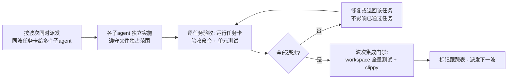
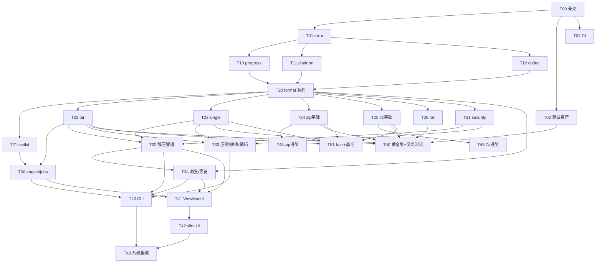

# hzip 实施任务规划（子 agent 并行编码）

| 项目 | 内容 |
|---|---|
| 文档版本 | v0.1 |
| 依据文档 | [02-程序详细设计.md](02-程序详细设计.md)、[03-测试方案及用例.md](03-测试方案及用例.md)、[04-编译与部署.md](04-编译与部署.md) |
| 用途 | 将设计拆解为可独立分发给子 agent 的编码任务卡；按波次并行执行，逐任务验收 |

---

## 1. 总控流程（如何使用本文档）

### 1.1 执行循环



1. **同波次任务无相互依赖，可全量并行**；跨波次任务必须等前置波次的集成门禁通过。
2. 每张任务卡自带**验收命令**（全部可本地执行），验收通过后在 §2 跟踪表标记 `✅`；失败标 `❌` 并附失败摘要。
3. **波次集成门禁**（每波结束统一执行）：

```bash
cargo fmt --all -- --check
cargo clippy --workspace --all-targets -- -D warnings
cargo test --workspace
cargo deny check 2>/dev/null || true    # T03 完成后启用
```

### 1.2 并行协作纪律（子 agent 通用约束，附在每个任务卡里）

- 只允许修改任务卡「独占范围」内的文件；其他 crate 只读引用。
- 根 `Cargo.toml`（workspace 与依赖版本）由 T00 建立，后续任务**只追加自己 crate 的成员声明与自有依赖**，不改他人条目；冲突时以先合并者为准、后合并者 rebase。
- 不引入任务卡未列出的第三方依赖；确需新增，先停下报告。
- 交付必须包含：实现代码 + 单元测试 + rustdoc 注释（公开 API 按 02 文档签名）+ `cargo clippy -D warnings` 零告警。
- 未实现部分留 `todo!()` + `#[ignore]` 测试占位，禁止静默砍功能。

### 1.3 子 agent 任务卡模板

```
你是 hzip 项目的实施工程师。完成任务 T-XX「XXX」。
必读文档：docs/design/02-程序详细设计.md 的 §X、§Y（本卡的唯一规范来源）。
独占范围：<文件/目录清单>；其余文件一律只读。
交付物与验收命令见任务卡；通过全部验收命令后结束。
禁止事项：<见通用约束 §1.2>
```

---

## 2. 任务跟踪总表

> 状态：`⬜ 未开始` / `🔁 进行中` / `✅ 验收通过` / `❌ 验收失败`（附摘要）

| 任务 | 名称 | 波次 | 前置 | 状态 |
|---|---|---|---|---|
| T00 | Workspace 骨架与质量门禁 | W0 | — | ⬜ |
| T01 | hzip-error 错误模型 | W1 | T00 | ⬜ |
| T02 | 测试资产生产线 | W1 | T00 | ⬜ |
| T03 | CI 工作流与合规配置 | W1 | T00 | ⬜ |
| T10 | hzip-progress 进度与取消 | W2 | T01 | ⬜ |
| T11 | hzip-platform 跨平台收口层 | W2 | T01 | ⬜ |
| T12 | hzip-codec 编解码层 | W2 | T01 | ⬜ |
| T20 | hzip-format 契约与注册表 | W3 | T10,T11,T12 | ⬜ |
| T21 | hzip-format-testkit 一致性套件 | W4 | T20 | ⬜ |
| T22 | hzip-fmt-tar | W4 | T20 | ⬜ |
| T23 | hzip-fmt-single | W4 | T20 | ⬜ |
| T24 | hzip-fmt-zip 基础 | W4 | T20 | ⬜ |
| T25 | hzip-fmt-7z 基础 | W4 | T20 | ⬜ |
| T26 | hzip-fmt-rar 只读 | W4 | T20 | ⬜ |
| T-CPIO | hzip-fmt-cpio（只读引入格式，02 §8.7） | W6+ | T20 | ✅ |
| T30 | core：Engine 与任务管理 | W5 | T21,T22 | ⬜ |
| T31 | core：security 安全模块 | W4 | T20 | ⬜ |
| T32 | core：解压管道（smart/conflict/encoding） | W5 | T31,T22,T23 | ⬜ |
| T33 | core：压缩/转换/编辑管道 | W5 | T31,T22,T23 | ⬜ |
| T34 | core：浏览与预览服务 | W5 | T20,T32 | ⬜ |
| T40 | hzip-cli | W6 | T30,T32,T33,T34 | ⬜ |
| T41 | GUI ViewModel 层 | W6 | T30,T32,T34 | ⬜ |
| T45 | zip 进阶（AES/zipx/编码修复） | W5 | T24 | ⬜ |
| T46 | 7z 进阶（AES/solid/BCJ2/分卷） | W5 | T25 | ⬜ |
| T50 | 黄金集回归与 7-Zip 交叉测试接入 CI | W6 | T02,T22~T26 | ⬜ |
| T42 | GUI slint 界面层 | W7 | T41 | ✅ |
| T43 | Windows 系统集成 | W7 | T40,T42 | ⬜ |
| T51 | Fuzz 与性能基准 | W7 | T22~T25 | ⬜ |

### 2.1 依赖与并行关系图



---

## 3. 任务卡

### T00 · Workspace 骨架与质量门禁（W0，无前置）

| 项 | 内容 |
|---|---|
| 独占范围 | 根 `Cargo.toml`、`rust-toolchain.toml`、`deny.toml`、`.gitignore`、`crates/` 下全部**空 crate 骨架**（目录 + Cargo.toml + 空 lib.rs，见 02 §2.2）、`build/checks/deps-direction.py`、`crates/xtask` |
| 交付物 | ① workspace 可编译：`cargo build --workspace` 绿；② 全部 13 个 crate 骨架就位（含 bin 型 hzip-cli/hzip-gui 的 `main.rs` 打印版本号占位）；③ 依赖方向检查脚本可运行（按 02 §2.1 五条红线，对 Cargo.toml 元数据静态分析）；④ `cargo fmt/clippy` 全绿 |
| 验收命令 | `cargo build --workspace && cargo clippy --workspace --all-targets -- -D warnings && python build/checks/deps-direction.py && cargo run -p hzip-cli -- --version` |
| 设计依据 | 02 §2.1、§2.2；04 §1、§3.2 |
| 关联用例 | —（基建） |

实施要点：workspace 依赖表按 04 §3.1 的版本清单建立占位（版本可由实施者以当时最新稳定版校准，但需集中声明）；xtask 提供 `cargo run -p xtask -- env-check`（04 §10）。

---

### T01 · hzip-error 错误模型（W1，前置 T00）

| 项 | 内容 |
|---|---|
| 独占范围 | `crates/hzip-error/**` |
| 交付物 | ① `HzipError` 全部变体与字段（02 §3.3）；② `code.rs`：附录 A 全部 29 个错误码常量 + `code()/is_retryable()/user_action()`；③ i18n key 清单文件（`crates/hzip-error/i18n-keys.md`，zh-CN/en 文案由后续 GUI/CLI 任务消费，本任务只产出 key 列表）；④ 单元测试：变体↔错误码↔user_action 映射全覆盖 |
| 验收命令 | `cargo test -p hzip-error && cargo clippy -p hzip-error --all-targets -- -D warnings` |
| 设计依据 | 02 §3 全部、附录 A |
| 关联用例 | TC-CORE-021（三处一致性，本任务实现 code↔文档两处锁定） |

实施要点：错误码**只增不改**；`Partial` 变体的 `failed` 用 `Box<HzipError>` 防递归膨胀；为 `#[non_exhaustive]` 预留测试（未知变体兜底 HZ-0000）。

---

### T02 · 测试资产生产线（W1，前置 T00，与 Rust crate 无依赖）

| 项 | 内容 |
|---|---|
| 独占范围 | `tests-assets/**`（gen/ golden/ malicious/ 及 README） |
| 交付物 | ① `gen/`：Rust 生成器（独立 bin，不依赖 hzip crate），按 03 §2.2 矩阵产出 roundtrip 源目录（文件名形态/文件形态全集）；② `golden/`：由 7-Zip/WinRAR(Windows 产出后入库)/GNU tar/Info-ZIP/Windows 系统 zip 产出的黄金档案 + 每项 `expected.json`（条目清单+sha256）；③ `malicious/`：zip-slip 各变体、炸弹（高比率/总量/条目数）、截断与位翻转样本 + 构造脚本；④ 全部可由脚本重新生成（03 §1.4 规范） |
| 验收命令 | `cd tests-assets/gen && cargo run --release`（产出物齐全且 `expected.json` 校验自一致）；`python tests-assets/malicious/build.py` |
| 设计依据 | 03 §1.4、§2.2、§2.4；01 §11.3 |
| 关联用例 | TC-ALG-013、TC-SEC-001~008 的数据基础 |

实施要点：黄金档案产出工具版本写入 `golden/MANIFEST.toml`（含 7-Zip 25.01 版本锁定，03 §2.3 TC-X-030）；WinRAR 黄金档案无法在 CI 生成，标注「人工产出」流程；档案内容全部自造数据。

---

### T03 · CI 工作流与合规配置（W1，前置 T00）

| 项 | 内容 |
|---|---|
| 独占范围 | `.github/workflows/**`、`deny.toml` 细化（T00 只建骨架） |
| 交付物 | ① `ci.yml`（PR 门禁，按 04 §6.1：quality + test 三平台 + msrv 通道，含外部工具安装步骤）；② `nightly.yml` 占位（全矩阵/覆盖率/fuzz，任务体内置 `if: false` 待 T50/T51 激活）；③ `release.yml`（tag 触发，cargo-dist 骨架）；④ deny.toml：许可证白名单（本项目为 GPL-3.0-or-later ⇒ 允许与 GPLv3 兼容的 `GPL-3.0`/`LGPL-3.0`/`GPL-2.0-or-later`，仍拒绝 `GPL-2.0-only`/`LGPL-2.0/2.1-only`/`AGPL`/`SSPL`；unrar 例外显式声明，04 §9） |
| 验收命令 | `cargo deny check`（本地通过）；YAML 语法校验（`actionlint` 或 CI 首跑） |
| 设计依据 | 04 §6、§9；01 §11.7 |
| 关联用例 | 门禁基建 |

---

### T10 · hzip-progress 进度与取消（W2，前置 T01）

| 项 | 内容 |
|---|---|
| 独占范围 | `crates/hzip-progress/**` |
| 交付物 | ① `CancellationToken`（级联/幂等/throw_if_cancelled）；② `ProgressEvent`/`Outcome`；③ `ProgressBus` 广播；④ `throttle` 10 Hz 合并器 + EWMA 速度计算（α=0.3、500ms 预热）；⑤ 单元测试：级联取消传播、事件顺序合法性、节流正确性（10Hz 窗口合并计数）、EWMA 数值用例 |
| 验收命令 | `cargo test -p hzip-progress && cargo clippy -p hzip-progress --all-targets -- -D warnings` |
| 设计依据 | 02 §4 全部 |
| 关联用例 | TC-CORE-010（事件守恒，单 crate 级先行实现）、TC-CORE-011 |

---

### T11 · hzip-platform 跨平台收口层（W2，前置 T01）〔大型任务〕

| 项 | 内容 |
|---|---|
| 独占范围 | `crates/hzip-platform/**` |
| 交付物 | ① 12 个子模块全部实现（02 §5.1 总表）：long_path / metadata（属性映射表）/ symlink（降级链）/ fs_util（含 is_case_sensitive 实测）/ temp_area（状态机+孤儿清理）/ watch / open / exec / proc（PID+创建时间双判定）/ signal / dirs / fs_caps；② `tests/parity.rs` 三平台一致性表框架（单平台跑通自身断言，跨平台断言由 CI 补全）；③ 单元测试：temp_area 路径分配稳定复现、去抖 500ms、原子替换（同卷/模拟跨卷）、保留名/长路径转换单测 |
| 验收命令 | `cargo test -p hzip-platform && cargo clippy -p hzip-platform --all-targets -- -D warnings`（Windows 上先行；`--features win-long-path` 显/隐两轮） |
| 设计依据 | 02 §5 全部（重点 §5.2 收口规则、§5.3 各子模块） |
| 关联用例 | TC-SEC-010~012、TC-SEC-015、TC-CORE-019/020、TC-WIN-001/012 的支撑层 |

实施要点：`windows-sys` 等平台依赖**只允许**出现在本 crate（红线 5）；本任务在 Windows（阶段 A 主平台）开发验证，Linux/macOS 分支用 `#[cfg]` 完整实现并配 `#[ignore = "linux-only"]` 式标记（阶段 B/C 激活，03 §1.3 规则 4）。

---

### T12 · hzip-codec 编解码层（W2，前置 T01）

| 项 | 内容 |
|---|---|
| 独占范围 | `crates/hzip-codec/**` |
| 交付物 | ① `CodecProvider/Encoder/Decoder` trait；② deflate/bzip2/xz/zstd 封装（flate2 miniz_oxide 后端等，按 02 §6）；③ 级别映射表（02 §6.3）实现 + 表驱动测试；④ crc32 流式；⑤ `filter` 模块 BCJ/BCJ2 **解码器**（编码器留给 T46 联动，本任务解码先行：能还原 7-Zip 产出的 BCJ2 流，用黄金样本单测）；⑥ roundtrip 单测：每 codec × 每级别 × {空/全零/随机/文本} 样本 |
| 验收命令 | `cargo test -p hzip-codec && cargo clippy -p hzip-codec --all-targets -- -D warnings` |
| 设计依据 | 02 §6 全部（§6.4 四流结构） |
| 关联用例 | TC-ALG-001~009 的编解码层部分 |

---

### T20 · hzip-format 契约与注册表（W3，前置 T10/T11/T12）〔契约冻结任务〕

| 项 | 内容 |
|---|---|
| 独占范围 | `crates/hzip-format/**` |
| 交付物 | ① `types/caps`：EntryInfo/EntryName/FormatCaps/EncryptionCaps（02 §7.2，EntryName 构造校验）；② `handler/reader/writer/editor` 四个契约 trait + `ExtractCtx/WriteCtx/Source/Sink/PasswordRef`（02 §7.3）；③ `registry`：注册表 + 嗅探（魔数表 + ustar + 扩展名回退）+ 组合装配（深度上限 3）；④ 单元测试：嗅探表全覆盖（每格式正/负样本）、组合装配深度防护、EntryName 语法校验 |
| 验收命令 | `cargo test -p hzip-format && cargo clippy -p hzip-format --all-targets -- -D warnings` |
| 设计依据 | 02 §7 全部 |
| 关联用例 | TC-CORE-017、TC-CONF 系列的契约基础 |

实施要点：本任务交付后 trait 进入**冻结范围**（02 §13.1），后续任务只能新增默认方法不能破坏签名；注册表测试用**内部 mock handler**（正式 MockHandler 在 T21，本任务可临时私有实现）。

---

### T21 · hzip-format-testkit 一致性套件（W4，前置 T20）

| 项 | 内容 |
|---|---|
| 独占范围 | `crates/hzip-format-testkit/**` |
| 交付物 | ① `run_conformance` 10 组用例（TC-CONF-001~010 逐条实现：元数据/roundtrip/选择性/乱序/追加/取消/错误密码/畸形/编辑原子性/列表零IO）；② `MockHandler`（可注入 panic/慢速/指定错误/受控进度）；③ 能力过滤（CapsFilter：不支持的能力自动跳过对应组）；④ 用 tar 的临时桩验证套件自身可运行 |
| 验收命令 | `cargo test -p hzip-format-testkit && cargo clippy -p hzip-format-testkit --all-targets -- -D warnings` |
| 设计依据 | 02 §8.6；03 §2.1 |
| 关联用例 | TC-CONF-001~010 本体 |

---

### T22 · hzip-fmt-tar（W4，前置 T20）

| 项 | 内容 |
|---|---|
| 独占范围 | `crates/hzip-fmt-tar/**` |
| 交付物 | ① ArchiveReader/Writer 实现（GNU/ustar/pax 三变体读取、pax 属性覆盖、GNU.sparse 处理）；② caps 声明 `write=true, append=仅裸tar, edit=false`；③ 接入 testkit：`tests/conformance.rs` 全 10 组通过 |
| 验收命令 | `cargo test -p hzip-fmt-tar && cargo clippy -p hzip-fmt-tar --all-targets -- -D warnings` |
| 设计依据 | 02 §8.4 |
| 关联用例 | TC-CONF-001~010（tar 展开）、TC-ALG-006、TC-X-010/011 |

### T23 · hzip-fmt-single（W4，前置 T20）

| 项 | 内容 |
|---|---|
| 独占范围 | `crates/hzip-fmt-single/**` |
| 交付物 | ① gz/bz2/xz/zst 单文件读写（条目名规则、gzip/zstd mtime、multi-stream 串联）；② testkit conformance 通过（按能力过滤） |
| 验收命令 | `cargo test -p hzip-fmt-single && cargo clippy -p hzip-fmt-single --all-targets -- -D warnings` |
| 设计依据 | 02 §8.5 |
| 关联用例 | TC-ALG-007、TC-X-010/011 |

### T24 · hzip-fmt-zip 基础（W4，前置 T20）

| 项 | 内容 |
|---|---|
| 独占范围 | `crates/hzip-fmt-zip/**`（不含 AES/zipx/编码修复——归 T45） |
| 交付物 | ① store/deflate 读写 + 追加（中央目录直改）；② CRC 流式校验 + 「无目录 zip」salvage 读取；③ 分卷写入（字节切分）；④ testkit conformance 通过 |
| 验收命令 | `cargo test -p hzip-fmt-zip && cargo clippy -p hzip-fmt-zip --all-targets -- -D warnings` |
| 设计依据 | 02 §8.1（排除 aes/encoding/zipx 模块） |
| 关联用例 | TC-CONF 全组（zip 展开）、TC-ALG-001、TC-X-012 |

### T25 · hzip-fmt-7z 基础（W4，前置 T20）

| 项 | 内容 |
|---|---|
| 独占范围 | `crates/hzip-fmt-7z/**`（不含 AES/solid/BCJ2 写/分卷——归 T46） |
| 交付物 | ① 头解析（02 §8.2 流程图）+ lzma/lzma2 读写；② 级别→dict/threads 映射；③ 临时文件两遍法处理头回写（管道输出场景）；④ testkit conformance 通过 |
| 验收命令 | `cargo test -p hzip-fmt-7z && cargo clippy -p hzip-fmt-7z --all-targets -- -D warnings` |
| 设计依据 | 02 §8.2 |
| 关联用例 | TC-CONF 全组（7z 展开）、TC-ALG-003、TC-X-001/002 |

### T26 · hzip-fmt-rar 只读（W4，前置 T20）

| 项 | 内容 |
|---|---|
| 独占范围 | `crates/hzip-fmt-rar/**` |
| 交付物 | ① unrar 绑定（panic_wall 三重防护：互斥 + catch_unwind + 错误映射，02 §8.3）；② rar4/rar5 只读 + 卷集自动发现（新旧命名）；③ caps `read-only`；④ testkit conformance 通过（read 组） |
| 验收命令 | `cargo test -p hzip-fmt-rar && cargo clippy -p hzip-fmt-rar --all-targets -- -D warnings` |
| 设计依据 | 02 §8.3；D2 |
| 关联用例 | TC-CONF（read 子集）、TC-X-006 |

---

### T31 · core：security 安全模块（W4，前置 T20）

| 项 | 内容 |
|---|---|
| 独占范围 | `crates/hzip-core/src/security/**`、`crates/hzip-core/src/consts.rs` |
| 交付物 | ① `sanitize_entry_path` 完整算法（02 §9.6 流程图逐分支）；② 符号链接策略表实现；③ 配额检查点（4 MiB 粒度，四类 Quota）；④ **proptest 属性测试**：畸形路径 10 万次生成零逃逸（TC-SEC-012）+ 恶意样本回放（tests-assets/malicious）；⑤ consts.rs 按 02 附录 B.2 建立 |
| 验收命令 | `cargo test -p hzip-core security && cargo clippy -p hzip-core --all-targets -- -D warnings` |
| 设计依据 | 02 §9.6、附录 B.2 |
| 关联用例 | TC-SEC-001~004、TC-SEC-008、TC-SEC-012 |

实施要点：core 其他模块此时尚未开工，security 作为独立模块先行（只依赖 format types + platform）；proptest 种子固定保证可复现。

---

### T30 · core：Engine 与任务管理（W5，前置 T21/T22）

| 项 | 内容 |
|---|---|
| 独占范围 | `crates/hzip-core/src/engine/**`、`src/jobs/**` |
| 交付物 | ① Engine 初始化流程（02 §9.2，含格式注册汇集点——各 fmt handler 在此按 feature 注册）；② worker 主循环 + 状态机（Queued/Running/WaitingInput/Cancelling/…）；③ JobHandle 请求-应答（通道容量 1、超时 120s）；④ 级联取消、并发上限；⑤ **以 MockHandler + 真 tar handler 双轨集成测试**：TC-CORE-005~014 对应单测 |
| 验收命令 | `cargo test -p hzip-core engine jobs && cargo clippy -p hzip-core --all-targets -- -D warnings` |
| 设计依据 | 02 §9.2、§9.3、§9.11 |
| 关联用例 | TC-CORE-005~014、TC-CORE-013（panic 隔离用 MockHandler 注入） |

### T32 · core：解压管道（W5，前置 T31/T22/T23）

| 项 | 内容 |
|---|---|
| 独占范围 | `crates/hzip-core/src/services/extract.rs`、`src/smart_extract.rs`、`src/conflict.rs`、`src/encoding.rs` |
| 交付物 | ① 解压完整管道（02 §9.4 流程：预检 1.05 系数 → smart 判定 → 净化 → 冲突 → 流拷贝 + 检查点）；② 智能解压判定 + 冲突决策器（RenameAuto 幂等，proptest）；③ GBK 编码检测（批量 chardetng + 置信度 0.8 + 手动 codepage 优先）；④ 单测以 tar/single 真实档案 + malicious 样本驱动：TC-CORE-001~004、TC-CORE-015/016、TC-SEC-005~007 |
| 验收命令 | `cargo test -p hzip-core extract smart conflict encoding && cargo clippy -p hzip-core --all-targets -- -D warnings` |
| 设计依据 | 02 §9.4、§9.7、§9.8、§7.3（EncodingPolicy） |
| 关联用例 | TC-CORE-001~004/015/016、TC-SEC-005~007 |

### T33 · core：压缩/转换/编辑管道（W5，前置 T31/T22/T23）

| 项 | 内容 |
|---|---|
| 独占范围 | `crates/hzip-core/src/services/compress.rs`、`src/services/convert.rs`、`src/services/edit.rs`、`src/report.rs` |
| 交付物 | ① 压缩管道（02 §9.5：walk 展开/过滤/预统计/分卷/finish）；② 转换 = 读管道接写管道（流式）；③ 编辑保存服务（02 §9.9 时序：TempArea 物化 → watch 去抖 → ChangeSet::Replace → rewrite → atomic_replace，失败保护）；④ 单测：roundtrip（压缩→解压自洽，经 T32 接口）、编辑原子性（TC-CONF-009 的 core 层）、部分失败汇总（TC-CORE-007/008） |
| 验收命令 | `cargo test -p hzip-core compress convert edit report && cargo clippy -p hzip-core --all-targets -- -D warnings` |
| 设计依据 | 02 §9.5、§9.9 |
| 关联用例 | TC-CORE-007/008/018/019、TC-CONF-009 |

### T34 · core：浏览与预览服务（W5，前置 T20/T32）

| 项 | 内容 |
|---|---|
| 独占范围 | `crates/hzip-core/src/services/browse.rs`、`src/services/preview.rs` |
| 交付物 | ① `browse()`（同步轻量 + refresh）+ 目录树构建 + 名称过滤；② `preview()` 按需流截断（文本 256KB/图 8MB/HEX 4KB）+ 文本编码检测转 UTF-8；③ 单测：列表零 IO 性能断言（1 GiB 档案 < 1s，TC-CONF-010 core 层）、预览截断、嵌套档案浏览 |
| 验收命令 | `cargo test -p hzip-core browse preview && cargo clippy -p hzip-core --all-targets -- -D warnings` |
| 设计依据 | 02 §9.10 |
| 关联用例 | TC-CONF-010、TC-CORE-017、TC-CLI-004 基础 |

### T45 · zip 进阶：AES / zipx / 编码修复（W5，前置 T24）

| 项 | 内容 |
|---|---|
| 独占范围 | `crates/hzip-fmt-zip/src/aes.rs`、`src/zipx.rs`、`src/encoding.rs` |
| 交付物 | ① WinZip AES（KV 拆包 + HMAC 预验，错误密码 HZ-3101，02 §8.1 图）；② zipx 方法 ID 12/93/14 解码路由；③ 编码修复模块（批量检测流程图实现，Suspect 标记）；④ 错误密码/密码边界（空/超长/非 ASCII/NUL）单测：TC-ENC 对应组 |
| 验收命令 | `cargo test -p hzip-fmt-zip && cargo clippy -p hzip-fmt-zip --all-targets -- -D warnings` |
| 设计依据 | 02 §8.1（aes/encoding/zipx）；D1 |
| 关联用例 | TC-X-003/004/014、TC-CORE-015/016 |

### T46 · 7z 进阶：AES / solid / BCJ2 写 / 分卷（W5，前置 T25）

| 项 | 内容 |
|---|---|
| 独占范围 | `crates/hzip-fmt-7z/src/header_crypt.rs`、`src/solid.rs`、`src/split.rs`；`crates/hzip-codec/src/filter/bcj2_encode.rs`（编码器，与 T12 解码器同目录不同文件） |
| 交付物 | ① 头加密（AES+SHA-256，错误密码不泄露条目名）；② solid 块打包（64MB 默认）+ BCJ2 编码器（接 T12 解码器，四流对称验证）；③ 分卷写入；④ 单测：7-Zip 产出的头加密/solid/BCJ2/分卷黄金档案解压（T02 资产）、hzip 产物回解 + BCJ2 压缩比断言（可执行样本 ≥5% 优于纯 lzma，TC-ALG-004） |
| 验收命令 | `cargo test -p hzip-fmt-7z && cargo test -p hzip-codec filter && cargo clippy -p hzip-fmt-7z -p hzip-codec --all-targets -- -D warnings` |
| 设计依据 | 02 §6.4、§8.2；D9 |
| 关联用例 | TC-ALG-004/005/015、TC-X-001/003/005、TC-PERF-006 |

---

### T40 · hzip-cli（W6，前置 T30/T32/T33/T34）

| 项 | 内容 |
|---|---|
| 独占范围 | `crates/hzip-cli/**` |
| 交付物 | ① clap 全子命令（02 §10.3）；② 退出码契约（0/1/2/130）+ 信号桥接（Ctrl-C → cancel）；③ 密码三通道优先级链（02 §10.2 图）；④ `--json` 双流输出（stdout 结果 + stderr NDJSON）+ schema serde 锁定；⑤ assert_cmd E2E：TC-CLI-001~015 全量 |
| 验收命令 | `cargo test -p hzip-cli && cargo clippy -p hzip-cli --all-targets -- -D warnings && cargo run -p hzip-cli -- c -f zip -o /tmp/a.zip docs/ && cargo run -p hzip-cli -- t /tmp/a.zip` |
| 设计依据 | 02 §10 全部 |
| 关联用例 | TC-CLI-001~015 |

### T41 · GUI ViewModel 层（W6，前置 T30/T32/T34）〔无 slint 依赖〕

| 项 | 内容 |
|---|---|
| 独占范围 | `crates/hzip-gui/src/viewmodel/**`（本任务不触碰 ui/ 与 slint 依赖） |
| 交付物 | ① MainViewModel（条目模型/过滤/树构建/选择集）、JobsViewModel（队列/进度/节流消费）、DialogViewModels（压缩参数/解压选项/密码状态机/冲突决策）；② 与 Engine 用真实 channel 对接的纯逻辑测试（`cargo test -p hzip-gui --lib` 无图形环境可跑，02 §11.1 规则）；③ ViewModel 不 import slint 类型（红线，验收检查） |
| 验收命令 | `cargo test -p hzip-gui --lib && cargo clippy -p hzip-gui --all-targets -- -D warnings && ! grep -r "use slint" crates/hzip-gui/src/viewmodel/` |
| 设计依据 | 02 §11.1、§11.3 |
| 关联用例 | TC-GUI ViewModel 层（03 §2.7 前置） |

### T50 · 黄金集回归与 7-Zip 交叉测试接入 CI（W6，前置 T02 + T22~T26）

| 项 | 内容 |
|---|---|
| 独占范围 | `tests-assets/runner/**`、`.github/workflows/nightly.yml`（激活 T03 占位） |
| 交付物 | ① 黄金集回归 runner：遍历 golden/ → hzip 解压 → expected.json 比对，产出 JUnit 报告；② 交叉测试双向脚本（03 §2.3：`7z a` 全矩阵 → hzip 解压；hzip 产 → `7z t`/`7z x`）；③ nightly CI 激活 + PR 抽样集（每格式×每算法至少 1 组）；④ 7-Zip 版本锁定进 MANIFEST 校验 |
| 验收命令 | `cargo run -p assets-runner -- --suite golden && cargo run -p assets-runner -- --suite cross --sample`（命名以实现为准，本地 Windows 全绿） |
| 设计依据 | 03 §2.2/§2.3；D8；01 §11.3 |
| 关联用例 | TC-X-001~030、黄金集全量 |

---

### T42 · GUI slint 界面层（W7，前置 T41）

| 项 | 内容 |
|---|---|
| 独占范围 | `crates/hzip-gui/ui/**`、`src/ui.rs`、`src/main.rs` |
| 交付物 | ① 8 个窗口组件（02 §11.4 清单）绑定 ViewModel；② 请求路由线程 + `invoke_from_event_loop` 回投 + 10Hz 节流消费；③ 单实例文件锁 + 退出钩子（TempArea 清理 + 2s 取消宽限）；④ 冒烟测试（TC-GUI-001~008，Windows 本地）+ VirtualList 大列表压测（TC-GUI-007） |
| 验收命令 | `cargo build -p hzip-gui && cargo test -p hzip-gui && cargo run -p hzip-gui`（人工冒烟：打开黄金档案、压缩、解压、密码弹窗） |
| 设计依据 | 02 §11 全部 |
| 关联用例 | TC-GUI-001~008 |

### T43 · Windows 系统集成（W7，前置 T40/T42）〔M4 项〕

| 项 | 内容 |
|---|---|
| 独占范围 | `shell/hzip-shell/**`、`build/package/**`（Windows MSI 部分） |
| 交付物 | ① IExplorerCommand 原生扩展 DLL（对文件+目录的 压缩/解压到当前/解压到文件夹/预览 四入口，02 §11.5 协议）；② MSI（WiX v5）打包：安装/升级保配置/卸载清注册表——**已由跨平台驱动 `build/package/package.py` 交付**（同时覆盖 dmg/deb/rpm/AppImage/tar.gz，04 §5；`tools/installer` 不再单独存在）；③ 手工检查单执行（TC-WIN-005~008，结果记录入本卡）；④ 在线更新检查（各文档挂账于本卡的「检查更新」；检查地址取配置 `[update].check_url`，默认 = 本项目 GitHub 仓库 `releases/latest`，02 附录 B.1） |
| 验收命令 | `cargo build -p hzip-shell`（或对应构建命令）+ 本地 MSI 安装/升级/卸载全流程人工验证记录 |
| 设计依据 | 02 §11.5；04 §5.1；D4 |
| 关联用例 | TC-WIN-005/006/008 |

### T51 · Fuzz 与性能基准（W7，前置 T22~T25）

| 项 | 内容 |
|---|---|
| 独占范围 | `fuzz/**`、`benches/**`、`.github/workflows/nightly.yml`（fuzz job 激活） |
| 交付物 | ① cargo-fuzz 五目标（zip/7z/tar/rar 绑定层/路径净化，TC-FUZ-001~005）+ 黄金语料种子；② criterion 基准（codec 吞吐、1 GiB 解压、列表打开、启动、内存峰值，TC-PERF-001~006）；③ 基线数据入库 `benches/baseline/`；④ nightly fuzz 批次 job |
| 验收命令 | `cargo fuzz run zip_parser -- -max_total_time=60`（各目标短跑无 crash）+ `cargo bench --bench codec` 产出报告 |
| 设计依据 | 03 §2.8/§2.9；01 §11.7 |
| 关联用例 | TC-FUZ-001~005、TC-PERF-001~006 |

---

## 4. 里程碑对齐与裁剪建议

| 波次完成后 | 对应里程碑 | 达成标志 |
|---|---|---|
| W0–W3 | M0 骨架 | CI 绿、契约冻结 |
| W4 + W5（T22/T23/T24 基础 + T30~T34） | **M1 核心可用（CLI 内部）** | core 全管道 + tar/gz/bz2/xz/zst/zip 基础 |
| W6（T40） | M1 完成（CLI 对外可用） | TC-CLI 全绿 |
| W5 进阶（T45/T46）+ T26 | M2 全格式 | 加密/BCJ2/rar |
| W6–W7（T41/T42） | M3 桌面 | GUI 冒烟 |
| W7（T43）+ T50/T51 持续 | M4 集成与分发 | v0.1 |

裁剪规则：若需更快见效，W5 中 T45/T46、W7 全部可延后，不影响 W6 的 CLI 可用闭环；T26（rar）依赖 unrar 环境问题可独立推迟。

## 5. 风险与回退

| 风险 | 应对 |
|---|---|
| 多 agent 并行改根 Cargo.toml 冲突 | §1.2 纪律：只追加自有条目；T00 一次性建全骨架 crate 成员，后续几乎不再改根文件 |
| T20 契约冻结后发现设计缺陷 | 走 02 §13.1 RFC 流程修订文档后，受影响 fmt 任务在下一波次追加补丁任务（不并行修改） |
| T11 平台模块在某任务需要的 API 缺失 | 允许在 hzip-platform 新增 pub API，但须同时补 parity 测试；新增文件归该任务独占 |
| 波次集成门禁失败 | 定位到具体任务退回修复，同波其他已验收任务不受影响（git 分支粒度隔离） |
