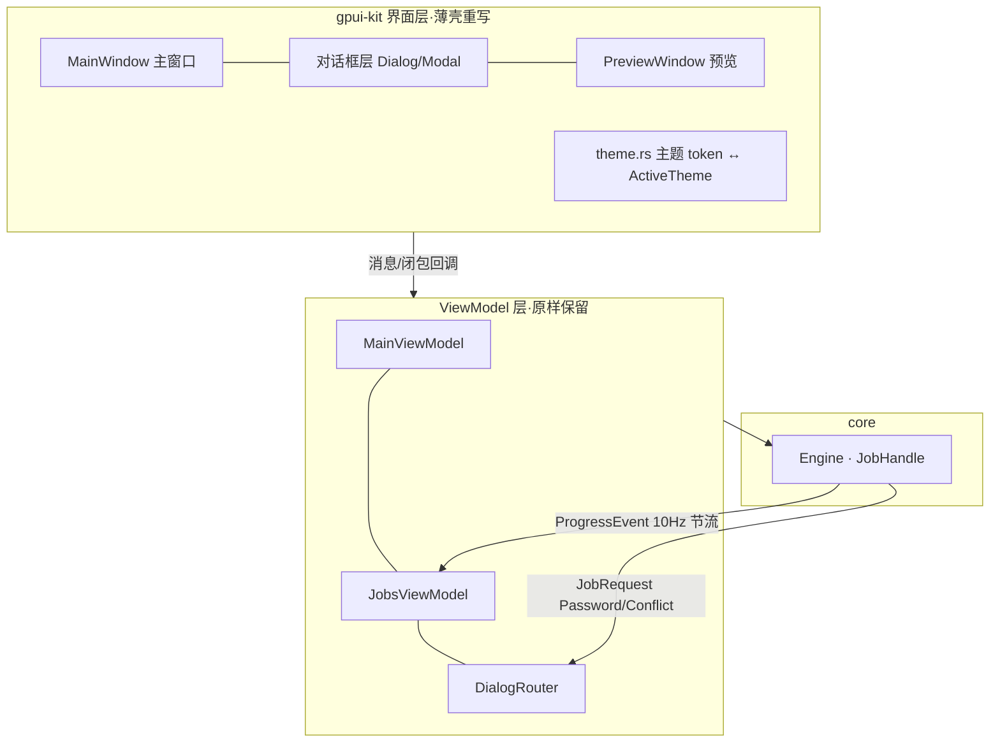

# hzip GUI gpui-kit 界面设计（Slint 迁移版）

| 项目 | 内容 |
|---|---|
| 文档版本 | v0.1（供审核：先审 UI 原型，再定实施任务） |
| 上游文档 | [02-程序详细设计.md](02-程序详细设计.md) §11、[T42 任务卡](../tasks/T-INIT/T42-GUI-slint界面层.md) |
| 技术决策 | hzip-gui 界面层由 **Slint → gpui-kit**（GPUI + gpui-component，Apache-2.0）重写 |
| 参照原型 | Bandizip 主界面（工具栏 + 面包屑 + 双栏浏览 + 状态栏） |
| 审阅范围 | 本文 §4 UI 原型图（8 窗口全部）；§3 架构与组件映射供同步确认 |

---

## 1. 决策记录

### 1.1 为什么迁移

| 项 | Slint 现状 | gpui-kit |
|---|---|---|
| License | 三重授权：GPLv3 / Royalty-free（须署名 AboutSlint）/ 付费商业；条款随版本可变 | Apache-2.0，无使用条件 |
| 组件库 | std-widgets 基础件为主，表格/虚拟列表需手写 | 60+ 组件，含虚拟滚动 Data Table（几十万行级） |
| 治理 | SixtyFPS GmbH 商业约束 | Apache-2.0 可 fork；gpui-kit 由 Longbridge 商业产品背书 |
| 大档案浏览 | Slint 列表性能风险（02 §13.2 已登记） | gpui-kit Table 虚拟滚动为内置能力 |

### 1.2 依赖选择

```toml
# crates/hzip-gui/Cargo.toml（替换 slint / slint-build / i-slint-backend-testing）
gpui-kit = "=0.7.1"        # 锁 0.x 漂移；0.7.1 自带 gpui-pre 0.3.8（吸收 Zed gpui 破坏性变更）
# features：关闭 tree-sitter-* / decimal / inspector（本应用用不到，控编译时间）
```

- `gpui-kit` 固定引用 `gpui-pre` 系列发布版，应用**只依赖 gpui-kit 一个 crate**，不直连 gpui。
- License 链：gpui-kit（Apache-2.0）→ gpui-pre（Apache-2.0）→ 全部兼容 workspace `GPL-3.0-or-later`（Apache-2.0 与 GPLv3 兼容，可链接进 GPLv3 产物，04 §9）。

### 1.3 红线继承（不变）

1. **ViewModel 层零迁移**：`src/viewmodel/**`（约 2.7k 行，纯 Rust、不 import UI 框架）原样保留；本迁移只重写 `src/ui/`（约 1.75k 行绑定/装配）与删除 `ui/*.slint`（约 1.17k 行）。红线措辞从「不 import slint」改为「不 import gpui/gpui_kit」。
2. `cargo test -p hzip-gui --lib` 无图形环境可跑（viewmodel 单测不受影响；gpui-kit 有 `test-support` feature 供 UI 冒烟测试）。
3. 密码通道（Zeroizing 持有、提交即清空）、10 Hz 节流、请求路由 120 s 超时、退出 2 s 宽限——全部行为契约不变。

---

## 2. 架构（迁移后）



与 Slint 版差异：

| 关注点 | Slint 版 | gpui-kit 版 |
|---|---|---|
| 绑定方式 | `in property` / `callback` 声明式双向绑定 | `Entity<T>` 状态 + `cx.notify()`；VM 状态由 UI 层包装成 `Entity`，渲染闭包读 VM |
| 回投主线程 | `slint::invoke_from_event_loop` | `cx.spawn` + `AsyncApp` / `BackgroundExecutor` |
| 数据模型搬运 | `VecModel<T>` + `for` 循环 | gpui-kit `Table`/`VirtualList` 直接吃 `Vec<Row>` + 稳定行 id |
| 对话框 | 独立 Window 组件 | `Modal`/`Dialog` 组件（同窗口浮层）为主；预览保留独立 Window |
| 菜单栏 | 普通按钮模拟 | gpui-kit `NativeMenu`（Windows 走 Win32 原生菜单） |
| 测试后端 | `i-slint-backend-testing` | gpui `test-support`（headless 测试上下文） |

---

## 3. 组件映射表（02 §11.4 八组件 → gpui-kit；R2 交付后终版）

> `.slint` 行为历史对照——R1 已重建为 gpui-kit 纯 Rust 实现，R2 完成「清零自绘」对齐（T-G56 审计表 #1~#14 全落地）。

| 现有组件 | gpui-kit 组件方案（R2 实装） | 说明 |
|---|---|---|
| 主窗口（原 `main.slint`） | `TitleBar` + `PopupMenu`（T-G51 菜单区）+ `Button` 工具栏 + `TabBar` + `StatusBar`（`components/status.rs`） | 菜单区弃 `AppMenuBar`/`cx.set_menus`（Windows 不弹），自绘触发器 + PopupMenu anchored 弹出 |
| 浏览页 | `Tree`（左目录树，懒展开）+ `DataTable`（右文件表，`ColumnsConfig` 列显隐/顺序）+ `Breadcrumb` + `Input`（过滤防抖 200ms） | T-G53 重做；`..` 上级行（根禁跳）；uniform_list 清零 |
| 压缩/解压/密码/冲突对话框（原 `*.slint`） | `Dialog` Modal + `Form::horizontal`+`FormField` + `Input`/`NumberInput` + `Switch` | T-G56；密码 `InputState` 密文模式 + 提交即清空（Zeroizing 语义不变） |
| 任务中心（原 `jobs.slint`） | `DataTable` 六列 + `Tag` 语义色全枚举 + `Progress`（含 indeterminate） | T-G56；失败下钻保留应用特定布局 |
| 预览窗口（原 `preview.slint`） | 独立 Window：`Tab` 三视图 + `uniform_list`（gpui 本体 API，06 既定）+ `img` | 唯一合法 uniform_list 残留（文本/HEX 虚拟滚动） |
| 设置（原 `settings.slint`） | `Dialog`(520px) + `TabBar`(underline 四分类：外观/行为/浏览列/默认参数) + `Select`/`Checkbox` | T-G54；即时保存 hzip-config（`Config::save`），主题即时生效 |
| 文件选择 | `rfd`（原生 IFileOpenDialog；扩展名过滤从 Engine 注册表派生） | T-G52；`PathPromptOptions` 无过滤能力已退役 |
| 图标 | `AppIcon`（自有 lucide 39 枚，`assets/icons/` RustEmbed）→ 回落 `gpui-kit-assets` 101 枚（链式 `AssetSource`） | T-G50；`application().with_assets(ChainedAssets)` 一行挂链 |

> **条目图标例外（T-ICON）**：文件列表四处（明细名称列 / 图标网格 / 紧凑列表 / 左栏树）的**条目**图标不走本行 lucide——由 `ui/widgets/file_icon.rs` 按扩展名取**系统文件管理器同款**图标（`ui.file_type_icons = system` 为默认；拿不到即回退自有 lucide，回退映射仍在 `views` 的 `row_type_icon`/`tree_row_icon`，两分支同尺寸故替换无跳动）；工具栏/按钮/菜单图标仍为上表本行的自有 lucide（主题单色语言，T-ICON 非目标）。

---

## 4. UI 原型图（审阅重点）

> 线框均为浅色主题示意；深色主题用同一 token 表反色（§5）。
> 标注 ⭐ 的是与现有 Slint 版的功能差异点（非纯视觉改版）。

### 4.1 主窗口 — 浏览页（Bandizip 风格）

```text
┌─────────────────────────────────────────────────────────────────────────────┐
│ 🔒 hzip 档案管理器 — demo.zip                                    — □ ✕    │ ← 自绘标题栏
├─────────────────────────────────────────────────────────────────────────────┤
│ 文件(F)  编辑(E)  视图(V)  工具(T)  帮助(H)                                │ ← 原生菜单栏
├─────────────────────────────────────────────────────────────────────────────┤
│ [↥ 解压]  [↧ 全部解压]  [＋ 压缩]  [✎ 预览]  [⟳ 刷新]  [⊞ 测试]  [⚙]      │ ← 工具栏（图标+文字）
├─────────────────────────────────────────────────────────────────────────────┤
│ 📁 > docs > src > main            🔍 过滤：名称/glob…      [仅目录] [␡]     │ ← 面包屑 + 过滤行
├──────────────┬──────────────────────────────────────────────────────────────┤
│ 🗜 demo.zip  │  名称 ▲        大小      压缩后    编码   修改时间           │
│              │ ──────────────────────────────────────────────────────────── │
│ ▾ 📁 docs    │   📄 main.rs      12.4 KB   4.1 KB   UTF-8  2026-08-12 09:30│
│   ▾ 📁 src   │   📄 lib.rs        8.2 KB   2.9 KB   UTF-8  2026-08-11 17:02│
│     📁 core  │   📄 util.rs      20.1 KB   6.6 KB   ⚠ GBK  2026-08-10 11:20│
│     📁 gui   │   📁 assets          —        —       —     2026-08-09 08:00 │
│   ▸ 📁 tests │                                                              │
│ ▸ 📁 target  │                                                              │
│              │                                                              │
├──────────────┴───────────────────────────────────────────────────────────────┤
│ 12,408 个条目 · 已选 2 · ⚠ 可疑编码 3        [■ 解压中 demo.zip 42% ▓▓▓░░] │ ← 状态栏 + 任务徽标
└──────────────────────────────────────────────────────────────────────────────┘
```

布局与交互说明：

| 区 | 内容 | gpui-kit 实现 |
|---|---|---|
| 标题栏 | 应用名 + 当前档案名 | `TitleBar`（Windows 集成窗口控制钮） |
| 菜单栏 | 文件/编辑/视图/工具/帮助 | `NativeMenu`：文件→打开/设置/退出；工具→测试完整性/编码修复预览 ⭐ |
| 工具栏 | 左 = 高频动作图标按钮（解压/全部解压/压缩/预览/打开；busy 时整排禁用），右 = 页面页签行（见 §4.2 落地修订） | 图标 `Button`（`ghost` 变体：**无边框、无底色**；圆角**不设**、随全局主题 `radius`——见 §4.2 三次修订与「直角」段）+ 悬停 tooltip；页签走 **`gpui-base` 无样式原语** `Tabs`/`Tab`（与工具按钮同高、悬停同浅底、聚焦项 = 底部 2px **主题色**下划线、本栏不画自己的边框线） |
| 面包屑 | `档案名 > 层级路径`；每段可点击跳转；右端过滤框 + 「仅目录」开关 | 段 = kit `Button`（`Text` 变体，无内边距像普通文本；带 `.tooltip()`/禁用态）+ 自绘 `ChevronRight` 分隔；点击段 = `nav-select` |
| 左栏 | 根入口（档案名）+ 懒展开目录树；复用 VM 平铺行模型（`TreeRow` depth 缩进不变）。**嵌套浏览不换根**：最外层档案恒为根，内层压缩包作容器节点挂在其目录下（`FolderZip` 图标、可展开 = 内层会话的行），行按 `TreeRow.level` 路由回所属会话；**组合档（`x.cpio.gz` / `x.tar.gz` / `x.tgz`）在根下多一层「内层容器」合成节点**（`init.cpio` / `data.tar`，2026-09-24 用户口径：展开内层容器才见容器里的结构；判定与命名单源 `hzip_format::exts::composite_inner_name`，树投影 `TreeNode::with_composite_layer`，合成节点无条目 id = 与隐式目录同款；**类型列显示格式名**（`cpio`/`tar`）而非「文件夹」，图标走归档图标，但 `is_dir` 为真故导航语义仍是目录） | `Tree` 或自组行列表（数据面不变） |
| 右栏 | 文件列表：**名称/大小/压缩后/编码/修改时间** 列；点列头排序 ⭐；双击目录 → 进入；双击**容器条目**（内层压缩包）→ 以它为下一层会话打开（压缩包当目录进，面包屑跨层、`..` 在档案根 = 退出该层）；双击普通文件 → 沿用配置（内置预览/外部打开）；⚠ 徽标标记可疑编码条目 | `Table`（虚拟滚动、可调列宽、点列头排序） |
| 状态栏 | 条目数/已选数/可疑编码计数 + 任务进度胶囊（点击进任务中心页签） | 自组状态行 + `ProgressBar` |

**面包屑段名过长：中段省略 + 悬停显全名（用户口径 2026-09-24）**。超过 24 个**字符**
（`widgets::breadcrumb::CRUMB_MAX_CHARS`）的段折叠为中段省略——保头**也保尾**
（`initramfs-tools…`.cpio.gz`：层名/扩展名的区分度在尾部，只留头部会把
`huge-init.cpio.gz` 与 `huge-init.tar.gz` 显示成同一个）；折叠过的段挂
`.tooltip(全名)`，未折叠的不挂（同一句话是噪音）。实现上段用 kit `Button` 的
`Text` 变体而非 `BreadcrumbItem`：后者没有 tooltip 槽位，而 div 级 tooltip 的
`ManagedTooltipExt`/`Root::tooltip_overlay` 都是 kit 内部可见性（`pub(crate)`），
外部接不上；`Button` 的 tooltip 是本应用已在用（帮助图标/工具栏/页签关闭钮）的
成熟路径。

与现 Slint 版的功能差异（⭐ 全集）：① 右栏改真表格 + 列排序；② 编码列直接在列表内展示可疑徽标；③ 新增「测试完整性」入口；④ 菜单栏升级为原生菜单。其余（双栏结构、懒展开树、过滤、busy 条语义）与现版一致。

### 4.1.1 打开类操作：窗口不自动关 + 任务中心留痕（用户口径 2026-09-24）

「正在打开」窗口的终局行为**按结果分岔**（`widgets/open_progress.rs`）：

| 终局 | 行为 | 理由 |
|---|---|---|
| 成功 | 停留 `[jobs].open_close_delay_ms`（默认 100 ms）后自动关 | 无需用户处置，闪一下即走 |
| **失败** | **不自动关**：原因常驻，等用户点「关闭」/ ✕ / Esc | 原实现失败也百毫秒自动关，用户只看到窗口一闪、连原因都读不到 |

失败同时**写入任务中心**（`viewmodel/jobs_vm::record_open`）：以任务行形态落账
（行为列「打开」、状态「已完成/失败」、失败行显示原因原文 + HZ 码），成功也记
（满足「记录该操作及操作结果」）。打开不是任务——该行无句柄：不可取消、泵不驱动、
不计入活跃徽标。失败原因与进度窗状态行同源（`shell::hz_reason`：`HZ-xxxx: 原文`），
故「打开失败 → 哪一步、什么原因、什么码」三处（窗口/任务中心/日志）一致。

失败原因进任务中心的通路还有一条修正：任务中心此前**只渲染逐条目失败明细**，
整档失败（打开失败、压缩顶层失败）在列表里是一片空白——现在「逐条目明细为空」
时用终局摘要行（`final_line`）补上，且文案经 `tr` 查表（此前直接显示
`err.hz_xxxx` 这种 key）。

**任务中心「失败原因」独立成列（用户口径 2026-09-24）**。此前失败行挂在**行根**上
渲染（`render_tr` 的额外子元素）——表布局会把它们当额外单元格，后续列整体错位（用户
实测「后面各列内容位置错乱」）。现在失败原因有自己的列（默认宽 220px，可拖拽调宽/
换序）：整档失败（打开失败、压缩顶层失败、打开记录）与逐条目失败明细都在该列，文案
经 `tr` 查表（i18n key 或人读原文皆可，`tr` 对非 key 输入原样返回）。

**打开类操作的后台化与过程明细（用户口径 2026-09-24）**：「正在打开」窗除状态行外
多一行**明细**（阶段 + 已处理字节，如 `正在解出内层档案… · 已处理 1.2 GiB / 3.4 GiB`），
由工作者线程写、渲染侧 10 Hz 读（窗口本就挂着 100 ms 重绘节拍，不为它加新的定时器）。
进入容器/展开延迟层的重活一律在**专用后台线程**上跑且**不持 AppData 锁**，故界面全程
可交互（转圈不停、还能开别的页签看任务中心）。连点/树+列表双路触发由会话切换原子闸
挡成一次——第二次点没有反应是**刻意**的（进度窗已经在屏幕上）。

**组合档延迟展开（用户口径 2026-09-24）**：打开 `.cpio.gz` 只显示一行 `init.cpio`
（容器行）；双击它才加载内层容器——**弹出「正在打开」进度窗**（`run_open_flow` 同款：
超过门槛才弹、成功后停留 `[jobs].open_close_delay_ms` 自动关、失败不关）。展开后的
会话是**嵌套层**：面包屑/`..`/左栏树与「双击内层压缩包」完全同构。

### 4.2 主窗口 — 任务中心页签

> **列宽拖动修复（2026-09-29，用户实测）**：任务表格的列**拖不动列宽**（列序可拖）。
> 根因两条，都在 `ui/views/jobs.rs`：① 行数据复用分支**每帧无条件** `table.refresh()`
> ——`TableState::refresh` = `prepare_col_groups`（按 `delegate.column()` 逐个重建
> col_groups），把拖动中的列宽当帧拽回旧值 ⇒ 一帧都活不过；② 表格**没订阅**
> `TableEvent::ColumnWidthsChanged`（kit 在鼠标松开时上抛全量列宽），`delegate.widths`
> 永远是空的 ⇒ 任何一次 refresh 都回落到默认列宽。修：行集未变（源行集 `Arc` 身份
> 相同）就**不重灌、不 refresh**（行数据不参与 col_groups）；订阅列宽事件回存委托
> （与文件列表 `BrowseDelegate` 同款，R-GUI4 #1 既有模式）。回归：
> `jobs::tests::{column_widths_changed_persists_into_delegate, unchanged_rows_skip_reload}`。
>
> 顺带把「派生行缓存」从**进程级 `static`** 挪进 `JobsHold`（每窗口一份）：静态缓存
> 在两窗口下互相顶掉 ⇒ 每帧都 miss，等于取消了该缓存（50 行 × 12 列 × 每格数次
> 字符串分配），并发渲染的用例也会互相干扰。
>
> **落地修订（2026-09-23，用户口径）**：页签行**不再单占一行**——工具按钮在左、
> 页面页签在右，同属工具栏那一行（`ui/bar/toolbar.rs` 收 `tabs` 右槽；
> 工具栏三态为 `hidden` 时退化为只剩页签的窄条）。页签集是**派生的**
> （`ShellState::present_tabs`）：`浏览` = 有打开的档案且未被关掉、
> `任务中心` = `ui.show_jobs`、`设置` = 设置页已开（设置**不再走弹层**，
> 见 08 §「设置页签化」）。
>
> **关闭语义**由 `AppShell::close_tab` 承担：浏览页签暂隐（开新档案复位）、
> 任务中心取消 `ui.show_jobs`、设置丢面板实体。刚启动若无档案、未开任务中心/设置
> → 一个页签都没有，内容区显示空态提示（`shell.no_tabs`，locale `chrome.toml`）。
> 注：kit 0.6.0 **没有** `DynamicTabs` 组件（全仓无此符号）。
>
> **紧排 + 下划线页签（用 `gpui-base` 无样式原语）**（2026-09-23 三次修订，用户口径）：
> 工具栏整条**去掉上下内边距**（移除 `.py(..)`：整条高度 = 最高的那个孩子），按钮
> 之间**去掉 gap**（相邻按钮左右缘重合，视觉间隔只由 `Button` 自身的 `px_2p5` 内部
> 内边距提供），按钮改 **`ghost` 变体**（无边框、常态无底色；不用「把边框色改透明」
> ——`Default` 变体的**禁用**语义样式会补回一条灰边，而 busy 时整排禁用）。**圆角不在
> 组件级设**：统一由全局 `theme.radius` 决定（本条栏与关闭钮原先各自硬编码
> `ButtonRounded::None`，2026-09-23 已撤掉——组件级硬编码会让「改主题圆角」失效）。
>
> 页签栏三条口径：① **Underline Tabs**（聚焦项用主题色提示当前在哪一页）；② 悬停要
> **跟工具按钮一样的浅色背景**；③ 这条栏**不要自己单独的边框**，行高与左侧按钮
> **一致**（否则两边高低不齐）。`TabBar` 五个变体都做不到三条同时成立：
> `Underline` 才是下划线样式，但行高 **36px**（Medium；按钮 32px）且对
> `Underline`/`Tab` **无条件**加一条全宽 1px `theme().border` 轨道线（`tab_bar.rs`
> 的 `#border-b`，外部关不掉）；`Tab`/`Outline`/`Pill`/`Segmented` 行高 32px 但
> 都不是下划线（分别是灰底 + 左右灰边 / 1px 全周描边 / 主题色填充 / 滑动指示块），
> 只有 `Outline`/`Pill` 带悬停底色。**故改用 `gpui-base` 的无样式原语**
> `gpui_kit::base::{Tabs, Tab}`（`gpui-component` 内部就是用它实现的）：`Tabs` 只挂
> `Role::TabList`、`Tab` 只挂 `Role::Tab` + 指针激活 + `aria-selected` /
> `aria-position-in-set`，**样式全归调用方**，于是：
> 行高/左右内边距/字号走**与工具按钮同一套映射**（`button.rs`：XSmall `h_5/px_1`、
> Small `h_6/px_2`、Medium `h_8/px_2p5`、Large `h_8/px_3` + `button_text_size`）
> ⇒ 两边逐像素同高；悬停底色直接抄 `ButtonVariant::Ghost` 的悬停口径
> （0.7.1 起 = 主题 token `tokens.accent`，暗色再压 0.5 透明度）⇒ 与按钮同源；
> **悬停前景也必须同源取 `accent_foreground`**（Ghost 的悬停前景就是它）——
> 2026-10-13 用户报障：原先写的是 `tab_active_foreground`，而它与 `tab_foreground`
> 在深浅两套主题下**是同一个颜色** ⇒ 那句 `.hover(text_color(..))` 是**空操作**，
> 用户把 `[ui].theme_color` 设成饱和色（#16A34A）后就成了「悬停底色变绿、文字仍深、
> 看不清」（菜单栏/工具栏悬停正常，正因为它们用成对 token）；回归断言
> `tab_bar::tests::hover_foreground_is_paired_and_differs_from_idle`（浅/深 × 默认/自定义
> 四组合）。边框一个不画，整行唯一
> 的线是工具栏自己的 `border_b_1`，聚焦项 = 底部 2px `theme().primary` 下划线用
> **绝对定位**画（不占内容盒 ⇒ 出现/消失不让文字跳 1px、也不把这一栏顶高）。
> **页签圆角也跟着主题**（2026-09-23 用户实测补充）：`gpui-base` 的 `Tabs`/`Tab`
> 是**无样式原语**，自己不画圆角——故 `ui/bar/tab_bar.rs` 显式取 `theme.radius`
> 画悬停底色、取 `theme.radius_full()` 画聚焦下划线的圆头端（`radius = 0` 时两者
> 都回直角，与整条栏的直角观感一致）。同理，「只读框/chip」与状态栏「任务胶囊」
> 原先各自硬编码 `SURFACE_RADIUS = 6px`（= 组件库默认圆的拷贝），已一并改为
> `cx.theme().radius`——圆角只有一个来源。
>
> 页签之间**零间隔**（2026-09-23 用户口径「TabBar 中间不需要有 margin 的间隔」：
> 原先沿用 kit Underline 的 10/12/16/20px 间距，现已移除 `.gap(..)`）——视觉分隔只由
> 每个页签自身的内边距与聚焦下划线提供；回归断言见
> `tab_bar::tests::switching_active_tab_keeps_strip_geometry`（相邻页签左右缘差 ≤0.51px
> 即紧贴，且切换当前页不改任何页签边界）。元素 id 由本模块自己发（`main-tab-*` / `tab-close-*`）——kit 的
> `Tab::ix()` 是 `pub(crate)`，若用 `gpui-component` 的 `Tab` 又脱离 `TabBar`，每个
> `Tab` 的 element id 都会停在 `0usize`。kit 的「溢出 ▾」下拉随之不用（本栏最多 3 个
> 页签，`tabs.len() > 3` 永不成立）。完整论证与口径用例见 `ui/bar/tab_bar.rs`
> **圆角（2026-09-23 起：用户可配）**：`[ui].corner_radius`（0~20，0 = 直角，
> 默认 0）→ `ui/theme.rs::apply_theme_cfg` 写 `theme.radius`，`radius_lg` 按档比
> 6:8 派生（R = 0 时两者都归零）。
> 为什么只能走全局：kit 的 `PopupMenu` 圆角只取自该槽位（容器 `popover_style`、
> 菜单项 `radius.min(8px)`；`PopupMenu` 未实现 `Styled`、内部 `RenderOptions` 私有
> ⇒ **组件级无钩子**），且 0 是 kit 的**官方方形模式**（`radius_full()` 随之归零，
> 徽标/头像不残留圆形——见 kit `styled.rs` 文档）。连带面 = 全部按 `radius` 取圆角的
> kit 组件（菜单/按钮/输入框/页签关闭钮/弹层容器）。工具按钮与页签关闭钮原先各自
> 硬编码 `ButtonRounded::None`，已撤掉——组件级硬编码会让「改圆角」失效。
> 断言：`theme::tests::theme_radius_follows_config`；设置项说明见 08 §5.1。
>
> 模块文档，版式回归用例见 `toolbar::tests::tab_strip_matches_button_height`。

```text
├─────────────────────────────────────────────────────────────────────────────┤
│ 浏览  │  任务中心 ⚠1                                    [全部取消] [清完]   │ ← 页签行
├──────────────────────────────────────────────────────────────────────────────┤
│ 任务              状态      进度                     速度        剩余  操作 │
│ ──────────────────────────────────────────────────────────────────────────── │
│ 解压 demo.zip    运行中   ▓▓▓▓▓▓░░░░ 62%        118 MB/s   00:32  [取消] │
│ 压缩 backups/    队列中   —                        —          —    [取消] │
│ 解压 old.rar     重试(密码)▓▓░░░░░░░░ 8%           4.2 MB/s   01:10  [取消] │
│ 解压 broken.7z   部分完成 ▓▓▓▓▓▓▓▓▓▓ 100%      —          —   [失败明细] │
│   └ ⚠ 3 条目失败：data/001.bin (CRC) · data/002.bin (CRC) · …             │ ← 失败下钻
└──────────────────────────────────────────────────────────────────────────────┘
```

- 行数据 = `JobRow`（VM 原样）；进度刷新 = 10 Hz 节流信号 → `cx.notify()`。
- 状态列用 `Badge` 着色：运行中(accent)/队列(灰)/等待输入(warn)/失败/取消(danger)/完成(success)。
- 「失败明细」展开 `FailureRow` 列表（消息为 i18n key 渲染，与 T42 约定一致）。

### 4.3 解压对话框

```text
        ┌─ 解压 ──────────────────────────────────────── ✕ ─┐
        │  解压对象: demo.zip（12,408 条目 · 已选 2）        │
        │                                                    │
        │  目标目录  [ F:\out\demo____________________ ] [浏览…]│
        │  ✔ 智能解压（多顶层时自动包壳）                    │
        │  冲突策略  [询问 ▾]     文件名编码 [自动 ▾]        │
        │  ☑ 尽力而为（跳过失败条目继续）                    │
        │                                                    │
        │  编码修复预览（3）                                 │
        │  ┌──────────────────────────────────────────┐     │
        │  │ ?????.txt        →  报告.txt   (GBK)      │     │
        │  │ ?????.doc        →  说明.doc   (GBK)      │     │
        │  └──────────────────────────────────────────┘     │
        │                              [取消]  [开始解压]   │
        └────────────────────────────────────────────────────┘
```

控件映射：`Select`×2（冲突策略/编码，白名单与现版一致）、`Switch`（智能解压）、`Checkbox`（尽力而为）、修复预览为只读行列表。对话框为窗口内 `Modal`（遮罩 + 居中），不再开独立 OS 窗口 ⭐。

### 4.4 压缩对话框

```text
        ┌─ 压缩 ──────────────────────────────────────── ✕ ─┐
        │  压缩对象: F:\data\project（3 个文件 · 2 个目录）  │
        │                                                    │
        │  格式  [zip ▾]     级别 [标准 ▾]                   │
        │  输出    [ F:\data\project.zip________ ] [浏览…]   │
        │  分卷    [ 0 = 不分卷__________ ] 字节             │
        │  排除    [ *.tmp, sub/*________________ ]          │
        │  密码    [ ●●●●●●●●________ ]  ⚠ 写侧加密未启用   │
        │                                                    │
        │  摘要: zip · 标准 · 单文件 · 0 排除规则            │
        │                              [取消]  [开始压缩]   │
        └────────────────────────────────────────────────────┘
```

- 摘要行 = 参数实时预览（每次控件变更重算，纯读 VM，无逻辑）。
- 密码仅 UI 态保留（`Zeroizing`），写侧加密启用前禁用提交并提示——与 T41 rustdoc 约定一致。

### 4.5 密码弹窗（Modal）

```text
        ┌─ 需要密码 ───────────────────────────────────── ✕ ─┐
        │  🔒 条目 data/secret.bin 需要密码（第 2/3 次尝试）  │
        │  [ ●●●●●●●●●●____________________ ]                │
        │  上次错误: 密码不匹配                               │
        │                              [取消]      [确定]    │
        └─────────────────────────────────────────────────────┘
```

- 三态 Hidden/Awaiting/Retry 映射：Retry 态显示尝试计数与上次错误；达 3 次自动 cancel（`PASSWORD_MAX_RETRIES`）。
- 提交时读取输入并立即置空（Zeroizing 通道不变）。

### 4.6 冲突弹窗（Modal）

```text
        ┌─ 文件已存在 ─────────────────────────────────── ✕ ─┐
        │  目标已存在:                                        │
        │  F:\out\demo\docs\main.rs                          │
        │  现有文件: 12.4 KB · 2026-08-12 09:30              │
        │  档案条目: 12.4 KB · 2026-08-15 14:02              │
        │  ☑ 对后续冲突全部应用此决策                         │
        │  [覆盖]  [跳过]  [自动改名]  [中止任务]     [取消]  │
        └─────────────────────────────────────────────────────┘
```

- 决策枚举（overwrite/skip/rename/abort）与 apply-all 写回 `DialogRouter::submit_conflict`，语义不变。

### 4.7 预览窗口（独立 Window，保留）

```text
┌─ 预览: docs/main.rs ────────────────────────────────── ─ □ ✕ ─┐
│ [文本] [图片] [HEX]                    [外部打开]              │
├───────────────────────────────────────────────────────────────┤
│ 1  use hzip_core::engine::Engine;                             │
│ 2  use hzip_format::Source;                                   │
│ 3                                                             │
│ …                                                             │
├───────────────────────────────────────────────────────────────┤
│ ⚠ 内容已截断（总大小 3.2 MB）                       [关闭]   │
└───────────────────────────────────────────────────────────────┘
```

- 三视图切换沿用；文本/HEX 用虚拟滚动等宽渲染（长文本不再一次性排版）⭐；图片视图 `img` 元素 contain 缩放。
- 截断语义沿用 core `preview`（文本 256 KB / 图片 8 MB / HEX 4 KB）。

### 4.8 设置

```text
        ┌─ 设置 ──────────────────────────────────────── ✕ ─┐
        │  外观                                              │
        │    主题            [跟随系统 ▾]                    │
        │    语言            [跟随系统 ▾]                    │
        │  行为                                              │
        │    双击档案条目     [内置预览 ▾]                   │
        │  默认参数                                          │
        │    默认格式         [zip ▾]                        │
        │    默认级别         [标准 ▾]                       │
        │                                                    │
        │  ✔ 设置已保存（即时生效）          [恢复默认]      │
        │                              [关闭]    [应用]      │
        └────────────────────────────────────────────────────┘
```

五项设置与现版一致；主题切换即时改 `ActiveTheme` 全局 token。

### 4.9 主题 token（对齐 gpui-kit ActiveTheme）

| Token | 浅色 | 语义 | 现值来源 |
|---|---|---|---|
| `bg` | `#ffffff`（= `surface`） | 窗口底 / 内容区 | 同上；**2026-10-08 用户口径**：内容区底色须与菜单/工具栏一致（随浅/深色模式取同一栏色），故 `bg` 直接取 `surface` 值（旧值 `#f7f7f5` 灰底已废；深色侧同理，`#1f2226`） |
| `surface` | `#ffffff` | 栏/卡片 | 同上 |
| `surface_hover` | `#eef0f2` | 悬停 | 同上 |
| `border` | `#d8dade` | 分隔线 | 同上 |
| `text` / `muted` | `#1c1f23` / `#5c6670` | 主/次文字 | 同上 |
| `accent` / `accent_soft` | `#2f6fed` / `#e3ecfd` | 主色/选中底 | 同上 |
| `warn` / `danger` / `success` | `#b8860b` / `#c62828` / `#1a7f37` | 状态色 | 同上 |

gpui-kit 自带语义主题（`ActiveTheme`）可直接挂这套值；深色主题用其内置暗色值，不另造 token。

**滚动条不参与主题色派生（用户口径 2026-09-24）**：滑块恒为**中性灰**
（`scrollbar.thumb.background = #A3A3A3E6`、悬停 `#A3A3A3`、轨道全透明），浅/深两套
主题同值——kit 该语义槽的 fallback 是 `accent`（主题色），不显式声明就会随主题色染色
（设置里换主色 → 所有滚动条跟着变色）。声明点唯一：`ui/theme.rs::theme_json` 的
`colors`（键名是**带点路径**，写错会被 serde 静默丢弃，`theme_json_keys_are_known`
门禁守）；断言：`theme::tests::scrollbar_color_is_theme_independent`（换主题色/
换深浅后三色逐值不变，且 accent 确实变了＝用例非空跑）。

---

## 5. 文件布局（R2 交付后；T-G50 目录重构落地版）

```text
crates/hzip-gui/
├── Cargo.toml                 # gpui-kit + rust-embed + rfd（无 slint、无 build.rs）
├── assets/icons/*.svg         # 自有 lucide 图标（build/icons/fetch-lucide-icons.sh 入库，构建离线）
├── build/icons/fetch-lucide-icons.sh  # 图标资产入库脚本（一次性工具，结果提交 git）
├── src/
│   ├── main.rs                # 启动流程（单实例锁 → Engine → gpui Application）
│   ├── lib.rs
│   ├── ui.rs                  # 模块声明（含 components/ + layout/）
│   ├── ui/
│   │   ├── app.rs             # AppShell chrome + run_ui 装配（with_assets 挂链）
│   │   ├── assets.rs          # ChainedAssets：自有 → gpui-kit-assets 链式回落
│   │   ├── components/        # 公共件（T-G50 新目录）
│   │   │   ├── icon.rs        #   AppIcon 枚举（IconNamed；全 UI 图标收口）
│   │   │   ├── status.rs      #   状态栏/busy 条/任务胶囊（StatusBar/Spinner）
│   │   │   ├── breadcrumb.rs  #   面包屑（Breadcrumb/BreadcrumbItem）
│   │   │   ├── filter_row.rs  #   过滤行（Input + InputState 防抖）
│   │   │   └── settings_sections.rs  # 设置四分类页内容件
│   │   ├── layout/            # 页面布局（T-G50 新目录）
│   │   │   ├── menu_bar.rs    #   自绘菜单条 + PopupMenu 弹出（T-G51）
│   │   │   ├── toolbar.rs     #   工具栏（AppIcon 5 钮 + 右侧页签槽）
│   │   │   ├── tab_bar.rs     #   页签行（派生页签集 + 关闭钮；挂工具栏右槽）
│   │   │   ├── browse_layout.rs  # 浏览页双栏 + `..` 行 + 空态（T-G53）
│   │   │   └── settings_layout.rs# 设置面板（2026-09-23 起为**页签内容**，非 Modal）
│   │   ├── browse.rs          # 浏览页（Tree/DataTable 组件化，T-G53）
│   │   ├── jobs_view.rs       # 任务中心（DataTable/Tag/Progress，T-G56）
│   │   ├── dialogs.rs         # 压缩/解压/密码/冲突/设置 五 Modal（Dialog/Form，T-G11/G54/G56）
│   │   ├── preview.rs         # 预览窗口（独立 Window；uniform_list 合法保留）
│   │   ├── file_picker.rs     # rfd 选择器封装（注册表派生过滤，T-G52）
│   │   ├── theme.rs           # token → ActiveTheme 覆盖
│   │   ├── binding.rs         # VM 行 → UI 行派生（含 tree_items_from_nav）
│   │   ├── pump_host.rs       # 事件泵线程 + UI forwarder
│   │   ├── instance.rs        # 单实例锁 + watch 队列
│   │   ├── exit.rs            # 退出钩子（2 s 宽限）
│   │   ├── state.rs           # AppData + 设置消费/持久化半场
│   │   └── contracts.rs       # 契约类型总表（含 R2 补丁：ColumnsConfig 等）
│   └── viewmodel/             # ⛔ 红线：不 import gpui/gpui_kit
└── ui/*.slint                 # ⛔ 已删（历史见 git）
```

---

## 6. 迁移策略（评审通过后展开为任务卡）

1. **Spike（先行）**：`password.slint` 对应的最小 Modal 用 gpui-kit 复刻，验证 Windows 渲染 / 中文输入法 / DPI / headless 测试四点。
2. **骨架**：Application + 主窗口三区静态布局 + theme 接入。
3. **浏览页**：面包屑 + 树 + Table（接 `MainViewModel` 现有 API，含过滤/选择/排序）。
4. **对话框组**：五个 Modal 接 `DialogRouter` / `dialog_vm`。
5. **任务中心**：页签 + `JobsViewModel` 接线（10 Hz 泵改 gpui 回投）。
6. **预览窗口**：三视图 + 截断提示。
7. **收尾**：删 `ui/*.slint`、`binding.rs` 改造完成、TC-GUI-001~008 用 gpui test-support 重跑；更新 02 §11 措辞（slint → gpui-kit）。

每步完成后 `cargo test -p hzip-gui --lib` 必须保持全绿（viewmodel 红线由既有 grep 验收机械把守，关键词从 slint 改为 gpui）。

---

## 附：评审问题清单

1. 主窗口右栏列集：**名称/大小/压缩后/编码/修改时间** 五列是否合适？（Bandizip 还有「属性/CRC/类型」，可后补）
2. 预览是否保留独立窗口（现设计保留），还是也收进主窗口页签？
3. 菜单栏是否需要（Bandizip 风格工具栏已覆盖高频动作）？当前原型保留原生菜单以收纳低频项（设置/测试/编码修复预览）。
4. 任务中心从「工具栏按钮」改为「页签」（与浏览并列）是否接受？
