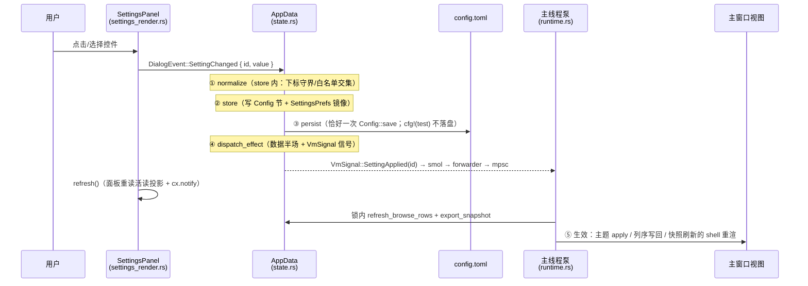

# 08 · GUI 设置：使用、落盘与生效逻辑

| 项目 | 内容 |
|---|---|
| 文档版本 | v1.4 —— 界面文案**全量 i18n**（zh-CN/en，8 表约 320 key）+ 修复菜单条/弹出框停留在旧语言（构建期快照类缺陷，见 §5.7）；v1.2 完成 T-SET 核查与修复轮（设置项 2/23/24 + `current_dir` 丢字段整类） |
| 适用范围 | `crates/hzip-gui` 设置面板 + 全部设置项消费点；`crates/hzip-config` 落盘键 |
| 上游文档 | [02-程序详细设计.md](02-程序详细设计.md) §11、[06-GUI-gpui-kit界面设计.md](06-GUI-gpui-kit界面设计.md) §4（UI 原型）、[07-GUI代码组织与分层约定.md](07-GUI代码组织与分层约定.md)、[T-SET 任务书](../tasks/T-SET/README.md) |
| 读者 | 需要新增设置项、或排查「改了没反应」的开发者 |
| 结论摘要 | 设置项的**编辑与落盘链路全通**（25/25）；**生效链路 16/24**（修复轮把「显示 .. 跳上级」「列顺序与显隐」「界面语言」接上，见 §7.1/§7.4/§5.7）。仍不可用的 8 项是**消费者缺失**（压缩页 4 项待 R-GUI3、双击行为与查看器 2 项待预览接线、自动更新待 T43）。**界面语言已升级为全量 i18n**：8 个文案表 / 约 320 key × 2 语言，覆盖框架外壳到对话框（§5.7） |

> **本文只描述事实与现状**。§5 逐项给出「设置逻辑 + 生效逻辑」，§6 是核查矩阵，
> §7 是缺陷清单。修改设置相关代码前先读 §9「扩展指引」。

---

## 1. 目的与范围

**设置系统的一句话定义**：每个设置项 = 注册表里的一行（`SettingDef`），它声明「
怎么读、怎么存、默认值、生效半场」；框架负责「取值 → 归一化 → 写配置 → 落盘 →
分发生效 → 刷新界面」这条固定流水线。设置项自己不写盘、不碰窗口。

覆盖范围：

- **在范围内**：设置面板 7 页共 24 个设置项 + 7 个动作按钮（3 个页级：检查更新、
  应用关联、解除关联；4 个行级：图像查看器/编辑器的 浏览… 与 恢复系统默认）
  + 页脚「恢复默认/关闭」+ 主窗口对设置的消费。
- **不在范围内**：`[security]`/`[logging]`/`[preview]`/`[extract].delete_after`/
  `[compress].solid_block_mib`/`[ui].tree_width` 等**未进设置面板**的配置键
  （只在 §7.6 把 `tree_width` 作为同类单向断链记录）。

---

## 2. 三层结构

```text
┌─ 定义层（app / viewmodel，无 gpui 依赖）───────────────────────────────┐
│ setting_id.rs      SettingId      24 个设置项标识（注册表键、gpui 元素 id 派生源）│
│ settings_registry.rs                                                     │
│   SettingDef      注册表行：{ id, page, label, desc, widget,             │
│                              default(), load(), store(), effect }        │
│   WidgetKind      控件种类：Switch / Select / CheckGroup / ExtGroup /     │
│                              Text / ColumnsBlock                        │
│   SettingValue    取值类型：Bool / Index / Text / StrSet / Columns        │
│   Effect          生效半场声明：DataOnly / Theme / Columns / Deferred /   │
│                              BackgroundAssoc                            │
│   REGISTRY        24 行常量表（唯一清单）                                  │
│   ACTIONS         7 行动作按钮（非设置项：不重置、不持久化）                  │
│   SettingsView    活读投影：每项当前值（AppData 镜像 + Config 两半）         │
│ labels.rs         label ↔ 落盘值 白名单（唯一文案源）                       │
├─ 数据层（app）────────────────────────────────────────────────────────┤
│ AppData           apply_setting / apply_reset / settings_view / persist   │
│ SettingsPrefs     ui 项的 AppData 内存镜像（面板与主窗口共同读它）            │
├─ 界面层（ui）─────────────────────────────────────────────────────────┤
│ settings_layout.rs 面板实体：TabBar + 活读投影 + 事件后 reload             │
│ settings_render.rs 注册表驱动渲染器：WidgetKind 分派 + 列块/勾选组叶子       │
│ shell/runtime.rs   主线程泵：快照刷新 + 主题 apply + 列序写回               │
│ shell/dispatch.rs  打开面板、事件上行、关联写注册表、解压/进度窗口提交点        │
└──────────────────────────────────────────────────────────────────────┘
```

依赖方向仍是 `ui → app → viewmodel`（[07](07-GUI代码组织与分层约定.md) §3 红线）；
`SettingId` 放 `viewmodel/`（`VmSignal` 要引用它），`SettingsTab` 放 `app/`（注册表要引用它）。

---

## 3. 一次设置变更的完整链路

### 3.1 五步流程



| 步 | 位置 | 做什么 | 不做什么 |
|---|---|---|---|
| ① 归一化 | 各 `store_*`（`settings_registry.rs:1019+`） | 下标越界回落 0；勾选集合与白名单求交并按白名单排序；扩展名去空去重 | 不报错、不弹窗（静默回落） |
| ② 落库 | 同上 | 写 `hzip-config` 对应节 + 同步 `AppData.settings` 镜像 | 不碰磁盘、不碰窗口 |
| ③ 落盘 | `state.rs:419 persist()` | `Config::save()`，失败仅 `warn!` | **测试进程直接 return**（`cfg!(test)`——防单测污染用户 `config.toml`） |
| ④ 分发 | `state.rs:286 dispatch_effect()` | 数据半场（列脏旗）+ `VmSignal::SettingApplied(id)` | `Deferred` 项不刷新面板 |
| ⑤ 生效 | `runtime.rs:396-455` 泵循环 | 见 §4.2 时机表 | 泵只对**全局态**项分支（Theme / Lang）；值型项靠「信号到达即刷快照」 |

**入口唯一**：面板所有控件都发 `DialogEvent::SettingChanged { id, value }`
（`settings_render.rs` 的 `row()`/`check_group()`/`assoc_group()`/`columns_section()`），
没有第二条写设置的路径。`ui/views/browse.rs:310` 的列拖动也复用同一事件
（拖列 = 改设置，同一事实源）。

### 3.2 为什么必须两半

`AppData` 不持 `Window`/`App`（app 层红线），因此：

- **数据半场**（`AppData` 内）：改内存镜像、置脏旗——可立即做；
- **UI 半场**（需 `&mut App`/`Window`）：换主题、写 `Global`、重渲——必须回到主线程泵。

两者靠 `VmSignal::SettingApplied(SettingId)` 串起来：`smol::channel` → forwarder 线程
→ `std::sync::mpsc` → 主线程泵（10 Hz 批消费）。**这也是「设置生效有 ≤100 ms 延迟」
的根因**，属设计内延迟。

### 3.3 刷新语义

- **面板**：`SettingsLayout::reload()`（`settings_layout.rs:111`）在**每次事件后**重读
  `SettingsView`（`AppData` 镜像 + `Config::load()`），不是每帧、也不是打开期冻结快照。
  因此面板显示的永远是当前值，不会回弹。
- **主窗口**：`ShellState::apply()`（`shell/mod.rs:148`）做**字段级变化检测**，变化才重渲。
- **代价**：一次控件交互 = 一次 `Config::save()` + 一次 `Config::load()`（面板 reload）。
  `Text` 行因此没做逐键输入（见 §7.5）。

---

## 4. 生效模型

### 4.1 Effect：注册表声明的生效半场（`settings_registry.rs:212`）

| Effect | 含义 | 数据半场动作 | UI 半场动作 | 使用者 |
|---|---|---|---|---|
| `DataOnly` | 仅数据面，主窗口随信号刷快照 | 无 | 泵收到信号即刷快照（无专用逻辑） | 18 项 |
| `Theme` | 主题是**全局态**（快照不携带） | 无 | 泵内 `ThemeModeChoice::apply`（`runtime.rs:421`） | Theme |
| `Locale` | 语言是**全局态**（rust-i18n） | 无 | 泵内 `init_locale` + `progress::relocalize` + `refresh_windows`（`runtime.rs:432`） | Lang |
| `Deferred` | 只更新压缩对话框模板，不逐帧刷 | 无 | 无 | Format / Level |
| `BackgroundAssoc` | 注册表写归主控后台线程 | 无 | 「应用/解除关联」按钮（`dispatch.rs:169`） | Assoc / CtxExtract / CtxCompress |

**判定标准（T-SET 修复轮明确）**：非 `DataOnly` ⇔ 该项除数据面外还需动作。
**值型设置**（列设置、`..` 显隐、目录大小等）一律随
[`AppStateUiSnapshot`](../../crates/hzip-gui/src/ui/contracts.rs) 进视图，改完即随下一次快照
刷新生效——声明 `DataOnly`。只有**全局态**（主题 = gpui `Theme`、语言 = rust-i18n locale）
才需要 UI 半场专用动作。

> **注意**：`Effect` 只区分「谁在哪一侧做额外动作」，**不表示该项真的有消费者**。
> 例如 `DataOnly` 的 `AutoUpdate` 依然无任何消费者（§7.2）。

### 4.2 生效时机分档

| 档 | 时机 | 用户观感 | 判定依据 |
|---|---|---|---|
| **A 即时** | 下一次泵批（≤100 ms，含面板自身刷新） | 立刻看到 | 泵批次里有 `SettingApplied` → 刷快照 → 重渲（值型项）；全局态项另加泵内专用动作（Theme/Lang） |
| **B 下次提交** | 下一次解压/压缩任务提交时 `Config::load()` 现读 | 「改了以后新任务才用新值」 | `dispatch.rs:323`、`dispatch.rs:280` |
| **C 任务终局** | 任务完成/取消时现读配置 | 「改了以后下一个任务结束才生效」 | `pump_host.rs:174`、`progress/mod.rs:90` |
| **D 需重启** | 进程启动时读一次 | 「重启后才生效」 | `runtime.rs:81` |
| **E 显式应用** | 用户按「应用/解除关联」按钮 | 「勾选后还得点一下按钮」 | `dispatch.rs:163-201` |
| **F 无消费者** | 永不生效 | 「怎么改都没反应」 | 全仓库无读取点（§7 逐条列证据） |

---

## 5. 逐项明细（按设置分类）

### 5.1 常规页（`SettingsTab::General`）

#### 1) 主题 · `Theme`（`settings_registry.rs:341`）

- **设置逻辑**：`Select`，白名单 `labels::THEME` = 跟随系统 / 浅色 / 深色（落盘值
  `system` / `light` / `dark`）→ 写 `[ui].theme`，镜像 `SettingsPrefs.theme_ix`。
- **生效逻辑**：`Effect::Theme`。泵（`runtime.rs:410-428`）在批次里找
  `SettingApplied(Theme)` → 取 `settings.theme_ix` → `ThemeModeChoice::from_index`
  → `apply(cx)` = `Theme::change(mode)` + `apply_theme(choice, cx)`
  （`ui/theme.rs:196`、`:277-330`，两套 hzip 语义色覆写）→ 同批 `update_from_state`
  触发 shell 重渲，颜色随重渲更新。
- **时机**：A 即时（≤100 ms）。**现状：✅ 已接线**。
- **已知边界**：
  - 「跟随系统」当前等价「浅色」（系统外观检测归挂账，`theme.rs` 注释明示）。
  - `Theme::change(mode, None, cx)` 传 `window = None`，**不自带 `window.refresh()`**
    （gpui-component `theme/mod.rs:262` 仅在 `Some(window)` 时刷新）；视觉生效依赖
    同批 `shell.update_from_state` 的重渲。若后续把该分支挪出批次，须补
    `cx.refresh_windows()`。
  - 信号通道是 `smol::channel::bounded(64)` + `try_send` 忽略失败
    （`state.rs:299`）：**通道满时该次主题生效信号会静默丢弃**（列设置走脏旗，不受影响）。

#### 2) 显示 `..` 跳上级 · `ShowDotdot`（`:354`）

- **设置逻辑**：`Switch` → 写 `[ui].show_dotdot`，镜像 `settings.show_dotdot`。
  出厂默认 `true`。
- **生效逻辑**：`browse.rs:163-164` 消费（`delegate.show_dotdot` /
  `show_parent = show_dotdot && 非根`）。
- **时机**：A 即时。**现状：✅ 已修复（T-SET 修复轮）**。
- **修复内容**：值随快照进视图的三段全通——`export_snapshot` 出口（`state.rs:408`）→
  `ShellState.show_dotdot`（`shell/mod.rs` 字段 + `apply()` 迁移）→ render 投影
  （`shell/mod.rs` render 快照 `show_dotdot: s.show_dotdot`）→ `browse_root` 落
  `delegate`。
- **曾经的断链（修复前）**：`export_snapshot` 有值，但 `ShellState` **无此字段**、
  render 快照用 `..Default::default()` 收尾 → `browse_root` 恒收 `false` →
  **`..` 行永不显示（默认开也不显示）**。该断链先于 T-SET 存在。
- **回归锚点**：`browse_page_follows_snapshot_settings`（真实 shell + 真实窗口，
  冷启动帧 + 变更帧；反转 render 投影即失败）。
- **相关**：`..` 行的**跳转目标**另依赖 `current_dir`（同属被丢弃字段，见 §7.8）。

#### 3) 自动更新 · `AutoUpdate`（`:368`）

- **设置逻辑**：`Switch` → `[ui].auto_update`，镜像 `settings.auto_update`，默认 `false`。
- **生效逻辑**：无。启动检查/在线更新挂账 T43（界面 desc 已写明）。检查地址已落配置
  `[update].check_url`（默认 = 本项目 GitHub 仓库的 releases/latest，B.1），T43 直接读它即可——**换源不必重新打包**。
- **时机**：F。**现状：⛔ 未实现（声明非目标）**。

#### 外观组增补：界面字体 / 字体大小 / 布局密度（2026-09-20，用户需求）

> 本节条目不参与上面的历史编号（§5.1 的 1)/2)/3) 是早期文档的编号，未随注册表
> 顺序改动）。三项在注册表里紧随主题色，属常规页「外观」组。

##### 界面字体 · `FontFamily`

- **设置逻辑**：`WidgetKind::FontSelect`——候选项**运行期**取自
  `TextSystem::all_font_names()`（Windows 走 DirectWrite 全系统字体枚举），首项
  「系统默认」值 = 空串。**下拉带搜索**（`SelectState::new(...).searchable(true)`
  + 搜索框占位 `setting.font_family.search`）：系统字体动辄数百项，靠滚动找不现实
  （用户要求）。上行 `SettingValue::Text(字体名)` → 写 `[ui].font_family`，
  镜像 `settings.font_family`。字体名**不进白名单**（系统字体随机器变化，编译期
  无法固定）；但「空串 = 系统默认」是契约。
- **生效逻辑**：`Effect::Theme`——字体族经全局 `Theme` 下发（`ThemeConfig` 的键名
  是**带点**的 `font.family`，见 `ui/theme.rs::merge_font_config`；拼成 `font_family`
  会被 serde 静默丢弃）。gpui-component 的 `Root` 每帧把 `theme.font_family` 挂到
  窗口根 div，文本样式沿树继承 ⇒ 连组件库自绘的按钮/下拉/输入框文案一起换。
- **时机**：A 即时（泵 `apply_ui_effects` → `reapply_from_config` + `refresh_windows`）。

##### 字体大小 · `FontSize`

- **设置逻辑**：`WidgetKind::Number { min: 10, max: 24, step: 1 }`——自绘步进控件
  `ui/widgets/number.rs`（`−` / 值 / `+`，到边界按钮禁用）→ 上行
  `SettingValue::Number(px)` → 写 `[ui].font_size`，镜像 `settings.font_size`。
  归一（`0`/越界 → 16）的唯一入口是 `hzip_config::Ui::font_size_px()`。
- **生效逻辑**：`Effect::Theme`——字号经全局 `Theme` 的 `font.size` 下发，各窗口
  `Root` 渲染帧执行 `window.set_rem_size(cx.theme().font_size)`。**全界面走 rem**
  （gpui 的 `text_sm()`/`gap_1()` 等尾风助手全是 rem 值）⇒ 一处改字号，文字与
  间距等比缩放，主窗/参数窗/进度窗/预览窗各自生效（rem 是**窗口级**状态）。
- **回归锚点**：`ui::theme::tests::theme_font_size_drives_window_rem`（真实窗口：
  `font.size` 改变 ⇒ `window.rem_size()` 跟随；键名拼错即失败）。

##### 圆角弧度 · `CornerRadius`（2026-09-23 用户需求）

- **设置逻辑**：`Number`（[−] 值 [+]），有效域 `hzip_config::CORNER_RADIUS_MIN`(0)
  ..=`CORNER_RADIUS_MAX`(20)，步长 1 → 写 `[ui].corner_radius`，镜像
  `settings.corner_radius`。**0 = 直角**（hzip 既有观感；0 是合法值而不是「漏键」，
  故归一只夹越界）。
- **生效逻辑**：`Effect::Theme`。圆角装在**全局 `Theme`** 上（`ui/theme.rs::apply_theme_cfg`：
  `theme.radius = R`、`radius_lg = R × 4/3`——档比取组件库默认 6:8，故 R=6 时
  `radius_lg` = 组件库原默认 8）。
- **为什么必须走全局**：kit 的 `PopupMenu` 圆角只取自 `theme.radius`（容器
  `popover_style`、菜单项 `radius.min(8px)`），`PopupMenu` 未实现 `Styled`、内部
  `RenderOptions` 私有 ⇒ **组件级没有钩子**；工具按钮/输入框/页签关闭钮也都读它。
  `R = 0` 是 kit 的受支持方形模式（`radius_full()` 随之归零）。
- **不改组件级硬编码**：工具栏按钮、页签关闭钮原先各自写死 `ButtonRounded::None`，
  已撤掉——否则用户调圆角时它们不跟。页签栏（`gpui-base` 无样式原语）显式取
  `theme.radius` 画悬停底色、`theme.radius_full()` 画聚焦下划线圆头端；
  「只读框/chip/任务胶囊」原先硬编码的 `SURFACE_RADIUS = 6px` 也改为 `theme.radius`。
  ⇒ **圆角只有一个来源**：改这一项，菜单/按钮/输入框/页签/弹层容器/内嵌面一起变。
- **测试**：`hzip-config::tests::corner_radius_normalizes_to_default`（归一）、
  `settings_registry::tests::appearance_settings_round_trip`（上行 → 落盘镜像）、
  `theme::tests::theme_radius_follows_config`（配置值 → `radius`/`radius_lg`/`radius_full`，
  含越界与换主题）。

##### 布局密度 · `Density`

- **设置逻辑**：`Select`，白名单 `labels::DENSITY` = 紧凑 / 标准 / 宽松（落盘值
  `compact` / `standard` / `loose`）→ 写 `[ui].density`，镜像 `settings.density_ix`。
  **标准 = 既有观感**（切到它不改任何东西）。
- **生效逻辑**：`Effect::Density`。间距刻度是**UI 线程级**量（`ui/spacing.rs` 的
  `DENSITY_MILLI`）：元素构建期没有 `App`（`.gap(...)` 是纯样式方法，拿不到 `cx`），
  故只能存线程局部。写入点两处——启动装配（`run_ui` → `spacing::init_from_config`）
  与泵消费 `SettingApplied(Density)`（写刻度 + `refresh_windows`）。
- **架构：布局度量提供器 `ui::spacing::LayoutMetrics`**（用户要求「像主题那样统一」）
  —— 它之于间距，等于 `Theme` 之于颜色：

  | 关注点 | 主题 | 布局密度 |
  |---|---|---|
  | 模式量 | `ThemeMode`（浅/深/跟随系统） | `Density`（紧凑/标准/宽松） |
  | 读入口 | `cx.theme()` | `metrics()`（`ui::spacing`） |
  | 具体值 | `theme.background` … | `metrics().gap_sm()` / `.pad_menu_x()` / `.row_band()` / `.component_size()` … |
  | 切换生效 | `theme::reapply_from_config` + 重绘 | `set_density` + 重绘（泵消费 `SettingApplied(Density)`） |

  > **数值定义处**（2026-09-21）：密度只做「基准值 × 系数」的乘法，**基准值**统一定义在
  > `ui/constant.rs`（`CARD_W_BASE` / `CARD_TITLE_H` / `TAB_RAIL_W_BASE` / `LABEL_COL_W_BASE` /
  > `ROW_BAND_BASE` / `CELL_GUTTER_BASE` / `TEXT_SLACK_PX` / `GLYPH_BOX_EM` / `INK_BOX_EM` 等）；
  > `ui/spacing.rs` 只负责把基准值按密度加工成最终像素。视图里不再出现布局字面量。

  **不是 gpui `Global`**（不能像 `Theme` 那样挂 `cx`）：元素构建期没有 `App`
  ——`.gap(...)`/`.px(...)` 是纯样式方法，`cx` 不在作用域内（这正是旧实现到处
  写死数字、密度管不到的原因）。故实现为 UI 线程局部的**进程内唯一来源**，
  语义与全局量一致（一处切、处处变），读写点各自唯一。
  **命名 token 优先**：`gap_xs/sm/md/lg/xl`、`pad_page/pad_group/pad_cell`、
  `row_band()`、`row_gap()`、`component_size()`；没有语义对应时
  用基础刻度 `space(step)`（= 旧 `sp(n)`，106 处既有调用点）。
- **密度系数**：紧凑 **0.75** / 标准 **1.00**（既有观感，逐像素不变）/ 宽松 **1.40**
  —— 用户实测 1.2×「和标准看不出差异」（多数组件只差 1~2px），1.4 是肉眼可辨的
  最小步进；行带 32 → 24 / 44.8px 同步。
- **四条作用面**：
  1. **自家间距**：全 UI 经 `metrics()`/`sp()`（`n/4` rem × 系数）——106 处。
  2. **组件固有尺寸**（`space()` 管不到的那层：按钮/下拉/开关/输入框/**复选框**/
     表格行由 gpui-component 按 `Size` 算）：`component_size()` = 紧凑 `Small` /
     其余 `Medium`，`with_size(...)` 挂到 74 处构造点。实测下拉 28→21px（恰好
     0.75×）、按钮 32→24、表格行 32→30、单元格内边距 8/4→6/3、文件关联勾选格
     高度随方框一起缩。宽松不用 `Size::Large`（那会把控件字号提到 `text_base`）。
  3. **组件容器内边距**：设置页分组框 `GroupBox::content_style(p(pad_group())
     .gap(gap_lg()))`（16px → 12 / 22.4）；目录树行缩进 `space(4·depth + 3)`。
  4. **行高**（两件事，别混）：
     - **文字行框** = `[ui].line_height` × 字号（配置文件项，默认 1.2，有效域
       1.0~3.0）——作用面：文件列表行、目录树行框、设置页复选标签行。
     - **下限是字体「墨迹盒」，不是 `ascent + |descent|`**（2026-09-21 用户实测回归）：
       `ascent+|descent|`（本机 16px = 20.8px = 1.30em）只是字体**声明**的字身框；
       字体真正的墨迹盒（`TextSystem::bounding_box`，全部字形叠加的外接矩形）实测
       上方 17.90 / 下方 3.92 ⇒ 行框至少
       `(A+D) + 2·max(墨迹上−A, 墨迹下−D) = 20.8 + 3.0 = 23.8px ≈ 1.49em`。
       按 1.30em 排框的症状正是用户报的：「文件名里的 `_` 紧凑档根本看不见、标准档
       在最底部马上就要溢出」。
     - **装得下 ≠ 不贴边**：墨迹盒恰好等于行框时 `_`/降部与行框边缘重合（本机
       16px 实测间隙 < 1px）——用户二轮实测正是「紧凑档 `_` 直接显示不出来、标准档
       过于贴近行底部、宽松档正常」。故行框下限 = 墨迹盒 + **上下各
       `constant::TEXT_SLACK_PX`（常量 2px）** ⇒ 本机 16px 下 23.8 + 4 = 27.8 → **28px**。
     - **行盒与文字行框必须同源、且取同一个 px 值**：文件列表
       `list_row_height = text_line_floor(window, rem_size) + 2×row_gap + 1`（`+1` 是
       kit 挂的 `border_b_1`：gpui 是 border-box，边框吃行高 ⇒ 不补这 1px，单元格
       内容盒就比行框矮 1px，文字上下各被裁 0.5px）。`render_tr` 把**同一个**
       `text_line_floor` 结果以 px 挂到行上（单元格文字继承）——不再用 `relative(em)`
       （相对值要经文本系统再乘一次字号，取整差一点就是裁字）。目录树行框、紧凑列表行同理。
     - **密度与行框解耦（用户二轮口径：密度只调行内上下 padding）**：
       `list_text_line_height` 按**基准字号**（`window.rem_size()`）算，不再随
       `component_size()` 走（旧实现紧凑档经 `Size::Small` 把单元格字号压到
       `text_sm` ⇒ 行框 21px ⇒ 墨迹 19.1px 顶满、`_` 看不见）；`render_td` 的单元格
       内容统一套壳 `h_full().flex().items_center().text_base()`：字号钉在基准、
       内容填满单元格内容盒并**垂直居中**（此前内容按块流顶在内容盒上沿，多出来的
       留白全落下方 ⇒「`_` 太贴行底」的观感）。
       实测行盒（rem 16）：紧凑 **29** / 标准 **31** / 宽松 **33**（= 行框 28 +
       上下各 `row_gap` 0/1/2 + 边框 1）；三档**内容盒与行框完全相同**，
       `_` 到行底的留白约 3.1 / 4.1 / 5.1px（改造前紧凑档 ≈0.1px ⇒ 不可见）。
       锚点：`browse::tests::file_list_cell_box_is_density_independent`（三档内容盒
       完全相同 + 垂直居中 + 行盒逐档只多 2px）、
       `browse::tests::file_list_row_height_follows_density`（配置驱动 + ≥ 墨迹盒 + 余量）、
       `browse_layout::tests::tree_row_padding_follows_density`
       （树行框 = 墨迹盒 + 上下各余量 ±1px ⇒ 既不裁字也不白留白）、
       `browse::tests::row_line_height_style_reaches_text`（行上设的行高真的落到文字上）。生效值
       **夹到字体字形盒下限**（`ascent + |descent|` ≈ 1.3em）：出厂 1.2 实际生效
       1.35em 常量版（拿不到 `Window` 的复选标签）/ 字形盒精确版（拿得到度量的
       树与列表）。**只负责「行框多高」，不负责「行与行贴多紧」**（后者是
       `row_gap`）。回归锚点：`ui::spacing::tests::line_height_em_clamps_at_glyph_box`、
       `ui::views::browse::tests::file_list_row_height_follows_density`（配置驱动 +
       字形盒边界 + 出厂不比改造前松）、
       `settings_layout::tests::line_height_config_drives_dense_rows_and_clamps_at_glyph_box`。
     - **设置页行带** `row_band()`（32 → 24 / 44.8px）——只管设置页行的「首行基准」。
     - 历史：改造前目录树/列表各行自取口径（树 = 字形盒、列表 = gpui
       `Window::line_height()`），两个旋钮都不可配；现统一到 `[ui].line_height`。
  5. **列表行留白**：`row_gap()` —— **逐档硬像素**（紧凑 0 / 标准 1 / 宽松 2px，
     不乘系数：它是「行与行贴多紧」的手感值）。目录树 / 文件列表 / 紧凑列表三处
     统一口径：行框取字体的**自然字形盒**（`ascent − descent`，实测 Segoe UI
     @16px = 16.4 − (−4.4) = **20.8px ≈ 1.3em**）——默认行高是 φ(1.618em)，
     多出的 ~0.3em 正是用户报的「文字/图标上下 padding」；但**不能写死小系数**
     （曾用 1.2em = 19.2px < 字形盒 ⇒ 基线被顶出框外、降部被 `overflow_hidden`
     裁掉，用户实测「g 看起来像 a」）。行框 = 字形盒（向上取整 <1px 余量）同时
     满足「上下 padding 为 0」与「文字必须完整」；实测行高 21 / 23 / 25px：
     - 目录树行（`ListItem`）：覆盖库写死的 `py_1().px_3()`。**可达性**：
       `refine_style(应用样式)` 的语义是**传入者覆盖**（`gpui-pre-refineable`：
       `if let Some(v) = refinement.f { self.f = v }`）⇒ `render_tree_item` 里的
       `py(0)` / `px(0)` / `line_height(字形盒)` 生效。行高无缓存问题：
       `uniform_list` 每帧按首行量得的整行高平铺，故行高随 padding 变。
       **缩进与行间隔都挂在行框之外**（内容子元素 `.ml(4·depth+3)` /
       `.my(row_gap())`，库默认 `px_3` 的 12px 与之相加 = 「文字前多一截」的
       来源）：行内 padding **四边恒 0** ⇒ 行高亮层（`absolute inset_0`，命中
       **内容盒**——实测：padding 非 0 时层高/层宽会短一截）恰好盖满整行（含
       缩进区），与文件列表选中态同形。**这一条是用户实测两次踩到的同一个坑**：
       先是上下 padding 让层短一截（上下露 accent），后是左 padding 让缩进区
       露出全量主题色 ⇒ 修法都是「把留白移出行框」；「贴多紧」只由 `row_gap()`
       一个旋钮控制（用户口径）。
     - 文件列表（`DataTable`）：行高在 `render_tr` 里 `h(文本行高 + 2×row_gap())`
       ——kit 先 `h(Size 档定值 30/32px)`，refine 在**后**⇒ 覆盖生效；单元格
       上下 padding 经 `Column::paddings`（`column()` 里下发），左右 = 8px ×
       系数（6 / 8 / 11.2）。文本行高按**本档单元格字号**折算（`Size::Small`
       → `text_sm` = 0.875rem；gpui 行高相对字号 ≈ 1.618），否则紧凑档会平白
       多出约 3px 空白。行内 padding 与行高**配套**：`row_h = line + 2×gap`、
       `cell.py = gap` ⇒ 内容盒恰好一行，不裁字。
     - 紧凑列表（右栏 List 模式）：行 `.py(row_gap())`（该行是应用自绘行，
       不经 kit 选中链路）。
     - 设置页**密集列表**（查看器页列块 `columns_section` / 上下文菜单页勾选组
       `check_group`）：行 `.py(row_gap())` + 容器 `gap(0)` ⇒ 相邻行间距 = 2×
       `row_gap`（紧凑 0 / 标准 2 / 宽松 4px；行的**上下各一份** 0/1/2px，与上
       面列表同一口径）。旧实现是每行 `band()`（= `row_band` 32px 起）或固定
       `py_0p5`：前者把行距变成「带内余量 + 容器 gap」两段（标准档实际 ~11px），
       后者不随密度动。回归锚点
       `settings_layout::tests::dense_lists_follow_row_gap_per_density`
       （断言块高随密度的增量 = 行数 × 2px）。
       - 勾选组的行框比文字高 3px（`ui::widgets::checkbox` 的**光学下内边距**
         `2 × OPTICAL_SHIFT`，为让方框与文字墨迹同轴）——它属于**行盒内部**，
         不计入行距；间距仍是「与相邻行盒的 2×row_gap」。
       - **密集列表的标签不做行带**（`settings_render::dense_label_with_help`）：
         多行块要与标签同轴的只有**块首行文字**，行带会把标签居中到 32px 带心、
         比首行文字低 `(32 − 22.5)/2 ≈ 4.7px` ⇒ 标签与块首行改为**顶边对齐**
         （两侧都带 `row_gap` 上内边距）。单行控件行仍走行带（其固有高度 20/21/
         22.5/32 不一，只有带内居中才能与标签同轴）。
       - **行框另行配置**：行距（`row_gap`）与行框（`[ui].line_height`）是两件事
         ——复选标签行框取 `spacing::line_height_em()`（配置值夹**墨迹盒 + 余量**
         下限，出厂 = `INK_BOX_EM` 1.6em；此前是字形盒 1.35em，与文件列表口径
         不一致且更紧）。用户口径「默认行高 1.2」在**下限以下不可达**：低于下限会把
         `overflow_hidden` 裁掉（`ui/widgets/checkbox.rs` 记着这次的「g 看起来像
         a」）。文字完整性锚点：`assoc_labels_fit_font_metrics`（行框 ≥
         ascent+|descent|）、`row_first_line_alignment_is_uniform`。
       - **实测行距（本机 rem 15）**：勾选行「行框 + 上下各 row_gap」= 紧凑
         20.5px / 标准 25 / 宽松 27（改造前 24 / 29 / 31）；查看器列块单行 =
         18.5 / 20.5 / 22.5（改造前 22.5 / 24.5 / 26.5）。
  7. **行高亮统一（用户报的三处不一致）**：所有「选中 / 聚焦」行的底色都只有
     一个来源 [`selection_row_bg`]（背景 × 30% 主题色，深浅主题自适应）。kit 在
     `list.active_highlight=false` 下对选中行画的是**全量 accent**
     （`list_item.rs:240`、`table/state.rs:2205`），且它**晚于** `refine_style`
     应用 ⇒ 应用侧无法用同行背景槽覆盖，故一律用绝对定位子层盖掉：
     - 表格行：应用选中集（`selected_ids`/`selected_dirs`，双通道）**并上**
       `kit_focus`（每帧镜像 `TableState::selected_row`）——后者覆盖三类应用
       选中集表达不了的行：`..` 占位行（`RowSel::None`）、面包屑跳转后 index
       悬空的聚焦行、kit 自设行；
     - 目录树行：行内 padding 恒 0 ⇒ 子层 `inset_0` 即整行（此前 1~2px 的
       行内 padding 会让 kit 的 accent 在上下露出一圈，正是「行高亮和文字/图标
       高亮不一致」）；
     - 图标网格 / 紧凑列表：行本身就是应用自绘（`c.bg(selection_row_bg(cx))`），
       同色同源。
     - **任务中心表格不动**：行内有按钮（`Size` 档定高），行高压到文本高会挤掉
       按钮——该页不在本诉求内。
  6. **页签栏**：主窗口 `TabBar` 挂 `with_size(component_size())`（`TabBar` 是
     `Sizable` 并把 size 传播给每个 `Tab` ⇒ 紧凑档 Tab 高 36→30px、横向内边距
     12→10px、Underline 间距 16→12px）。**设置面板已改为竖排页签**（用户要求
     「Tabs 样式改为垂直 tab」，2026-09-21）：自绘一列轨道，项内边距取间距刻度
     （`space(1.5)` / `gap_sm`）⇒ 整条高度按密度单调（轨道宽 `tab_rail_w()` =
     132px × 系数）。选中项 = `selection_row_bg` 底色 + 左侧主题色竖条（只靠
     底色时浅色主题下与背景几乎同色）。

#### 设置面板的容器与拖动（2026-09-21 用户要求）

> **已废止（2026-09-23）**：设置不再是弹层——改为**可关闭的设置页签**
> （用户口径：「减少一个弹窗、空间利用更好」）。因此本节与下文的弹层几何
> （占满视口的透明弹层 + 自绘卡片 + 拖动标题栏）**整体下线**：
> `SettingsPanel::open`（含拖动状态机、卡片/遮罩/`settings-card` 锚点）已删除，
> 取而代之的是 `SettingsPanel::new_entity` + 工具栏「设置」→
> `AppShell::dispatch_toolbar(ToolbarAction::Settings)` 装配页签内容
> （`AppShell.settings_panel`，关闭页签即丢弃）。面板自身（七分类竖排页签、
> 分隔线、行带、密度缩放）不变，只是宿主从 Dialog 换成了内容区。
> 相应测试：`settings_layout::tests::settings_panel_renders_content_in_tab`、
> `shell::tests::dispatch_settings_opens_tab_on_real_shell`。
>
> **页内留白与「恢复默认配置」**（同日用户口径）：页签内容区四周留白
> `sp(4.)`（外壳侧 `settings-host` 包裹层——内边距不能与面板根的 `min_h_full`
> 同元素，否则外框高 = 100% + padding 会溢出），并补 `overflow_y_scrollbar`
> 承担原 Dialog 滚动体；原 Dialog footer 的「恢复默认」按钮改为**注册表驱动**
> 的常规页动作 `ActionDef{ key:"set-reset-defaults", page:General,
> kind:Emit(DialogEvent::SettingsReset) }`（事件仍走 `AppData` 五步流程 →
> `apply_reset`），成功提示沿用 `setting.reset_ok`（`settings_render::action_toast`）。
> 测试：`shell::tests::toolbar_trimmed_and_settings_page_padded`、
> `settings_layout::tests::general_page_has_reset_defaults_button`（不点击——
> 点击会真落盘，测试不碰用户配置）。

（以下为历史记录，描述的是已删除的弹层实现）

用户要求「设置弹窗要能支持拖动」，而 gpui-component 的 `Dialog` **把位置写死**：
`left = 视口宽/2 − 宽/2`、`top = margin_top 或 视口高/10`，且这两个值在
`refine_style` **之后**应用（实测：传 `.left()/.top()` 完全无效，位置纹丝不动）。

对策（不改依赖，只借它的写死项）：让**弹层本身占满视口并完全透明** ——
`.w(视口宽)`（⇒ `left = 0`）、`.margin_top(0)`（⇒ `top = 0`，同时去掉 kit 的
顶部滑动动画对位置的叠加）、`.bg(透明)/border_0/rounded_none/shadow_none`、
`.p(0)`（kit 按本 style 的 padding 算 `pt/pb`）、`.overlay(false)`；
真正的**卡片**由本模块自绘、绝对定位在视口内 ⇒ 位置完全归我们管：

- **拖动** = 标题栏 `on_mouse_down/on_mouse_move/on_mouse_up` 累加鼠标位移到
  `Rc<Cell<Point>>`，`cx.notify()` 触发重绘（`Root` 逐帧重建弹层，面板实体只建
  一次）。回归锚点：`settings_layout::tests::drag_title_bar_moves_settings_card`
  （真实鼠标事件驱动，断言卡片位移 == 鼠标位移）。
- **遮罩自绘**：`.overlay(false)` 后 kit 的遮罩会被占满视口的弹层挡掉点击 ⇒
  自铺一层（点击 = 关闭）；Esc 仍由 kit 的 layer `close_on_escape` 兜底。
- **长文本控件行**（`WidgetKind::Text`，如「常规 → 日志目录」显示当前路径）：
  `band()` 带 `min_w_0`（行带要能缩到可用宽度），控件锚点盒也带 `min_w_0`——
  长路径的 min-content 否则会把控件列顶出内容列（用户六轮实测：紧凑档整行显示不全，
  实测控件盒 [920,1259] vs 内容列 [800,1233]，越界 26px）。真正的保证仍是**卡片够宽**
  （`CARD_W_BASE` 820）+ 锚点 `inline_action_buttons_fit_at_every_density`（逐档断言
  控件盒在内容列内且 ≥300px 宽）。
- **行内动作按钮**（`Clear` / `FilePicker` / `Open`，如「常规 → 日志目录」那两个）：
  `settings_render::inline_actions` 把每个按钮包进 **`flex_none`** 的盒子（按钮**不缩**
  ——被压瘦到文字显示不全正是用户五轮报的症状）并允许换行；但换行要生效需本行拿到
  **确定宽度**，而 kit 的 `FormField` 控件列（`div().w_full().flex_1()`，`min-width:auto`）
  以内容 min-content 兜底 ⇒ 真正的保证是**卡片够宽**（`CARD_W_BASE` 700）+
  锚点 `inline_action_buttons_fit_at_every_density`（逐档断言三个按钮盒子都在
  `settings-content` 之内且宽度 ≥32px；把 `CARD_W_BASE` 调回 640 该用例立刻红）。
- **底部按钮对齐**（2026-09-21 用户三轮）：`footer_row` 左右内边距与正文同源
  （`px(sp(4.))`，随密度）⇒「恢复默认 / 关闭」的左右缘与页内容对齐。
- **分组框无边框**（用户三轮：「右侧不需要再用一个边框把内容包住」）：
  `group()` 取 `GroupBoxVariant::Normal`（既无背景也无边框，只保留内边距/间距语义；
  `Outline` 才画那圈边框），组与组之间的间距由外层 `Form` 行距承担。
- **卡片宽 720**：页签轨道 132 + 两列间距 16 + 卡片内边距 2×16 + 页内容 ≈540
  ——总宽比原来（680）略宽而**页内容**比原来（648）窄一档，正合用户
  「各个设置页的宽度可以稍微调窄一点点」。
- **滚动条默认常显**（2026-09-21 用户：设置弹窗右侧内容能滚轮翻页却看不到滚动条，
  不知道还能往下翻）：`theme::apply_theme` 在 `apply_config` **之后**设
  `Theme::global_mut(cx).scrollbar_mode = Always` —— kit 的 `Scrollbar` 未显式设 mode 时
  取**主题**的该字段（gpui-base `Scrollbar::mode` 文档：“If unset, the current
  application theme projection is used”），而 kit 的 `Scrollable`
  （`overflow_y_scrollbar()`，正文滚动区正是它）走这条 ⇒ 全应用滚动条常显
  （设置正文、文件列表、目录树、预览…）。改这一行即可换成 `Hover` / `Scrolling`
  或做成配置项；若只想设置弹窗常显，需改为自建滚动条（按元素设 mode）。
- **卡片默认尺寸随布局密度**（2026-09-21 用户四/五轮：紧凑/标准不需要这么大，
  密度只切整窗尺寸、**tabs 与右侧的左右宽度占比恒定**——两侧同乘一个密度系数）
  **再收窄页签轨、再加宽卡片**（五轮实测：「常规 → 日志目录」那行按钮显示不全）：
  宽 `CARD_W_BASE = 820` × 密度系数（紧凑 615 / 标准 820 / 宽松 1148），
  页签轨 `120` × 密度系数（90 / 120 / 168 ⇒ 轨:内容 = 120:650 ≈ 18.5%，与档位无关；
  锚点 `settings_dialog_default_height_and_pinned_footer` 逐档断言占比恒定），
  高 `CARD_H_BASE = 600` × 密度系数（450 / 600 / 840），各自夹到视口内。
  **左侧名称列宽也随密度**（`label_col_w()` = 140 × 系数 ⇒ 105 / 140 / 196）：
  标签左对齐、字号不随密度变 ⇒ 列宽一缩，「label 与设置项区域」的可见间距同步变窄
  （kit 的 `FormField` 内建 label↔content gap 固定 4px，这是这一层唯一的口子）。
  标题栏/底部按钮行同样随密度（`CARD_TITLE_H` 52 / `CARD_FOOTER_H` 48，× 系数）
  ⇒ 正文高度 = 卡片 − 上下边框 2 − 标题 − 底部，底部按钮恒贴卡片下沿。
  **高度用默认值固定**（用户三轮口径：不按内容收短），内容过长则滚轮滚动。
  尺寸/视口相关的量**每帧现算**（密度可在弹窗打开期间被改；构建期算一次会在缩放或
  切密度后失真——实测：视口压到 320 卡片仍是 720）。位置按**视口中心**对齐，
  切密度/缩放不偏。
  **正文分两层**（视口 / 滚动内容）：`Scrollable` 会把调用方元素挪进内容槽并强制
  `h_auto() + min_h_full()`（`scrollable.rs:140-147`）——调用方设的高度会被丢掉
  （实测：算定 170 的正文仍报 247）。故外层 div 是**视口**（算定高 + 锚点
  `settings-body`），内层才是 `overflow_y_scrollbar` 的滚动内容；正文也不用
  `flex_1`：滚动包装根是 `size_full`、内容 `min_h_full` 会把 auto 高撑回去，
  flex 分配落不到实处（表现就是卡片被内容顶破、底部按钮被推出）。
  **面板撑满正文视口**（用户四轮：中间内容区占满除顶部/底部的全部空间，页签轨
  竖线撑满内容区）：面板根 `min_h_full()` + 分隔线 `self_stretch()`；滚动内容的
  底部内边距挪到右侧内容列（`settings-content` 的 `pb(sp(3.))`），否则面板会短掉
  这条内边距（实测：正文 498 / 竖线 487）。
  回归锚点：`settings_layout::tests::settings_dialog_shows_panel_content`
  （卡片/正文/面板根/首行标签四处边界都要有高度，且首行标签落在卡片可见区内；
  并断言**竖排页签与内容之间的 1px 竖线**：页签轨右缘 ≤ 线 ≤ 内容左缘、线宽 1px、
  线高 ≥ 面板高——`self_stretch()` 跟内容长，否则只有 1px 高看不见）、
  `settings_layout::tests::settings_dialog_height_follows_content`
  （逐页签：内容短时卡片 = 面板实测 + 标题底部 + 内边距；内容长时卡片 = 视口 − 48
  且正文比面板矮 ⇒ 可滚）。
- **只动间距**：字号另有旋钮；图标尺寸、描边宽度、圆角不动。
- **已知边界（库内固定、无 API 可达）**：**菜单项内边距**（`PopupMenu` 内部
  写死 `py_1()/px_2()`；`PopupMenuItem` 是枚举、不带 `Styled`，菜单栏走
  `MenuItem` 描述 ⇒ 应用侧覆盖不到）、`Dialog` 自身内边距、`ListItem`（树/列表行）
  内部行高、`Field` 行内 gap（固定 4px）。要连这些一起随密度缩，只能
  `[patch.crates-io]` 本地 fork gpui-component。
- **回归锚点**：`ui::views::settings_layout::tests::density_scales_rendered_geometry`
  （渲染后真实边界：行带高、关联页格间距±2.0/1.6px、下拉高 28→21 = 0.75×、
  分组内边距 ±4/3.2px）；
  `ui::spacing::tests::{sp_at_equals_tailwind_step_at_standard, component_size_follows_density}`
  （标准档逐值等价 ⇒「改写不改观感」的证据）；`ui::widgets::number::tests::*`
  （步进控件边界）。

### 5.2 文件关联页（`SettingsTab::Assoc`）

#### 4) 关联格式 · `Assoc`（`:484`）

- **设置逻辑**：`ExtGroup`（候选扩展名来自 `associable_extensions(engine)`，打开面板时现算）
  → 勾选集合经 `assoc_normalize`（去空去重）→ 写 `[ui].assoc_formats`，镜像 `settings.assoc`。
  **勾选只落盘，不写注册表**（`dispatch.rs:161-162` 注释明示）。
- **候选来源（2026-09-20 起）**：`hzip_format::exts::FORMAT_EXTS` 表 ∩ 本构建**已注册且
  可读**的 handler（`associable_extensions`）。**只列单点扩展名**——Windows 关联查找以
  最后一个点为准，`tar.gz` 实际走 `.gz`，故候选里是 `tgz` 而非 `tar.gz`。默认构建产出
  **13 项**：`zip 7z rar tar | tgz tbz tbz2 txz tzst | gz bz2 xz zst`。
  需求裁剪（不含 rar 的发行版构建）下 `rar` 自动消失——「不广告未编入的格式」。
- **版式**：按 `ExtKind` 分三组（归档容器 / tar 复合归档 / 单流压缩），组内
  `flex_wrap` 流式换行的勾选格（一行多个，列数随窗宽自适应）。
  **格宽随内容**（2026-09-21 用户三轮：固定 96px 格三档都太宽 ⇒ 收窄到勾选框自身
  宽度，只留 `pad_cell()` 左右内边距作点击区）；**上下内边距按密度**走
  `row_gap()`（紧凑 0 / 标准 1 / 宽松 2px），与上下文菜单页的复选行 `check_group`
  同一口径。
- **曾经的缺陷**：候选取自 `Signature::extensions`（嗅探回退表）⇒ 只有 7 项，
  且**别名全部缺席**。后果不止「格式太少」：右键菜单的解压条目显隐按同一集合判定
  （`archive_exts`），于是 `a.tgz` 被当成非档案 ⇒ **右键里没有解压项**，而
  `a.tar.gz` 只靠 `.gz` 侥幸命中。现三处消费方（关联候选 / 菜单能力集 / 选择器
  过滤）统一由 `hzip_format::exts` 表驱动。
- **生效逻辑**：`Effect::BackgroundAssoc`。点「应用关联」→ `DialogEvent::SettingsApplyAssoc`
  → `dispatch.rs` `std::thread::spawn` 后台线程 →
  `hzip_platform::assoc::apply_association(AssocSpec{extensions, prog_id, exe_path})`
  写系统侧（Windows：**HKCU**，免管理员；Linux：`hzip.desktop` + `mimeapps.list`；
  macOS：`lsregister` + `LSHandlers`）。「解除关联」走 `remove_association(&spec)`。
  失败原因**上浮到状态行**（不再仅 `error!` 日志）。
- **双击落点（2026-09-21 修正）**：`apply_association` 除 `OpenWithProgids`（「打开方式」
  列表）外，还写 **`HKCU\Software\Classes\.<ext>\(Default) = hzip.Archive`**——这才是
  双击用谁打开的位。顶上别人的默认值前先备份到 `hzip.Archive\PrevDefault\<ext>`，
  解除关联时还原（仅在当前值仍是我们时；旧值本不存在则删值回落 HKLM）。
  **本页曾经的实现只写 `OpenWithProgids`**，于是「应用关联」按下去双击仍归原程序
  ——用户报的正是这个（本机 `.tar/.gz` 的 HKCU 默认是 Bandizip）。
- **`UserChoice` 的硬边界**：Win8+ 若用户显式选过默认程序（`FileExts\.<ext>\UserChoice`，
  哈希保护），写 `.ext\(Default)` **不生效**，且 `SetAppAsDefault` 在发行者不同时返回
  `E_ACCESSDENIED`——**没有编程途径抢回来**。故本页有**状态行**如实回显：已生效 /
  点「应用关联」后生效 / 被 `<占用者>` 占用（占用者名取 `ProgId\shell\open\FriendlyAppName`
  ——shell 自己在「打开方式」里显示的就是它；查不到再回落 `Application\ApplicationName`、
  ProgId 类描述、ProgId 原文）。
- **「应用关联」= 直接接管默认（2026-09-29 第三轮修正）**：**不再**有「经典模式」
  开关（用户口径：那复选框多余）。`apply_association` 对每个勾选格式先
  **清掉 `FileExts\.<ext>\UserChoice`**（系统的「用户显式选择」层）再写
  `.ext\(Default)`，随后发 `SHChangeNotify` ⇒ 双击默认立刻改到 hzip。
  - **不需要管理员**：`UserChoice` 的 DACL 是 `Deny <用户> SetValue` +
    `Allow <用户> FullControl`——不许改值、允许删键。故实现只在**父键**上调
    `delete_subkey_all`，**绝不带写标志打开 `UserChoice` 本身**（早期实现用
    `KEY_READ|KEY_WRITE` 探存在性 → 被 Deny 当场拒 → 用户看到「报错没有权限」，
    这就是该报障的真因）。
  - 极少数机器/策略连 DELETE 都被拒时，`ShellExecuteW("runas", 本程序,
    --hzip-elevate-clear-user-choice=<ext,…>)` 弹一次 UAC 兜底（内部 argv，不进
    公开协议；子进程只删键随即退出）。用户取消 UAC ⇒ 如实报错，不当成功。
  - 代价写进 `setting.assoc.help`：这些格式此前的系统 UI 显式选择会被丢弃且不可还原。
  - 页脚保留**一个**「打开系统「默认应用」设置」按钮（`SettingsAssocOpenAppSettings`）
    作为兜底入口；被占行只陈述事实（每格式一个「打开方式」按钮已按用户口径删除）。
  - **结果必须弹窗**（用户口径 2026-09-29：失败了应该弹窗报错）：`run_assoc` 在后台
    段结束前**逐项回读系统实况**（`assoc_not_taken` / `assoc_still_ours`），
    有点没接管就 `VmSignal::ShowMessage` 弹出标准消息窗（`op_window::open_message_window`
    ——与密码连错同一条通道）；写入报错则原样上浮。弹窗正文逐项写明成因：
    「被受保护的『用户显式选择』压着（未清除成功）」/「系统里仍是 <占用者>」/
    「没有生效」。**写入成功 ≠ 系统采用了我们**，所以不能只看返回值。
  - **刷新硬化**：`SHChangeNotify` 前补线程级 `CoInitializeEx`（后台裸线程没有套间，
    shell 调用可能静默失效），并用 `SHCNF_IDLIST | SHCNF_FLUSH`（等 Explorer 处理完
    再返回，否则用户在「默认应用」页看到的还是旧值）。
  - **`DefaultIcon` 必须 `create_subkey`**（2026-09-29 修复）：ProgId 刚被清过、子键
    不存在，旧写法用「只打开不创建」的 `open_subkey_with_flags` ⇒ 永远写不出来 ⇒
    文件图标退化成「未知类型」——用户看到的就是「这个格式没关联上」（`.zip` 那类
    Windows 自带图标的格式反而显得正常，正是用户报障的现象）。
- **状态行的扩展名来源（2026-09-29 第二轮修正）**：改为取 **AppData 镜像**
  （`settings.assoc`）而非磁盘 `[ui].assoc_formats`——镜像与勾选框同源，才能保证
  「状态行列出的格式」与「用户眼前勾选的格式」**逐项一致**。此前按磁盘取值，
  磁盘落后一步时状态行会列出上一组格式（用户报障：「我勾了 zip，下面却说已由
  hzip 打开 .tar/.tgz/…」）。另外应用/解除/打开设置后显式
  `invalidate_assoc_status_cache()`，不再让 60s TTL 的旧结果留在状态行。
- **三平台后端（2026-09-29）**：关联不再是 Windows 专属。
  `hzip-platform/src/assoc/{mod,win,linux,macos,mime}.rs`（结构同 `context_menu`：
  各后端互不引用、`feature = "cross-check"` 强制编译防腐坏）。
  | | 注册 | 默认落点 | 程序能直接改默认 |
  |---|---|---|---|
  | Windows | `HKCU\Software\Classes\hzip.Archive` + `OpenWithProgids` | `.<ext>\(Default)`（被 `UserChoice` 压着时无效） | 否（须用户点一次「打开方式」） |
  | Linux | `~/.local/share/applications/hzip.desktop` | `~/.config/mimeapps.list` 的 `[Default Applications]` | **能** |
  | macOS | `lsregister -f <App.app>` | `LSHandlers`（`com.apple.launchservices.secure`） | **能** |
  跨平台的回读模型是 `ExtAssocState{effective, effective_name, ours, pinned}`：
  `pinned` 只可能为 true 于 Windows 的 `UserChoice`（Linux/macOS 直接改配置文件即可夺回），
  状态行据此只在真正「改不动」时才请用户出手。
  Linux 的 `mimeapps.list` 改写是**行级手术**（只动我们认领的 MIME，用户其它条目/
  注释一字不动）；macOS 写 `LSHandlers` 前先把现有数组读回来合并（**绝不整体覆盖**
  ——否则会吃掉其它程序留在同一份表里的关联）。
- **语义边界（用户反馈澄清，2026-09-20）**：本页勾选 = **把 hzip-gui 注册为该格式的
  系统默认打开程序**（ProgId + `.ext` 关联），**不是**「勾了才支持该格式的压缩/解压」。
  压缩/解压能力由引擎注册表决定、默认可用；右键菜单里解压条目的显隐由**能力集**
  `archive_exts` 判定（与勾选解耦——回归锚点 `menu_spec_archive_exts_follows_capability_not_association`）。
- **时机**：E 显式应用。**现状：✅ 已接线**（须按按钮，非即时）。
  > 注意两个按钮写的**不是同一处**：
  > - 「应用关联」→ `apply_association`：ProgId + `.ext`（`OpenWithProgids`/`DefaultIcon`），
  >   影响双击打开与「打开方式」列表；
  > - 「应用到系统」（**上下文菜单页**）→ `context_menu::install`：写
  >   `%APPDATA%\hzip\shell-menu.json`，其中 `archive_exts` 决定右键菜单里
  >   **解压条目的显隐**（DLL 的 `is_archive_path`）。
  >
  > 故本页扩展名清单变更后，右键菜单要生效需在上下文菜单页**再点一次「应用到系统」**；
  > 只点「应用关联」不会更新 `archive_exts`。
  >
  > **2026-09-20 起自动保鲜**：`archive_exts` 是引擎能力而非选项，故应用**启动时**
  > 调 `ContextMenu::refresh_capabilities`（只替换该字段，`items` 原样保留；未安装
  > = no-op）——升级新增格式（rar / `tgz` 等别名）后，用户**无需重按任何按钮**，
  > 重启应用即可（DLL 每次弹菜单现读该文件）。实测：升级后 `.rar` 右键里解压项
  > 缺失的根因正是旧 `archive_exts`（7 项）被 DLL 当作「非档案」。

#### 5) 解压菜单 · `CtxExtract`（`:408`）／ 6) 压缩菜单 · `CtxCompress`（`:421`）

- **顺序（2026-09-21 用户要求）**：「用 hzip 打开」置顶。顺序由
  `ui::contracts::CTX_EXTRACT_KEYS` 的**数组顺序**单点决定，它同时驱动两处消费方：
  ① 本页勾选格的排列；② `build_menu_spec` → `shell-menu.json` 的 `items` 数组 →
  DLL 按数组顺序枚举子菜单 ⇒ 资源管理器里看到的顺序。
  `context_menu::VERBS`（argv 表，按 key 查）顺序不决定渲染，但已与之保持一致，
  免得读代码的人以为有两套顺序。回归锚点：`menu_spec_mirrors_checked_items_exactly`
  里「`spec.extract[0].key == "open_hzip"`」。

- **设置逻辑**：`CheckGroup`，白名单 = `CTX_EXTRACT_KEYS` / `CTX_COMPRESS_KEYS`
  （`ui/contracts.rs`）；`whitelist_order` 丢弃非白名单 key 并按白名单顺序输出 →
  写 `[ui].ctx_extract` / `[ui].ctx_compress` + 镜像。默认空集。
- **生效逻辑**：同上——只在「应用关联」时随 `AssocSpec` 写进注册表右键菜单。
- **时机**：E。**现状：✅ 已接线**（与 Assoc 同一后台线程）。

### 5.3 上下文菜单页（`SettingsTab::ContextMenu`）

> **T-CM 已修正**：两个 ctx_* 菜单项与「双击行为」同在该页，并新增
> 「应用到系统」「从系统清除」两个动作按钮与状态行。
>
> 该页是**唯一**会写操作系统的设置页，故采用**手动提交**语义（`Commit::Manual`）：
> 勾选只改内存草稿（`AppData::ctx_draft`），点「应用」才落盘一次 + 写系统；
> 「清除」撤销系统侧全部痕迹并把两个集合归零。理由：勾选变更频繁，而写注册表 /
> 文件系统 / AppX 包既慢又对用户可见，不能每次点击都触发。
>
> 改动不落盘这一点由投影保证：`SettingsView` 对这两项返回**草稿优先**值，
> 故面板显示的是「你将要应用的」，而不是「已应用的」；状态行另显示
> 「有未应用的更改」提示（`setting.ctx_dirty`）。

#### 7) 双击档案条目 · ~~`OpenAction`~~ —— **已删除**（用户口径 2026-09-28）

- **删除理由**：内置文本/图片查看器**暂时停用** → 双击一律「物化 + 指定程序/
  系统默认程序打开」，「内置预览 / 系统默认程序」两档失去语义（选哪个都一样）。
- **落点**：`SettingId::OpenAction` / `[ui].open_action` / `labels::OPEN_ACTION` /
  locales 词条一并下线；双击行为固定为 `open_selection_entry` 的外部打开分支
  （见 [11-压缩包密码与加密设计](11-压缩包密码与加密设计.md) §4.5）。

### 5.4 解压设置页（`SettingsTab::Extract`）

> 本页 7 项全部有消费者：4 项（智能解压/冲突策略/尽力而为/编码/进度窗口）走
> **提交时现读配置**，另 2 项（完成通知/完成后退出）走**任务终局现读**。

统一链路（`dispatch.rs:305 submit_extract_locked`，`:323` `Config::load()`）：

```text
toolbar/argv 解压意图 → submit_extract_locked
  → cfg = Config::load()
  → d.extract.{smart,best_effort,conflict,codepage,symlink} = cfg.{extract.*,security.symlink}
  → ExtractDialogVm::build_spec（dialog_vm.rs:217）→ ExtractOptions → 提交任务
```

| # | 项 | 落盘键 | 取值/归一化 | 生效细节 | 时机 | 现状 |
|---|---|---|---|---|---|---|
| 8 | 智能解压 · `ExtractSmart`（`:435`） | `[extract].smart` | Switch，默认 false | `ExtractOptions.smart` | B | ✅ |
| 9 | 冲突策略 · `ExtractConflict`（`:449`） | `[extract].conflict` | Select：询问/覆盖/跳过/重命名/仅更新 → `ask/overwrite/skip/rename/newer` | `conflict_from_str` → `ConflictPolicy` | B | ✅ |
| 10 | 尽力而为 · `ExtractBestEffort`（`:462`） | `[extract].best_effort` | Switch，默认 false | `ExtractOptions.best_effort` | B | ✅ |
| 11 | 文件名编码 · `ExtractCodepage`（`:476`） | `[extract].codepage` | Select：自动/gbk/big5/sjis/euc-kr/cp1252/utf-8；**下标 0 = 自动 → 落 `None`** | `codepage_from_str` → `Option<&Encoding>` | B | ✅ |
| 12 | 完成通知 · `NotifyOnFinish`（`:489`） | `[jobs].notify_on_finish` | Switch，默认 false | `pump_host.rs:174` 每任务终局现读 → `hzip_platform::notification::notify` | C | ✅ |
| 13 | 进度窗口 · `ProgressWindow`（`:503`） | `[jobs].progress_window` | Switch，默认 **true** | `dispatch.rs:280` 每次提交现读 → 开关决定是否开独立进度窗 | B | ✅ |
| 14 | ~~已删除~~（原「自动关窗」，2026-09-20 与「完成后退出」合并；进度窗底部复选框与 15 同一配置 `[jobs].exit_on_finish`） | — | — | — | — | — |
| 15 | 完成后退出 · `ExitOnFinish`（`:531`） | `[jobs].exit_on_finish` | Switch，默认 false | `pump_host.rs:174`：开 **且** 队列无活跃任务 → 等 `[jobs].exit_delay_ms`（默认 1000，仅配置可调）→ `VmSignal::QuitRequested` → 泵主线程 `cx.quit()`（`runtime.rs:445`）；**同一延迟**用于进度窗关窗（`dispatch_rows` 排定 → `tick_pending_closes` 到点关）；进度窗复选框经 `apply_setting` 走同一配置 | C | ✅ |

> **本页是全应用唯一「设置即时可用」的完整样板**：配置只在提交点被读，
> 因此天然没有「刷新」问题。新增任务类默认值时照抄这条。

### 5.5 压缩设置页（`SettingsTab::Compress`）

#### 16) 默认格式 · `Format`（`:546`）／17) 默认级别 · `Level`（`:559`）

- **设置逻辑**：`Select`（FORMAT 七项 / LEVEL 六项）→ **同写两键**：
  `[defaults].format|level`（权威）与 `[ui].default_format|default_level`（GUI 镜像），
  并镜像 `settings.format_ix|level_ix`（`store_format`/`store_level`，`:1130-1149`）。
- **生效逻辑**：应由「新压缩任务」消费 `[defaults].*`。
- **时机**：F。**现状：❌ 断链（R-GUI3 阻塞）**。证据：
  - GUI 内无任何 `cfg.defaults.{format,level}` 读取点；
  - `CompressDialogVm::new()`（`dialog_vm.rs:99-105`）**硬编码** `format = zip` +
    `Level::default()`（Normal），且在 `AppData::new` 里只构造一次；
  - `ui/dialogs/compress.rs::compress_dialog` **无调用方**，`DialogEvent::CompressStart`
    无消费者 → 压缩对话框整体未接线。
  - 因此本页全部 4 项（含 18/19）当前「落盘正确、永不生效」。

#### 18) 保留元数据 · `KeepMetadata`（`:572`）／19) 完成后校验 · `VerifyAfter`（`:586`）

- **设置逻辑**：`Switch` → `[compress].keep_metadata` / `[compress].verify_after`，默认均 `true`。
- **生效逻辑**：应由压缩任务消费（core 侧 `CompressSpec.{keep_metadata,verify_after}`
  已被 `hzip-core` 实现并有测试）。
- **时机**：F。**现状：❌ 断链**，同一根因：压缩对话框未接线，任务参数走 `CompressSpec::default()`
  （恒 `true`），配置值到不了 core。

### 5.6 查看器页（`SettingsTab::Viewer`）

#### 20) 目录行显示大小 · `FolderSize`（`:601`）

- **设置逻辑**：`Switch` → `[ui].show_folder_size`，镜像 `settings.show_folder_size`，默认 `false`。
- **生效逻辑**：`AppData::refresh_browse_rows()`（`state.rs`）在**每次泵批次**里被调用
  （`runtime.rs`），开关开时按 `MainViewModel::dir_sizes()`（全量 entries 一次预计算的
  `rows::dir_size_map` 聚合表：目录路径 → (原始和, 打包和)）回填 `dir_rows` 目录行 →
  快照 → shell 重渲。（旧实现 `fold_dir_sizes` 在行集内后序求和——右栏逐层浏览后
  行集只含一层、子孙不在集内，聚合恒 0，已替换。）
- **时机**：A 即时。**现状：✅ 已接线**（改完下个泵批即见聚合大小）。

#### 21) 图像查看器 · `ImageViewer`（`:615`）／22) 编辑器 · `Editor`（`:626`）

- **设置逻辑**：`WidgetKind::Text`——**不是可输入文本框**：行内显示「当前：<路径>（空 = 系统默认）」，
  值只能由行尾两个动作按钮产生：`ACTIONS` 里的 `浏览…`（`ActionKind::FilePicker`，
  后台线程 `pick_executable`）与 `恢复系统默认`（`ActionKind::Clear` → 写空串）。
  → 写 `[ui].image_viewer` / `[ui].editor` + 镜像。
- **生效逻辑**：应由「预览/编辑外部打开」路径消费。
- **时机**：F。**现状：❌ 断链（F）**。证据：全仓库除注册表/store/镜像/测试外，
  **无任何读取点**；且预览链路本身未接线（与 §5.3-7 的 `OpenAction` 同一缺口）。

#### 23) 列顺序与显隐 · `Columns`（`:637`）

- **设置逻辑**：`WidgetKind::ColumnsBlock`（`settings_render.rs:344 columns_section`）：
  每列一个显隐 `Checkbox`（名称列锁定）+ 上移/下移按钮；任一变更都**全量重排
  `columns.order` 后整块上行** `SettingValue::Columns(ColumnsConfig)` → 写 `[ui].columns`
  （`Columns{order,hidden}` 字符串数组）+ 镜像 `settings.columns`。
  - 归一化：`columns_from_pod` 过滤未知名并补齐缺失列（向后兼容）；
    显隐切换用 `toggle_visible`（**只改 `hidden`，保留用户列序**——旧实现重建全序会静默重置列序，
    已由回归测试 `toggle_visible_keeps_user_order` 锚定）。
  - 列拖动（`browse.rs:310 TableEvent::MoveColumn`）走同一事件，表头拖动与设置页共享事实源。
- **生效逻辑（单一来源 = 快照）**：`settings.columns` → `export_snapshot.columns`
  → `ShellState.columns` → render 快照 → `browse_root`：`delegate.columns != snap.columns`
  时重置 `delegate.columns` / `delegate.visible`（`browse.rs:165-170`）→ `table.refresh()`。
  `Effect` 为 `DataOnly`——不需要专用 UI 半场。
- **时机**：A 即时（改完下一次泵批即落到 `delegate`）。**现状：✅ 已修复（T-SET 修复轮）**。
- **修复内容**：删掉侧信道（`AppData.columns_dirty` 脏旗 + `sync_browse_hold` 旁路写
  `Global` + `BrowseHold.columns` 第二份副本），改为「快照即唯一来源」——
  冷启动（`browse_hold` 首帧即用快照值，不再写死 `ColumnsConfig::default()`）与
  即时生效一并解决；`Effect::Columns` 变体随之删除（无行为差异的空变体）。
- **曾经的缺陷（修复前）**：改动靠脏旗旁路写 `BrowseHold.columns`（即时生效可用），
  但 `browse_hold` 创建时把列配置写死为出厂默认且启动不发信号 → **重启后浏览页仍用
  出厂列序**（设置页显示 A、浏览页显示 B 的割裂）。
- **回归锚点**：`browse_page_follows_snapshot_settings`（冷启动帧即采用隐藏列/列序 +
  下一帧跟随变更）。

#### 24) 工具栏样式 · `ToolbarStyle`（settings_registry.rs `ToolbarStyle` 行）

- **设置逻辑**：`Select`（白名单 `opt.toolbar_style.*`）→ `[ui].toolbar_style`，镜像
  `settings.toolbar_style_ix`。**值域（T-TVS2 内容语义）**：`icon_text`（图标和文字，
  默认）/ `icon_only`（仅图标，tooltip 保留功能名）/ `hidden`（整条收起）。
  旧值 `large`/`small`（T-MENU5 尺寸语义——渲染层从未有视觉差异，`icon_size` 死代码）
  读取时经 `toolbar_style_of` 无感回落 `icon_text`（旧用户看到的本就是图标+文字）。
- **生效逻辑**：菜单「视图 ▸ 工具栏」单选组与设置面板 Select 双入口同发
  `SettingChanged` → `apply_setting` 落盘 + 镜像 → 快照 `toolbar_style_ix` →
  `ShellState` 变化检测 → `toolbar.rs` 渲染分支（`icon_only` 不调 `Button::label`——
  组件 label 为 `Option`，原生支持仅图标）。
- **时机**：A 即时。**现状：✅ 已接线（T-TVS2）**。

#### 25) 视图样式 · `ViewStyle`（settings_registry.rs `ViewStyle` 行）

- **设置逻辑**：`Select`（白名单 `opt.view_style.*`）→ `[ui].view_style`，镜像
  `settings.view_style_ix`。值域：`detail`（DataTable，默认）/ `icon`（图标网格）/
  `list`（紧凑列表）。
- **生效逻辑**：双入口同上 → 快照 `view_style_ix` → `browse_layout.rs` 右栏三分支渲染。
  **列设置仅 detail 模式消费**；icon/list 忽略列序（设计 §2.5）。icon 格列数随窗宽
  自适应、选中高亮依赖快照携带的选中集（T-TVS3）。
- **时机**：A 即时。**现状：✅ 已接线（T-MENU5/9 落地 + T-TVS3 打磨）**。

#### 26) 任务中心页签显隐 · `ShowJobs`（settings_registry.rs `ShowJobs` 行）

- **设置逻辑**：`Switch` → `[ui].show_jobs`（**默认 false**），镜像 `settings.show_jobs`。
- **生效逻辑**：菜单「视图 ▸ 任务中心」开关与设置面板 Switch 双入口同发
  `SettingChanged` → `apply_setting` 落盘 + 镜像 → 快照 `show_jobs` →
  `ShellState`（`apply` 变化检测 + `to_snapshot` 回投）→ 主窗口渲染：
  - `show_jobs=false` → **页签栏整条不渲染**（只剩浏览一个页签，标签栏无意义），
    内容分支恒为浏览页；`ShellState::apply` 把残留的 Jobs 页签修回 Browse，
    `switch_tab(Jobs)` 亦为 no-op；
  - `show_jobs=true` → 页签栏渲染（浏览/任务中心）。
- **时机**：A 即时。**现状：✅ 已接线（2026-09-20）**。
- **本地先行（2026-09-24 缺陷修复）**：`show_jobs` 平时只靠异步信号链回流，页签栏
  因此可能**晚一拍**——用户实测「在设置里打开任务中心，页签栏里不出现该页签」。
  修法（两条，事实源仍是 AppData）：
  1. **设置面板订阅**：`AppShell` 挂 `cx.observe(&panel, …)`，面板一 notify（设置项
     变更即 notify）就把 `show_jobs` 从 AppData 同步进 `ShellState`（`dispatch.rs`
     `ToolbarAction::Settings` 处装配，关闭设置页签即退订）；
  2. `switch_tab`/`close_tab(Jobs)` 原有的「本地先行」保持不动。
  ⇒ **没有打开档案时**也能只凭这一项渲染出「任务中心」页签（此前只测过「有档案 +
  show_jobs」的组合，无档案这一格是空白）。
- **页签聚焦（2026-09-24 缺陷修复）**：**打开/更换档案**（快照 `archive_name` 变化且
  非空）→ `ShellState.tab` **复位到浏览页**（用户口径「打开压缩包就该看到内容」）。
  判据在克隆之前用 `&str` 比较（逐帧不付克隆成本）；同一档案的快照逐帧不变**不**
  复位——否则用户在浏览中切到任务中心会被每帧拽回来。
- **回归锚点**：`shell::tests::jobs_tab_requires_show_jobs`（页签可达性 + 关掉即回浏览）、
  `shell::tests::jobs_tab_shows_without_archive`（无档案 + 开任务中心：页签栏必须渲染）、
  `shell::tests::opening_archive_focuses_browse_tab`（打开/换档案聚焦浏览、逐帧不复位）、
  `shell::tests::tab_bar_hidden_when_jobs_disabled`（真实窗口：关闭无 `main-tabs-wrap`、
  打开有）、`menu_bar::tests::view_menu_shape_with_checked_tree`（菜单勾选态随值）。

### 5.7 语言页（`SettingsTab::Language`）

#### 27) 界面语言 · `Lang`（`:649`）

- **设置逻辑**：`Select`，白名单 `labels::LANG` = 跟随系统 / 简体中文 / English
  （落盘值 `system` / `zh-CN` / `en`）→ 写 `[ui].lang` + 镜像 `settings.lang_ix`。
- **缺中文字形 → 回退英文（用户口径 2026-10-12）**：本项有 `？` 帮助（`setting.lang.help`）。
  产品不内置字体，若本机**没有任何能渲染中文字形的字体**，中文文案会整屏变成 `.notdef`
  豆腐块——既读不懂也看不出该装什么。故启动（`runtime.rs` 的 `app.run` 内、**开窗之前**）
  与运行期切语言（`apply_ui_effects` 的 `lang_ix` 分支，在 `relocalize` **之前**）各判定一次：
  `ui::fonts::apply_cjk_guard` 用界面当前主题字体真整形探针汉字（`GlyphId(0)` = 缺字形），
  缺字形且语言是**自动**（`system`/脏值）→ 落 `en` + 告警日志（写明装哪款字体）；显式
  `zh-CN` 只告警不改（尊重用户选择）；探测失灵（连拉丁字形都拿不到）不回退。判定与单测见
  `crates/hzip-gui/src/ui/fonts.rs`；Linux 安装包用 `Recommends` 带中文字体（02 §12.2）。
- **生效逻辑**：`Effect::Locale`，两处消费——
  1. 启动装配：`runtime.rs` `init_locale(&config.ui.lang)`（开窗之前）；
  2. 运行时切换（T-SET 修复轮）：泵批次判定 `batch_requested(&batch, Lang)` →
     `apply_ui_effects(cx, theme_ix, lang_ix, job_rows)` → `init_locale(LANG[ix])`
     → `progress::relocalize`（重建已展示的输出区文案：`err_text` 在灌入时定稿，
     增量 `apply` 无法回译，必须整表重算）→ `cx.refresh_windows()`。
     （`batch_requested` / `apply_ui_effects` 为泵生效分派的**可测面**——泵循环内联在
     `run_ui` 的异步闭包里，测试不可达；抽出后 §5.7 的回归锚点可直接驱动。）
- **时机**：A 即时。**现状：✅ 全链路已接线且逐段有锚点**（落库 → 落盘 → 信号 → 泵应用）。
- **覆盖范围（全量界面文案，2026-09 起）**：`Lang` 影响**全部用户可见文案**——
  界面框架（菜单/工具栏/页签/状态栏/标题栏）、设置面板（7 页签 + 24 项 label/desc
  + 动作按钮）、下拉候选（主题/级别/冲突/编码/格式/语言）、对话框与请求-应答弹窗、
  任务中心与进度窗口、浏览页列头与空态、系统通知与文件选择器，以及原有的错误原因文案。
  文案表见 `crates/hzip-gui/locales/*.toml`（8 个文件，约 320 key × 2 语言）。
  统一入口 `crate::tr(key)` / `crate::tr_with(key, args)`。
  **仍不翻译**：`tracing::*` 日志、内部诊断用的 `Err(String)`（只进日志，不上界面）、
  配置契约值（如 `zip`/`normal`/`store`）、gpui element id、匹配用的逻辑键。
- **i18n 接入约定（新文案/新控件必读）**：
  1. key 用英文点分命名（`所在表面.语义`）；`zh-CN` 值必须与改造前的中文**逐字节一致**
     （改文案 ≠ 翻译；金标用例 `zh_cn_text_matches_pre_i18n_wording` 把设置页全部
     中文文案钉在 HEAD 原文上）；
  2. **落盘值/匹配键/元素 id 永不经 `tr`**——展示名与身份键必须分开
     （列枚举即范例：`BrowseColumnId::key()` 稳定英文用于 config 与 element id，
     `label()` 本地化只用于显示）；
  3. 控件文案在**渲染时**求值（页面不缓存展示串），这样切语言后下一帧即生效。
     **但有两类消费面是「构建期快照」，必须显式重建**（否则停留在旧语言）：
     - **`Select` 候选项**：`SelectState` 持 `Vec<String>` 快照 → 语言变化由
       `SettingsPanel::sync_select_locale` 在帧内 `set_items` 换掉
       （换 delegate 数据，实体身份与订阅保留）；
     - **菜单条与弹出框**：`build_app_menus` 把触发器名/条目名快照进
       `GlobalState`（`OwnedMenu` 持 `SharedString`）→ 语言变化由
       `MenuBar::sync`（每帧，`AppShell::render` 调用）检测 locale 变化并重建 +
       `reload`。**这是用户实测缺陷**：此前只在 `has_archive` 变化时重建，
       故切语言后菜单栏与弹出框仍是旧语言。
  4. 新增文案后跑 `cargo test -p hzip-gui --lib`——`every_declared_key_has_both_locales`
     挡「只翻一边」，`every_referenced_key_resolves_in_both_locales` 挡拼错 key
     （拼错时 rust-i18n 原样返回 key，界面会直接把 `setting.x.y` 画出来）。
- **构建注意**：翻译在**宏展开期**载入（`rust_i18n::i18n!` 编译期内嵌），
  改 `locales/*.toml` 后必须让 crate 重新编译（`touch` 任一源文件即可）——
  cargo 不追踪宏内的文件读取。磁盘与内嵌不一致由
  `every_declared_key_resolves_in_both_locales` 兜住（它用 `tr` 查内嵌表）。
- **回归锚点**（四段各一，均验证有牙齿）：
  - 控件→事件：`settings_layout::tests::lang_select_event_flows_to_store_and_signal`
    （真实 `SelectEvent::Confirm("English")` → 下标 2 + 信号出泵 + `init_locale` 后
    `t!("err.hz_1004") == "Source not found"`）；
  - 批内判定：`shell::runtime::tests::batch_requested_matches_only_the_named_setting`
    （按 id 精确匹配，别项信号不得触发本项动作）；
  - 泵应用：`progress::tests::pump_effects_switch_locale_and_rebuild_finalized_text`
    （活窗口 + 真实 `apply_ui_effects`：locale 变 en 且已定稿文案重建；**删掉
    `init_locale` 调用即失败**）；
  - 重建语义：`progress::tests::lang_switch_rebuilds_live_output_text`
    （`relocalize` 退化为增量 `apply` 即失败）。

### 5.8 页外动作按钮与页脚

#### 行内垂直对齐契约（行带 `ROW_BAND`，2026-09-20）

**用户实测缺陷**：设置弹窗里文字描述与控件的垂直对齐不一致，「文字一会儿高一会儿低」。

**根因**（实测自渲染边界，`crates/hzip-gui/src/ui/views/settings_layout.rs` 的
`row_first_line_alignment_is_uniform` 可复现）：行内各控件**固有高度不同**——
`Switch` 20 / 复选框 21 / 文本行 22.5 / `Select`·`ColorPicker` 32；而旧实现每行都按
**顶边**对齐（`Field::items_start`），于是标签文字（22.5 行框）与控件的相对位置随
控件类型漂移：

| 行内控件 | 修复前「标签中心 − 控件中心」 | 修复后 |
|---|---|---|
| `Select` / `ColorPicker`（高 32） | **+4.75px** | **+0.25px** |
| `Switch`（高 20） | **−1.25px** | **+0.25px** |
| 行尾 ？ 图标（20px 按钮 vs 22.5px 行框） | **−1.25px** | **+0.25px** |
| 跨行极差 | **6px**（肉眼可见） | 0.5px（取整噪声） |

**契约**（单一事实源 = `settings_render::ROW_BAND`，高 32px = 最高单行控件的高度）：

1. 行内**首行**的一切——标签文本、行尾 ？ 图标、控件——都在同一高度带内**垂直居中**
   （`band()` 容器 + `items_center`）⇒ 中心线与控件固有高度无关。
2. 高 ≤ 行带的控件：**控件中心 == 标签文本中心**。
3. 高于行带的块（勾选组 / 关联组 / 列块）：**块顶边 == 带顶边**，且**块首行中心 ==
   标签中心**（块的每个直接行经 `band()` 进带）。关联组的首行是**组标题**，仍走该
   条款。
3b. **密集列表**（上下文菜单页的勾选组 / 查看器页的列块，2026-09-21 用户口径收紧行距
   后改判）：标签与块首行**顶边对齐**、两侧都不进行带（见 §4.7 第 5 条）。比的是
   **文字行框顶边**而非中心——两侧行框高本就不同（标签 ≈1.4rem 自然行框、复选行
   1.5rem），中心天然差 0.75px，属设计内；旧判据「块顶边 == 带顶边」在标签脱离行带
   后不再适用。
4. 页外行同样适用：页级动作按钮行、上下文菜单页状态行。
5. 测试锚点 `ctl-*`（控件边界，点击测试按其中心命中）与行带解耦——锚点只包控件
   本身，行带包在锚点外层（否则锚点中心落到空白，`switch_click_*` 会失败）。

##### 复选框：方框与文字的**光学**对齐（`OPTICAL_SHIFT`，2026-09-20）

行带解决的是「标签列 ↔ 控件列」，但**复选框内部**（方框 ↔ 它自己的文字）另有
一字面/字身框的偏差（用户实测：文件关联页的拉丁扩展名、上下文菜单页的中文勾选项
都「方框偏高、文字偏低」）：

| 量 | 本机主题字体（标签字号 16px） |
|---|---|
| 标签行框 | 24px（字号 × 行高 1.5） |
| 字身框 `ascent + \|descent\|` | 20.8px（16.4 + 4.4） |
| 基线（字身框在行框内居中） | 18.0px |
| `x_height` | 8.256px ⇒ 拉丁小写字面中心 = 18.0 − 4.13 = **13.87** |
| 方框中心（`items_center` ⇒ 行框中心） | **12.0** ⇒ 方框**偏高 1.87px** |

对策（`ui/widgets/checkbox.rs`）：标签块加**下内边距 `2 × OPTICAL_SHIFT`** —— 行高由
标签块决定、方框随行垂直居中 ⇒ 方框恰相对文字下移 `OPTICAL_SHIFT`，标签行框高度不变。
nudge 是**同页统一常量**（不按标签逐个算字面）：同排复选框的方框必须落在同一条
水平线上，逐个对齐会把一排方框做成锯齿。

取值经**用户两轮观感校准**（理论值略过冲：拉丁小写字面在 x-height 带内偏下、数字/大写
只到 cap 带，同排混合时眼睛取折中）：

| `OPTICAL_SHIFT` | 用户观察 |
|---|---|
| 0（仅按字身框居中） | 「checkbox 高一些，文字低一些」——明显 |
| 1.87（理论值 = x-height 带中心） | 「checkbox 比文字稍微低了一点点」——很细微 |
| **1.5（当前）** | 折中取值（理论值与 cap 带对齐值 0.42 之间、靠近理论一侧） |

**回归锚点**：`ui::widgets::checkbox::tests::box_centers_on_text_ink`——用**实时字体
度量**（`ascent`/`descent`/`x_height` 取自 `TextSystem`）重算期望下沉量，对
`gz`/`rar`/`解压到此处`/`自动解压` 四个标签断言「方框中心 == 字面中心」（容差 0.75px）；
把常量改错即失败（实测：置 0 → 报「字面中心应为 +1.87px」）。
`indicator_centers_with_label` 另证「`items_center` 真的覆盖了组件写死的 `items_start`」。

**回归锚点**：`settings_layout::tests::row_first_line_alignment_is_uniform`——遍历七页
× 注册表全部行（+ 动作行 + 状态行），用**渲染后的真实边界**断言上述 1–4，容差 0.5px；
新增设置项自动纳入。改坏任一处（例如某行漏 `band()`）该用例即失败（实测：撤掉
Switch 行的 `band()` → 报「控件中心比标签中心偏 −5.75px」）。


| 控件 | 位置 | 事件 | 生效逻辑 | 现状 |
|---|---|---|---|---|
| 检查更新 | 常规页「操作」行 | `SettingsCheckUpdate` | `consume_dialog_event` 命中即 no-op；全仓库无第二消费者 | ❌ 无动作（T43 挂账） |
| 应用关联 / 解除关联 | 文件关联页「操作」行 | `SettingsApplyAssoc` / `SettingsRemoveAssoc` | 后台线程 + HKCU（§5.2-4） | ✅ |
| 浏览… / 恢复系统默认 ×2 | 查看器页两个 Text 行行尾 | `SettingChanged{Text}` | 只改值，无消费者（§5.6-21/22） | ⚠️ 值可变，无效果 |
| 恢复默认 | 页脚 | `SettingsReset` → `AppData::apply_reset`（`state.rs:268`） | 注册表全量 `store(default)` + **一次**落盘 + 只对 Theme/Columns 补发 UI 半场 | ✅ 数据面全对；但**结果仍受各项生效状态限制**（例如恢复默认也修不好 `..` 行） |
| 关闭 | 页脚 | `SettingsClose` + `window.close_dialog` | 即时保存语义下无批量应用步骤 | ✅ |

---

## 6. 生效核查矩阵

| # | 设置项 | 分类页 | 落盘键 | Effect | 生效时机 | 现状 |
|---|---|---|---|---|---|---|
| 1 | 主题 | 常规 | `[ui].theme` | Theme | A | ✅ |
| 2 | 显示 `..` 跳上级 | 常规 | `[ui].show_dotdot` | DataOnly | A | ✅ 修复轮修（快照三段全通） |
| 3 | 自动更新 | 常规 | `[ui].auto_update` | DataOnly | — | ⛔ T43 未实现 |
| 3b | 日志目录 | 常规 | `[logging].dir` | DataOnly | 重启 | ✅（空 = 平台默认；坏目录回退 + 警告；行内「打开日志目录/配置文件」） |
| 4 | 关联格式 | 文件关联 | `[ui].assoc_formats` | BackgroundAssoc | E | ✅ |
| 5 | 解压菜单 | 上下文菜单 | `[ui].ctx_extract` | BackgroundAssoc（`Commit::Manual`） | E（页内「应用」按钮） | ✅ |
| 6 | 压缩菜单 | 上下文菜单 | `[ui].ctx_compress` | BackgroundAssoc（`Commit::Manual`） | E（同上） | ✅ |
| 7 | ~~双击档案条目~~ | — | — | — | — | — 已删除（2026-09-28：内置查看器停用，双击固定走系统/指定程序） |
| 8 | 智能解压 | 解压 | `[extract].smart` | DataOnly | B | ✅ |
| 9 | 冲突策略 | 解压 | `[extract].conflict` | DataOnly | B | ✅ |
| 10 | 尽力而为 | 解压 | `[extract].best_effort` | DataOnly | B | ✅ |
| 11 | 文件名编码 | 解压 | `[extract].codepage` | DataOnly | B | ✅ |
| 12 | 完成通知 | 解压 | `[jobs].notify_on_finish` | DataOnly | C | ✅ |
| 13 | 进度窗口 | 解压 | `[jobs].progress_window` | DataOnly | B | ✅ |
| 14 | ~~已删除~~（原「自动关窗」`[jobs].progress_auto_close`，与「完成后退出」重合） | — | — | — | — | — |
| 15 | 完成后退出 | 解压 | `[jobs].exit_on_finish` | DataOnly | C | ✅ |
| 16 | 默认格式 | 压缩 | `[defaults].format` + `[ui].default_format` | Deferred | — | ❌ 无消费者（R-GUI3） |
| 17 | 默认级别 | 压缩 | `[defaults].level` + `[ui].default_level` | Deferred | — | ❌ 无消费者（R-GUI3） |
| 18 | 保留元数据 | 压缩 | `[compress].keep_metadata` | DataOnly | — | ❌ 无消费者（R-GUI3） |
| 19 | 完成后校验 | 压缩 | `[compress].verify_after` | DataOnly | — | ❌ 无消费者（R-GUI3） |
| 20 | 目录行显示大小 | 查看器 | `[ui].show_folder_size` | DataOnly | A | ✅ |
| 21 | 图像查看器 | 查看器 | `[ui].image_viewer` | DataOnly | A | ✅（2026-09-28：双击图片类条目 → 该程序；空 = 系统默认） |
| 22 | 编辑器 | 查看器 | `[ui].editor` | DataOnly | A | ✅（2026-09-28：双击其余文件 → 该程序；空 = 系统默认） |
| 23 | 列顺序与显隐 | 查看器 | `[ui].columns` | DataOnly | A | ✅ 修复轮修（快照唯一来源，冷启动回放） |
| 24 | 显示任务中心 | 查看器 | `[ui].show_jobs` | DataOnly | A | ✅ 新增（默认关：只有浏览页、无页签栏） |
| 25 | 界面语言 | 语言 | `[ui].lang` | Locale | A | ✅ 修复轮修（切换链路通；i18n 覆盖仅错误文案） |

**统计（25 项，T-SET 修复轮后 + 2026-09-20 增量）**：✅ 17 项 · ❌ 7 项 · ⛔ 1 项。
可用 =「解压设置页 8 项 + 文件关联页 3 项 + 常规页『主题』『显示 .. 跳上级』
+ 查看器页『目录行显示大小』『列顺序与显隐』『显示任务中心』+ 语言页『界面语言（限错误文案）』」；
不可用 =「常规页『自动更新』（T43）、上下文菜单页『双击档案条目』、
压缩设置页 4 项（R-GUI3）、查看器页 2 项（图像查看器、编辑器）」。

> **判定依据（证据等级）**：本表逐行来自**代码通读**（消费者检索 + 读点定性），
> 不是运行观测。可运行验证的部分：
> - 「编辑 → 落盘 → 面板回显」由 T-SET 的 4 个真实窗口用例覆盖
>   （`settings_layout.rs` 内：全量渲染、关联降级、上行链路、真实点击）；
> - 「落盘到 `config.toml`」由一次性探针实测（`HZIP_CONFIG` 指向临时文件，
>   主题/列序均落盘成功）；
> - 「A 档即时生效」的**目视确认**在本环境不可得（桌面窗口无输入通道），
>   需人工跑 `cargo run -p hzip-gui` 逐页点检。
> 由此，❌ 项（找不到消费者）的结论是**确定性**的；
> ✅ 项中「解压/进度/关联」三条链路是提交点直读配置，也属确定性；
> 仅「主题」与「目录大小」的**视觉**结果留待人工确认。

---

## 7. 缺陷清单与修复建议

### 7.1 `[高]` 显示 `..` 跳上级恒失效 —— ✅ 已修复（T-SET 修复轮）

- **原证据**：`ShellState` 无该字段 + render 用 `default()` 收尾喂 `browse_root`
  → `browse_root` 恒收 `false`。
- **落地修法**：`ShellState.show_dotdot`（字段 + `apply()` 迁移 + 变化检测）+
  render 快照写入 `show_dotdot: s.show_dotdot`。备选（`browse_root` 直读 `AppData`）
  未采纳——违背「快照即渲染输入」约定。
- **防回归**：`browse_page_follows_snapshot_settings`（真实 shell 两帧；反转 render
  投影即失败——已验证有牙齿）。

### 7.2 `[高]` 双击行为 / 图像查看器 / 编辑器三项无消费者 —— ✅ 已收敛（2026-09-28）

- **修法**：双击文件 → `AppShell::open_selection_entry`：物化副本后按扩展名分流
  `image_viewer`（图片类）/ `editor`（其余），都为空则系统默认程序；`OpenAction`
  设置项删除（两档语义重合，见 §5.3 第 7 条）。

### 7.3 `[高]` 压缩设置页 4 项无消费者（R-GUI3 阻塞）

- **证据**：`dialog_vm.rs:99`（硬编码 zip+Normal）、`ui/dialogs/compress.rs::compress_dialog`
  无调用方、`DialogEvent::CompressStart` 无消费者、GUI 无 `cfg.defaults.*` / `cfg.compress.*` 读取点。
- **修法（R-GUI3）**：
  1. 加 `submit_compress_locked`（对齐 `submit_extract_locked`）：提交时
     `Config::load()` → 填 `CompressDialogVm.{format,level}` 与
     `CompressSpec.{keep_metadata,verify_after}`；或把 `Effect::Deferred`
     真正实现为「每次提交读 config」；
  2. 给 `compress_dialog` 接线（工具栏/argv `--compress`）。
- **权衡**：若短期不做，建议把压缩页 4 项在界面上标注「（压缩对话框接线后生效）」，
  避免「改了无效」的误判。

### 7.4 `[中]` 列设置冷启动不回放 —— ✅ 已修复（T-SET 修复轮）

- **原证据**：`browse_hold` 把列配置写死为 `ColumnsConfig::default()`，启动不发信号。
- **落地修法**：采纳下文的方案 (a) 并推到底——`AppStateUiSnapshot.columns` 成为
  **唯一来源**，`browse_root` 每帧比对快照并重置 `delegate.columns/visible`；
  同时删除 `AppData.columns_dirty`、`sync_browse_hold`、`BrowseHold.columns`
  （原方案 (b) 依赖泵时序且 Global 未建时会丢，未采纳）。
- **防回归**：`browse_page_follows_snapshot_settings`（冷启动帧即采用配置列序/显隐）。

### 7.8 `[高]` `current_dir` 被丢弃 → `..` 跳根 + 左树不跟随 —— ✅ 已修复

- **现象**（用户报告）：启用「显示 `..` 跳上级」后，单击 `..` 即跳转，且**直接跳到档案根**。
- **两个独立缺陷**：
  1. **单击即跳转**（接线错）：`..` 行的跳转发生在「目标推导」阶段，而该阶段对
     `SelectRow`（单击）与 `DoubleClickedRow`（双击）**都**执行 → 单击就导航；又因
     `gpui-component` 的 `on_row_left_click` **每次点击都** `emit(SelectRow)`，双击会发出
     `SelectRow` + `DoubleClickedRow` 两次导航，泵在两次点击之间（≤100 ms）刷新了快照，
     第二次便以新 `current_dir` 再算一次 → **连跳两级直达根**。
  2. **`current_dir` 从未进视图**（同 §7.1/§7.4 的字段丢弃类）：`ShellState` **无
     `current_dir` 字段**，render 投影落 `..Default::default()` → `browse_root` 恒收
     `""` → `parent_seg_of("")` = `""` = 根。**即便单击/双击分离正确，目标也永远是根。**
     附带：左树「跟随 current_dir 选中 + 滚动到位」同样恒以 `""` 判定（`browse.rs:137`），
     实际上永远定位根行。
- **落地修法**：
  - 决策与动作分离：新增纯函数 `row_action(double_clicked, row, current_dir)` +
    `RowAction::{Up, Enter, Activate, Select}`，订阅侧按 `row_action` 分发——
    **单击只上报选中（`Select`），双击才激活**（`..` 双击 → `Up(parent_seg_of(current_dir))`）；
  - `ShellState.current_dir`（字段 / `apply()` 迁移 / 变化检测 / 投影）；
  - **防整类缺陷**：render 的内联快照构造提取为 `ShellState::to_snapshot()`，并加往返
    测试 `snapshot_round_trips_through_shell_state`（`apply` 接收的每个视图消费字段必须
    原样回投 + 逐字段变化检测）——该测试对 §7.1/§7.4/§7.8 三次丢字段事故**任一复发即失败**。
- **回归锚点**：
  - `browse::tests::row_action_separates_click_from_activation`（单击不导航、双击只跳一级）
  - `browse::tests::row_action_routes_dir_and_file_on_double_click`（目录/容器/文件分流）
  - `browse::tests::dotdot_row_navigates_on_double_click_only`（真实 shell + 真实窗口 +
    真实 `TableEvent`：单击零跳转、双击目标 `"docs"`；**修复前此测试直接复现 `[""]`**）
  - `shell::tests::snapshot_round_trips_through_shell_state`（字段丢弃整类）

### 7.5 `[中]` `Text` 行不可手输

- **现状**：`row()` 的 `Text` 分支只输出描述 + 行尾按钮（设计取舍：手打路径无收益，
  且 `InputState` 逐键上行会造成「一次按键一次 `Config::save()`」的写盘放大）。
- **若需手输**：在 `Text` 分支接 `InputState`，**提交语义选一个**：Enter/失焦提交（推荐）
  或 300 ms 防抖后提交，绝不可逐键落盘。

### 7.6 `[低]` 同类单向断链（非设置项，一并记录）

- `[ui].tree_width`：**已修复**（2026-09-20）——拖动写盘 + **启动/重开窗读回**
  （`browse.rs` `BrowseHold.tree_width` ← 配置，`browse_layout.rs` 作面板初始宽度）；
  并修掉「菜单切隐目录树再显示 → 树继承表格全宽（很长的目录树）」——
  面板从 Resizable 组增删会按索引重分配尺寸表，现由显隐切换沿
  （`browse_root`）+ `restore_tree_panel_width` 按记忆宽度插回。
  回归锚点：`browse_layout::view_mode_tests::restore_tree_panel_width_puts_tree_back_at_memory`。
- `[preview].max_*`：未进设置面板、未见 GUI 消费。
- `[logging].*`：仅 `main.rs:104` 启动读。

### 7.7 `[低]` 稳健性

- `VmSignal::SettingApplied` 走 `bounded(64)` + `try_send` 丢弃
  （`state.rs:299`）：高负载下主题生效可能偶发丢失。建议对**需要 UI 半场的项**
  （Theme/Columns）改用具名脏位（如 `theme_dirty: Option<usize>`）而非依赖信号不丢。
- `SettingsTab::ContextMenu` 页名与内容不符（页内只有「双击行为」），
  建议改名为「打开方式」或把 ctx_* 移入本页。
- **locale 是进程级全局**（rust-i18n `AtomicStr`）：运行中切换会当即影响所有线程的
  `t!` 结果。当前唯一消费点（进度输出文案）在泵线程 UI 半场重建，无并发写；
  若将来在后台线程序列化文案，需在同一批次内完成 locale 读取与文案定稿。
  测试侧已加 `viewmodel::testutil::locale_lock()` 串行化改 locale 的用例。

---

## 8. 与既有文档的关系 / 非目标

- **本文与 [07](07-GUI代码组织与分层约定.md) 的分工**：07 管「代码放哪」，
  08 管「设置怎么流、谁消费、何时生效」。新增设置项时两份都要看（07 §4 约定 #7 给流程，
  本文 §9 给对照表）。
- **非目标（本版本明确不做）**：
  - 真实 i18n 逐句切换（`Lang` 仅落盘 + 重启生效）；
  - 在线更新检查（T43）；
  - `SettingsPrefs` 结构重构；
  - 把 `[security]`/`[logging]`/`[preview]` 等未入面板的键搬进设置页。
- **本文的期望演进**：§6 的 ❌/⚠️ 收敛到 ✅，或明确降级为「已知未实现」并在界面标注。

---

## 9. 扩展指引

### 9.1 新增一个设置项（4 处改动，流程零改）

1. `viewmodel/setting_id.rs`：加枚举项 + `key()` 一行（gpui 元素 id，全窗口唯一）；
2. `app/settings_registry.rs`：
   - 若用到新白名单，先在 `app/labels.rs` 加 `Pair` 表；
   - 加 `load_*` / `store_*` 两个纯函数（`store` 内必须做归一化；**不得写盘**）；
   - 往 `REGISTRY` 追加一行（`id/page/label/desc/widget/default/load/store/effect`）；
   - 若是 `Select`，`labels` 必须与 `labels::*` 逐位对齐（已有互锁测试）；
   - `default()` 必须等于 `hzip-config` 的默认（已有互锁测试 `defaults_match_lower_layer_defaults`）；
3. `hzip-config`：加对应字段 + `Default`（缺 `serde(default)` 会破坏旧配置兼容）；
4. 若需要 UI 半场（换主题/写 Global）→ 加一个 `Effect` 变体并在 `runtime.rs` 泵里消费；
   若只是「下次任务读」→ 用 `DataOnly`，在提交点 `Config::load()` 现读即可。

**不需要改**：面板渲染（`settings_render.rs` 遍历 `REGISTRY`）、落盘、重置、
类型守卫、事件路由。

### 9.2 判定「我的设置项会不会生效」

```text
该值有没有被读？
├─ 没有 → 现在改它没用（先把消费者写出来，再谈接线）
└─ 有 → 读点在什么时候？
        ├─ 提交任务时 Config::load() → B 档，天然正确（推荐形态）
        ├─ 视图每帧从快照读 → 把值加进 AppStateUiSnapshot 一路带下去
        │    （对照 `show_dotdot` / `columns` 两条样板：契约 → 出口 →
        │     ShellState → render 投影 → 视图；四段缺一即断链）
        ├─ 读全局态（Theme / locale / 注册表）→ 声明非 DataOnly 的 Effect，
        │    在泵内 `SettingApplied(id)` 分支做 UI 半场动作
        └─ 进程启动时读一次 → D 档，必须在界面文案里写明「重启后生效」
```

### 9.3 三条硬性纪律

1. **设置项不得自行 `Config::save()`**——写盘是框架尾步，一次事件只碰一次盘；
2. **测试进程零落盘**——`persist()` 的 `cfg!(test)` 守卫不得绕过
   （历史事故：测试值曾写进用户真实 `config.toml`）；
3. **`store` 只写「配置 + 镜像」**，不碰 `Window`/`Global`/磁盘；UI 半场一律经 `Effect` 声明。
4. **值型设置不得自建侧信道**：不为「让视图知道」另置脏旗/写 `Global`——把值加进
   `AppStateUiSnapshot` 即可（`columns_dirty` + `sync_browse_hold` 的教训：两份副本
   必然有一份忘记初始化，冷启动即回退默认值）。

---

## 10. 附录：关键代码索引

| 关注点 | 位置 |
|---|---|
| 设置项清单（唯一事实源） | `app/settings_registry.rs:339` `REGISTRY`（24 行） |
| 动作按钮表 | `app/settings_registry.rs:253` `ACTIONS`（7 行 = 3 页级 + 4 行级） |
| 控件/取值/生效枚举 | `app/settings_registry.rs:169` / `:112` / `:212` |
| 全量重置 | `app/settings_registry.rs:803` `apply_defaults` |
| 五步流程 | `app/state.rs:255` `apply_setting` / `:268` `apply_reset` / `:286` `dispatch_effect` / `:419` `persist` |
| 启动装载 | `app/state.rs:170` `load_settings`（`runtime.rs:78` 调用） |
| 事件入口 | `app/state.rs:211` `consume_dialog_event`；上行装配 `ui/shell/dispatch.rs:155` |
| 面板骨架 / 活读刷新 | `ui/views/settings_layout.rs:80` `new_entity` / `:111` `reload` / `:123` `open` |
| 注册表驱动渲染 | `ui/views/settings_render.rs:59` `page` / `:105` `row` / `:344` `columns_section` |
| 主线程泵（生效分派） | `ui/shell/runtime.rs:396-455`（快照刷新 `:399`、主题 `:423-431`、locale `:432-446`） |
| 快照迁移（主窗口消费面） | `ui/shell/mod.rs` `ShellState` / `apply()` / `to_snapshot()` / `update_from_state()` |
| 行点击决策（单击/双击分流） | `ui/views/browse.rs` `row_action` + `RowAction`；订阅分发在 `browse_hold` |
| 浏览页消费设置 | `ui/views/browse.rs`（`..` 显隐 / 列序快照同步 / 拖列回写）+ `parent_seg_of`（`..` 目标段） |
| 解压提交点（现读配置） | `ui/shell/dispatch.rs:305` `submit_extract_locked`（`:323` `Config::load()`） |
| 进度窗口开关 | `ui/shell/dispatch.rs:275` `open_progress_window`（`:280` 现读） |
| 任务终局钩子 | `app/pump_host.rs:170` `job_finished_hooks`（`:174` 现读） |
| 进度窗关窗判定 | `ui/views/progress/mod.rs` `is_close_on_terminal`（勾选「完成后退出」时 Done/Cancelled 排定延迟关窗，`dispatch_rows` 调用）/ 到点执行 `tick_pending_closes`（`runtime.rs` 泵每 tick 兜底驱动） |
| 语言运行时切换 | `ui/shell/runtime.rs:432`（`init_locale` + `relocalize`）/ `ui/views/progress/mod.rs` `relocalize` / `:272` `ProgressWindow::relocalize` |
| 主题应用 | `ui/theme.rs:196` `apply_theme` / `:277-330` `ThemeModeChoice` |
| 文件关联写注册表 | `ui/shell/dispatch.rs:163-201`（后台线程 + HKCU） |
