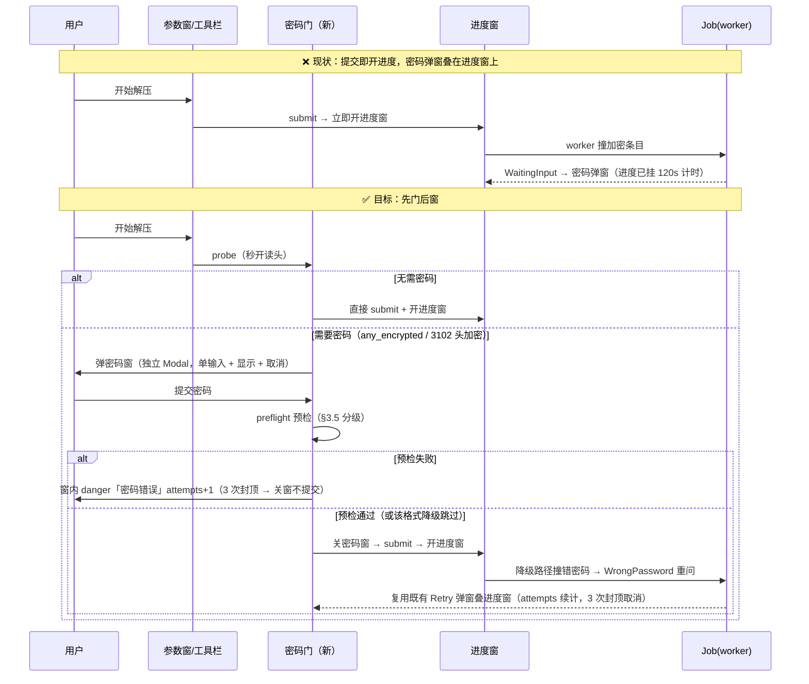

# hzip 压缩包密码与加密设计

| 项目 | 内容 |
|---|---|
| 文档版本 | v0.1（**设计稿**——未改动任何代码，供评审） |
| 需求来源 | ① 压缩弹窗高级参数区支持密码输入（两次防错）；② 解压遇加密档案先弹密码窗，**验证通过才显示解压进度弹窗**；③ 加解密必须落在底层格式实现；④ 单列哪些格式支持密码 |
| 上游文档 | [02-程序详细设计.md](02-程序详细设计.md) §1.2（Zeroizing）/§3.3（3100 段）/§7.3 红线 3/§8.1/§8.2/§9.9/§9.11/§10.2/§11.3/附录 B.2、[05-实施任务规划.md](05-实施任务规划.md) T45/T46、[09-GUI压缩对话框设计.md](09-GUI压缩对话框设计.md) §3.3/§4/§10④/§13③、[03-测试方案及用例.md](03-测试方案及用例.md) TC-ENC/TC-CONF-007/TC-CLI-009 |
| 参照产品 | 7-Zip 24.x「添加到压缩包 · 加密」「输入密码」、Bandizip 7.x「压缩 · 密码」「密码输入」弹窗（竞品细节以实测复核为准） |
| 审阅范围 | §2 格式矩阵、§3 底层改动、§4 GUI 时序（解压密码门）、§6 改动清单、§8 决策项 |

---

## 1. 目标与范围

### 1.1 诉求 → 落点

| 诉求 | 落点 | 现状 |
|---|---|---|
| 压缩弹窗密码输入（两次） | 09 §3.3 加密区（密码 / 确认密码 / 加密方式 / 加密文件名） | **UI 已实装**：双输入、不一致 danger 校验、方式下拉、摘要就地显示（`op_window.rs:866-871`、`dialogs/compress.rs:163-185`）；但 `WRITE_ENCRYPTION_READY=false`（`op_window.rs:658`）、`build_spec` 故意不携带密码（`dialog_vm.rs:285-297`）——**填了也不加密** |
| 解压先弹密码、验证过才开进度窗 | §4「解压密码门」新时序 | 现状是反的：提交 → 进度窗 → worker 撞加密条目 → `WaitingInput` → 进度窗上叠密码弹窗（`runtime.rs:739-749`） |
| 加解密在底层压缩实现处理 | §3 不变式：密码学只存在于 fmt crate（zip crate / sevenz-rust / unrar 承载） | **本就是现状**，予以确认冻结：core 只路由 `PasswordRef`/`Zeroizing`，GUI 永不碰密钥运算 |
| 哪些格式支持密码 | §2 矩阵 | 见下 |

### 1.2 范围

**内**：zip/7z 写侧加密接通；解压/浏览密码门与进度窗时序；7z 读侧密码接线（当前自产加密 7z **自己解不开**，见 §3.3）；CLI 压缩加密参数与 `l`/`p` 密码通道；互操作与回归测试。

**外**（登记备查）：公钥/密钥文件加密、SFX、**加密档案的条目编辑**（删除/改名/替换——现状自然报 3101，单列后续卡）、convert 目标加密（`convert.rs:153` 恒明文重打包，语义如此）、密码找回（不存在）、分卷间不同密码（单档单密码，两家同）。

---

## 2. 格式支持矩阵（哪些压缩包能支持密码）

| 格式 | 压缩时设密码 | 解压时要密码 | 方案 | 实现载体 | 现状（证据） |
|---|---|---|---|---|---|
| **zip** | ✅ 本设计接通 | ✅ **已全通**（CLI e2e TC-CLI-009 真实跑过） | ZipCrypto（传统·弱，兼容向）／ **WinZip AES-128/192/256**（AE-1/AE-2） | zip crate `aes-crypto`（读写 API 均确认存在：`write/options.rs:393 with_aes_encryption`、`unstable::write::FileOptionsExt::with_deprecated_encryption`） | 读 ✅（`reader.rs:16-18` ZipCrypto 预验 + `aes.rs:17-23` AES 双验证）；写 ❌ 两处显式 `Unsupported`（`handler.rs:88-94`、`writer.rs:124-129/320-327`） |
| **7z** | ✅ **已实装**（`writer.rs:330-355`） | ❌ **读侧未接线**（见 §3.3） | AES-256-CBC + SHA-256 KDF（2^NumCyclesPower，默认 19）；「加密文件名」= 头加密 | sevenz-rust `aes256` + `header_crypt.rs` 协议 | 写 ✅（含头加密，caps `AesHeader` `handler.rs:52-55`）；读 ❌ 打开/解码三处硬编码 `Password::empty()`（`reader.rs:483/515/531`），`read_entry` 的 `_pw` 参数未用（`reader.rs:649`） |
| **rar** | ✗ **只读格式，永不做写** | ✅ 已通（`ctx.passwords` 逐条现取，`reader.rs:25-27`） | rar5 AES-256；rar4 专有算法（经 unrar） | unrar（`Archive::with_password`） | 读 ✅（真实样本 `real_rar4_wrong_password_is_3101`）；**头加密 3102 后无重开通道**（`reader.rs:263-267` 死路；黄金测试因此 `#[ignore]`，`tests:292-309` 注释自证） |
| **tar** | ✗ | ✗ | 格式规范无加密概念 | — | caps `None` ✓ |
| **gz / bz2 / xz / zst** | ✗ | ✗ | 同上 | fmt-single | 显式拒绝 5001（`handler.rs:140-144`）✓ |

**三条格式语义**（矩阵的读法）：

1. **zip 永远不能加密文件名**——中央目录存明文文件名，所有工具（7-Zip/Bandizip 同）都做不到；zip 的密码只保护条目数据。
2. **7z 的「加密文件名」= 头加密**（`-mhe=on`）：开 = 数据+文件名全包，列目录也要密码（HZ-3102）；关 = 数据加密、文件名明文。
3. **tar/gz 系没有加密定义**——需要加密时引导改用 7z（09 §4 统一交互已定：控件**禁用 + 灰字原因**，不隐藏；如「该格式不支持加密，建议改用 7z」）。把 tar 塞进 7z 容器加密属另一格式选择，hzip 不做隐式组合。

> GUI 压缩格式列表（zip/7z/tar/gz/bz2/xz/zst）中**可设密码的只有 zip 与 7z**——这就是「能支持密码的压缩包格式」的直接答案。

---

## 3. 底层设计（加密只在格式层处理）

### 3.0 不变式（确认冻结，需求③的回应）

| 层 | 职责 | 证据 |
|---|---|---|
| fmt crate（zip/7z/rar） | **全部密码学**：KDF、加解密流、校验头/HMAC 预验、错密码判定 | zip→zip crate aes-crypto（`aes.rs:17-30`）；7z→sevenz-rust aes256 + `header_crypt.rs`（RustCrypto 备用原语）；rar→unrar |
| hzip-format | 只定义**契约与密码载体**：`PasswordRef<'_>` 借用、`PasswordSource` 问询、`EncryptionRequest` 请求、`EncryptionCaps` 能力（`caps.rs:13-44`、`password.rs:37-39`） | 02 §7.3 |
| hzip-core | 只**路由**密码：请求-应答 `JobRequest::Password`（`extract.rs:944-963` PwRouter）、`Zeroizing` 传递、日志脱敏 | 02 §9.11/§12.3 |
| hzip-gui / hzip-cli | 只**采集**密码：masked 输入、提交即清、三通道解析 | 02 §1.2/§10.2 |

红线 3 不变且升级为预验义务：**错密码必须返回 `Password`（3101/3102），禁止静默乱码流**；凡格式层存在 O(1) 预验通道（ZipCrypto 2 字节校验头 / AES KV+HMAC / 7z 头解密），必须在交付任何明文字节前完成验证（02 §7.3 原文 + `aes.rs:15-23` 已实现）。

### 3.1 契约层调整（hzip-format；涉 02 §7.2/§7.3 修订，走 §13.1）

| # | 调整 | 理由与证据 | 兼容性 |
|---|---|---|---|
| A | **`OpenOptions` 增 `password: Option<Zeroizing<String>>`**（现仅 `codepage`/`entry_name`，`handler.rs:81-84`） | 头加密档案**打开即需密码**：7z 构造期 `Archive::read` 解不了头 → 3102（`reader.rs:483`）；rar5 头加密列目录 → 3102（`reader.rs:263`）。二者今天都是**死路**——错误上抛后没有任何通道能带密码重新 open（`browse.rs:37-39` 只写「原样上抛」；rar 黄金测试注释明说「由 core 重新 open_reader 驱动」——该通道不存在） | 字段新增，`Default` 兜底；zip/tar/single 忽略此字段；逐 handler 消费 |
| B | **`FormatCaps` 增 `write_encryption: &'static [EncryptionRequest]`**（读写能力分离） | 现状单值 `encryption` 是**读**能力，且已撒谎：zip 实际能读 ZipCrypto+AES 双方案，却只声明 `ZipCrypto`（`handler.rs:43`）。GUI 的「加密方式」候选与 `enc_writable` 需要**写**能力做唯一门控（`op_window.rs:660`「格式能力是 UI 门控唯一来源」教义），不能在 GUI 里私藏格式→方案映射 | 新增常量字段，`FormatCaps` 构造点全量补 `&[]` 默认；zip=`[Aes(128/192/256), ZipCrypto?]`、7z=`[Aes(Bits256)]`、rar/tar/single=`&[]` |
| C | **`CreateOptions` 增 `encrypt_names: Option<bool>`**（7z「加密文件名」开关） | 现状 writer 拿到密码**恒开**头加密（`writer.rs:352 set_encrypt_header(true)`），GUI 的 `enc_names` 复选框没有数据面可落 | `None`=格式默认（7z 默认 `true`，见决策②）；其余格式忽略 |

### 3.2 zip 写侧（T45 收尾）

1. **AES 写 = 接线，不是造轮子**：`handler.rs:88-94` 与 `writer.rs:124-129` 的 `Unsupported` 改为按 `CreateOptions.encryption` 装配 `SimpleFileOptions::with_aes_encryption(AesMode, pw)`（`write.rs:502`；salt 随机、PBKDF2 派生、HMAC 尾、AE-1/AE-2 均由 zip crate 承担）。`aes-crypto` feature 已在 workspace 并集常开（根 `Cargo.toml:35`）。
2. **ZipCrypto 写**：zip crate 的写 API 在**非 feature 门控的 `unstable` 命名空间**（`lib.rs:71 pub mod unstable` + `unstable.rs:16-26`），semver 不稳承诺，故版本**精确锁** `=9.0.4`（该命名空间的 rustdoc 明写「MUST use an exact version specifier」）。三选一见决策①。
3. **密码注入点统一惯例**：`next_entry(meta, PasswordRef)` 首次携带密码即档案级固化（照抄 7z writer 既有语义 `writer.rs:330-355`），后续条目带同密码；`EntryMeta.encrypted` 按加密请求置位（现恒 `false`，`compress.rs:580` 注释已预告「T46 起条目级 pw」）。目录条目零长不加密（无意义），仅文件条目加密。
4. **如实登记的偏差**：zip 按 `bytes_written < 20` 自动切 AE-2/AE-1，**无法强制全量 AE-2**（`aes.rs:31-33` 已登记；9.0.4 的同一规则见其 `write.rs:2197`，与 4.6.1 逐字相同——2026-10-17 升级依赖时复核）——互操作测试按「7-Zip 能开 + 往返一致」裁决，不断言 AE-x 标签。
5. **追加语义**：zip 追加是中央目录直改（`append.rs`），旧条目不动、新条目带当前密码——追加到加密 zip **不需要旧密码**（不读旧数据），与 7-Zip 行为一致；补一条用例锁住。

### 3.3 7z 读侧接线（关键缺口：自产自解都做不到）

现状：写侧已交付（含头加密），但读侧三处 `Password::empty()`（`reader.rs:483/515/531`）+ `read_entry(_pw)` 未用——**hzip 自己压的加密 7z，hzip 自己解不开**；conformance 测试只好只断言「不产出乱码」（`conformance.rs:549-565`）。接线分两分支：

| 分支 | 触发 | 接线 |
|---|---|---|
| **头加密**（`kEncodedHeader`） | 7-Zip `-mhe=on`；hzip 默认形态（决策②） | 消费 `OpenOptions.password`（3.1 A）→ `Archive::read(inner, len, pw)`；**解头成功即密码验证完成**（天然 O(1) 精确预检）；解头失败 → 既有 `PasswordRequired`→`Password{Header}` HZ-3102 零泄露映射（`reader.rs:343-346`）**原样复用** |
| **数据加密**（头明文） | 7-Zip `-mhe=off`、第三方包 | open 仍空密码（头没加密，`entries()` 可列 ✓）；**解码期**带密码：`read_entry(PasswordRef)`、`extract/test` 的 `ctx.passwords` → `BlockDecoder::new(folder, &archive, pw, src)`（`reader.rs:531` 三处空密码改取注入源）；`MaybeBadPassword`→3101 映射已有（`reader.rs:347-349`） |

写侧仅一处微调：`set_encrypt_header` 由恒 `true` 改随 `CreateOptions.encrypt_names`（3.1 C）。

### 3.4 rar / tar / single

- **rar**：读路径完备；经 3.1 A 打通头加密重开（`open` 带密码 → `Archive::with_password` 用于 listing）。写永不支持（caps 已如实声明）。
- **tar / single**：维持显式拒绝（`writer.rs:140-144` 的 5001 是正确行为，不要动）。

### 3.5 core 服务层

| 项 | 内容 |
|---|---|
| 压缩密码注入 | `compress.rs` 四处 `PasswordRef::none()`（477/487/637/655）改为档案级 `PasswordRef::new(pw)`（密码取自 `CompressSpec.encryption` 配套字段，见下）；`EntryMeta.encrypted` 按请求置位（580 行注释兑现）。`CompressSpec` 已有 `encryption: Option<EncryptionRequest>` 且已透传 `CreateOptions`（93-94/283 行）——**只差密码本体**：增 `password: Option<Zeroizing<String>>`（与 `EncryptionRequest` 同进同出，成对校验：有请求无密码 → 提交前 HZ-5003） |
| **`probe` 探测**（新，密码门支撑） | `Engine` 增 `probe(src) -> Probe { header_encrypted, any_encrypted }`：open + `entries()` + 读 `EntryInfo.encrypted/header_encrypted` 聚合 + 关。契约红线 1 保证 `entries()` 只读头、秒开（02 §7.3）。数据源优先级：GUI 已浏览的档案用现成条目元数据（`row.encrypted` 与列表 Lock 徽标同源），未浏览才现探 |
| **`preflight` 预检**（新，分级） | 组合既有能力，**不加新 trait 方法**：① 7z/rar5 头加密 → 带密码 open，成败即结论（精确）；② zip → 首个加密条目 `read_entry(pw)` 触发既有预验（ZipCrypto 校验头/AES KV，`aes.rs:18-21`「流尚未交付」），**条目 `size_packed` > 64 MiB 则跳过预检**（zip 读加密走整条目临时 spool，`reader.rs:309`，须限界）；③ 7z 数据加密（头明文）→ **无廉价验证通道**（CRC 需全解），跳过；④ rar 数据加密 → 同③，跳过（P1 可加有界试解）。跳过 ≠ 失败：进进度窗后由既有 `WrongPassword` 重问链兜底（§4.2） |
| convert / 测试自检 | convert 源密码已有（`convert.rs:156-162 ask_password`）✓ 不动；`compress.rs:795` 自检恒 `NoPwSource` 正确（自产未加密产物） |

### 3.6 CLI

| 命令 | 现状 | 调整 |
|---|---|---|
| `c` 压缩 | `--password-env` 已有 flag（`cli.rs:66-69`）但 `ops.rs` 构造 `CompressSpec` **不携带加密** → 通道空转 | 密码值 → `CompressSpec.password` + 新增 `--encryption <zipcrypto\|aes128\|aes256\|aes>`（缺省按格式：zip→aes256、7z→aes）与 `--encrypt-names`/`--no-encrypt-names`（仅 7z；缺省随决策②）。TTY 下 rpassword **问两次**（与 GUI 双输入同构防错）；env 通道单值直取 |
| `x`/`t`/`cv` | 三通道优先级链 + 3 次重试 + 3101 退出 2，e2e 已锁（`password.rs`、TC-CLI-009） | **不动**（02 §10.2/退出码契约冻结） |
| `l`/`p` | **无任何密码通道**：flag 没有、resolver 没有（`cli.rs:110-133`）——头加密档案 `hzip l` 直接 3102 退出，连 `HZIP_PASSWORD` 都不会被读 | 补 `--password-env` + 接同一 `PasswordResolver`（3102 → 通道取密码 → 带 `OpenOptions.password` 重开）；非 TTY 且无 env → 3102 退出 2（现状语义，不挂起——TC-CLI-012 看门狗不变）。见决策⑤ |

---

## 4. GUI 设计

### 4.1 压缩对话框（09 §3.3 已画好——落地清单）

> 口径确认：需求说的「高级参数里的密码输入项」即 09 的**「加密」折叠区**（与「高级选项」并列的第二折叠区，参数窗正文内）——布局不动，本设计只**解除写侧挂账**。

| # | 调整 | 证据/落点 |
|---|---|---|
| 1 | `WRITE_ENCRYPTION_READY: false → true`（随 §3.2/§3.3 交付同批翻转） | `op_window.rs:658`——翻转后加密区自动露出，面板侧无需改动（注释原话） |
| 2 | `build_spec` **携带** `password` + `encryption`，删除「故意不携带」挂账注记与 `let _ = (&self.password, …)` | `dialog_vm.rs:285-297`；守护测试 `compress_build_spec_carries_new_fields` **反转断言**（现断言「密码不进 spec」，`dialog_vm.rs:1079-1100`） |
| 3 | `enc_writable` 改由 `caps.write_encryption` 派生；「加密方式」候选用白名单 ∩ `write_encryption` 过滤 | `op_window.rs:955`（现为 `enc_supported && WRITE_ENCRYPTION_READY` 常量门） |
| 4 | `enc_hint` 删「写侧未启用」分支，只留「该格式不支持加密，建议改用 7z」 | `op_window.rs:840-865`；摘要行「已设密码（暂不写出）」措辞同步删除 |
| 5 | 校验补全：加密方式 ≠ none 且密码为空 → danger + 禁提交；两密码不一致 → danger（**已有**） | 不一致校验 `op_window.rs:866-871` ✓；空密码为新增 |
| 6 | 密码明文收敛：`ParamsForm.password_text: String` 改 `Zeroizing<String>`（或提交即清零），提交成功后清空两输入 | 现状明文 String 持有 `op_window.rs:324/404`；VM 侧已是 `Option<Zeroizing<String>>`（`dialog_vm.rs:193`），但 UI 态游离——02 §1.2 要求「涉及密码的类型一律 Zeroizing」 |
| 7 | 摘要/就地摘要：`enc_summary` 显示「AES-256 · 加密文件名」/「未加密」 | `op_window.rs:896-899` 现只按密码空判，需带方式与文件名开关 |

**双输入交互规格**（09 §3.3 既有，确认不改）：两框均 `Input` masked + 显示切换（`mask_toggle`）；实时比对，不一致 → 确认框下 danger「两次输入不一致」；提交即清空内部态（`dialogs/mod.rs:41-45` 语义）。

### 4.2 解压密码门（★新时序：验证通过才开进度窗）

现状与目标：

**实现结构**（最大化复用既有件）：

| 件 | 方案 |
|---|---|
| 门的载体 | `DialogRouter` 增**门状态**（与 job 状态并列：`gate: Option<GateRequest { src, attempts, last_error }>`），投影进既有 `UiDialogPrompt::Password` 通道（`state.rs:1111-1140`）——**宿主窗口解析、身份换窗、遮罩/Esc、prompt_window 生命周期全部白嫖**（`runtime.rs:739-749` 无主界面挂参数窗/进度窗的逻辑原样生效）。job_id 槽用保留值区分门/任务中，或 `Password{ job_id: Option<u64> }`（实现二选一，倾向后者语义干净） |
| 渲染 | 复用 `password_dialog` + `PasswordDialogProps`（`dialogs/password.rs`）：门态 = attempts/last_error 同一套字段；Retry 文案「第 n/3 次」同源 |
| 应答路由 | `answer_prompt`（`prompt.rs:122-148`）分叉：门武装 → 跑 preflight（背景线程，notifier 回投）；任务中 → `router.submit_password`（现状） |
| 提交编排 | 照「**入口可多、构造与投递只有一份**」教义（`dispatch.rs:457` 注释）新增唯一门控入口 `submit_extract_gated(...)`：`probe → 无需密码 ? 原 submit+开进度 : arm gate`。三个既有入口（参数窗 `ExtractStart`、工具栏/右键 `submit_extract_locked`、协议 argv 管线）全部改走它 |
| **进度窗时序** | `open_progress_window_with`（`dispatch.rs:33` 唯一进度窗入口）只在「门验证通过 / 无需密码」后调用；门未过 = 进度窗从未打开 = 用户看到的正是「验证通过才显示解压进度弹窗」 |
| 批量多档案 | `op_window.rs:1013-1017` 循环逐档案过门：背景循环内 `probe → 需密码 ? 阻塞等门结果 : 提交`，门通道单实例串行复用（attempts 按档案重置） |
| 取消语义 | 门上取消 = **不提交任何任务**、关窗回参数窗（参数窗保留已填参数）；任务中 Retry 取消 = `handle.cancel()`（现状） |
| 头加密档案 | browse/探测遇 3102 → 同一门（reason=HeaderEncrypted，`PasswordReason` 枚举已有）→ `OpenOptions.password` 重开（3.1 A 使其可行）。浏览成功后**本次解压仍独立过门**（决策③选 A 的语义） |
| CLI | **不引入门**——CLI 无进度窗概念，三通道异步应答已是正确形态；非 TTY 永不阻塞（TC-CLI-012）不变 |

### 4.3 浏览 / 预览 / 列表

- 列表 Lock 徽标已有（`views/browse.rs:1535 row.encrypted → AppIcon::Lock`）✓，与 `probe` 同数据源。
- 打开头加密档案 3102 现状「原样上抛」（`main_vm.rs:103-106`）→ 改：**3102 → 拉起密码门（HeaderEncrypted reason）→ `OpenOptions.password` 重开**（这是门的第二个挂载点，同一通道）。
- **加密条目双击打开**：已落地（2026-09-28，见 §9.7）——`entry.encrypted` + 该档案未缓存密码 → 密码门（`GateAction::OpenSelection`），预检通过后缓存并重跑；
  内层加密容器同门（`GateAction::OpenContainer`，嵌套解出时带 `OpenOptions.password` + `PasswordRef`）。打开动作本身已改为「一律外部程序」（内置查看器停用），故不再有内置预览的 3101 死路；
  `ui/views/preview.rs` 保留代码待恢复（恢复时按 §9.7 的接线点接回带密码预览）。

### 4.4 密码呈现安全（现状已达标项确认）

masked 输入 + 显示开关、提交即清 UI 内部态（`password.rs:43-66`）、`Zeroizing` 持有（02 §1.2）、日志 `redact!` 脱敏（02 §12.3）、密码不进任何 `tracing` 字段（`compress.rs:295` 注释「密码/加密请求内容不落日志」）✓。本设计仅补 §4.1 #6 的 UI 态明文 String 一处。

---

## 5. 7-Zip / Bandizip 参照对照

| 能力 | 7-Zip | Bandizip | hzip 本设计 |
|---|---|---|---|
| 压缩密码输入 | 密码 + 确认两框 | 密码 + 确认两框 | 同（09 §3.3 已实装） |
| 加密算法选择 | zip：AES-256 / ZipCrypto；7z：AES-256 唯一 | AES-256 默认，ZipCrypto 标注不安全 | ENC_METHOD：none / zipcrypto / aes128 / aes256（AES 三档源自 WinZip 规范，zip crate 三档 `AesMode` 原生支持）；**缺省 AES-256**（两家同款默认） |
| 加密文件名 | 仅 7z，复选框（默认不勾） | 仅 7z，复选框 | 仅 7z，`encrypt_names`（默认值见决策②） |
| zip 能否加密文件名 | 不能（格式限制） | 不能 | 不能——UI 不提供该选项（`enc_names_supported = caps.encryption == AesHeader`，`op_window.rs:839` 现判定即正确） |
| 解压遇密码 | 弹密码 Modal，错则回弹重输 | 弹密码 Modal，错则回弹重输 | 同，且**更严**：预检通过才开进度窗（需求②显式化）；降级格式由既有 Retry 链兜底 |
| 头加密档案 | 列目录即要密码、零名称泄露 | 同 | 同（HZ-3102 零泄露已实现并有测试，`conformance.rs:531`） |
| 密码记忆 | 无（每次操作询问） | 设置项可记忆（可选） | 本期每次操作独立过门（决策③ A）；会话缓存列 P2 |
| tar/gz 加密 | 不支持 | 不支持 | 不支持 + 禁用引导 7z（09 §4） |

> 竞品行为以本机实测复核为准；本表只锁定**本设计不弱于两家**的交互底线。

---

## 6. 改动清单（按文件）

| 层 | 文件 | 改动 | 量级 |
|---|---|---|---|
| format | `handler.rs` | `OpenOptions.password`（3.1 A）、`CreateOptions.encrypt_names`（3.1 C） | S |
| format | `caps.rs` | `FormatCaps.write_encryption`（3.1 B）+ 全 caps 构造点补默认 | S |
| fmt-zip | `handler.rs`/`writer.rs` | 解除两处 `Unsupported` → `with_aes_encryption`（+ 决策①的 ZipCrypto 路径）；`next_entry` 密码固化；`EntryMeta.encrypted` 置位；caps `write_encryption` | M |
| fmt-7z | `reader.rs` | 三处 `Password::empty()` → 注入源（`OpenOptions.password` / `PasswordRef` / `ctx.passwords`）；`_pw` 参数启用 | M |
| fmt-7z | `writer.rs` | `set_encrypt_header` 随 `encrypt_names`（一行级） | S |
| fmt-rar | `reader.rs` | listing 带 `OpenOptions.password` 重开（3102 死路打通） | S |
| core | `services/compress.rs` | `CompressSpec.password`；四处 `PasswordRef::none()` → 档案级注入；`encrypted` 置位 | S |
| core | `services/browse.rs`（或新 `probe.rs`） | `probe` + `preflight` 两个服务函数 | M |
| cli | `cli.rs`/`ops.rs` | `c` 的 `--encryption`/`--encrypt-names` + 密码进 spec；`l`/`p` 补 `--password-env` + resolver | M |
| gui | `ui/views/op_window.rs` | `WRITE_ENCRYPTION_READY=true`；候选/校验/摘要/明文收敛（§4.1） | S |
| gui | `viewmodel/dialog_vm.rs` | `build_spec` 携带密码 + 测试反转 | S |
| gui | `viewmodel/router.rs` | 门状态 + `UiDialogPrompt` 投影扩展 | M |
| gui | `ui/shell/dispatch.rs` | 唯一门控入口 `submit_extract_gated` + 进度窗时序挂钩；三入口收口 | M |
| gui | `ui/shell/prompt.rs`/`runtime.rs` | 应答分叉（门/preflight 背景执行）；3102 打开→门重开 | S |
| gui | `locales/{zh-CN,en}` | 门态文案（密码错误/第 n 次/格式不支持加密等，09 §10 key 清单大半已列） | S |
| tests | 见 §7 | — | M |

量级合计：**S×10 + M×7**，无 L；无新依赖（RustCrypto/zip/sevenz-rust 全部就位）。

---

## 7. 测试与验收

**既有锚点（保持全绿，不动语义）**：TC-CONF-007 错密码 3101（zip + 真实 rar4 样本）、TC-CLI-009 三通道 e2e（`zipcrypto-7z.zip` 黄金夹具）、7z 头加密零泄露（`conformance.rs:531 header_encrypted_flag`）、`content_encrypted_no_garbled_stream`（红线 3 兜底）、router 三态/3 次封顶单测（`router.rs:399-484`）、密码提交即清（`dialogs/tests.rs:129`）。

**新增**：

| # | 用例 | 守什么 |
|---|---|---|
| 1 | zip 写 AES-256 往返 + **7-Zip 交叉开包**（T50 资产管线） | 产物真加密（无密码读 → 3101 非乱码）+ 互操作 |
| 2 | zip 写 ZipCrypto（若决策① A/B）+ 7-Zip 交叉 | 老工具兼容 |
| 3 | 追加到加密 zip：旧条目不动、新条目带密码、**无需旧密码** | §3.2 #5 语义 |
| 4 | 7z 自产加密回解：头加密（零密码 3102 → 带密码全量 sha256 一致）、数据加密（`encrypt_names=false` 分支） | **修「自产自解断链」的回归锚** |
| 5 | 7z/rar 头加密：`probe` 判定 + `OpenOptions.password` 重开 + 零泄露维持 | 3.1 A |
| 6 | `preflight` 分级：zip 正/误密码 O(1) 判定；>64MiB 首条目跳过；7z 头精确；7z 数据跳过降级 | §3.5 矩阵 |
| 7 | GUI `tc_gui_005_password_dialog` 从 `#[ignore] todo!` 落实（`contracts/tests.rs:28-33`）：三态 + 3 次封顶 + 取消 | 密码弹窗主链 |
| 8 | GUI 门时序：preflight 失败 → **submit 未被调用、进度窗未开**（VM 半场 mock 计数）；通过 → 恰一次 | 需求②的可断言面 |
| 9 | GUI 双密码不一致/空密码禁提交；`build_spec` 携带加密（反转断言）；`write_encryption` 门控候选 | §4.1 |
| 10 | CLI：`c --encryption aes256` 产物自读回 + 7-Zip 开；`l` 3102 通道（决策⑤后）；非 TTY 不挂起维持 | §3.6 |

验收口径（随任务卡落）：`cargo test -p hzip-fmt-zip -p hzip-fmt-7z -p hzip-core -p hzip-gui --lib` + CLI e2e + 交叉用例；clippy 零告警；红线检查 `python build/checks/deps-direction.py`（violations=0）。

---

## 8. 分期与决策项

### 8.1 分期

| 期 | 内容 | 对应诉求 |
|---|---|---|
| **P0**（主链贯通） | §3.1 三字段契约 → zip 写 AES → 7z 读接线 → core 密码注入 + probe/preflight → GUI 翻转挂账 + 解压密码门时序 → CLI `c` 加密 + `l/p` 通道 → 测试 1/4/5/6/7/8/9/10 | 三条诉求全绿 |
| **P1** | 加密条目预览门（决策④）、批量多档案门打磨、rar 数据加密有界预检、ZipCrypto 若 P0 选 C 则届时补、测试 2/3 | 体验补全 |
| **P2** | 加密档案的**条目编辑**（读写全密码通道）、convert 目标加密、会话密码缓存（决策③ B）、fmt 级 O(1) `verify_password` API（去掉 64MiB spool 预检） | 范围外挂账 |

任务卡映射：zip 写 = **T45 收尾**；7z 读 = **T46 收尾**（原卡「AES」读写各半，读侧欠账）；密码门 + GUI 接通、CLI 扩展 = 新卡（建议 **T-ENC-GUI / T-ENC-CLI**——沿用 TC-ENC 测试组前缀；注意 `T-PW` 已被[进度窗口任务卡](../tasks/T-PW/README.md)占用）。§3.1 三字段走 02 §13.1 修订（字段级 RFC，不动红线）。

### 8.2 决策项（请拍板）

| # | 决策 | 选项 | 建议 |
|---|---|---|---|
| ① | ZipCrypto **写** | A：用 zip `unstable::FileOptionsExt`（零自研；风险=unstable API 随版本漂移，以 `=9.0.4` 精确锁版 + 冒烟测试守——该命名空间 rustdoc 亦要求精确版本号）／B：自研 PKWARE（~100 行 + 交叉测试）／C：本期砍掉该选项（ENC_METHOD 收窄，UI 标注「暂不支持」） | **A**——API 实测存在、版本已锁、成本最低；评审若不接受 unstable 语义则 C（读侧 ZipCrypto 不受影响） |
| ② | 7z「加密文件名」默认值 | A：默认**开**（安全优先：文件名不泄露，但列目录也要密码）／B：跟 7-Zip 默认关 | **A**——本产品核心诉求就是「发现密码就弹窗」，文件名明文是真实泄露面；复选框始终可关 |
| ③ | 解压密码是否会话缓存 | A：每次解压操作独立过门（严格符合需求字面；头加密档案会浏览、解压各问一次）／B：内存会话缓存（档案路径+大小+mtime 指纹，验证过不重问，Zeroizing 不落盘） | **P0 用 A**（简单、可预期），P2 视使用反馈上 B |
| ④ | 加密条目**预览/进入**是否本期过门 | A：本期（复用门组件，改动小）／B：P1（本期预览遇加密仍 3101，提示「请先解压」） | **B（P1）**——不阻塞三条主诉求；P0 集中把「压/解」链打穿 |
| ⑤ | CLI `l`/`p` 密码形态 | A：补 `--password-env` + TTY rpassword 交互（与 `x` 三通道同构）／B：只支持 env，不交互 | **A**——与既有三通道完全同构，交互成本极低；非 TTY 降级语义冻结不动 |

---

## 附：现状证据速查

| 断言 | 证据 |
|---|---|
| GUI 加密区 UI 已实装（双输入+校验+门控位） | `op_window.rs:156-158/866-871/950-958`、`dialogs/compress.rs:163-185` |
| 写侧挂账开关 | `op_window.rs:658 WRITE_ENCRYPTION_READY = false` |
| build_spec 故意丢弃密码 | `dialog_vm.rs:285-297` + 测试 `dialog_vm.rs:1079-1100` |
| zip 写拒绝 | `fmt-zip/handler.rs:88-94`、`writer.rs:124-129/320-327` |
| zip crate 写加密 API 存在 | `zip-9.0.4/src/write/options.rs:393 with_aes_encryption`、`unstable.rs:33 FileOptionsExt`、`lib.rs:48 pub mod unstable`（无 feature 门） |
| 7z 写已交付、读未接线 | `fmt-7z/writer.rs:330-355` vs `reader.rs:483/515/531/649` |
| 7z/rar 头加密 3102 无重开通道 | `fmt-7z/reader.rs:483`（构造期即死）、`fmt-rar/reader.rs:263-267`、`fmt-rar/tests:292-309`（ignore 注释自证） |
| 解压密码请求-应答链已建成（只等消费方接线） | `core/extract.rs:171/944-963 PwRouter`、`router.rs` 三态、`prompt.rs` 开窗/应答、`runtime.rs:739-749` 宿主 |
| CLI 三通道已完备、`l/p` 无通道 | `cli/password.rs`、`cli.rs:110-133` |
| 进度窗先于密码的现状时序 | `dispatch.rs:33/458`、`op_window.rs:1377`、`state.rs:1111-1140` |
| GUI 密码弹窗测试未落实 | `contracts/tests.rs:28-33 #[ignore = "T-G30"] todo!` |

---

## 9. 落地修订（实施记录）

**决策执行**：①A（ZipCrypto 写走 zip `unstable::write::FileOptionsExt`，锁 `=9.0.4`）、②A（`encrypt_names` 默认开）、③A（不缓存——每次解压独立过门）、⑤A（CLI `l`/`p` 三通道同 `x`）；④ 加密**条目预览**仍列 P1（data-encrypted 条目预览 3101，先于解压提示）。

**架构落点相对 §4.2 的修订**（实现更简，用户可见时序不变）：

| 设计稿 | 落地 |
|---|---|
| 独立 probe/gate 服务 + submit_extract_gated | 并入 core 解压 job：`open_archive_retry`（头加密 3102 在任何进度事件之前经 `JobRequest::Password` 问密码重开）+ `resolve_early_password`（所选含加密 → 首事件前问密码并有界预检 ≤64 MiB，`ExtractPipeline::early_pw` 复用、管道内零二次弹窗） |
| 进度窗「门验证通过才开」 | **进度窗挂起机制**：解压提交点登记 `jobs.register_progress_open`，泵在**首个非 `JobStarted` 事件**（`JobTotal`/`Entry*`/`JobFinished`）发 `VmSignal::ProgressWindowOpen(id, force)` 开窗——`JobStarted` 由 jobs 起跑线通用发出（先于密码问询）故被排除；密码弹窗因此天然先于进度窗 |
| §4.3 浏览门 | `DialogRouter::browse_gate`（无任务、`job_id = u64::MAX` 哨兵投影）：`open_archive_task` 武装 → `answer_prompt` 门分支带密码同步重开（红线 1 头解析秒开）→ MRU/会话在门内落账；`open_then_extract` 对头加密档案**不预开**（避免与任务内问询双弹窗——job 自问，单弹窗+挂起时序） |

**顺手修出的真缺陷**：zip 读侧 CRC 收口缺 `crc32 == 0 → 视为未提供`（02 §8.3 红线 2 唯一例外）分支——WinZip AES（AE-2）按规范把中央目录 CRC 置 0，首次写读闭环即误报 Checksum（`fmt-zip/reader.rs` 两处校验点补分支）。

**契约变更**：`OpenOptions.password`、`FormatCaps.write_encryption`（读写能力分离，UI 门控唯一来源）、`CreateOptions.encrypt_names`；`CompressSpec::{password, encrypt_names}`（成对校验 HZ-5003 提取为 `validate_encryption_pair` 并单测）。

**验收**：`cargo test --workspace` **845 通过 / 0 失败**（+13 新用例：TC-ENC-ZIP×4、TC-ENC-7Z×3、TC-CLI-ENC×4、成对校验、浏览门计数）；clippy 0 警告；`deps-direction` violations=0；`cargo fmt --check` 干净。

### 9.1 上线首验缺陷与修复（2026-09-23 用户实测）

**症状**：GUI 工具栏解压与右键「hzip-智能解压」对加密档案都**不弹密码窗**，约 1–2 分钟后失败文本「不支持的操作」；紧随其后提交带密码的压缩，弹窗长期停在「队列中、等待开始…」。用浏览门打开同一档案（输密码看条目）一直是正常的。

**根因 A（密码窗不出）**：`pump_host.rs::run_job_loop` 用 `rx.recv()` 阻塞等下一条进度事件，`drain_requests`（把 `JobRequest::Password` 收进 router → 快照投影弹窗）只在**事件到达之后**执行。而早期密码门 `resolve_early_password` 的问询恰好落在「`JobStarted` 之后、`JobTotal` 之前」的**无事件窗口**——请求永远排不空，worker 侧 `recv_timeout` 满 120 s 决策超时（`request.rs` 构造成 `HzipError::Unsupported{ what: "hz-5002 decision-timeout (>120s)" }`，GUI 只渲染错误类型 → 用户看到「不支持的操作」）。冲突弹窗历来可用，是因为冲突发生在条目事件之间（排空随事件一起跑）；浏览门不经任务，故也不受影响。

**根因 B（压缩排队卡死）**：engine 有 `max_running` 门控（`engine/mod.rs:90` = `max_parallel` 与池大小取小）。卡在 `WaitingInput` 的解压任务整整 120 s 占着运行名额，后提交的压缩任务只能停在 `Queued`（行文案「队列中 / 等待开始…」）。A 修好后自动消解。

**修复**（三处，均在 GUI 泵侧）：

1. `hzip-progress::EventReceiver::recv_timeout` + 三分态 `RecvTimeout::{Event, Timeout, Closed}`——原 `try_recv` 把「无事件」与「已关闭」都塌成 `None`，调用方无法据此决定继续等还是退出。
2. `run_job_loop` 改 **20 ms 静默检查点**（与 core `need()` 的取消检查节奏一致）：空转超时也排空请求，密码请求 20 ms 内到账。
3. `drain_requests` **弹窗互斥串行**：router 已有待决弹窗（密码/冲突）或浏览门在等应答时不 `intake`——请求留在通道，等当前弹窗收口后的下一轮再收，防后到任务的请求顶掉 `active_job` 使先到任务饿死（多任务并发加密解压场景）。

**回归测试**：`recv_timeout_trichotomy`（hzip-progress）、`drain_defers_while_dialog_busy_then_intakes`、`run_job_loop_prompts_password_in_event_silence`（驱动真实 `run_job_loop`：只投请求、不投任何进度事件，断言弹窗状态到账——修复前该断言必失败）。

**遗留（如实登记）**：用户若忽略密码窗满 120 s，仍会看到「不支持的操作」——`hz-5002` 的 error kind 就是 `Unsupported`，GUI 只渲染类型、不渲染 `what` 细节（文案可读性问题，未改契约）。

### 9.2 提示窗独立化与冲突弹窗修复（2026-09-23 第二轮用户实测）

**症状**：① 右键「智能解压」对加密包不弹密码框（最终仍是 120 s 后「不支持的操作」）；② 右键「解压」参数窗没有密码项；③ 冲突处理弹窗层级低于进度窗、宽度不足溢出（覆盖/跳过挤出）、「应用到全部」勾不上。

**根因（scout 取证 + 代码核对）**：

- ① 旧实现把密码/冲突提示用 `window.open_dialog` 长在**宿主窗口**上（`runtime.rs` 解析「主窗优先 → active → 任一窗口」）。`UiMode::Direct`（右键动作）**根本不建主窗口**；进度窗在解压提交点还是**挂起**的（`register_progress_open`），此时进程内零窗口 → 宿主解析为 `None`，请求登记了却无人渲染 → 120 s 决策超时（hz-5002）。即便有进度窗，进度窗根视图**没挂对话框层**（未包 `Root`），`open_dialog` 同样无人渲染。
- ② 解压链路**完全没有密码通道**：`ExtractOptions`（`hzip-core/src/services/extract.rs`）与 `ExtractDialogVm`（`hzip-gui/src/viewmodel/dialog_vm.rs`）都没有 password 字段，密码只走运行时 `ctx.need(JobRequest::Password)`。
- ③ 冲突弹窗是 460 px 的 Modal，footer 一行硬塞 1 复选框 + 4 按钮（无 gap/换行）→ 溢出；复选框是**受控件**（`.checked(props)` + 回调写回），而旧代码把状态存在**每帧重建**的 `Rc<Cell>` 里 → 永远回到未勾选。

**修复（①②③ 中的 ①③）**：

1. 新增 `ui/views/prompt_window.rs`：密码/冲突共用的**独立 OS 窗口**（`panel_shell` 形态，560×360、不可缩放、开窗即 `activate_window`）。层级天然在进度窗之上，直启模式（零窗口）也有宿主，宽度固定不再溢出。
2. 提示窗生命周期改由主线程泵**每批信号无条件 `sync`**：无窗则开、有窗就地更新（身份变化重置交互态，重试也刷新）、待决消失即关窗；删掉「宿主窗口解析」与 `open_prompt_dialog`（主窗内 Modal 路径整体退役）。
3. 冲突「应用到全部」改为**实体字段** + `cx.notify()`（`PromptWindow.apply_all`），勾选真实生效并随决策上抛。

**验证**：`cargo test --workspace` 849 通过 / 0 失败；clippy 0 警告；GUI lib 连跑稳定；新增 `prompt_window::tests::prompt_body_follows_kind`。

**未实施（遗留）**：② 解压参数窗的「密码（可选）」需要跨层新增通道——core `ExtractOptions`/JobSpec 增 password 字段 → `resolve_early_password`/`PwRouter` 作为**首个候选**（错/空回落到现有询问链）→ GUI `ExtractDialogVm` + 参数窗字段 + `build_spec` 携带；本次未做，留待下一轮。

### 9.3 直启模式提示窗回归修复（2026-09-23 第三轮用户实测）

**症状**：右键「智能解压」带密码档案 → 输完密码后**既没有进度窗、也没有冲突提示**；密码窗输入框聚焦高亮上沿被裁、窗口过大。

**根因**：直启模式（`UiMode::Direct`）**没有主窗口**，进程内唯一的常驻窗口本该是进度窗——但 argv 解压意图把进度窗**挂起**（`register_progress_open`）等密码应答。等待期间零窗口，提示窗是唯一窗口；应答后提示窗自行关闭，此刻若进度窗尚未开（或同一批内先关后开），就没有窗口托管后续的进度与冲突提示 → 用户看到「输完密码什么都没发生」。

**修复**：

1. 直启模式改为**提交点立即开进度窗**（`mode == UiMode::Direct` 走立即开分支，不再挂起）；提示已独立成窗，天然浮在进度窗之上，不必再用「挂起」保证层级。主界面模式维持挂起语义（主窗在场，提示有家）。
2. 提示窗高度 360 → **230**（密码态只有一行输入）；正文容器加顶部留白（`pt(sp(2))`），输入框聚焦高亮环不再被滚动容器上沿裁掉。

**验证**：`cargo test --workspace` 850 通过 / 0 失败；clippy 0 警告。

### 9.4 任务调度按文件串行/并行 + 关提示窗即取消（2026-09-23 第四轮用户实测）

**症状**：右键「添加到压缩文件」填了密码后压缩任务**一直停在「队列中等待」**；用户同时提出期望——**同一档案的任务串行、不同档案并行**。

**根因**：

1. **关提示窗 ≠ 应答**：用户直接 ✕ 关掉密码/冲突提示窗时，旧实现只是窗口消失，请求仍挂在 router 上——任务干等到 `REQUEST_TIMEOUT_SECS=120`，期间**一直占着并发名额**，其后提交的任务只能排队。
2. **全局门控不区分文件**：调度只按「运行数 < max_parallel」放行队头，任一卡住的任务会拖住其后的**所有**任务（哪怕它们操作的是完全不同的档案）。

**修复**：

1. 提示窗 ✕ → **视为取消应答**（密码 → `PasswordCancel`；冲突 → `ConflictAnswer(Abort)`）——`sync` 检测到「登记身份未变但窗口已死」即回取消并清登记。
2. 引擎调度加**资源键**（`jobs/mod.rs::resource_keys`）：键 = **源档案 + 输出档案**路径（`canonicalize` 后小写归一，失败回落原样）。派发时跳过键被占用者、取其后的第一个可跑任务（保序），全被占则等占用方收口；全局上限仍是 `max_parallel`。解压 a.zip 与重压 a.zip 互斥，a.zip 与 b.zip 并行。

**测试**：core `sched_tests`（同键等待 / 异键派发 / 键覆盖源与输出且归一）；`mock_jobs::parallel_limit` 原用**同一 tar 路径**造 5 个任务（隐含依赖「同文件也并行」的旧行为，且运行中重写同一文件）——改为各自独立档案，其验证目标「全局并发 ≤ 2」不变。

**遗留（下一轮）**：解压参数窗「密码（可选）」跨层通道；解压参数窗高度按内容自适应（现固定 660 高，下方留白）。

### 9.5 参数窗高度按内容估（2026-09-23 第五轮用户实测）

**症状**：右键「解压选项」窗口下方一大片空白（固定 660 高）。
**修复**：`op_window::params_window_height(kind)` 按该面实际字段行数估高（解压面 6 行 → 夹到 `PARAMS_WINDOW_MIN_H`；压缩面 12 行 → 仍取默认上限 660），窗口仍可缩放。
**测试**：`ui::views::op_window::tests::params_height_follows_content`（解压面矮于压缩面且都在 `[min, max]` 内）。

### 9.6 解压密码通道（含解压选项窗控件，2026-09-23 第六/七轮）

**已落地**（全链贯通，右键「解压选项」可见密码框）：

1. `ExtractOptions.password: Option<Zeroizing<String>>`（与 `CompressSpec.password` 同口径）；
2. **首个候选**语义：`open_archive_retry`（头加密打开）与 `resolve_early_password`（条目级预热）都先用它——有界条目真读验证通过即**零弹窗**，不对则落回现有询问链（首个弹窗按「密码错误」呈现）；无有界条目沿用「采纳不验」降级；
3. GUI：`ExtractDialogVm.password` + `build_spec` 携带；解压选项窗新增**密码输入框**（掩码、可选），值经 `bind_input` 回表单（`ParamsForm.extract_pw_text`）→ `to_extract_vm` → spec；提交即清（02 §1.2）。快捷路径（config 无密码来源）为 `None`，仍走运行时询问链。

**关于「仅当档案加密才显示密码框」**：不做条件显示——头加密档案**不输密码连目录都列不出来**，无从判定；且探测需真开档案（代价与不确定性都高）。改为**常显可选框**（label「密码」，留空即不参与）。

**测试**：`dialog_vm::tests::extract_build_spec_carries_password`、`op_window::tests::extract_form_password_reaches_vm`（未填 → `None`；填了 → 进 spec）。

**顺带修复（同轮用户实测）**：压缩面「填了密码但「加密方式」下拉停在「不加密」」→ core 判 `hz-5003` 单边（error kind = `Unsupported`，界面显示「不支持的操作」）。现在 `enc_request()` 与 CLI 同语义：**有密码即视为要加密**（缺省 AES-256），下拉显式选过则按所选。测试 `op_window::tests::password_without_scheme_implies_aes256`。

### 9.7 会话密码缓存 + 打开条目密码门（2026-09-28 用户口径）

**需求**：① 浏览压缩包时双击打开文件前**检测该档案是否有密码**——有则先弹密码框，
输入后**缓存**（该档案进入「解密中」态），此后同档案**再打开文件/解压都不再询问**；
② 内置文本/图片查看器**暂时停用**，文本/图片一律用系统默认程序（设置-查看器里
可指定单独程序）。

**决策变更（相对 §8.2）**：③ 由「A 不缓存（每次独立过门）」→ **会话内存缓存**
（用户明确要求；`Zeroizing` 持有、进程内不落盘）；④ 加密条目的**打开**门本期落地
（原列 P1）。

**实现落点**：

| 层 | 改动 |
|---|---|
| core `services::browse` | `Browser::preview` / `read_entry` / `enter` 增 `PasswordRef` 形参（会话密码显式传递，单一来源）；新增 `preflight_password(registry, path, pw)`——头加密以「解头成败」判定，数据加密取首个**有界**加密条目真读（流交付前完成预验，zip KV/校验头）判定，无有界条目 = 不验（降级）；上限 `PREFLIGHT_MAX_BYTES` 与 `extract::resolve_early_password` **同源常量** |
| core `services::preview` | `preview`/`auto_mode` 透传 `PasswordRef` |
| core `services::extract` | `PREFLIGHT_MAX_BYTES` 改为引用 core 同一常量（判据单源） |
| CLI `p` | `browse_with_password` 回传解析到的密码 → `browser.preview(pw)`（此前加密条目恒 3101） |
| GUI `AppData` | `session_passwords: HashMap<PathBuf, Zeroizing<String>>` + `cached_password`/`remember_password`/`forget_password`；嵌套会话弹栈按临时路径清除；`take_pending_gate_action()` 收口 |
| GUI `DialogRouter` | `BrowseGate` 泛化为 `GateAction::{OpenArchive, OpenSelection, OpenContainer(path)}` + 缓存键 `key`；`gate_resolve()` 把动作移入 `pending_gate_action`（泵取出重跑）；旧 `browse_gate_*` 更名 `gate_*` |
| GUI `main_vm` | `read_entry`/`preview_in`/`preview_data`/`materialize_in`/`materialize_entries` 增 `Option<&Zeroizing<String>>`；`materialize_in` **密码错直接上抛**（档案级失败，供门自愈），其余逐条错误仍 best-effort |
| GUI `shell` | `open_selection_entry`：加密条目 + 无缓存 → `arm_password_gate(OpenSelection)`；`open_container`：加密内层容器同理（`OpenContainer`），且嵌套解出时带 `OpenOptions.password` + `PasswordRef`；`begin_browse_gate_reopen` 成功后 `remember_password`；`retry_pending_gate_action` 由主线程泵调用重跑 |
| GUI `prompt` | **统一入口** `handle_dialog_event`（提示窗与设置面板两条注入路径共用）：门分支先行（`spawn_gate_verify` 后台 `preflight_password` → 通过则缓存 + `gate_resolve`；错则 `gate_fail` attempts+1）→ 否则落任务态 `answer_prompt`。**顺带修复**：旧实现只在设置面板闭包里截门密码提交，而唯一的提示窗回调走另一条路 ⇒ 提示窗提交门密码**无人消费**（头加密浏览门的提交实为 no-op） |
| GUI `submit_extract` | 参数窗未填密码时用该档案缓存密码作为 core 首个候选（零弹窗，即「解密中态」直接解压） |
| GUI 内置查看器 | `OpenAction` 设置项 / 枚举 / config 字段 / labels / locales **删除**；双击固定「物化 → `image_viewer`（图片类）/`editor`（其余）→ 系统默认」；`smart_open_routes_to_viewer` 下线。`ui/views/preview.rs` 与 `PreviewPayload/Event` **保留待启用**（用户口径「暂时不启用」，模块仍 `pub`，无死代码告警） |

**错密码自愈**：打开路径若以 `HzipError::Password` 失败（缓存失效 / 该格式无廉价预检
的降级命中）→ 丢弃缓存 + 重新武装门重问，绝不「错密码留在缓存里 → 之后永远读不出」。

**测试**：core `tests/password_gate.rs`（`preflight_password` 正/误密码；`Browser`
带/不带密码读条目与预览）、router `gate_resolve_moves_action_to_pending`（门 → 待执行
槽）、`browse_gate_arm_retry_cap`（更名后仍守幂等/上限）；GUI lib 366 通过。

### 9.8 门放行的续走修复（2026-09-28 第二轮用户实测）

**症状**：双击加密条目 → 密码框 → 输入密码后**不再继续**打开该文件，必须**再双击
一次**才打开（第二次因密码已缓存而直接成功）。

**根因（本次交付自身的接线缺口）**：门内的「放行动作」由**主线程泵的快照批次分支**
（`if !batch.is_empty() || state_changed { … shell.retry_pending_gate_action … }`）
消费——门放行因此**依赖批次条件与 primary 窗口解析**，任一不成立（快照分支未走、
primary 解析不到）动作就永远躺在待执行槽里。二次双击之所以成功，是因为它重新走了
一次入口（此时缓存已命中）。

**修法（两条，互为兜底）**：

1. **专用信号 + 无条件消费**：门内后台线程放行后发 `VmSignal::GateActionReady`；
   主线程泵在**无条件信号循环**（与 `OpenProgress` 同处——不受快照批次门控）里
   逐窗口 `shell.retry_pending_gate_action(cx)`。取专用信号而非复用
   `DialogChanged`：门放行**不得**依赖任何批次条件。
2. **目标随门携带**：`GateAction::OpenSelection { id, name, picker }`——放行后打开的
   是**武装门时捕获的那个条目**，不再从选择集重新推导（门弹出期间快照刷新/行集
   重建可能改写选择集，重新推导会直接 no-op）；`AppShell::open_one_entry(id, name,
   target, cx)` 成为「已定位条目」的唯一打开实现，双击/右键「打开」/「打开方式…」
   与门放行四条路径共用。

**守卫用例**（`ui::shell::tests::encrypted_entry_open_goes_through_password_gate`
扩到四段）：① 加密条目无缓存 → 门武装 + 密码窗投影；② 正确密码 → 预检 → 缓存 +
解门 + 动作进待执行槽 + **`GateActionReady` 已发出**；③ 「打开方式…」形态 + 错密码 →
attempts+1、门保持且 `picker: true` 保留；④ 再输正确密码 → 放行 →（泵那一行）
`retry_pending_gate_action` → **自动续走物化与外部打开**（以「打开记录出现」为证，
无需用户再双击）。

### 9.7 会话密码缓存：任务链「输一次就够」+ 重开复用 + 外部触发清空（2026-09-29 用户实测）

**用户口径（原话拆分）**：

1. 打开加密压缩包后，在里面做文件/文件夹的**新建、重命名、删除**，每次都要重新输密码；
2. 这个密码**输一次后缓存下来**，后面只要 hzip-gui 程序没关闭，就继续用上一次的；
3. **重新打开压缩包**时若该档案密码已缓存，继续用上一次的密码；
4. 缓存**只影响 hzip-gui 的界面操作**：基于操作系统文件资源管理器右键菜单触发的加解密，
   应与「hzip-gui 重新打开」同语义——**清空**密码缓存。

**根因（三处，前两处是主因）**：

| # | 现象 | 根因 |
|---|---|---|
| 1 | 每次编辑都问密码 | 会话缓存只在**浏览门**（双击加密条目）与**门内重开**（头加密档案）里写（`prompt.rs::spawn_gate_verify`、`shell/mod.rs::begin_browse_gate_reopen`）。任务链里被问到的密码（`JobRequest::Password` → 密码窗应答，或参数窗直接填）**从来没有回写缓存**——用户答一百次也不会留一次 |
| 2 | 「重开用缓存」名不副实 | `open_archive_task` 已带缓存密码，但**编辑保存后的保活重开**（`spawn_browse_reopen`）用 `OpenOptions::default()` 空密码重开——头加密档案必然重开失败（界面空白），数据加密档案则让会话一直处于「未解锁」观感 |
| 3 | 每窗口一份 | 缓存挂在每窗口的 `AppData` 上（多窗口独立），与用户口径「程序没关就继续用」不符 |

**修复**：

1. **进程级缓存** [`crate::app::password_cache::PasswordCache`]：`Mutex<HashMap<PathBuf, Zeroizing<String>>>`，
   `run_ui` 建一份、注入每个窗口的 `AppData`（与 `TempArea` 同款装配）；不落盘、无过期、`Zeroizing` 持有、
   `Debug` 只打印条数（02 §1.2 明文红线）。
2. **任务成功后入缓存**（`AppData::{note_job_password, commit_verified_job_passwords}`）：
   用户在任务链里应答的密码、以及提交时参数窗已填的密码（`submit_spec*` 预登记），先记进
   `pending_job_passwords`；UI 每批次按任务终局判定（`JobsViewModel::verify_of`）——
   **Done/Partial = 密码正确 → 进缓存**，失败/取消/已清行一律丢弃。
   这样「输入一次就够」，且**绝不把没验过的密码喂给后续操作**（错密码仍然问）。
   （另一条路是应答即预检：但编辑任务此时正拿着档案改，第二次打开有不确定性；
   任务成功是零额外代价且更强的证明。）
3. **缓存键按任务语义**（`dispatch::password_cache_key`）：读档案类任务（解压/测试/编辑/转换）
   = **档案本体**；压缩 = **产出档案**（参数窗里填的密码正是写给新档案的，建成即用）。
4. **重开带缓存密码**：`spawn_browse_reopen` 从会话缓存取该档案密码传给 `OpenOptions`——
   头加密档案编辑保存后重开不再失败（与 `open_archive_task` 同口径）。
5. **外部触发清空**：二实例转发（资源管理器右键菜单/关联动词，`watch_forward_queue` 回调）
   到达时 `PasswordCache::clear()`——与「重新打开」同语义；新进程天然空（不落盘）。
6. **自愈**：读条目报 `Password` 错仍走既有「丢缓存 + 重开密码门」路径（`forget_password`），
   换密码后重输即刷新。

**关于 §8.2 决策 ③（「不缓存——每次解压独立过门」）**：本轮用户口径**显式推翻该决策**——
缓存成为要求项；其顾虑（跨档案误用）由「键 = 档案路径 + 只在验证成功后写入」化解。

**测试**：`app::password_cache::tests::{remember_get_forget_clear, debug_never_prints_password}`；
`app::state::tests::{task_password_answered_once_is_cached_after_success, failed_job_password_is_not_cached, password_cache_is_shared_between_windows}`
（第一条是用户现场的端到端复现：加密 zip 里连续两次重命名，第一次输密码、第二次**零弹窗**直接成功）。
