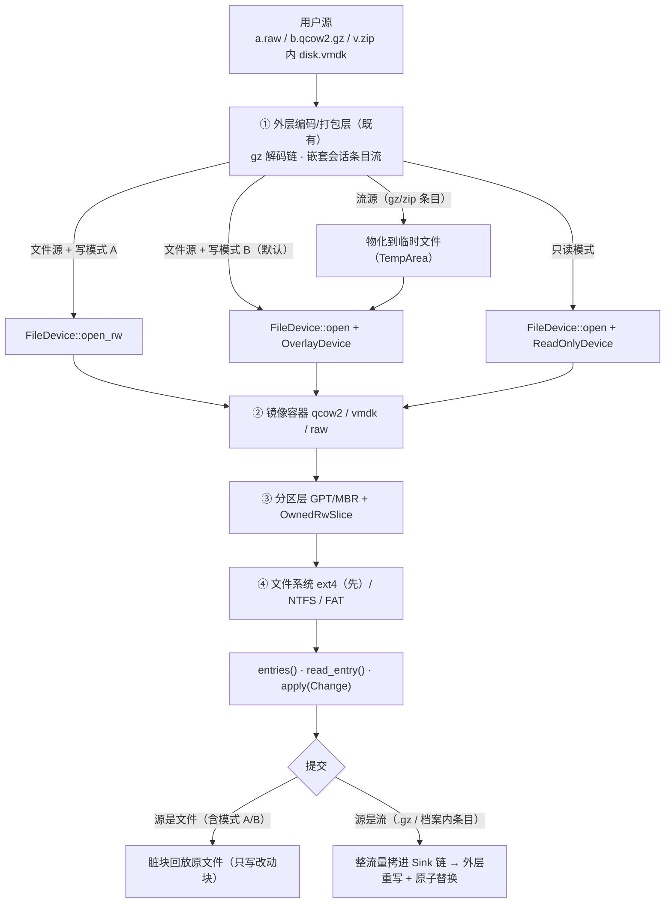
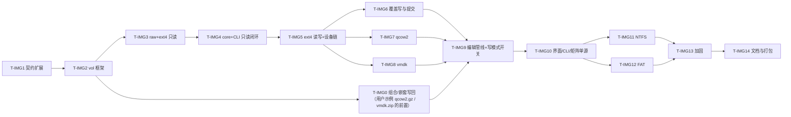

# T-IMG：磁盘镜像（qcow2 / raw / vmdk）浏览与卷内文件读写 · 任务计划

| 项目 | 内容 |
|---|---|
| 日期 | 2026-10-16 |
| 状态 | **计划已定稿（用户三条决策已裁定，待开工）** |
| 来源 | 用户需求：「在 hzip 上支持 qcow2, raw, vmdk 这种磁盘镜像格式，比如我要打开 qcow2.gz, vmdk.zip, raw.tgz 这种格式，能打开预览目录结构，然后可以像打开其他压缩包那样修改里面的文件（往里面添加文件、删除文件、通过本地软件打开文件进行编辑后保存）」 |
| 用户裁定 | ① **接受**引入第三方纯 Rust 栈（§3）；② 写回**默认覆盖写（B）**，**提供显示开关**可切到就地写（A）；③ **一起发**（读+写同一版），文件系统**先 ext4**，ext4 测过后再补 NTFS / FAT |
| 目录内容 | 本文件 = 总览（架构 / 选型 / 能力矩阵 / 全局口径 / 任务索引）；逐任务计划见同目录 `T-IMG1-*.md` … `T-IMG14-*.md` |
| 关系 | 修订 `01-总体架构设计.md` §1.1 非目标与 §10.4「vhd/vhdx 不做」：当时否决理由是「需自研 FAT/NTFS 解析器，成本远超收益」；2026-10 起纯 Rust、MIT/Apache、可写、有 `qemu-img`/`chkdsk`/`fsck` 交叉验证的栈已成熟，代价从「自研」降为「集成 + 适配 + 加固」（T-IMG14 同步该结论） |

---

## §1 目标与验收观感

三个用户示例必须端到端成立：

| 用户操作 | 期望观感 |
|---|---|
| 打开 `b.qcow2.gz` | 列表先出现一层 `b.qcow2`（既有组合档内层容器层）→ 双击进层 → 出现分区行（`1. EFI System (FAT32)` / `2. root (ext4)`）→ 进分区见到目录树 |
| 打开 `v.zip`（内含 `disk.vmdk`） | 既有嵌套会话：`v.zip` → 双击 `disk.vmdk` 进层 → 分区行 → 目录树 |
| 打开 `a.raw.tgz` | 同第一行（`a.raw` 无魔数，靠探针判定） |
| 在卷内改文件 | 与改压缩包**同一套交互**：双击用本地程序打开 → 保存 → 写回；右键追加/删除/改名/建目录；提交有进度、可取消 |
| 不能改时 | 明确理由（如「卷内日志未重放，默认只读」），不静默失败、不静默降级 |

> **前置条件（2026-10-16 勘察发现）**：「改压缩包」这条路**今天只对未包裹的档案成立**——组合档（`.gz` 之类）与嵌套会话（档案里的条目）**都没有编辑通路**（§7）。用户三个示例里 `qcow2.gz`、`vmdk.zip` 都是被包裹的，因此 **T-IMG0** 是 M2 的前置，不是可选项。

**与竞品的关系**：7-Zip / Bandizip 只能**只读**打开这类镜像；本特性做到**可写**，等于内置一个迷你 guestfs——差异化显著，数据风险也显著，故 §6 的保守策略不可裁。

## §2 分层与数据流

**关键洞察**：写模式 A 与 B 的差别只在**设备链末端**——A 末端是真文件（写即落盘），B 末端是 `OverlayDevice`（暂存，提交时只回放脏块）。其上（镜像/分区/文件系统/条目/ChangeSet）**完全同一份代码**，所以「开关」实现成本极低（T-IMG2 的 `open_source(mode)` + T-IMG9 的一个枚举设置项），而安全性差异很大。

四条既有契约的复用（**不新造编辑模型**）：

| 用户动作 | 既有契约 | 卷内落地 |
|---|---|---|
| 添加文件 / 建目录 / 改名 / 删除 | `ChangeSet::{Append,MakeDir,Rename,Delete}` | `fs_ext4::Filesystem::{apply_create...,apply_mkdir,apply_rename,apply_unlink,apply_rmdir}` |
| 本地编辑后保存 | `ChangeSet::Replace`（D11 链路：物化 → 变更检测 → 写回） | `Filesystem::apply_replace_file_content` |
| 列表 / 预览 / 提取 | `ArchiveReader::{entries,read_entry,extract}` | 卷树投影为扁平 `EntryInfo`（§4.3） |

## §3 选型（用户已裁定：接受）

同一家族（`antimatter-studios`），共用**一个**块设备接口 `fs_core::{BlockRead,BlockDevice}`，写路径各有交叉验证；全部 MIT/Apache ⇒ `deny.toml` 零改动。

| crate（lib） | 版本 | 我们用的入口 |
|---|---|---|
| `rust-fs-core`（`fs_core`） | 0.3.11 | `BlockRead{read_at,size_bytes}`、`BlockDevice{write_at,flush,is_writable,set_len,can_grow}`、`FileDevice::{open,open_rw,open_best_effort}`、`SliceReader`/`OwnedRwSlice`、`CachingDevice`、`ReadOnlyDevice`、`CountingDevice`、`BlockReadStreamer` |
| `rust-img-qcow2`（`img_qcow2`） | 0.6.1 | `Qcow2Reader::{open,open_rw,open_on_device,open_rw_on_device,virtual_size,header,has_backing,is_writable,extents,cluster_status_at,write_at,flush}` |
| `rust-img-vmdk`（`img_vmdk`） | 0.5.1 | `VmdkReader::{open,open_rw,open_rw_on_device,virtual_size,descriptor,grain_size_bytes,is_writable,write_at,flush}` |
| `rust-fs-ext4`（`fs_ext4`） | 0.8.0 | `Filesystem::{mount,mount_with_cache,mount_recovering,mount_lazy,replay_journal_if_dirty,finish,flush,audit,audit_repair,lookup_path_bytes,read_dir_ino,read_ino,stat_ino,apply_create,apply_mkdir,apply_rmdir,apply_unlink,apply_rename,apply_replace_file_content,apply_pwrite,apply_chmod,apply_utimens,apply_symlink,set_volume_label}` |
| `rust-fs-ntfs`（`fs_ntfs`） | 0.10.2 | `facade::Filesystem::{mount,mount_rw,mount_rw_replaying_log,is_dirty,volume_stats,read_dir,read_file,create_file,mkdir,unlink,rmdir,remove,rename,truncate,write_file_contents,link,create_symlink}`（T-IMG11） |
| `rust-disk-partitions`（`disk_partitions`） | 0.7.1 | `probe`/`probe_with_status`/`sniff`、`Partition`/`PartitionSet`/`TableKind`/`FsKind`、`SECTOR_SIZE` |
| `fatfs` | 0.3.6 | `format_volume`（造夹具）、`FileSystem`/`File` r/w（T-IMG12） |

版本一律 `=` 精确锁（上游 0.x 且刚改过名 `am-fs-*`→`rust-fs-*`）。被否方案（`qemu-img`+libguestfs、OS 挂载、只读栈、自研）理由见本目录 git 历史与 T-IMG14 §决策记录。

## §4 能力矩阵（UI 与文档同源，T-IMG10 单源化）

### 4.1 镜像层

| 格式 | 读 | 写 | 备注 |
|---|---|---|---|
| `raw`/`img`/`dd`（含 MBR/GPT、裸 FS） | ✔ | ✔ | 无魔数 ⇒ 内容探针（T-IMG3） |
| `qcow2` v2/v3 · 未压缩/zlib/zstd 簇 · 稀疏/零簇 | ✔ | ✔ | 写 = 簇分配 + refcount 维护（T-IMG7） |
| `qcow2` + backing 链 | ✔ | ✔（copy-up，体积会涨） | UI 提示 |
| `qcow2` 加密 / 外部数据文件 / 扩展 L2 / dirty | ✔/✗ | ✗（报名字拒绝） | 上游拒绝 |
| `vmdk` `monolithicSparse` | ✔ | ✔ | 维护冗余 GD / content id / `uncleanShutdown`（T-IMG8） |
| `vmdk` `streamOptimized` | ✔ | ✗（只读） | OVA 导出常见；二期可「另存为 sparse」 |
| `vmdk` `monolithicFlat` / `twoGbMaxExtent*` / `vmfsSparse` / 快照 delta | 二期（`vmdk-core` 只读回退） | ✗ | 上游报名字拒绝，不误读 |
| VHD / VHDX / md / LVM / LUKS | ✗（本期不做） | ✗ | 架构留位（T-IMG14 记结论） |

### 4.2 文件系统层

| FS | 列/读 | 增删 | 改名 | 建目录 | 时间戳 | 权限 | 符号链接 |
|---|---|---|---|---|---|---|---|
| ext2/3/4（**首发**） | ✔ | ✔ | ✔ | ✔ | ✔ | ✔ mode/xattr/ACL | ✔ |
| NTFS（T-IMG11） | ✔ | ✔ | ✔ | ✔ | ✔ | 部分 | ✔ |
| FAT12/16/32（T-IMG12） | ✔ | ✔ | ✔ | ✔ | 部分 | ✗ | ✗ |
| 其它（XFS/btrfs/squashfs/ISO9660/exFAT） | ✗ 本期不做 | ✗ | ✗ | ✗ | | | |

### 4.3 条目投影（为什么「分区层 = 顶层目录」）

`hzip-core` 的 `Browser::enter`（`crates/hzip-core/src/services/browse.rs:282-331`）**只按扩展名**给嵌套条目选 handler（注释明写「走扩展名回退，非魔数嗅探」），且 `entries()` 在进层时就急切建好——分区不是条目，**不能**做成嵌套会话层。故：

- 镜像 `entries()` 返回**扁平全树**：`1. EFI System (FAT32)/EFI/BOOT/BOOTX64.EFI`、`2. root (ext4)/etc/fstab`…，由 core 既有「按 `/` 切树」铺出左树/右栏；无分区表则少一层直接铺卷根；
- 分区行 `is_dir = true`，类型列复用 `TreeRowMeta.container_format` 显示卷类型；
- 代价（如实记）：列表 = 走完所有分区元数据 ⇒ 单次条目上限（`QuotaLimits`）+ 可取消 + 会话内缓存（T-IMG13 硬指标）；
- 已知限制：**改名成 `.bin` 的 dd 镜像双击进不去**（`enter` 只认扩展名）；顶层直接打开（走嗅探）不受影响。

## §5 任务索引

| 任务 | 计划文件 | 交付物 | 依赖 | 验收命令 |
|---|---|---|---|---|
| T-IMG0 | [T-IMG0-组合与嵌套写回.md](T-IMG0-组合与嵌套写回.md) | **组合/嵌套会话写回**（`CompositeEditor` + 逐层冒泡 + 嵌套编辑启用）。勘察发现：今天组合编辑与嵌套编辑都是**明确不支持**的，而用户三个示例里 `qcow2.gz`、`vmdk.zip` 都是被包裹的 | T-IMG2 | `cargo test -p hzip-core --test composite_edit` |
| T-IMG1 | [T-IMG1-契约扩展.md](T-IMG1-契约扩展.md) | **已实施**：`FormatHandler::{probe,probe_head_bytes,supports_in_place_edit}`（默认实现，既有格式零改动）、`Confidence::Medium`、`CreateOptions.volume_write`、`ArchiveEditor::write_in_place` | — | `cargo test -p hzip-format` |
| T-IMG2 | [T-IMG2-vol框架.md](T-IMG2-vol框架.md) | `hzip-vol`：卷/FS 契约、设备链、`OverlayDevice`、分区层、物化器、**分区即目录的投影** · **已实施 7/8**（32 条测试；余 `editor.rs` 写路径） | T-IMG1 | `cargo test -p hzip-vol` |
| T-IMG3 | [T-IMG3-raw与ext4只读.md](T-IMG3-raw与ext4只读.md) | `hzip-fmt-raw` 探针 + `hzip-fs-ext4` 只读适配 + testkit 夹具 | T-IMG2 | `cargo test -p hzip-fmt-raw -p hzip-fs-ext4` |
| T-IMG4 | [T-IMG4-核心接入与CLI只读.md](T-IMG4-核心接入与CLI只读.md) | core 注册 + exts 表 + CLI `l`/`x` 只读闭环（**里程碑 M1**） | T-IMG3 | `cargo test -p hzip-core --test volume` |
| T-IMG5 | [T-IMG5-ext4读写与设备链.md](T-IMG5-ext4读写与设备链.md) | 设备链 A/B/RO + `fs_ext4` 写操作映射（**里程碑 M2**） | T-IMG4 | `cargo test -p hzip-fs-ext4` |
| T-IMG6 | [T-IMG6-覆盖写与提交.md](T-IMG6-覆盖写与提交.md) | `OverlayDevice` 提交回放 / `Sink` 整流量拷 / 取消后原档不变 | T-IMG5 | `cargo test -p hzip-vol --test overlay` |
| T-IMG7 | [T-IMG7-qcow2容器.md](T-IMG7-qcow2容器.md) | `hzip-fmt-qcow2`（r/w，dirty/加密只读）+ 最小 qcow2 夹具 | T-IMG5 | `cargo test -p hzip-fmt-qcow2` |
| T-IMG8 | [T-IMG8-vmdk容器.md](T-IMG8-vmdk容器.md) | `hzip-fmt-vmdk`（sparse r/w，其余拒写） | T-IMG5 | `cargo test -p hzip-fmt-vmdk` |
| T-IMG9 | [T-IMG9-编辑管线与写模式开关.md](T-IMG9-编辑管线与写模式开关.md) | 编辑管线接入 + `ui.volume_write_mode` 开关（默认 B）+ 提交进度/取消 | T-IMG6,7,8,**T-IMG0** | `cargo test -p hzip-core --test volume_edit` |
| T-IMG10 | [T-IMG10-界面与CLI完善.md](T-IMG10-界面与CLI完善.md) | 类型列/只读徽标/文案单源化/CLI 写侧动词（**里程碑 M3 = 发版**） | T-IMG9 | `cargo test -p hzip-gui --lib` |
| T-IMG11 | [T-IMG11-ntfs.md](T-IMG11-ntfs.md) | `hzip-fs-ntfs`（含 `$LogFile` 重放/拒写口径） | T-IMG10 | `cargo test -p hzip-fs-ntfs` |
| T-IMG12 | [T-IMG12-fat.md](T-IMG12-fat.md) | `hzip-fs-fat`（FAT12/16/32） | T-IMG10 | `cargo test -p hzip-fs-fat` |
| T-IMG13 | [T-IMG13-加固.md](T-IMG13-加固.md) | fuzz/配额/时延门槛/交叉验证脚本 | T-IMG11,12 | `cargo test -p hzip-vol --release` |
| T-IMG14 | [T-IMG14-文档与打包.md](T-IMG14-文档与打包.md) | design 01/02/04/05 同步、README、打包体积、CI | T-IMG13 | `python build/checks/deps-direction.py` |

进度（2026-10-16 更新）：

- [x] **T-IMG1 契约扩展**（探针/Medium/`supports_in_place_edit`/`volume_write`/`write_in_place`/`volume_rows`）
- [x] **T-IMG2 `hzip-vol`**（8/8 模块：错误模型·spool·覆盖设备·三态设备链·分区层·驱动注册表·投影·编辑器；`reader`/`editor` 另有 11 条契约用例）
- [x] **T-IMG3 raw + ext4**（raw 11 条端到端；ext4 19 条读+写；夹具 17 条自证）
- [x] **T-IMG4 core 接入**（`volume-formats` feature + 驱动注册表 + 三容器注册；扩展名表 + 平台 MIME + 引擎级 8 条 + CLI 4 条）
- [x] **T-IMG5 ext4 写**（含挂载策略落地口径：`mount_lazy` + 显式重放）
- [x] **T-IMG7 qcow2**（24 条）· [x] **T-IMG8 vmdk**（29 条）· [x] **T-IMG11 NTFS**（40 条）· [x] **T-IMG12 FAT**（35 条）
- [x] **XFS 驱动（用户追加口径：文件系统含 XFS）**：`hzip-fs-xfs` 35 条（读+写；上游 `rust-fs-xfs 0.14.1`，**大端 + 校验和小端**）；未实现项按上游限制如实拒绝（跨目录改名 / 目录超短格式 / realtime·reflink·v4 写 / 外部日志 / 脏日志卷不可写）
- [x] **T-IMG10 部分**（分区行：硬盘图标/类型列/语言化名 + `locales/vol.toml` 53 键双向完整性测试）——余：只读徽标与理由 tooltip、CLI 写侧动词
- [ ] **T-IMG6 覆盖写与提交**（覆盖层/回放/幂等已实现并有用例；**余**：覆盖层扩容支持——VMDK 分配 grain 类写在覆盖模式下现以 `vol.unsupported.resize` 干净失败，见该卡 §已定边界）
- [ ] **T-IMG0 组合/嵌套写回**（读侧组合链已通；写回外层未做）
- [~] **T-IMG9 编辑管线接线**：core 的**路径选择**（单格式卷容器 ⇒ 就地写）与**变更路由**（档案级名/id → 卷内；**单卷与多卷都按分区归集**，2026-10-16 起）已落地并有现实验证（`hzip-core/tests/volume.rs::edit_batch_inside_a_volume_writes_in_place` + `::edit_batch_inside_a_two_partition_image_hits_the_right_partition`、`hzip-vol/tests/editor.rs` 11 条）；余：设置页三态开关（**「外部编辑器保存写回」与「多分区归集」已于 2026-10-16 落地**，见 T-IMG9「落地记录」）
- [ ] **T-IMG13 加固**（fuzz/配额门槛/性能基线/交叉验证脚本）
- [ ] **T-IMG14 文档与打包**（01/README/02 附录 C 已同步；余 CI/打包/体积登记）

## §6 全局口径（每个任务都遵守，不逐条重复）

1. **错误映射单源**：`hzip-vol::error::VolError` 实现 `From<VolError> for HzipError`；拒绝一律 `HzipError::Unsupported{what}` 且 `what` 用**稳定标识 + 文案键**（例：`vol.readonly.dirty`、`vol.reject.qcow2-encrypted`），文案在 `hzip-gui/locales/*.toml` 与 CLI i18n 表同键（T-IMG10 校验键齐）。
2. **临时物化与 spool 约定**（按既有实现对齐，别另发明）：
   - 流 → 需要随机访问：经 `hzip_platform::TempArea`（`crates/hzip-platform/src/temp_area.rs:89`，`new_session` + `materialize`）或与 `hzip-fmt-zip/src/reader.rs:111 fn materialize` 同款的 `NamedTempFile` 保活（`Materialized { keep }`）；
   - 文件名前缀必须用 **`hzip-spool-`**（`crates/hzip-core/src/services/space.rs` 的 `SPOOL_PREFIX`）⇒ 进程被强杀留下的孤儿由启动期 `sweep_stale_spools()` 按 `SPOOL_STALE_AFTER=24h` 回收（该文档记录了历史上 29.6 GiB 孤儿把系统盘挤爆的实测）；
   - 打开前的**盘空间预检**复用既有口径：`space::precheck_open_temp_space()`（用编码层声明大小：gz 尾 ISIZE / xz 尾索引 / zst 帧头）+ `SPACE_HEADROOM`，不足立即 `HZ-1002`（毫秒级失败，不白解一层）。`hzip-vol` **不依赖 `hzip-core`** ⇒ 由 core 通过 `VolOptions.spool: SpoolPolicy { dir, prefix, max_bytes }` 传入，`hzip-vol::materialize` 只执行 + 计数超限即 `VolError::Quota`。
3. **进度/取消**：镜像物化、元数据扫描、外层重写三条长活各自上报 `ProgressBus` 并响应 `CancellationToken`（12 号 UI 线程阻塞审计口径）；`entries()` 亦须可取消。
4. **配额与盘空间的分工**（易混，写清）：物化/spool 受**磁盘可用空间**约束（上面第 2 条），**不受** `QuotaLimits::MaxFileBytes`（32 GiB）约束——否则 40 GiB 镜像根本打不开；而**提取镜像内文件**时 `QuotaKind` 照旧适用（既有全局规则）。新增「临时盘剩余空间不足」显式错误，不在半途写坏产物。
5. **不做静默降级**：格式不支持 ⇒ 报错；只读 ⇒ 带理由的只读（`caps_edit=false` + 文案），不假装可写。
6. **测试夹具不依赖外部工具**：`hzip-format-testkit` 用上游 crate 的 `mkfs`/`format_volume` 现场造小镜像（≤ 8 MiB 量级），qcow2/vmdk 用手写头（无 create API）。**每个新格式/驱动 crate 另出 `tests/conformance.rs`**：`TC-CONF-001..010` 经 testkit 的 `KitCtx`/`DynTestList`/`run_conformance` 重驱动（夹具 stub 化的用例照既有 fmt crate 的做法 skip 或就地重实现——`mock::MockHandler`/`stub::StubArchive`/`malformed::PanicCounter` 已备）。`qemu-img`/`7z`/`chkdsk` **只在开发机存在时**跑交叉验证（`#[ignore]` 或 feature 门控），不进 CI 硬门。
7. **门禁**：每任务收尾必须 `cargo fmt --check`、`cargo clippy --workspace --all-targets -- -D warnings`、`python build/checks/deps-direction.py`（violations=0）、`cargo test --workspace`。
8. **嵌套会话的编辑启用**由**会话**判定（`chain_editable`），不由单个 handler 决定：内层可编辑 ∧ 外层可重建（编码层齐全或外层档案 `caps.edit`）才为真；GUI 快照 `caps_edit` 取它，**删掉硬编码的 `!snap.nested`**（`views/browse.rs:316,466`、`app/state.rs:763-784`；见 T-IMG0 §5.3）。

## §7 勘察发现（2026-10-16 已查实）：组合/嵌套编辑今天**不存在**

原计划把「组合源怎么写回」当作未决点，现已按源码查实，结论比预想严重，故新增前置任务 **T-IMG0**：

| 证据 | 事实 | 后果 |
|---|---|---|
| `crates/hzip-format/src/registry.rs:151-153` | `open_editor` 对 `Sniffed::Composite` 直接 `Unsupported{ what: "组合格式不支持编辑" }` | `.qcow2.gz` 这类**没有编辑通路**，与卷容器无关，是既有缺口 |
| `crates/hzip-gui/src/views/browse.rs:316,466` | `can_edit: snap.caps_edit && !snap.nested` | 进到 `v.zip` 里的 `disk.vmdk` 后，改名/新建/删除**一律置灰** |
| `crates/hzip-gui/src/app/state.rs:763-784` | `caps_edit()` 口径写着「非组合格式（tar/single/rar/组合 → false）」 | 组合档在 UI 侧就没有可编辑的表达 |
| `crates/hzip-core/src/services/edit.rs:121-205,476-495` | 编辑落点 = `rewrite` → 同目录 `{name}.hzip-tmp-{uuid}` → `atomic_replace`，**只对「源本身是可编辑档案」成立** | 嵌套会话里 `d.archive` 指向外层档案，直接复用会改错层 |

处置（已落在 T-IMG0 与相关任务里）：

1. **形状 1（外层是编码层）**：新增 `CompositeEditor` = 编码链 + 内层编辑器，但**装配放 core**（`services/composite_edit.rs`，编码链从 `services/convert.rs`/`compress.rs` 抽成共用的 `services/codec_chain.rs`）——依据：`FormatRegistry::create_writer` 本就是**故意桩**（`registry.rs:132-136`「组合写归 core 转换管线」），把组合编辑塞回 registry 会让 CLI/GUI/既有测试都突然面对新对象；`hzip-format` 只新增一个**辅助 API** `open_inner_editor(src, opts) -> (Vec<FormatId>, Box<dyn ArchiveEditor>)`；
2. **形状 2（外层是档案条目）**：逐层冒泡——内层编辑器产出新内层档 → 外层 `ChangeSet::Replace{条目, 临时档}` → **只有最外层做一次原子替换**；
3. **外层不可重建**（tar/cpio/rar 无编辑器）⇒ 整链 `caps.edit=false` + 理由键 `vol.readonly.outer-not-editable`（不静默）；
4. 嵌套会话的编辑启用改由会话携带的 `chain_editable` 决定，**删掉硬编码的 `!snap.nested`**（GUI 快照 `caps_edit` 直接取它）；
5. `write_in_place`（就地写）在组合链上无意义（外层必重写）⇒ `supports_in_place_edit()` 由 core 在**会话判定**里结合「源是否常规文件 + 是否组合链」给出，不在 handler 里硬写；
6. **不给契约加 `Seek`**：`hzip-format` 全仓没有定位抽象，所有流都是前向 `Box<dyn Read + Send>`（`Source::Stream` 且不可重放）——需要定位的格式一律**自己 spool 到临时文件**，zip/cpio/tar 三个 reader 已是这个做法（§6.2 的 spool 约定）。卷容器沿用同一惯例，不新增「可定位源」这种破坏既有契约面的大改。

## §8 风险与不做

| 风险 | 缓解 |
|---|---|
| 上游 0.x 会动（已改名一次） | `=` 精确锁版本；上游类型**不出现在 hzip 公共 API**（全包在 `hzip-vol` 契约后）；适配层一 crate 一驱动；二期可换实现（`vmdk-core`/`isomage`） |
| 写坏用户虚拟机磁盘 | 默认 B（提交前原文件一字节不动）+ 脏卷默认拒写 + 提交前自检（`audit`/`fsck`）+ 可写需显式开关（默认开关值 B，可切只读） |
| 大镜像性能（40 GB 在 .gz 里） | 诚实标注：读需物化（≈解压耗时）、写需整档重压；未压缩顶层可切 A 走快路径；物化结果按 mtime 会话内缓存 |
| **组合链写回 = 全量重压**（`qcow2.gz`/`vmdk.zip` 的提交） | 格式决定的固有代价（`.gz` 无随机写）；写模式开关在组合链上只影响**内层暂存**，不影响外层重压——设置项提示与文档必须说清（T-IMG0 §7） |
| 上游写路径边界（NTFS 目录 64 索引块、休眠卷拒写） | 能力矩阵如实展示 + 明确文案；不做「绕过」 |
| 本期不做 | VHD/VHDX、md/LVM/LUKS、qcow2 create/resize、镜像修复、BitLocker、WOF 压缩文件写、exFAT 写 |
